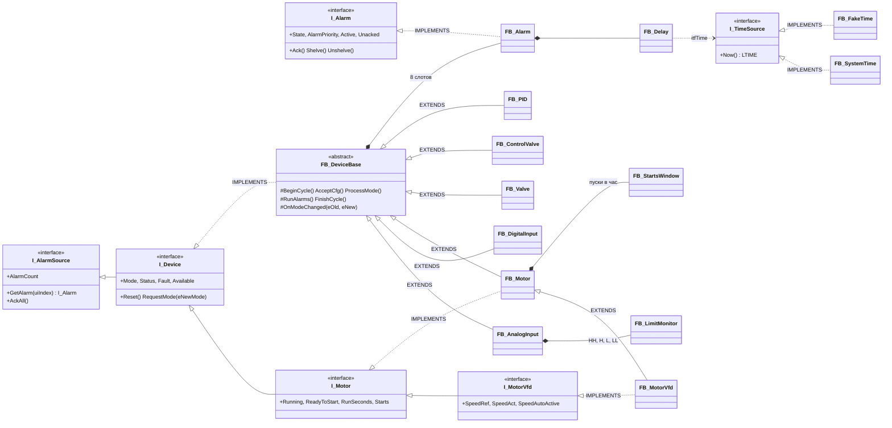

# plc-process-lib

[](https://github.com/<GITHUB_USER>/plc-process-lib/actions/workflows/ci.yml)

Библиотека технологических функциональных блоков для CODESYS V3.5 SP17 Patch 3 (целевой ПЛК — ОВЕН
ПЛК210, пространство имён `PL`): аналоговые и дискретные входы, двигатели прямого пуска и с ПЧ,
запорная и регулирующая арматура, ПИД-регулятор и тревоги ISA-18.2. У каждого устройства — режимы
(авто, ручной, местный, вывод из работы), безопасное состояние, диагностика NAMUR NE 107 (у AI — и
NE 43), квитирование и обмен с HMI/SCADA через структуры команд и состояний; поведение закреплено
контрактом [docs/API.md](docs/API.md) и проверено 420 тестами coUnit в CODESYS Control Win V3.

## Демонстрация

> **Плейсхолдер.** Графики реальных прогонов (переходный процесс ПИД на модели объекта первого порядка с
> запаздыванием, фильтр и подтверждение отказа AI по NE 43, ход задвижки с реверсом) и скриншоты итогов
> `cds.py test` будут добавлены отдельным проходом по медиа. Сейчас итоги прогона — текстом в
> [docs/TEST_REPORT.md](docs/TEST_REPORT.md).

## Функциональные блоки

| ФБ | Назначение | Документ |
|---|---|---|
| `FB_AnalogInput` | вход 4–20 мА / 0–1 / инж. ед. / отсчёты: масштабирование, корень с отсечкой, фильтр с постоянной времени, не зависящей от цикла, достоверность по NE 43, уставки HH/H/L/LL, подмена | [FB_AnalogInput.md](docs/fb/FB_AnalogInput.md) |
| `FB_DigitalInput` | дискретный вход: задержки включения и отключения, инверсия, отказ канала, подмена | [FB_DigitalInput.md](docs/fb/FB_DigitalInput.md) |
| `FB_Motor` | двигатель прямого пуска: команды HMI и автоматики, блокировки и разрешения с первопричиной, контроль ОС, минимальные времена работы и паузы, пуски в час, моточасы | [FB_Motor.md](docs/fb/FB_Motor.md) |
| `FB_MotorVfd` | двигатель с ПЧ (наследник `FB_Motor`): задание 0–100 % с рампой, ОС по частоте, отказ связи с ПЧ | [FB_MotorVfd.md](docs/fb/FB_MotorVfd.md) |
| `FB_Valve` | запорная арматура (привод или соленоид): открыть, закрыть, стоп, концевики, время хода, «оба концевика», муфта, реверс | [FB_Valve.md](docs/fb/FB_Valve.md) |
| `FB_ControlValve` | регулирующий клапан: задание положения с пределами и скоростью, рассогласование с ОС, положение безопасности | [FB_ControlValve.md](docs/fb/FB_ControlValve.md) |
| `FB_PID` | ПИД в идеальной форме: D по измерению с фильтром, обратный расчёт (anti-windup), безударные переходы, рампа задания, расчёт по реальному dt | [FB_PID.md](docs/fb/FB_PID.md) |
| `FB_Alarm` | тревога ISA-18.2: 4 базовых и 3 наложенных состояния, приоритет, задержки, shelve с таймаутом, подавление; внутри устройств | [FB_Alarm.md](docs/fb/FB_Alarm.md) |
| `FB_DeviceBase` | абстрактная база устройств: режимы, конфигурация с последней корректной копией (LKG), NE 107, 8 слотов тревог | [FB_DeviceBase.md](docs/fb/FB_DeviceBase.md) |
| `FB_Delay` | единственный таймер библиотеки: задержки включения и отключения от источника времени `I_TimeSource` | [FB_Delay.md](docs/fb/FB_Delay.md) |
| `FB_SystemTime`, `FB_FakeTime` | источники времени: системное `LTIME()` и подменное для тестов | [FB_SystemTime.md](docs/fb/FB_SystemTime.md), [FB_FakeTime.md](docs/fb/FB_FakeTime.md) |
| `FB_LimitMonitor`, `FB_StartsWindow` | одна уставка с гистерезисом и задержками; пуски за скользящий час | [FB_LimitMonitor.md](docs/fb/FB_LimitMonitor.md), [FB_StartsWindow.md](docs/fb/FB_StartsWindow.md) |
| `F_IsFinite`, `F_RateLimit`, `F_Ne107Worst`, `F_LTimeToSec`, `F_TimeToSec` | функции: конечность REAL по битам, ограничение скорости, худший статус NE 107, перевод времени | [Functions.md](docs/fb/Functions.md) |

Типы (`ST_<Dev>Cmd`, `ST_<Dev>Sts`, `ST_<Dev>Cfg`, перечисления), константы и карты битов `wStatus` —
[docs/ARCHITECTURE.md](docs/ARCHITECTURE.md) и разделы ФБ.

## Архитектура



Вызов устройства — один на цикл, со всеми `VAR_IN_OUT`: команды из `GVL_Hmi`, конфигурация и
энергонезависимые данные — из Persistent Variables приложения, по переменной на устройство
(контракт, раздел 1):

```st
GVL_Devices.fbM201.xAutoRun := xMixerDemand;                    // запрос автоматики (уровень)
GVL_Devices.fbM201(
    xFbRun   := GVL_IO.xM201_Run,                               // ОС «работает»
    xPowerOk := GVL_Devices.fbPWR1.xValue,                      // напряжение на вводе (FB_DigitalInput)
    stCmd    := GVL_Hmi.stM201Cmd,                              // VAR_IN_OUT
    stCfg    := GVL_Persist.stM201Cfg,                          // VAR_IN_OUT CONSTANT
    stRetain := GVL_Persist.stM201Retain);                      // VAR_IN_OUT: режим, моточасы, пуски
GVL_IO.xM201_QRun := GVL_Devices.fbM201.xQRun;
```

Сводка решений и порядок тела устройства — [docs/API.md](docs/API.md), разделы 0 и 9.4.

## Как подключить библиотеку

1. Собрать и поставить в репозиторий библиотек CODESYS (Windows, CODESYS 3.5.17.30, Python 3.11+):

   ```bat
   python tools\codesys\cds.py library --compiled --install
   ```

   Команда собирает `build/plc-process-lib.library` и `.compiled-library` из `src/` (без `tests/` и
   `PRG_Main`), проверяет пул объектов и ставит библиотеку `plc-process-lib, <версия> (plc-portfolio)` в
   репозиторий `System`. Шаги в IDE (сохранить как библиотеку, поставить вручную) —
   [docs/MANUAL_STEPS.md](docs/MANUAL_STEPS.md), раздел 7.
2. В проекте: **Library Manager → Add Library → plc-process-lib**. Пространство имён — `PL`:
   `PL.FB_Motor`, `PL.ST_MotorCfg`, `PL.GVL_Const.MOT_STS_RUNNING`.
3. Репозиторий портфолио на шаблоне `plc-repo-template` подключает библиотеку записью в
   `tools/codesys/config.json` и ссылкой на неё в `modes.<режим>.libraries` (или `library.libraries`):

   ```json
   "libraries": {
     "plc-process-lib": {
       "namespace": "PL",
       "title": "plc-process-lib",
       "company": "plc-portfolio",
       "version": "*",
       "build_from_repo": {"env": "PL_REPO", "default": "../plc-process-lib"}
     }
   }
   ```

   Если нужной версии нет, `cds.py` сам соберёт и поставит её командой `library --install` в
   соседнем репозитории (`build_from_repo`). `"*"` — для разработки рядом; после релиза закрепляйте
   точную версию (`"1.0.0.0"`). Подробно — [tools/README.md](tools/README.md#библиотеки-library-и-deps).
4. Приёмник событий тревог (журнал) — `PL.GVL_Lib.itfAlarmSink := fbJournal;` до вызова устройств.
   Моточасы и пуски живут в `stRetain` — объект Persistent Variables создаётся вручную
   ([MANUAL_STEPS.md](docs/MANUAL_STEPS.md), раздел 10).

## Быстрый старт без железа

Нужен Python 3.11+ (в CI — 3.12). CODESYS не нужен.

```bash
python -m pip install -r requirements-dev.txt
python -m pytest                                # инструменты, соглашения тестов, DUT и константы против контракта
python tools/check/st_lint.py --strict          # заголовки, имена, «магические числа»
python tools/check/run_iec_checker.py --tests   # статанализ (iec_checker v0.4)
python tools/check/run_rusty.py                 # проверка типов RuSTy (необязательно)
python tools/reference/pid.py                   # эталоны тестов: common.py, ai_reference.py, motor.py, valve_reference.py, pid.py
```

## Как запустить тесты

Нужны Windows, CODESYS 3.5.17.30 и Python 3.11+ (установка — [docs/MANUAL_STEPS.md](docs/MANUAL_STEPS.md)).
Рантайм — CODESYS Control Win V3 в пользовательском процессе, права администратора не нужны.

| Команда | Что делает |
|---|---|
| `python tools/codesys/cds.py test` | импорт `src/` и `tests/`, сборка, прогон coUnit в Control Win V3 → `build/test-results.json`, `build/junit.xml` |
| `python tools/codesys/cds.py build --tests` | сборка тестового приложения (0 ошибок, 0 предупреждений) |
| `python tools/codesys/cds.py check --tests` | компиляция **всех** объектов, в том числе недостижимых из задач |
| `python tools/codesys/cds.py roundtrip` | импорт → экспорт → побайтное сравнение с `src/` и `tests/` |
| `python tools/codesys/cds.py library` | сборка `.library` и проверка пула библиотеки |
| `python tools/codesys/cds.py report` | итоги прогона → [docs/TEST_REPORT.md](docs/TEST_REPORT.md) |

Рантайм один на машину: если тесты гоняет другой репозиторий, `cds.py` ждёт блокировку. Соглашения
тестов (наборы, регистрация, имена, `FB_FakeTime`, правило NaN) — [docs/TESTING.md](docs/TESTING.md).

## Тесты и проверки

coUnit 1.2.0.0, CODESYS 3.5.17.30, CODESYS Control Win V3 (32 бит), 19.10.2026 — **420 тестов в 14
наборах, все пройдены**:

| Набор | Тестов | | Набор | Тестов |
|---|---|---|---|---|
| `FB_Time_Test` | 24 | | `FB_AnalogInput_Test` | 51 |
| `FB_Util_Test` | 26 | | `FB_DigitalInput_Test` | 18 |
| `FB_Common_Test` | 11 | | `FB_Motor_Test` | 52 |
| `FB_Alarm_Test` | 38 | | `FB_MotorVfd_Test` | 27 |
| `FB_DeviceBase_Test` | 44 | | `FB_Valve_Test` | 41 |
| `FB_Runtime_Test` | 8 | | `FB_ControlValve_Test` | 24 |
| `FB_Integration_Test` | 3 | | `FB_Pid_Test` | 53 |

Основа — 151 тест, устройства — 266, межсемейные — 3. Тесты каждого семейства проверены мутациями
(однострочная ошибка в коде — хотя бы один тест падает): разделы «Тесты» в [docs/fb/](docs/fb/) и
[docs/TEST_REPORT.md](docs/TEST_REPORT.md).

| Проверка | Где | Итог |
|---|---|---|
| сборка CODESYS 3.5.17.30, `build --tests` и `check --tests` | локально | 0 ошибок, 0 предупреждений |
| `cds.py roundtrip` | локально | 0 различий |
| `cds.py library` (проверка пула) | локально | 0 ошибок |
| `st_lint --strict` | CI | 0 замечаний, подавлений нет |
| iec_checker v0.4 (`--tests`) | CI | 0 ошибок разбора, 0 необоснованных находок |
| RuSTy 1.0.6 | CI, необязательно | 0 ошибок, исключённых файлов нет |
| ruff, mypy, pytest | CI | пройдено |

Обоснования находок и снятые обходы анализаторов — [docs/STATIC_ANALYSIS.md](docs/STATIC_ANALYSIS.md).

## Документация

- [API.md](docs/API.md) — контракт API 1.0.0 (нормативно): имена, типы, карты битов, порядок тела, список тестов; отличия от rc2 — раздел 0
- [fb/](docs/fb/) — по ФБ: назначение, входы и выходы, параметры, диаграмма состояний, карта битов, пример, тесты
- [ASSUMPTIONS.md](docs/ASSUMPTIONS.md) — допущения и решения: контракт, основа, семейства, открытые вопросы, интеграция
- [STYLE_GUIDE.md](docs/STYLE_GUIDE.md) — стиль ST с примерами «так — не так»
- [TESTING.md](docs/TESTING.md) — соглашения тестов
- [ARCHITECTURE.md](docs/ARCHITECTURE.md), [DECISIONS.md](docs/DECISIONS.md) — обзор типов и рассмотренные варианты API
- [TEST_REPORT.md](docs/TEST_REPORT.md), [STATIC_ANALYSIS.md](docs/STATIC_ANALYSIS.md), [BUILD_ERRORS.md](docs/BUILD_ERRORS.md) — отчёты
- [MANUAL_STEPS.md](docs/MANUAL_STEPS.md) — шаги в IDE: библиотека, тесты, Persistent Variables, релиз
- [LAYOUT.md](docs/LAYOUT.md) — раскладка исходников; правила кода — [CONTRIBUTING.md](CONTRIBUTING.md); изменения — [CHANGELOG.md](CHANGELOG.md)

## Ограничения и дальнейшие шаги

- **ПЛК210 не проверялся.** Все прогоны — CODESYS Control Win V3 (x86, 32 бит). На контроллере
  повторить: разрешение и монотонность `LTIME()`, время цикла тестовой задачи, поведение сравнений с
  NaN на ARM (F-10), стек для экземпляров устройств, цена копирования LKG (ASSUMPTIONS.md, R1–R16).
- **Границы NAMUR NE 43** (3,6 / 3,8 / 20,5 / 21,0 мА и включение 3,6 и 21,0 мА в отказ) —
  **сверить** с текстом NE 43 (A-02). Повторное оповещение после shelve — сверить с ANSI/ISA-18.2-2016.
- **Persistent Variables** скриптом CODESYS SP17 не создаются: объект для `stCfg` и `stRetain`
  (моточасы, пуски, режим) — ручной шаг в IDE ([MANUAL_STEPS.md](docs/MANUAL_STEPS.md), раздел 10).
- Монотонность `LTIME()` при смене системного времени ОС — ручная проверка (раздел 9 там же).
- Открытые вопросы семейств (перемежающийся обрыв AI, задержки уставок после возврата, стартовая
  рампа регулирующего клапана и др.) решены для v1.0 правилами наладки, изменения — кандидаты v1.1
  ([ASSUMPTIONS.md](docs/ASSUMPTIONS.md#открытые-вопросы-семейств-решения-интеграции)).
- Защиты и блокировки ФБ — логика управления, а не ПАЗ: библиотека не сертифицирована по МЭК 61508/61511,
  защиты объекта дублируются аппаратно (в Local ПЛК механизм не останавливает, A-04).
- iec_checker 0.4 и RuSTy 1.0.6 понимают не все конструкции CODESYS: что понижение скрывает —
  [tools/README.md](tools/README.md), что осталось в коде — [STATIC_ANALYSIS.md](docs/STATIC_ANALYSIS.md).
- Дальше: графики и скриншоты прогонов (раздел «Демонстрация»), релиз v1.0.0 с `.library` и
  `.compiled-library` ([MANUAL_STEPS.md](docs/MANUAL_STEPS.md), раздел 12), КНС на этой библиотеке (проект 02).

## Summary (EN)

`plc-process-lib` is a library of process-control function blocks for CODESYS V3.5 SP17 Patch 3 (OWEN
PLC210 target, namespace `PL`): analog and digital inputs (NAMUR NE 43 signal validation), direct-on-line
and VFD motors, on/off and control valves, a PID controller with back-calculation anti-windup and
bumpless transfer, and ISA-18.2 alarms. Every device shares an abstract base with operating modes,
last-known-good configuration, NAMUR NE 107 status and HMI/SCADA command/status structures laid out as a
Modbus register map. The behaviour is fixed by an API contract (`docs/API.md`, v1.0.0) and covered by 420
coUnit tests that pass in CODESYS Control Win V3, deterministic through an injectable time source and
mutation-checked per family. Sources are plain-text ST, built, tested and packaged as a `.library`
headlessly by `tools/codesys/cds.py`; CI lints the code and runs iec_checker. Not yet verified on PLC210
hardware.

## Лицензия

[MIT](LICENSE) © 2026 <ИМЯ ФАМИЛИЯ>
