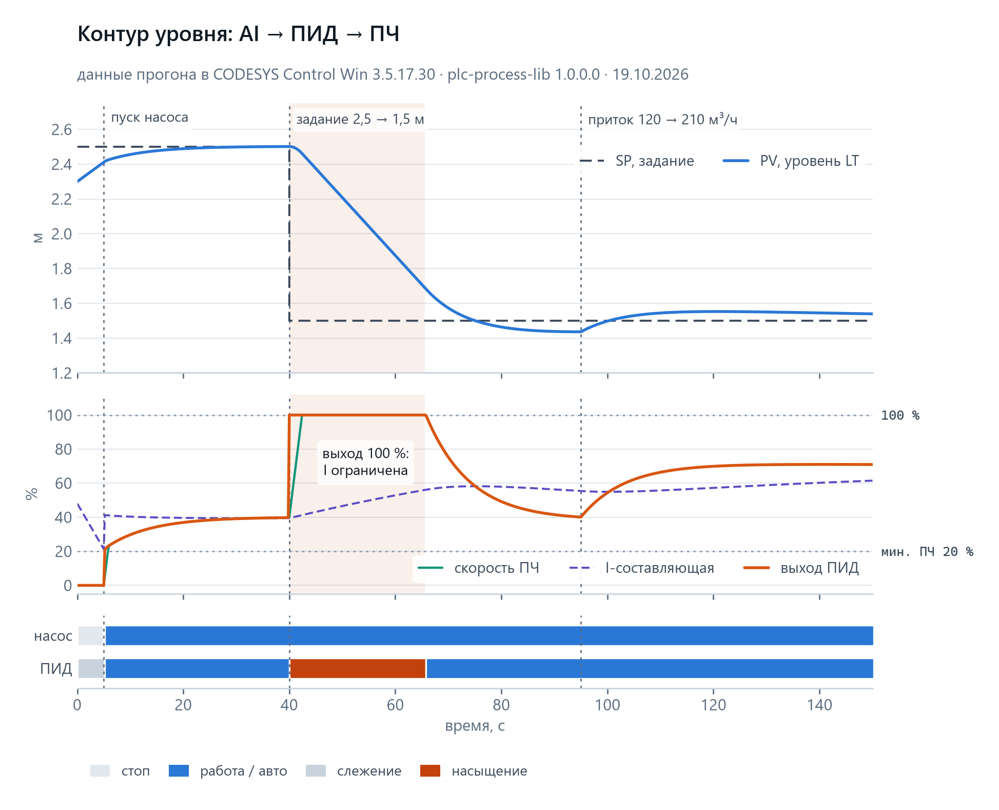
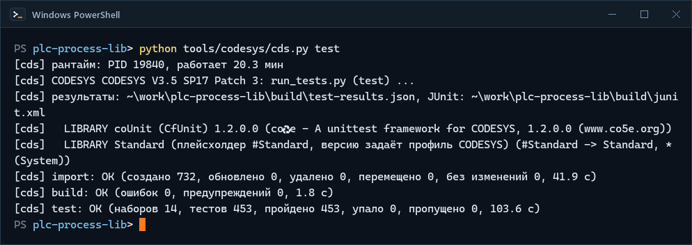
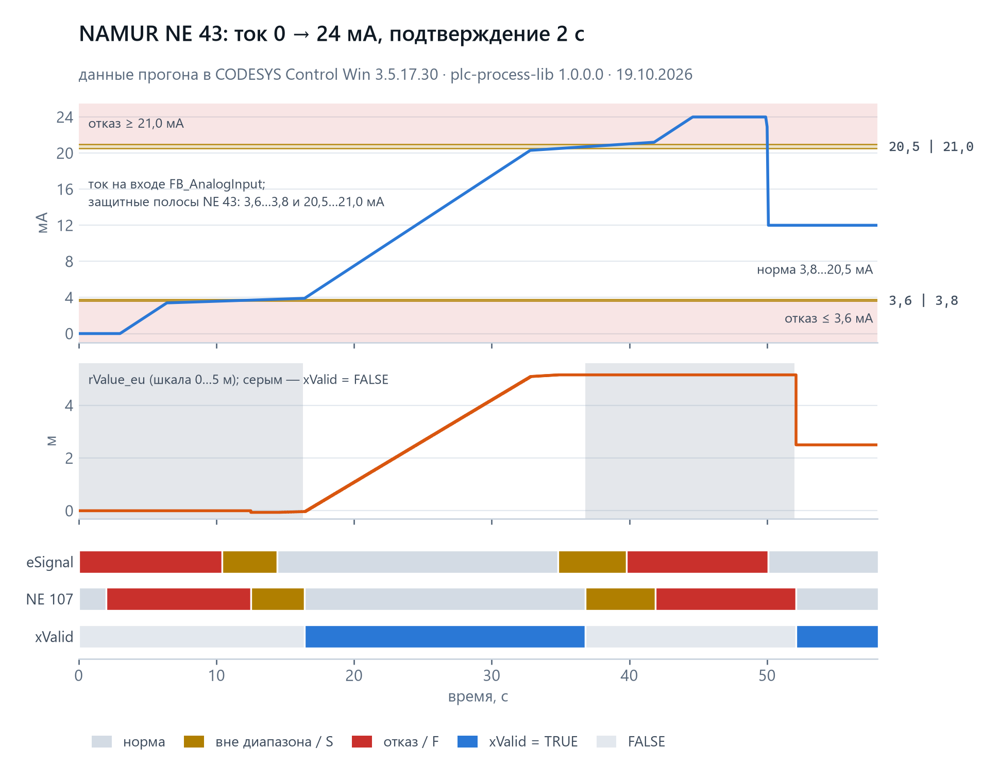
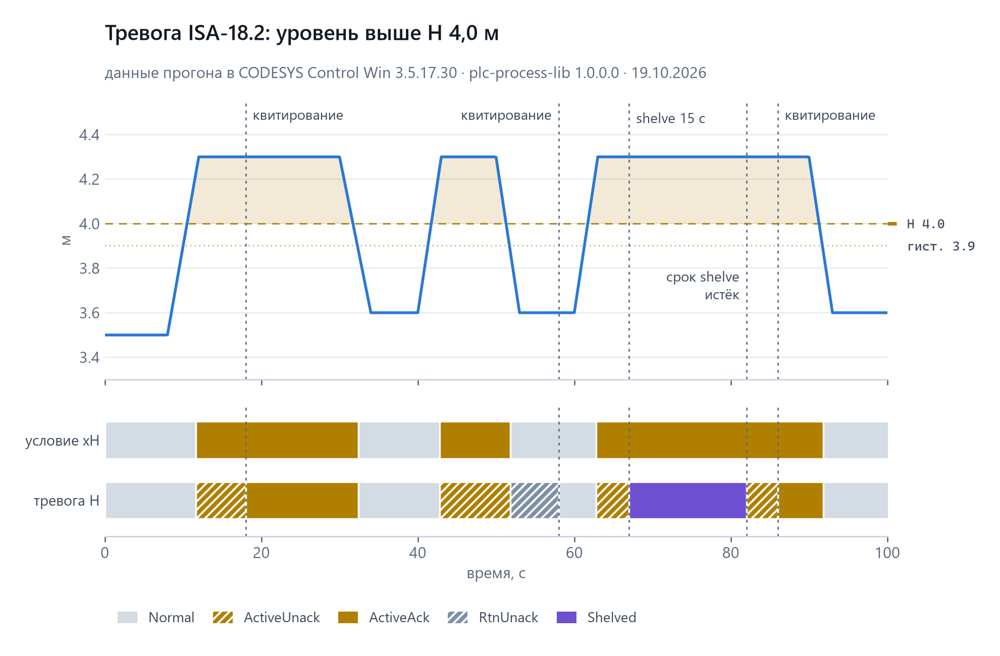
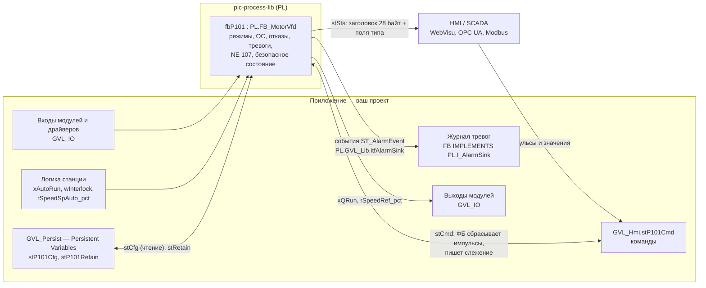

<p align="center">
  <picture>
    <source media="(prefers-color-scheme: dark)" srcset="docs/media/banner-dark.svg">
    <source media="(prefers-color-scheme: light)" srcset="docs/media/banner-light.svg">
    
  </picture>
</p>

<p align="center">
  <a href="https://github.com/kr0nsch/plc-process-lib/actions/workflows/ci.yml"></a>
  <a href="https://github.com/kr0nsch/plc-process-lib/releases/latest"></a>
  <a href="LICENSE"></a>
  
  
  
  <a href="#тесты-и-качество"></a>
</p>

<p align="center">
  <a href="#что-это-и-зачем">Что это</a> ·
  <a href="#быстрый-старт">Быстрый старт</a> ·
  <a href="#как-использовать-в-своём-проекте">Как использовать</a> ·
  <a href="docs/USAGE.md#7-связь-с-hmiscada">HMI/SCADA</a> ·
  <a href="#документация">Документация</a> ·
  <a href="#summary-en">Summary (EN)</a>
</p>

**Готовые функциональные блоки для типовых устройств АСУ ТП на CODESYS 3.5** (целевой ПЛК — ОВЕН ПЛК210):
аналоговые и дискретные входы, двигатели прямого пуска и с ПЧ, задвижки, регулирующие клапаны, ПИД-регулятор,
тревоги ISA-18.2. Библиотека заменяет блоки, которые в каждом проекте пишут заново и каждый раз с новым обменом
с HMI: у всех устройств одинаковые режимы, безопасное состояние, диагностика NAMUR NE 107 и один формат команд и
состояний для HMI/SCADA, а поведение проверено 453 юнит-тестами в CODESYS Control Win.
**Для кого:** программисты ПЛК на CODESYS 3.5 у интеграторов и машиностроителей и техлиды, которые выбирают
базовый набор ФБ и стандарт обмена со SCADA.

## Что это и зачем

На насосной станции или водоподготовке — десятки однотипных механизмов. Блоки для них обычно пишут под проект:
у двигателя одни переменные для HMI, у задвижки другие, режимы и квитирование сделаны по-разному, задержки
считаются циклами задачи, моточасы теряются при загрузке программы, тестов нет. Мнемосхему, карту Modbus и
наладку приходится повторять для каждого типа. `plc-process-lib` берёт этот слой на себя: устройство
подключается объявлением экземпляра и одним вызовом в цикле, приложению остаётся логика объекта.

**Что даёт**

- **Один формат обмена с HMI/SCADA.** Команды `ST_<Dev>Cmd` и состояние `ST_<Dev>Sts` всех устройств начинаются
  общим заголовком: слова состояния и отказов, режим, статус NE 107, ответ на команду, маски тревог, тип
  устройства — 28 байт, 14 регистров Modbus. Один фейсплейт SCADA и одна схема карты регистров на все типы.
- **Режимы и безопасное состояние одинаковы у всех.** Auto, Manual, Local, вывод из работы; безопасный выход при
  отказе и без корректной конфигурации; блокировки и разрешения с первопричиной у двигателей и арматуры.
- **Диагностика.** Статус NAMUR NE 107 у каждого устройства, достоверность сигнала 4–20 мА по NAMUR NE 43 у
  аналогового входа, контроль обратной связи, времени хода арматуры и связи с ПЧ.
- **Тревоги ISA-18.2 внутри устройств.** До восьми на устройство: квитирование, shelve с таймаутом, подавление,
  приоритеты; события уходят в журнал приложения через интерфейс `PL.I_AlarmSink`.
- **Время не зависит от цикла задачи.** Задержки, фильтры и наработка считаются по монотонным часам `LTIME()`,
  а не по числу циклов.
- **Ошибка в уставке не останавливает механизм.** Неверную конфигурацию с HMI устройство не принимает: показывает
  ошибку и работает по последней корректной.
- **Моточасы и режимы — в Persistent Variables приложения,** а не в экземпляре ФБ: по справке CODESYS такие
  данные переживают загрузку программы.
- **Поведение закреплено и проверено.** Контракт [docs/API.md](docs/API.md) задаёт каждое поле и каждую реакцию;
  453 теста coUnit (бывший CfUnit — фреймворк юнит-тестов для CODESYS) проходят в CODESYS Control Win V3.

**Для кого**

- программисты ПЛК на CODESYS 3.5 у интеграторов и машиностроителей: насосные станции, водоподготовка,
  вентиляция — объекты с типовыми механизмами;
- техлиды, которые выбирают базовый набор ФБ и стандарт обмена со SCADA для своих проектов;
- разработчики HMI/SCADA: карты битов и регистров каждого устройства описаны в [docs/fb/](docs/fb/).

Общие библиотеки (Util, OSCAT BASIC) дают «кирпичи» — таймеры, регуляторы, преобразования. Здесь — устройство
целиком: режимы, контроль обратной связи, тревоги, диагностика и обмен с HMI в одном вызове и с одинаковым
интерфейсом у всех типов.

**Совместимость.** Проверено на CODESYS 3.5.17.30 (V3.5 SP17 Patch 3) с CODESYS Control Win V3, 32 бит. ОВЕН
ПЛК210, другие версии CODESYS и ПЛК других производителей не проверялись. Зависимость — только библиотека
Standard; пространство имён — `PL`.

## Как это выглядит

Графики — журналы одного прогона демо-приложения [tools/demo/](tools/demo/README.md) на установленной библиотеке
1.0.0.0 в CODESYS Control Win V3 (задача 10 мс, 19.10.2026). Объект в контуре — модель ёмкости на ST: графики
показывают поведение ФБ, а не настройку контура под конкретный объект. Данные — CSV в
[docs/media/data/](docs/media/data/), без сглаживания.

<p align="center">
  <picture>
    <source media="(prefers-color-scheme: dark)" srcset="docs/media/chart-level-loop-dark.png">
    <source media="(prefers-color-scheme: light)" srcset="docs/media/chart-level-loop-light.png">
    
  </picture>
</p>
<p align="center"><sub>Контур уровня <code>FB_AnalogInput</code> → <code>FB_PID</code> → <code>FB_MotorVfd</code>: пуск насоса без рывка, ступень задания с насыщением выхода ПИД и обратным расчётом по фактическому заданию ПЧ, ступень притока · <a href="docs/media/data/demo-level-loop.csv">CSV</a></sub></p>

<p align="center">
  
</p>
<p align="center"><sub><code>python tools/codesys/cds.py test</code>: импорт исходников в новый проект, сборка без ошибок и предупреждений, 453 теста в 14 наборах пройдены — CODESYS 3.5.17.30 и Control Win V3, 19.10.2026; ожидание компиляции и тестов в GIF сжато</sub></p>

<p align="center">
  <picture>
    <source media="(prefers-color-scheme: dark)" srcset="docs/media/chart-ne43-dark.png">
    <source media="(prefers-color-scheme: light)" srcset="docs/media/chart-ne43-light.png">
    
  </picture>
</p>
<p align="center"><sub>Аналоговый вход по NAMUR NE 43, ток 0 → 24 мА: мгновенная классификация сигнала, отказ подтверждается через 2 с, <code>xValid</code> снимается, значение удерживается, насыщение на 3,8 и 20,5 мА · <a href="docs/media/data/demo-ne43.csv">CSV</a></sub></p>

<p align="center">
  <picture>
    <source media="(prefers-color-scheme: dark)" srcset="docs/media/chart-isa18-alarm-dark.png">
    <source media="(prefers-color-scheme: light)" srcset="docs/media/chart-isa18-alarm-light.png">
    
  </picture>
</p>
<p align="center"><sub>Тревога H уровня по ISA-18.2: квитирование и shelve — командами <code>stCmd</code>, как кнопками HMI; по истечении shelve активная тревога снова не квитирована · <a href="docs/media/data/demo-alarm.csv">CSV</a></sub></p>

## Быстрый старт

### Подключить библиотеку к проекту — нужен CODESYS, ПЛК не нужен

Нужен CODESYS 3.5.17 (проверено на 3.5.17.30) с CODESYS Control Win V3 — он входит в установку CODESYS и без
лицензии работает 2 часа.

1. Скачать `plc-process-lib.compiled-library` (249 КБ) из [релиза v1.0.0](https://github.com/kr0nsch/plc-process-lib/releases/tag/v1.0.0).
   Там же `plc-process-lib.library` (641 КБ) — с исходным текстом, если хотите смотреть код ФБ в IDE.
2. «Инструменты → Репозиторий библиотек → Установить…» (Tools → Library Repository → Install) и выбрать файл.
   Увидите в списке `plc-process-lib, 1.0.0.0 (plc-portfolio)`.
3. В проекте под CODESYS Control Win V3: «Менеджер библиотек → Добавить библиотеку» (Library Manager → Add
   Library) → `plc-process-lib`. Увидите объекты `PL.FB_AnalogInput`, `PL.FB_Motor`, `PL.ST_MotorCfg` и т. д.
4. Вставить в `PLC_PRG` аналоговый вход — форма вызова та же, что в демо-приложении:

   ```st
   PROGRAM PLC_PRG
   VAR
       fbLT101    : PL.FB_AnalogInput;                            // уровнемер
       stLT101Cmd : PL.ST_AnalogInputCmd;                         // команды HMI
       stLT101Cfg : PL.ST_AnalogInputCfg := (rRangeHi_eu := 5.0); // 4–20 мА = 0–5 м
       rLT101_mA  : REAL := 12.0;                                 // в проекте — канал модуля AI
   END_VAR

   fbLT101(rIn := rLT101_mA, stCmd := stLT101Cmd, stCfg := stLT101Cfg);
   ```

5. «Онлайн → Логин», «Отладка → Старт». Увидите: `fbLT101.rValue_eu` = 2.5, `xValid` = TRUE,
   `stSts.stCommon.eNe107` = `Good`. Запишите в `rLT101_mA` значение 2.0 (обрыв линии): через 2 с `eNe107`
   станет `Failure`, `xValid` — FALSE, значение 2.5 удержится.

Дальше — [«Как использовать в своём проекте»](#как-использовать-в-своём-проекте).

### Проверки без CODESYS

Нужны git и Python 3.11+ (в CI — 3.12). Эти проверки идут в CI на каждый коммит.

1. Клонировать и поставить зависимости в виртуальное окружение. **На Windows клонируйте в короткий путь,**
   например `C:\src\plc-process-lib`: самые длинные пути в `tests/` — 106 символов, а без параметра Windows
   `LongPathsEnabled` полный путь не может быть длиннее 260 символов. Если каталог клона длиннее ~150 символов,
   git не может извлечь файлы («Filename too long»). С `core.longpaths` git справляется, но pytest и линтер
   ST всё равно падают с `FileNotFoundError`. Глубокий каталог работает только при
   `git clone -c core.longpaths=true …` и включённом `LongPathsEnabled` (нужны права администратора).

   ```bash
   git clone https://github.com/kr0nsch/plc-process-lib.git
   cd plc-process-lib
   python -m venv .venv
   source .venv/bin/activate        # Windows (cmd): .venv\Scripts\activate
   python -m pip install -r requirements-dev.txt
   ```

   Увидите в конце: `Successfully installed …` — в списке `ruff-0.17.1`, `mypy-2.4.0`, `pytest-9.1.1`,
   `hypothesis-6.170.0` (версии закреплены в [requirements-dev.txt](requirements-dev.txt)).
2. Тесты Python: инструменты сборки, соглашения тестов ST, совпадение DUT, констант, масок и объявлений ФБ с
   контрактом, шаблоны текстов тревог.

   ```bash
   python -m pytest
   ```

   Увидите: `616 passed, 10 skipped` (меньше минуты). Пропущены 10 интеграционных тестов с настоящими
   iec_checker и RuSTy: они ждут бинарники из шагов 4–5. С обоими инструментами — `626 passed` (около минуты).
3. Линтер ST: раскладка файлов, заголовки POU, префиксы имён, «магические числа».

   ```bash
   python tools/check/st_lint.py --strict
   ```

   Увидите: `st_lint: файлов 1332, ошибок 0, предупреждений 0`.

<details>
<summary>Статанализ iec_checker и проверка типов RuSTy — нужны отдельные бинарники</summary>

4. Статанализ iec_checker v0.4. Скачать `iec_checker_Windows_x86_64.exe` или `iec_checker_Linux_x86_64` из
   [релиза v0.4](https://github.com/iec-checker/iec-checker/releases/tag/v0.4) и положить в
   `~/.local/plc-tools/iec-checker/` (или указать путь в переменной `IEC_CHECKER`; на Linux — `chmod +x`).

   ```bash
   python tools/check/run_iec_checker.py --tests
   ```

   Увидите: `run_iec_checker (v0.4): файлов 116; необоснованных 0, обоснованных 5192, …`. Обоснованные
   находки — ограничения разборщика и сознательные решения, разбор — [docs/STATIC_ANALYSIS.md](docs/STATIC_ANALYSIS.md).
5. Проверка типов RuSTy 1.0.6 (необязательно). Из [релиза v1.0.6](https://github.com/PLC-lang/rusty/releases/tag/v1.0.6)
   взять `plc.exe` (Windows) или `plc-linux-x86_64` (сохранить как `plc`) и `stdlib-1.0.6.tar.gz`; положить в
   `~/.local/plc-tools/rusty/` и распаковать архив там же (или задать `RUSTY_PLC` и `RUSTY_STDLIB_INCLUDE`).

   ```bash
   python tools/check/run_rusty.py
   ```

   Увидите: `run_rusty: проверено файлов 117, исключено 0, без ошибок`. Перед итогом — 399 предупреждений
   (E049, E067, E091 и др.): это ожидаемо, разбор — [STATIC_ANALYSIS.md](docs/STATIC_ANALYSIS.md#rusty-plc---check).

</details>

Прогон тестов ST в CODESYS — в разделе [«Тесты и качество»](#тесты-и-качество).

## Как использовать в своём проекте

Типовой порядок работы. Полное руководство с правилами вызова, всеми устройствами, журналом тревог, обменом с
HMI/SCADA и Modbus и разбором частых ошибок — [docs/USAGE.md](docs/USAGE.md).

1. **Поставить библиотеку и добавить в проект** — «Быстрый старт», шаги 1–3.
2. **Объявить данные устройства.** Это код приложения, в библиотеке этих переменных нет: команды
   `PL.ST_<Dev>Cmd` — в списке для HMI (`GVL_Hmi`), параметры `PL.ST_<Dev>Cfg` и энергонезависимые данные
   `PL.ST_DeviceRetain` — в объекте Persistent Variables (`GVL_Persist`), экземпляр `PL.FB_<Dev>` — в GVL или
   программе. Объект Persistent Variables создаётся в IDE вручную ([MANUAL_STEPS.md, раздел 10](docs/MANUAL_STEPS.md#10-моточасы-и-пуски-двигателей-persistent-variables-приложения)).
3. **Вызывать каждый экземпляр один раз за цикл одной задачи** и передавать все `VAR_IN_OUT` (`stCmd`, `stCfg`,
   `stRetain`): входы автоматики присваиваются до вызова, выходы на модули читаются после.
4. **Подключить журнал тревог.** Журнала в библиотеке нет: ФБ приложения реализует `PL.I_AlarmSink`, и каждый
   цикл до вызова устройств выполняется `PL.GVL_Lib.itfAlarmSink := fbJournal;` — заготовка в
   [USAGE.md, раздел 6](docs/USAGE.md#6-журнал-тревог).
5. **Связать с HMI/SCADA.** HMI пишет `GVL_Hmi.st<TAG>Cmd` (импульсные биты сбрасывает ФБ, ответ — в
   `eCmdResult` и `uiCmdSeq`) и читает `fb<TAG>.stSts`. По Modbus команды идут только через адаптер по фронту,
   тексты тревог берутся из [docs/alarm_templates.csv](docs/alarm_templates.csv) — [USAGE.md, раздел 7](docs/USAGE.md#7-связь-с-hmiscada).

Пример — уровнемер, ПИД уровня и насос с ПЧ (сокращённо: объявления целиком и пояснения — в
[USAGE.md, раздел 4](docs/USAGE.md#4-пример-контур-уровня-ai--пид--пч)). Цепочка и порядок вызовов — те же, что в
демо-приложении [`FB_DemoLevelLoop`](tools/demo/src/POUs/FB_DemoLevelLoop/FB_DemoLevelLoop.impl.st), которое
работало в Control Win (первый график выше).

```st
// GVL_Hmi:     stLT101Cmd : PL.ST_AnalogInputCmd;  stLIC101Cmd : PL.ST_PidCmd;  stP101Cmd : PL.ST_MotorCmd;
// GVL_Persist (объект Persistent Variables):
//   stLT101Cfg  : PL.ST_AnalogInputCfg := (rRangeHi_eu := 5.0);           // 4–20 мА = 0–5 м
//   stLIC101Cfg : PL.ST_PidCfg := (eAction := PL.E_PidAction.Direct,      // уровень выше — насос быстрее
//                                  rPvMax_eu := 5.0, rSpMax_eu := 5.0,    // диапазон PV и задания, м
//                                  xUseOutAct := TRUE);                   // обратный расчёт по заданию ПЧ
//   stP101Cfg   : PL.ST_MotorCfg;   stLIC101Retain, stP101Retain : PL.ST_DeviceRetain;
// GVL_Devices: fbLT101 : PL.FB_AnalogInput;  fbLIC101 : PL.FB_PID;  fbP101 : PL.FB_MotorVfd;
// PRG_Devices: fbJournal : FB_Journal;  xPumpDemand, xLeadAuto : BOOL;  rLeadRef : REAL;
PL.GVL_Lib.itfAlarmSink := fbJournal;                                   // журнал тревог, каждый цикл

GVL_Devices.fbLT101(rIn := GVL_IO.rLT101_mA, stCmd := GVL_Hmi.stLT101Cmd, stCfg := GVL_Persist.stLT101Cfg);

xLeadAuto := GVL_Devices.fbP101.SpeedAutoActive;                        // насос в Auto-работе?
rLeadRef  := GVL_Devices.fbP101.SpeedRef;                               // если нет — ПИД следит за заданием ПЧ
GVL_Devices.fbLIC101(rPv_eu := GVL_Devices.fbLT101.rValue_eu, xPvValid := GVL_Devices.fbLT101.xValid,
                     xTrack := NOT xLeadAuto, rTrack_pct := rLeadRef, rOutAct_pct := rLeadRef,
                     stCmd := GVL_Hmi.stLIC101Cmd, stCfg := GVL_Persist.stLIC101Cfg,
                     stRetain := GVL_Persist.stLIC101Retain);

GVL_Devices.fbP101.xAutoRun         := xPumpDemand;                     // запрос логики станции
GVL_Devices.fbP101.rSpeedSpAuto_pct := GVL_Devices.fbLIC101.rOut_pct;   // задание от ПИД
GVL_Devices.fbP101(xVfdRunning := GVL_IO.xP101_VfdRun, rSpeedAct_pct := GVL_IO.rP101_SpeedAct_pct,
                   stCmd := GVL_Hmi.stP101Cmd, stCfg := GVL_Persist.stP101Cfg,
                   stRetain := GVL_Persist.stP101Retain);
GVL_IO.xP101_QRun         := GVL_Devices.fbP101.xQRun;                  // команда «работа» на ПЧ
GVL_IO.rP101_SpeedRef_pct := GVL_Devices.fbP101.rSpeedRef_pct;          // задание на ПЧ, %
```

Умолчания `ST_PidCfg` — обратное действие (`Reverse`), диапазон PV и задания 0–100 и `xUseOutAct = FALSE`;
для контура уровня их задают, как выше. ПИД и насос после первой загрузки — в Manual: переведите их в Auto командой `stCommon.xSetAuto`, режим
запомнится в `stRetain`. Только после этого `xPumpDemand` пускает насос.

Задвижка, двигатель прямого пуска, дискретный вход, регулирующий клапан и отдельная станционная тревога
подключаются так же — [USAGE.md, раздел 5](docs/USAGE.md#5-задвижка-и-другие-устройства) и разделы «Пример
вызова» в [docs/fb/](docs/fb/). Репозиторий на шаблоне [plc-repo-template](https://github.com/kr0nsch/plc-repo-template)
подключает библиотеку записью в `config.json` — [USAGE.md, раздел 10](docs/USAGE.md#10-проект-на-шаблоне-plc-repo-template).

## Как устроено

### Функциональные блоки

| ФБ | Назначение | Документ |
|---|---|---|
| `FB_AnalogInput` | вход 4–20 мА / 0–1 / инж. ед. / отсчёты: масштабирование, корень с отсечкой, фильтр с постоянной времени, не зависящей от цикла, достоверность по NE 43, уставки HH/H/L/LL, подмена | [FB_AnalogInput.md](docs/fb/FB_AnalogInput.md) |
| `FB_DigitalInput` | дискретный вход: задержки включения и отключения, инверсия, отказ канала, подмена | [FB_DigitalInput.md](docs/fb/FB_DigitalInput.md) |
| `FB_Motor` | двигатель прямого пуска: команды HMI и автоматики, блокировки и разрешения с первопричиной, контроль ОС, минимальные времена работы и паузы, пуски в час, моточасы | [FB_Motor.md](docs/fb/FB_Motor.md) |
| `FB_MotorVfd` | двигатель с ПЧ (наследник `FB_Motor`): задание 0–100 % с рампой, ОС по частоте, отказ связи с ПЧ | [FB_MotorVfd.md](docs/fb/FB_MotorVfd.md) |
| `FB_Valve` | запорная арматура (привод или соленоид): открыть, закрыть, стоп, концевики, время хода, «оба концевика», муфта, реверс | [FB_Valve.md](docs/fb/FB_Valve.md) |
| `FB_ControlValve` | регулирующий клапан: задание положения с пределами и скоростью, рассогласование с ОС, положение безопасности | [FB_ControlValve.md](docs/fb/FB_ControlValve.md) |
| `FB_PID` | ПИД в идеальной форме: D по измерению с фильтром, обратный расчёт (anti-windup), безударные переходы, рампа задания, расчёт по реальному dt | [FB_PID.md](docs/fb/FB_PID.md) |
| `FB_Alarm` | тревога ISA-18.2: 4 базовых и 3 наложенных состояния, приоритет, задержки, shelve с таймаутом, подавление; внутри устройств и отдельно | [FB_Alarm.md](docs/fb/FB_Alarm.md) |
| `FB_DeviceBase` | абстрактная база устройств: режимы, конфигурация с последней корректной копией (LKG), NE 107, 8 слотов тревог | [FB_DeviceBase.md](docs/fb/FB_DeviceBase.md) |
| `FB_Delay` | единственный таймер библиотеки: задержки включения и отключения от источника времени `I_TimeSource` | [FB_Delay.md](docs/fb/FB_Delay.md) |
| `FB_SystemTime`, `FB_FakeTime` | источники времени: системное `LTIME()` и подменное для тестов | [FB_SystemTime.md](docs/fb/FB_SystemTime.md), [FB_FakeTime.md](docs/fb/FB_FakeTime.md) |
| `FB_LimitMonitor`, `FB_StartsWindow` | одна уставка с гистерезисом и задержками; пуски за скользящий час | [FB_LimitMonitor.md](docs/fb/FB_LimitMonitor.md), [FB_StartsWindow.md](docs/fb/FB_StartsWindow.md) |
| `F_IsFinite`, `F_RateLimit`, `F_RateLimitLr`, `F_Ne107Worst`, `F_LTimeToSec`, `F_TimeToSec` | функции: конечность REAL по битам, ограничение скорости (REAL и с состоянием в LREAL), худший статус NE 107, перевод времени | [Functions.md](docs/fb/Functions.md) |

### Потоки данных



Каждое устройство наследует абстрактную базу `FB_DeviceBase`, и тело любого устройства идёт в одном порядке:
время → конфигурация (LKG) → сброс → режим → команды → логика устройства → тревоги → заголовок состояния.
Иерархия классов и интерфейсов — [docs/ARCHITECTURE.md](docs/ARCHITECTURE.md); нормативный порядок тела —
[API.md, раздел 9.4](docs/API.md#94-порядок-тела-каждого-устройства-нормативно).

### Каталоги

| Каталог | Что внутри |
|---|---|
| `src/DUTs/` | типы: Cmd, Sts, Cfg каждого устройства, `ST_DeviceRetain`, перечисления — 50 файлов |
| `src/POUs/Devices/`, `src/POUs/Control/` | устройства: AI, DI, двигатель, двигатель с ПЧ, задвижка, регулирующий клапан; ПИД |
| `src/POUs/Alarm/`, `src/POUs/Base/` | тревога ISA-18.2 `FB_Alarm`; абстрактная база `FB_DeviceBase` |
| `src/POUs/Time/`, `src/POUs/Util/` | `FB_Delay` и источники времени; функции, `FB_LimitMonitor`, `FB_StartsWindow` |
| `src/Interfaces/`, `src/GVLs/` | интерфейсы `I_*`; `GVL_Const` — константы и маски битов, `GVL_Lib` — приёмник тревог |
| `tests/` | 14 наборов coUnit, 453 теста, вспомогательные ФБ |
| `tools/codesys/` | `cds.py`: импорт ST в проект, сборка, тесты, библиотека — CODESYS без окна |
| `tools/check/`, `tools/assemble.py` | проверки без CODESYS: линтер, iec_checker, RuSTy |
| `tools/reference/`, `tools/project_checks/` | эталонные модели на Python для ожидаемых значений тестов; сверка кода с контрактом (pytest) |
| `tools/demo/` | демо-приложение на установленной библиотеке, сценарии графиков |
| `docs/` | руководство, контракт API, документы по ФБ, отчёты проверок |

`src/` — источник истины в виде текстовых файлов ST; проект CODESYS и библиотека собираются из них скриптом,
`.project` и `.library` в git не хранятся. Инструменты `tools/` взяты из шаблона
[plc-repo-template](https://github.com/kr0nsch/plc-repo-template). Служебная программа `src/POUs/PRG_Main` в
библиотеку не входит.

## Тесты и качество

**В реальном CODESYS** (3.5.17.30, CODESYS Control Win V3, 32 бит, 19.10.2026) прошли все **453 теста coUnit
1.2.0.0 в 14 наборах**: основа (время, утилиты, тревоги, база устройств) — 158, устройства — 290, межсемейные —
5, в том числе контур AI → ПИД → ПЧ. Время в тестах задаёт подменный источник `FB_FakeTime`, поэтому каждый тест
детерминирован и проходит за один вызов. Тесты каждого семейства проверены однострочными мутациями: каждую
применённую мутацию, кроме эквивалентных, ловит хотя бы один тест; выжившие мутации закрыты новыми тестами.
Перед выпуском три независимых ревью (стандарты, ПО, потребители) нашли 23 замечания. 22 закрыты в этом
репозитории исправлением или новым тестом. Одно (F3: ПИД как тип устройства для генератора `iolistgen`)
исправлено в контракте, а изменения в самом генераторе описаны в [CONSUMERS.md](docs/CONSUMERS.md#iolistgen).
Итоги по наборам, мутации и находки ревью — [docs/TEST_REPORT.md](docs/TEST_REPORT.md).
**На ПЛК210 библиотека не запускалась.**

| Проверка | Где | Итог |
|---|---|---|
| сборка CODESYS 3.5.17.30, `build --tests` и `check --tests` | локально | 0 ошибок, 0 предупреждений |
| юнит-тесты coUnit, `cds.py test` | локально, Control Win V3 | 453 из 453 |
| `cds.py roundtrip` | локально | 0 различий |
| `cds.py library` (проверка пула) | локально | 0 ошибок |
| `st_lint --strict` | CI | 1332 файла, 0 замечаний, подавлений нет |
| iec_checker v0.4 (`--tests`) | CI | 0 ошибок разбора, 0 необоснованных находок; 5192 обоснованных — [разбор](docs/STATIC_ANALYSIS.md) |
| RuSTy 1.0.6 | CI, необязательно | 0 ошибок, исключённых файлов нет; 399 предупреждений — [разбор](docs/STATIC_ANALYSIS.md#rusty-plc---check) |
| ruff, mypy, pytest | CI | пройдено; pytest — 626 тестов: в CI 622 пройдено, 4 интеграционных теста RuSTy пропущены (RuSTy — отдельное задание); локально с iec_checker и RuSTy — 626 из 626 |

**Прогон в CODESYS.** Нужны Windows, CODESYS 3.5.17.30, Python 3.11+ и coUnit 1.2.0.0 (скачать с CODESYS Forge и
установить или указать путь в `COUNIT_LIBRARY` — [MANUAL_STEPS.md, раздел 2](docs/MANUAL_STEPS.md#2-counit-cfunit-1200)).
Рантайм — CODESYS Control Win V3 в пользовательском процессе, права администратора не нужны
([раздел 4](docs/MANUAL_STEPS.md#4-рантайм-codesys-control-win-v3-без-прав-администратора)). Команды запускают
CODESYS без окна.

```bat
python tools\codesys\cds.py test
```

Увидите в конце: `[cds] test: OK (наборов 14, тестов 453, пройдено 453, упало 0, пропущено 0, … с)`; результаты —
`build\test-results.json` и `build\junit.xml`. Прогон занимает 2–3 минуты.

| Команда | Что делает |
|---|---|
| `python tools/codesys/cds.py build --tests` | сборка тестового приложения (0 ошибок, 0 предупреждений) |
| `python tools/codesys/cds.py check --tests` | компиляция **всех** объектов, в том числе недостижимых из задач |
| `python tools/codesys/cds.py roundtrip` | импорт → экспорт → побайтное сравнение с `src/` и `tests/` |
| `python tools/codesys/cds.py library` | сборка `.library` и проверка пула библиотеки |
| `python tools/codesys/cds.py report` | итоги прогона → [docs/TEST_REPORT.md](docs/TEST_REPORT.md) |
| `python tools/demo/run_demo.py` | демонстрационный прогон на установленной библиотеке 1.0.0.0 → CSV в `docs/media/data/` ([tools/demo/](tools/demo/README.md)) |

Рантайм один на машину: если тесты гоняет другой репозиторий, `cds.py` ждёт блокировку. Соглашения тестов
(наборы, регистрация, имена, `FB_FakeTime`, правило NaN) — [docs/TESTING.md](docs/TESTING.md); эталоны ожидаемых
значений — модели на Python в `tools/reference/`.

## Документация

| Вопрос | Документ |
|---|---|
| Как подключить библиотеку, вызвать ФБ, связать с HMI/SCADA и Modbus? | [docs/USAGE.md](docs/USAGE.md) |
| Что значит этот вход, бит `wStatus` или регистр `stSts`? Как вызвать конкретное устройство? | [docs/fb/](docs/fb/) — документ на каждый ФБ |
| Какова точная семантика: команды, режимы, конфигурация, отказы, безопасное состояние, раскладка регистров? | [docs/API.md](docs/API.md) — нормативный контракт, разделы 1–2 и 4 |
| Как устроены типы, база устройств, тревоги, константы? | [docs/ARCHITECTURE.md](docs/ARCHITECTURE.md) |
| Почему API именно такой и какие решения приняты при реализации? | [docs/DECISIONS.md](docs/DECISIONS.md), [docs/ASSUMPTIONS.md](docs/ASSUMPTIONS.md) |
| Как выполнить шаг в IDE: coUnit, рантайм, библиотека, Persistent Variables, релиз? | [docs/MANUAL_STEPS.md](docs/MANUAL_STEPS.md) |
| Что проверено и с каким результатом? | [docs/TEST_REPORT.md](docs/TEST_REPORT.md), [docs/STATIC_ANALYSIS.md](docs/STATIC_ANALYSIS.md) |
| Какие тексты тревог показывать оператору? | [docs/alarm_templates.csv](docs/alarm_templates.csv) |
| Как писать код и тесты в этом репозитории? | [CONTRIBUTING.md](CONTRIBUTING.md), [docs/STYLE_GUIDE.md](docs/STYLE_GUIDE.md), [docs/TESTING.md](docs/TESTING.md), [docs/LAYOUT.md](docs/LAYOUT.md) |
| Как работают `cds.py`, линтер и анализаторы? | [tools/README.md](tools/README.md) |
| Как получены графики? | [tools/demo/README.md](tools/demo/README.md) |
| Что изменить в проектах на библиотеке после 1.0.0? | [docs/CONSUMERS.md](docs/CONSUMERS.md) |
| Что менялось от версии к версии? | [CHANGELOG.md](CHANGELOG.md) |

## Ограничения и планы

- **На ПЛК210 не проверялось.** Все прогоны — CODESYS Control Win V3 (x86, 32 бит). На контроллере нужно повторить:
  разрешение и монотонность `LTIME()`, время цикла, сравнения с NaN на ARM, запас стека и цену копирования
  конфигурации ([API.md, раздел 24.2](docs/API.md#242-проверить-во-время-выполнения-codesys-control-win-v3-затем-плк210)).
- **Пороги NAMUR NE 43** (3,6 / 3,8 / 20,5 / 21,0 мА) и повторное оповещение после shelve приняты по практике —
  их нужно сверить с текстами NE 43 и ANSI/ISA-18.2-2016 ([API.md, раздел 24.3](docs/API.md#243-сверить-с-источником)).
- **Persistent Variables** скриптом CODESYS 3.5.17 не создаются — это ручной шаг в IDE. Сохранность
  persistent-данных и монотонность `LTIME()` при смене системного времени проверяются вручную
  ([MANUAL_STEPS.md, разделы 9–10](docs/MANUAL_STEPS.md#9-ручная-проверка-монотонность-ltime-r1-контракта)).
- **Это не ПАЗ.** Защиты и блокировки ФБ — логика управления: библиотека не сертифицирована по МЭК 61508/61511,
  защиты объекта дублируются аппаратно; в режиме Local ПЛК механизм не останавливает.
- **Открытые вопросы v1.0** (перемежающийся обрыв AI, задержки уставок после возврата, стартовая рампа
  регулирующего клапана и др.) остаются открытыми до v1.1. Поведение v1.0 закреплено тестами, и для каждого
  вопроса есть решение для наладки на объекте ([ASSUMPTIONS.md](docs/ASSUMPTIONS.md#открытые-вопросы-семейств-решения-интеграции)).
- **Дальше:** КНС на этой библиотеке (`kns-pump-station`) и генератор `iolistgen`, который создаёт `GVL_Hmi`,
  `GVL_Persist` и вызовы устройств из перечня сигналов, — оба готовятся.

## Связанные проекты

Библиотека — второе звено портфолио: шаблон репозитория → библиотека устройств → проекты объектов на ней.

- [plc-repo-template](https://github.com/kr0nsch/plc-repo-template) — шаблон, на котором построен этот
  репозиторий: исходники ST в git, сборка проекта и библиотеки скриптом `cds.py`, CI.
- [plc-ci-toolkit](https://github.com/kr0nsch/plc-ci-toolkit) — линтеры, сборка CODESYS, тесты и JUnit для CI
  отдельным набором инструментов.
- [sis-interlock-demo](https://github.com/kr0nsch/sis-interlock-demo) — демонстрация логики ПАЗ; берёт из
  библиотеки источник времени `PL.I_TimeSource`, таймер `PL.FB_Delay` и подменные часы `PL.FB_FakeTime` для тестов.
- `kns-pump-station` (готовится) — флагман: КНС с тремя насосами с ПЧ на устройствах этой библиотеки, модель
  объекта, HMI.
- `iolistgen` (готовится) — генератор: перечень сигналов → объявления и вызовы устройств, карты Modbus, тексты
  тревог для SCADA.

## Summary (EN)

`plc-process-lib` is a CODESYS 3.5 library of process-device function blocks (OWEN PLC210 target, namespace `PL`):
analog inputs with NAMUR NE 43 validation, digital inputs, direct-on-line and VFD motors, on/off and control valves,
a PID controller with anti-windup and bumpless transfer, and ISA-18.2 alarms. It is for PLC programmers at system
integrators and machine builders who re-write such blocks for every project: all devices share the same modes,
safe state, NAMUR NE 107 diagnostics and one HMI/SCADA command/status layout with a common 14-register header.
Behaviour is fixed by an API contract (`docs/API.md`) and covered by 453 coUnit tests passing in CODESYS Control
Win V3; not yet verified on PLC210 hardware. Download the `.compiled-library` from [Releases](https://github.com/kr0nsch/plc-process-lib/releases),
install it via Tools → Library Repository and follow [docs/USAGE.md](docs/USAGE.md).

## Лицензия

[MIT](LICENSE) © 2026 kr0nsch

---

<p align="center"><b>Портфолио АСУ ТП</b></p>
<table>
<tr><td width="33%"><a href="https://github.com/kr0nsch/plc-repo-template">01 · plc-repo-template</a><br><sub>ST в git, сборка проекта скриптом, CI</sub></td><td width="33%"><a href="https://github.com/kr0nsch/plc-process-lib"><b>02 · plc-process-lib</b></a><br><sub>ФБ: AI, двигатель, ПЧ, задвижка, ПИД, тревоги</sub></td><td width="33%"><span data-repo="kns-pump-station">03 · kns-pump-station</span> <sub>(готовится)</sub><br><sub>флагман: КНС, три насоса с ПЧ, модель, HMI</sub></td></tr>
<tr><td width="33%"><a href="https://github.com/kr0nsch/kns-port-domestic">04 · kns-port-domestic</a><br><sub>перенос на Astra.IDE / MasterSCADA 4D</sub></td><td width="33%"><span data-repo="plc-iiot-stack">05 · plc-iiot-stack</span> <sub>(готовится)</sub><br><sub>OPC UA / MQTT → InfluxDB → Grafana</sub></td><td width="33%"><a href="https://github.com/kr0nsch/iolistgen">06 · iolistgen</a><br><sub>перечень сигналов → ST, карты Modbus, SCADA</sub></td></tr>
<tr><td width="33%"><a href="https://github.com/kr0nsch/plc-ci-toolkit">07 · plc-ci-toolkit</a><br><sub>линтеры, сборка CODESYS, тесты, JUnit</sub></td><td width="33%"><a href="https://github.com/kr0nsch/s7-to-codesys">08 · s7-to-codesys</a><br><sub>конвертер SCL → ST с отчётом о переносе</sub></td><td width="33%"><a href="https://github.com/kr0nsch/sis-interlock-demo">09 · sis-interlock-demo</a><br><sub>ПАЗ: MooN, матрица причин и следствий</sub></td></tr>
</table>
