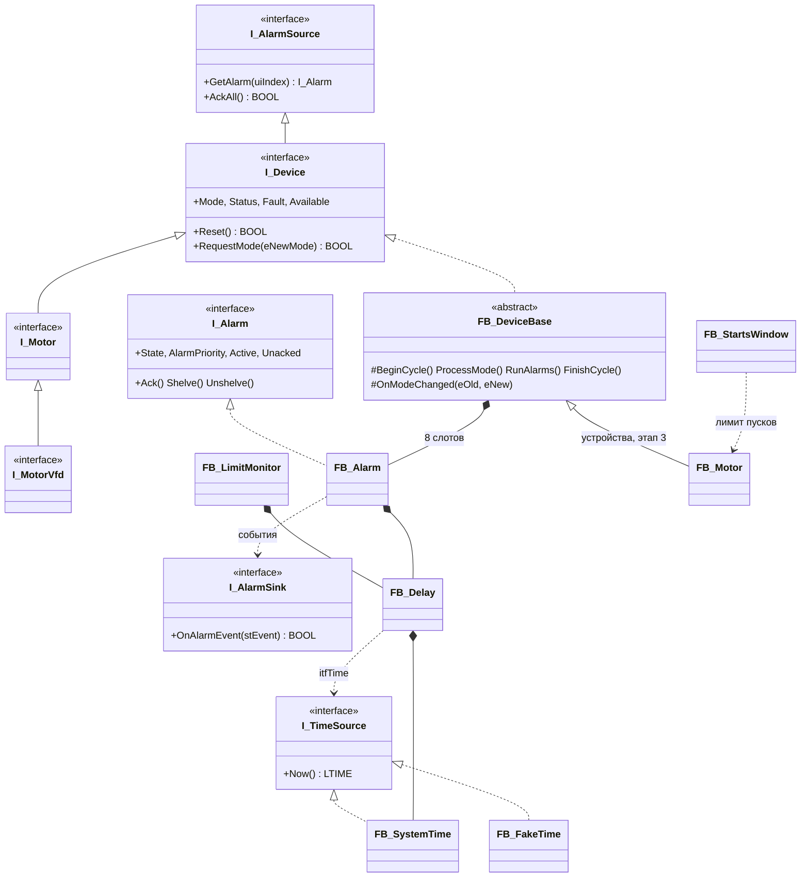

# plc-process-lib

[](https://github.com/<GITHUB_USER>/plc-process-lib/actions/workflows/ci.yml)

Библиотека технологических функциональных блоков для CODESYS V3.5 SP17 Patch 3 (целевой ПЛК — ОВЕН
ПЛК210, пространство имён `PL`): аналоговые и дискретные входы, двигатели прямого пуска и с ПЧ,
запорная и регулирующая арматура, ПИД, тревоги ISA-18.2. Режимы, диагностика NAMUR NE 107 и NE 43,
обмен с HMI/SCADA через структуры команд и состояний, юнит-тесты coUnit с подменяемым временем.

**Состояние: этап 2 — основа готова.** Готовы все общие типы (50 DUT, в том числе Cmd/Sts/Cfg всех
устройств), константы и карты битов, интерфейсы, время и утилиты, тревога ISA-18.2 `FB_Alarm` и
абстрактная база устройств `FB_DeviceBase`; 151 тест coUnit зелёный в CODESYS Control Win V3.
Сами устройства — следующий этап.

## Демонстрация

> _Плейсхолдер: скриншоты фейсплейтов и GIF прогона тестов появятся вместе с устройствами._

## Архитектура



| Компонент | Что это | Этап |
|---|---|---|
| `E_DeviceMode`, `E_Ne107Status`, `E_CmdResult`, `ST_DeviceCmd`, `ST_DeviceSts`, `ST_DeviceRetain` … | общие типы; Sts — карта регистров Modbus без скрытого выравнивания | 1 ✔ |
| `ST_<Dev>Cmd`, `ST_<Dev>Sts`, `ST_<Dev>Cfg` шести устройств | обмен с HMI/SCADA и параметры (Persistent Variables приложения) | 1 ✔ |
| `GVL_Const`, `GVL_Lib` | константы, маски битов `wStatus`/`wFault`/`wWarning`/`wCfgErr`, приёмник тревог | 1 ✔ |
| `I_TimeSource`, `I_Alarm`, `I_AlarmSource`, `I_AlarmSink`, `I_Device`, `I_Motor`, `I_MotorVfd` | интерфейсы для станционной логики | 1 ✔ |
| [`FB_SystemTime`](docs/fb/FB_SystemTime.md), [`FB_FakeTime`](docs/fb/FB_FakeTime.md), [`FB_Delay`](docs/fb/FB_Delay.md) | время: системное и подменное, единственный таймер библиотеки | 1 ✔ |
| [`F_LTimeToSec`, `F_TimeToSec`, `F_IsFinite`, `F_Ne107Worst`, `F_RateLimit`](docs/fb/Functions.md), [`FB_StartsWindow`](docs/fb/FB_StartsWindow.md), [`FB_LimitMonitor`](docs/fb/FB_LimitMonitor.md) | утилиты | 1 ✔ |
| [`FB_Alarm`](docs/fb/FB_Alarm.md) | тревога ISA-18.2: 4 базовых и 3 наложенных состояния, приоритет, задержки, shelve с таймаутом, события в журнал | 2 ✔ |
| [`FB_DeviceBase`](docs/fb/FB_DeviceBase.md) | абстрактная база устройств: режимы, LKG-конфигурация, NE 107, 8 слотов тревог, общий заголовок Sts | 2 ✔ |
| `FB_AnalogInput`, `FB_DigitalInput`, `FB_Motor`, `FB_MotorVfd`, `FB_Valve`, `FB_ControlValve`, `FB_PID` | устройства | 3 |

Обзор типов, констант и карт битов — [docs/ARCHITECTURE.md](docs/ARCHITECTURE.md).

## Как подключить (после релиза `.library`)

```st
// Library Manager: plc-process-lib, пространство имён PL
VAR
    fbStartDelay : PL.FB_Delay;
END_VAR
fbStartDelay(xIn := xRequest, tOnDelay := T#5S);         // без itfTime — системное время
xStart := fbStartDelay.xOut;
PL.GVL_Lib.itfAlarmSink := fbJournal;                    // приёмник тревог — каждый цикл
```

## Быстрый старт без железа

Нужен Python 3.11+ (в CI — 3.12). CODESYS не нужен.

```bash
python -m pip install -r requirements-dev.txt
python -m pytest                        # инструменты, соглашения тестов, константы и DUT против контракта
python tools/check/st_lint.py --strict  # заголовки, имена, «магические числа»
python tools/assemble.py --tests        # стандартный ST в build/assembled/
python tools/check/run_iec_checker.py --tests   # статанализ (iec_checker v0.4)
python tools/check/run_rusty.py         # проверка типов RuSTy (необязательно)
python tools/reference/common.py        # эталонные значения тестов
```

## CODESYS: сборка и тесты

Нужны Windows, CODESYS 3.5.17.30 и Python 3.11+ (установка — [docs/MANUAL_STEPS.md](docs/MANUAL_STEPS.md)).

| Команда | Что делает |
|---|---|
| `python tools/codesys/cds.py build --tests` | `src/` + `tests/` → тестовый проект, полная сборка (здесь проверяются все объекты библиотеки) |
| `python tools/codesys/cds.py test` | сборка и прогон coUnit в CODESYS Control Win V3, `build/test-results.json`, `build/junit.xml` |
| `python tools/codesys/cds.py report` | итоги прогона → [docs/TEST_REPORT.md](docs/TEST_REPORT.md) |
| `python tools/codesys/cds.py roundtrip` | импорт → экспорт → побайтное сравнение с `src/` и `tests/` |
| `python tools/codesys/cds.py build` | рабочая сборка `src/` (служебная программа `PRG_Main`) |
| `python tools/codesys/cds.py export` | после правок в IDE: проект → `src/` (до коммита) |

Все опции — [tools/README.md](tools/README.md#codesyscdspy--codesys-из-консоли).

## Тесты и проверки

| Проверка | Где | Итог (16.10.2026) |
|---|---|---|
| coUnit 1.2.0.0 в CODESYS Control Win V3 | `cds.py test` | 151 тест, 6 наборов, все пройдены |
| сборка CODESYS 3.5.17.30 | `cds.py build --tests` | 0 ошибок, 0 предупреждений |
| roundtrip | `cds.py roundtrip` | 0 различий |
| `st_lint --strict` | CI | 0 замечаний |
| iec_checker v0.4 | CI | 0 необоснованных находок (разбор — [docs/STATIC_ANALYSIS.md](docs/STATIC_ANALYSIS.md)) |
| RuSTy 1.0.6 | CI, необязательно | 4 известные ошибки (`FB_SystemTime`; `VAR_IN_OUT CONSTANT` в `FB_Alarm`, `FB_DeviceBase` — [STATIC_ANALYSIS.md](docs/STATIC_ANALYSIS.md)) |
| ruff, mypy, pytest | CI | пройдено |

Как писать тесты (наборы, регистрация, имена, `FB_FakeTime`) — [docs/TESTING.md](docs/TESTING.md).

## Документация

- [API.md](docs/API.md) — контракт API v1.0 (нормативно): имена, типы, значения, карты битов, порядок тела устройств, список тестов, проверенное компиляцией и на рантайме
- [DECISIONS.md](docs/DECISIONS.md) — рассмотренные варианты API и почему выбран этот
- [ARCHITECTURE.md](docs/ARCHITECTURE.md) — состав, типы, константы и карты битов
- [TESTING.md](docs/TESTING.md) — соглашения тестов для команд семейств ФБ
- [fb/](docs/fb/) — по ФБ: назначение, входы и выходы, поведение, пример, тесты
- [ASSUMPTIONS.md](docs/ASSUMPTIONS.md) — допущения и решения (A-01…A-15 контракта, F-01…F-29 основы) и ответы на вопросы времени выполнения (раздел 24.2 контракта)
- [STATIC_ANALYSIS.md](docs/STATIC_ANALYSIS.md), [TEST_REPORT.md](docs/TEST_REPORT.md), [BUILD_ERRORS.md](docs/BUILD_ERRORS.md) — отчёты
- [MANUAL_STEPS.md](docs/MANUAL_STEPS.md) — шаги в IDE, релиз `.library`, ручные проверки
- [LAYOUT.md](docs/LAYOUT.md) — раскладка исходников; правила кода — [CONTRIBUTING.md](CONTRIBUTING.md)

## Ограничения и дальнейшие шаги

- Устройства — следующий этап; типы для них уже заморожены (A-13), шаблон документа — [docs/fb/_TEMPLATE.md](docs/fb/_TEMPLATE.md).
- Свойство приоритета тревоги называется `AlarmPriority`, а не `Priority`, как в контракте: обход
  ключевого слова разборщика iec_checker (F-17, ждёт решения).
- Проверено только в CODESYS Control Win V3 (32 бит); на ПЛК210 — разрешение `LTIME()`, время цикла
  тестов, исключения при NaN (F-10) — проверить при переносе.
- Монотонность `LTIME()` при смене времени ОС — ручная проверка ([MANUAL_STEPS.md](docs/MANUAL_STEPS.md), раздел 9).
- iec_checker 0.4 и RuSTy 1.0.6 понимают не все конструкции CODESYS: обходы и известные находки —
  [STATIC_ANALYSIS.md](docs/STATIC_ANALYSIS.md).

## Summary (EN)

`plc-process-lib` is a library of process-control function blocks for CODESYS V3.5 SP17 Patch 3
(OWEN PLC210 target, namespace `PL`): analog/digital inputs, motors with and without VFD, on/off and
control valves, PID and ISA-18.2 alarms, with operating modes, NAMUR NE 107/NE 43 diagnostics and
HMI/SCADA command/status structures. Stages 1–2 (this state) deliver the foundation: all 50 data types,
constants and status bit maps, the interfaces, time sources, utilities, the ISA-18.2 alarm `FB_Alarm` and
the abstract device base `FB_DeviceBase`; 151 coUnit tests pass in CODESYS Control Win V3, deterministic
via a fake time source, including runtime checks of virtual dispatch and `SUPER^` body calls. Sources
are plain-text ST built and tested headlessly by `tools/codesys/cds.py`; CI lints and runs iec_checker.

## Лицензия

[MIT](LICENSE) © 2026 <ИМЯ ФАМИЛИЯ>
