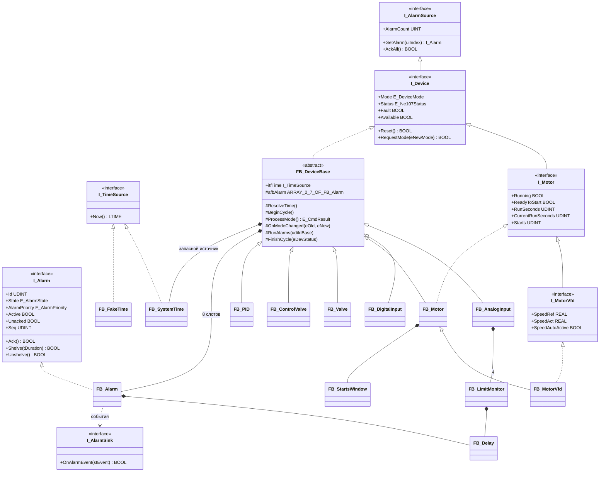
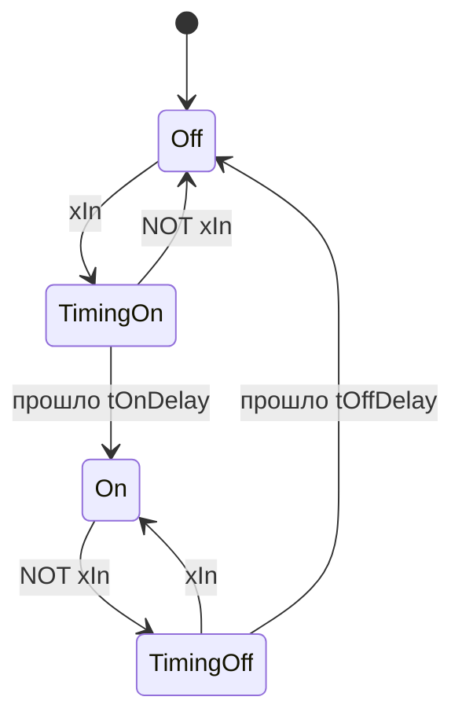
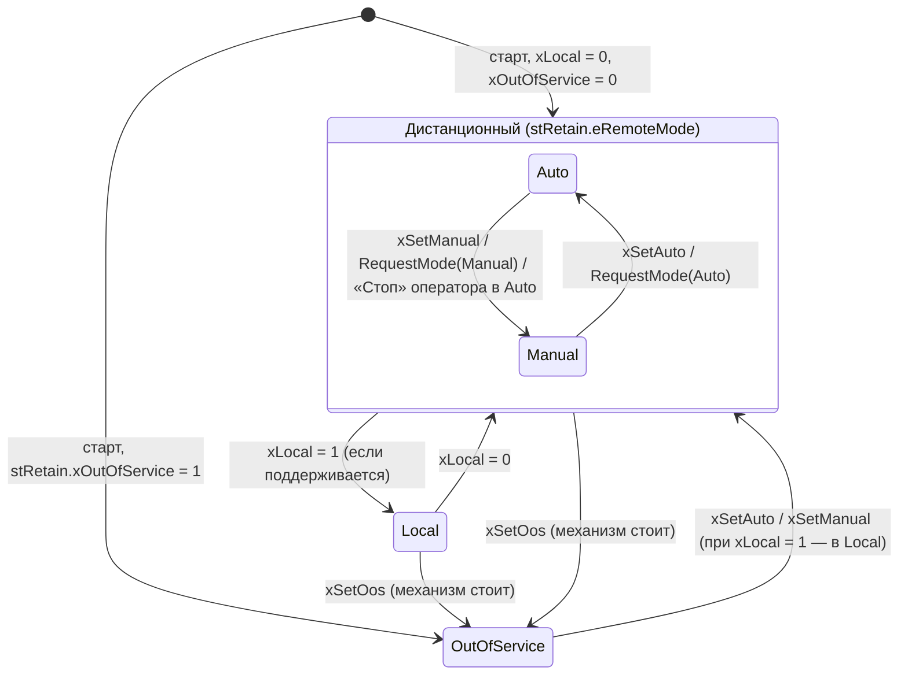
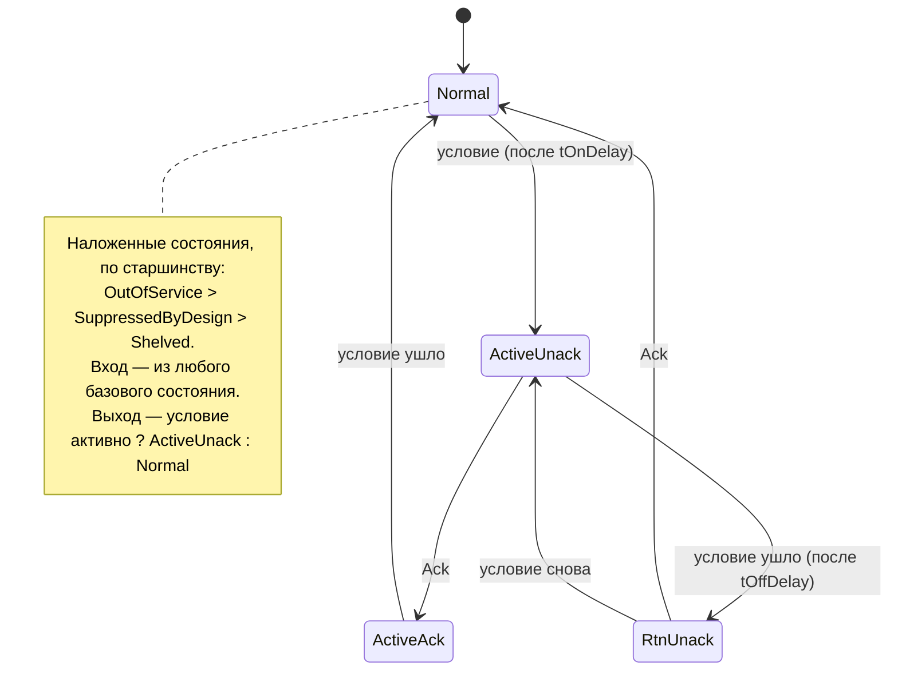
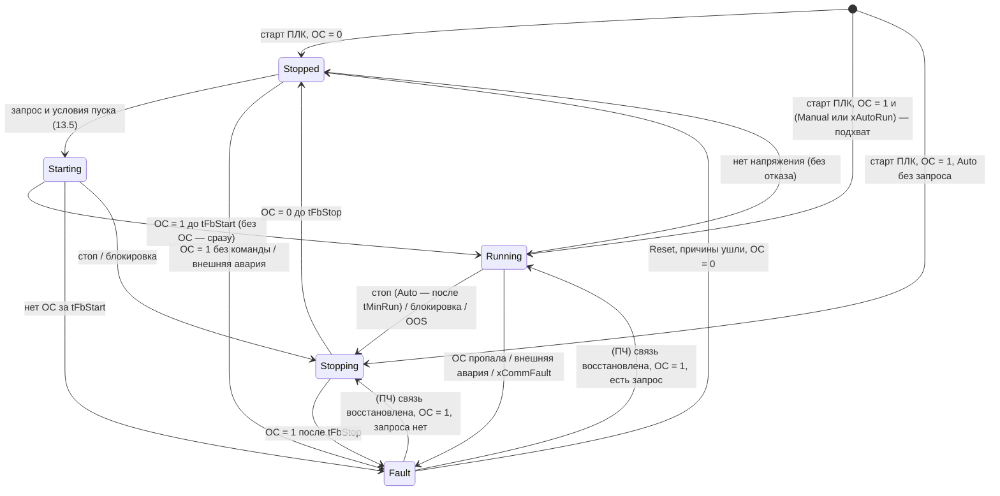
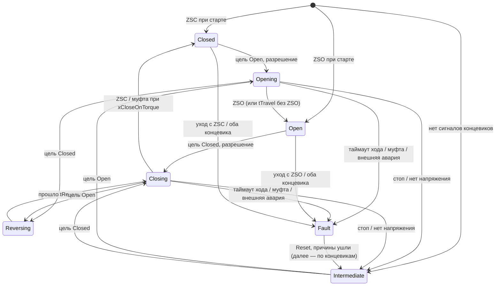

# plc-process-lib — контракт API v1.0

| | |
|---|---|
| Статус | **Контракт.** Команды, которые пишут код параллельно, опираются только на этот документ. Изменения вносятся через PR в этот файл с записью в «Журнал изменений» (раздел 26) |
| Версия | 1.0.0, 2026-10-16 — реализация всех семейств и интеграция; отличия от 1.0.0-rc2 — [раздел 0, «Отклонения от rc2»](#отклонения-от-rc2); исправления по ревью перед выпуском — [«Изменения по ревью перед выпуском»](#изменения-по-ревью-перед-выпуском). rc2 — проверка реализуемости в 3.5.17 и потребностей проектов 02/07 ([Проверено компиляцией и на рантайме](#проверено-компиляцией-и-на-рантайме)) |
| Платформа | CODESYS V3.5 SP17 Patch 3 (3.5.17.30). Таргет — ОВЕН ПЛК210, без железа — CODESYS Control Win V3 |
| Пространство имён | `PL` (Project Information → Default namespace) |
| Тесты | coUnit 1.2.0.0 (бывший CfUnit), namespace `coUnit` |
| Основание | спецификация библиотеки ([README](../README.md)), правила репозитория [CONTRIBUTING.md](../CONTRIBUTING.md), раскладка [LAYOUT.md](LAYOUT.md); потребители — проекты портфолио 02 (КНС), 07 (генератор iolistgen), 10 (демонстрация ПАЗ) |
| Почему так | [DECISIONS.md](DECISIONS.md): рассмотренные варианты API, оценки, факты компиляционных зондов |
| Реализация | Решения, которые контракт не задаёт, — [ASSUMPTIONS.md](ASSUMPTIONS.md) (основа F-xx, семейства AI-, DI-, M-, VFD-, VLV-, CV-, P-); изменения нормативного поведения относительно rc2 — [раздел 0](#отклонения-от-rc2) |

Обозначения:
- **ДОЛЖЕН** / **НЕ ДОЛЖЕН** — нормативное требование. Реализация, которая его нарушает, не принимается.
- «Зонд Pn» — конструкция скомпилирована в CODESYS 3.5.17.30 (Control Win V3, 32 бит) 2026-10-16, 0 ошибок. Подробности — DECISIONS.md, раздел 6.
  **Уточнение:** выводы P5 (в части `SUPER^();`), P14 и P15 опровергнуты зондами Q1, Q2, Q5; остальные пункты P4–P13 подтверждены повтором в чистом проекте (0 ошибок).
- «Зонд Qn» — уточняющий зонд: отдельный чистый проект на каждый вопрос, CODESYS 3.5.17.30, только компиляция. Результаты — [Проверено компиляцией и на рантайме](#проверено-компиляцией-и-на-рантайме).
- «Проверить в CODESYS» — поведение во время выполнения на момент редакции контракта не было подтверждено (раздел 24). Ответы, полученные тестами на CODESYS Control Win V3, — [Проверено компиляцией и на рантайме](#проверено-компиляцией-и-на-рантайме).
- «Сверить с источником» — требование стандарта, которое нужно сверить с первоисточником.

---

## 0. Сводка решений

1. **Шаблон вызова.** `stCmd : ST_<Dev>Cmd` — `VAR_IN_OUT`, `stCfg : ST_<Dev>Cfg` — `VAR_IN_OUT CONSTANT`, `stRetain : ST_DeviceRetain` — `VAR_IN_OUT`, `stSts : ST_<Dev>Sts` — `VAR_OUTPUT`.
   Cmd живёт в `GVL_Hmi` приложения, Cfg и Retain — в объекте Persistent Variables приложения, **по переменной на устройство** (`st<TAG>Cfg`, `st<TAG>Retain`). В библиотеке нет ни одной RETAIN/PERSISTENT-переменной.
2. **Общий заголовок.** Первое поле каждой Cmd — `stCommon : ST_DeviceCmd`, каждой Sts — `stCommon : ST_DeviceSts` (14 полей по 16 бит). Старший байт `wStatus` общий для всех устройств; там же `wFault`, `wWarning`, `wCfgErr`, `eCmdResult`, `uiCmdSeq`, маски тревог и тип устройства `eDevType`.
   Sts состоят только из 16- и 32-битных полей без скрытого выравнивания: карта регистров Modbus = порядок полей (4.6).
3. **Время.** `I_TimeSource.Now() : LTIME`. `FB_SystemTime` возвращает оператор `LTIME()` (нс от старта, зонды P1, P2). Вход `itfTime` равен 0 → работает встроенный в экземпляр `FB_SystemTime`, глобальных переменных времени нет.
   Единственный таймер библиотеки — `FB_Delay`. `TON`/`TOF`/`TP` в коде библиотеки **запрещены**.
4. **Режимы.** `E_DeviceMode`: Auto=1, Manual=2, Local=3, OutOfService=4; 0 считается Manual.
   - Приоритет: OOS > Local > Auto/Manual.
   - Дистанционный режим и OOS энергонезависимы.
   - «Стоп» в Auto переводит устройство в Manual; «Пуск» двигателя в Auto отклоняется.
5. **NE 107.** Значения упорядочены по тяжести: Good=0, M=1, S=2, C=3, F=4. Сводный статус — `MAX`.
6. **Конфигурация.** `CheckConfig` выполняется в каждом вызове.
   - Корректной Cfg ещё не было → CheckFunction и безопасный выход.
   - Cfg испорчена в работе → CheckFunction и биты `wCfgErr`, логика работает по последней корректной копии (LKG).
7. **Отказы.** Механические — фиксируются до Reset. Отказы сигнала и связи — не фиксируются.
   Безопасное состояние — по таблице раздела 2.6.
8. **Иерархия.** `FB_DeviceBase` (ABSTRACT, `IMPLEMENTS I_Device`) → `FB_AnalogInput`, `FB_DigitalInput`, `FB_Motor` (→ `FB_MotorVfd`), `FB_Valve`, `FB_ControlValve`, `FB_PID`.
   `I_Device EXTENDS I_AlarmSource`, `I_Motor EXTENDS I_Device`, `I_MotorVfd EXTENDS I_Motor`.
   Тело базы при вызове наследника не выполняется само: `FB_MotorVfd` вызывает тело `FB_Motor` явно — `SUPER^(stCmd := stCmd, stRetain := stRetain, stCfg := stCfg)`. Без параметров `SUPER^();` даёт ошибку C0039 (зонд Q1).
9. **Тревоги.** `FB_Alarm` по ISA-18.2: 7 состояний. В базе 8 слотов, индекс — перечисление типа, `udiId = stCfg.udiAlarmIdBase + слот`.
   События уходят в `PL.GVL_Lib.itfAlarmSink`. Тексты тревог в ПЛК не хранятся.
10. **Тесты.** coUnit, тест проходит за один вызов. Время — только через `FB_FakeTime`. В списке 222 теста, обязательных для v1.0 — 117.

### Отклонения от rc2

Редакция 1.0.0 закрепляет решения, принятые при реализации семейств и интеграции (16.10.2026). Каждое
проверено тестами coUnit на CODESYS Control Win V3; подробности и обоснования — [ASSUMPTIONS.md](ASSUMPTIONS.md)
по номеру записи. Текст разделов ниже уже приведён к 1.0.0 (пометка «1.0.0» с номером записи).

**Имена и раскладка, закреплённые в контракте**

| № | Было в rc2 | В 1.0.0 | Почему |
|---|---|---|---|
| F-17 | свойство `I_Alarm.Priority`, `FB_Alarm.Priority` (разделы 3, 6, 10.1, 22.3, 22.4) | `AlarmPriority` | `PRIORITY` — ключевое слово МЭК 61131-3 (объявление задачи `TASK … (PRIORITY := …)`): член публичного интерфейса с таким именем непереносим между средами МЭК и инструментами |
| F-01 | `PRG_Tests` содержит экземпляры всех наборов (22.5) | наборы регистрируются экземплярами в GVL семейства с `{attribute 'linkalways'}`, `PRG_Tests` только вызывает `coUnit.RUN()` | параллельная разработка семейств; без `linkalways` набор молча пропадает |
| F-04, F-26 | тесты размеров — в `FB_DeviceBase_Test`; базу проверяют `FB_DigitalInput` и `FB_Motor` (23.2) | размеры — `FB_Common_Test`; база — тестовое устройство `FB_TestDevice`; тесты всех семи типов — `FB_Integration_Test` | основа писалась раньше устройств |
| F-28 | перечень 2.1 ставит `xAck` раньше режима | `eCmdResult` — последней команды в порядке тела 9.4: Reset → режим → команды устройства → `xAck`/`AckAll()` и маски | порядок 9.4 нормативен, HMI шлёт одну команду за раз |

**Поведение, уточнённое или изменённое семействами**

| № | Раздел | rc2 | 1.0.0 |
|---|---|---|---|
| AI-2 | 11.3, п. 6 | отказ не подтверждён — «последнее хорошее, `xValid = TRUE`» | без свежего хорошего значения (старт ПЛК с оборванной линией, первый вызов после OutOfService, до первой корректной Cfg) на время подтверждения — значение как при подтверждённом отказе, `xValid = FALSE`, уставки сняты, бита `AI_STS_FAIL_PENDING` нет; NE 107 Failure — по-прежнему через `tFailDelay` |
| AI-12 | 11.3, п. 5 | «когда отказ ушёл, `lrFlt := rEng`» | `lrFlt := rEng` — после **подтверждённого** отказа, выхода из OutOfService и первой корректной Cfg; короткий неподтверждённый провал фильтр замораживает, после него фильтр продолжает с прежнего состояния |
| AI-3, AI-10 | 11.3, п. 8; 11.5 | слежение `rSubstValue_eu` — в Auto; контроль сигнала без оговорок | слежение — во всех режимах, кроме Manual; без корректной Cfg и в OutOfService сигнал не контролируется (обрыв в OutOfService — CheckFunction, не Failure) |
| DI-1, DI-2 | 12.3 | задержки — от первого вызова; «отказ канала — значение по `eFailValue`» | в первом вызове с корректной Cfg задержки предустанавливаются на текущий сигнал после инверсии; при отказе канала задержки стоят на значении отказа, после возврата канала оно снимается **через** `tOnDelay`/`tOffDelay`, без скачка |
| M-09 | 13.5 | «защёлка не ставится» | `xStart` во время Stopping ставит отложенный пуск после останова; если к останову условие пуска не выполнено, пуск отменяется вторым результатом `RejectedPermit`/`RejectedInhibit`; `xStart` в Starting/Running — `Accepted` |
| M-10 | 13.7 | нет напряжения: Running/Starting → Stopped | Starting, Running, Stopping → Stopped, если ОС = 0; пока ОС есть (выбег, ПЧ пережил провал) — Stopping с контролем `tFbStop` |
| M-18, VFD-01 | 13.7, 14.2 | подхват — в первом вызове; точки расширения в первом вызове — по умолчаниям | подхват — по первой **достоверной** ОС (ПЧ по Modbus ещё не опрошен); в первом вызове параметры ПЧ — из `stCfg`, если она корректна |
| M-20 | 13.6 | FailToStop — только в Stopping | и в Fault (Auto, Manual), если двигатель отключён отказом ExtFault, FailToStart или FeedbackLost, а ОС держится дольше `tFbStop` (сварившийся контактор) |
| M-21 | 13.8 | пуски и текущая работа — по фронту `xRunning` | провал ОС в Running короче `tFbLossFilter` пуском не считается и `CurrentRunSeconds` не обнуляет |
| M-22, M-23 | 13.8 | `ReadyToStart` — `NOT xRunning`; `xOosAllowed` — по `eState` | `ReadyToStart` — нет ни команды, ни работы по ОС; вывод из работы — только при остановленном по ОС двигателе |
| VFD-02 | 14.3 | нет команды работы — задание 0 | в Local и OutOfService задание следит за `rSpeedAct_pct` (возврат в Manual без провала задания) |
| VLV-05 | 15.4 | «смена направления в движении: оба выхода сняты на `tReverse`» | и после остановки (концевик, стоп, отказ, нет напряжения) встречное направление включается не раньше `tReverse` после снятия выхода; то же направление — сразу |
| VLV-09, VLV-19 | 15.4 | `xQClose` — до ZSC, при `xCloseOnTorque` — до муфты; таймаут — «больше `tTravel`» | при `xCloseOnTorque` закрытие завершает **только** муфта (ZSC выход не снимает и лишь подтверждает положение); муфта раньше подключённого ZSC — TorqueTrip; таймаут — ровно на `tTravel`, как `FB_Delay` |
| VLV-15 | 15.4 | — | положение «по времени» сбрасывается в Local и OutOfService (и у соленоида без тока катушки): дальше — по концевикам или Unknown |
| CV-1, CV-11 | 16.3 | без корректной Cfg — по умолчаниям типа (9.4); Local — `= rPosFb_pct` | без корректной Cfg положение безопасности и инверсия — из **поданной** `stCfg` (`LIMIT(0, rSafePos_pct, 100)`, NaN → 0); Local — `LIMIT(0, rPosFb_pct, 100)` |
| P-02 | 17.4 | `dt <= 0` — шаг инициализации | `dt = 0` (два вызова с одним временем) — расчёта нет, выход держится; «время назад» — шаг инициализации |
| P-15 | 17.5 | слот 0 PvInvalid: `NOT xPvValid AND eMode = Auto` | после `ShedToManual` тревога держится и в Manual, пока PV негодна; признак снимают годная PV и OutOfService (иначе тревоги при `ShedToManual` не было бы никогда) |
| P-16 | 17.5 | цель не конечна → прежняя цель | удерживаемая цель тоже ограничивается `rSpMin_eu…rSpMax_eu` |

### Изменения по ревью перед выпуском

Три независимых ревью выпуска (стандарты NE 43, NE 107, ISA-18.2 и практика арматуры; ПО и мутации тестов;
потребители — проекты 02 и 07), 19.10.2026. Каждое изменение сначала воспроизведено тестом, который падал до
исправления; подробности и обоснования — [ASSUMPTIONS.md](ASSUMPTIONS.md) по номеру, все находки —
[TEST_REPORT.md](TEST_REPORT.md#ревью-перед-выпуском-находки-и-мутации).

| № | Раздел | Было | Стало |
|---|---|---|---|
| AI-13 | 11.3 | ток 3,6…3,8 и 20,5…21 мА — значение экстраполируется, `xValid = TRUE` | значение — насыщение NE 43 (3,8 / 20,5 мА), без экстраполяции; подтверждённый выход за диапазон (`xOor`) — `xValid = FALSE`; уставки считаются |
| F-30 | 2.2, 2.5 | Local — вклад в NE 107 «—» (Good) | Local — `CheckFunction` (местное управление, категория C) |
| F-31 | 4.1, 10.2 | приоритет None — Normal без события | тревога не в Normal закрывается событием `Disabled` (новое значение `E_AlarmEventReason`) |
| F-32 | 4.2, 10.5 | `wAlmShelved` — Shelved, SuppressedByDesign и OutOfService; `wReserve` | `wAlmShelved` — только Shelved; `wAlmSuppressed` (бывший `wReserve`, раскладка та же) — только SuppressedByDesign; OutOfService — по `eMode` |
| F-33 | 10.3, 14, 16, 17 | значение процесса в событии и Sts могло быть NaN | `ST_AlarmEvent.rValue` и поля Sts ПИД, клапана, ПЧ конечны (NaN, ±Inf → 0.0); сырое — только `stSts.rIn` AI |
| VFD-09, VFD-10 | 14.3 | подхват — задание от 0; пуск в провал связи — предустановка терялась | подхват — задание от фактической скорости (в Manual — и задание оператора); предустановки ждут связи |
| VFD-11 | 13.2, 13.7, 13.8 | недостоверная ОС удерживает `xRunning` бессрочно | без питания или после отказа связи — «не работает»: счётчики, `Running` и бит RUNNING стоят |
| VFD-12 | 14.4, 21.1 | без питания станции — отказ связи каждого ПЧ | без питания и `VFD_POWER_UP_DELAY` после его возврата связь не контролируется |
| VFD-13, CV-14 | 14.3, 16.3 | рампы ПЧ и клапана — состояние в REAL | состояние рампы в LREAL (`F_RateLimitLr`, 8.1) |
| CV-13 | 16.3 | плотное закрытие без гистерезиса | снимается на `rTightShut_pct + CV_TIGHT_HYST_PCT` |
| VLV-20 | 2.4, 2.6, 15.4 | при любом отказе блокировка задвижку не двигала | при одних отказах контроля — аварийный ход в положение безопасности |
| VLV-21 | 15.4 | муфта открытия при страгивании с седла — TorqueTrip | при страгивании (ZSC замкнут, `tLimitFilter` после размыкания, не дольше `VLV_UNSEAT_BYPASS`) не контролируется |
| I-11, I-13 | 18.3, 19 | `docs/alarm_templates.csv` не было; ПИД в `GVL_Persist` без типа генератора | шаблоны есть; Pid — тип устройства iolistgen, данные приложения — `persist_extra` ([CONSUMERS.md](CONSUMERS.md)) |

Новые константы `GVL_Const` (5.1): `VLV_UNSEAT_BYPASS`, `CV_TIGHT_HYST_PCT`, `VFD_POWER_UP_DELAY` — параметры вне
Cfg, потому что типы Cfg заморожены в 1.x (A-13). Новая функция `F_RateLimitLr` (8.1), защищённый метод
`FB_Valve.SafeMoveOnFault` (22.4). Энергонезависимые типы не менялись.

**Реализация сверх контракта (не API).** Защищённые методы-шаги, которых нет в 22.4, — деталь
реализации: их имена зарезервированы так же, как переменные базы (повтор имени в наследнике — C0097),
вызывать их потребителю не нужно ([22.4](#224-srcpous)).

---

## 1. Шаблон вызова и потоки данных

```st
// Логика станции (ручной код, проект 02) — ДО вызова PRG_Devices: входы-запросы автоматики
GVL_Devices.fbP101.xAutoRun   := GVL_Station.axPumpRun[1];         // запрос «работать» (уровень)
GVL_Devices.fbP101.wInterlock := GVL_Station.awPumpInterlock[1];   // защитные блокировки

// PRG_Devices (генерирует iolistgen, проект 07): сигналы перечня и все VAR_IN_OUT
GVL_Devices.fbP101(
    xFbRun     := GVL_IO.xP101_Run,
    xExtFault  := GVL_IO.xP101_Fault,
    xLocal     := GVL_IO.xP101_Local,
    xPowerOk   := GVL_Devices.fbPWR1.xValue,                 // колонка link_power: DI «напряжение на вводе» (20.1)
    stCmd      := GVL_Hmi.stP101Cmd,                        // VAR_IN_OUT
    stCfg      := GVL_Persist.stP101Cfg,                    // VAR_IN_OUT CONSTANT
    stRetain   := GVL_Persist.stP101Retain);                // VAR_IN_OUT
GVL_IO.xP101_QRun := GVL_Devices.fbP101.xQRun;
```
Входы, которые не передаются в вызове, сохраняют последнее присвоенное значение, поэтому разделение «станция присваивает — генератор вызывает» корректно (R5).

| Часть | Секция | Где живёт | Кто пишет | Кто читает |
|---|---|---|---|---|
| `stCmd : ST_<Dev>Cmd` | `VAR_IN_OUT` | `GVL_Hmi` приложения | HMI/SCADA пишет; ФБ сбрасывает импульсные биты и пишет слежение | ФБ |
| `stCfg : ST_<Dev>Cfg` | `VAR_IN_OUT CONSTANT` | Persistent Variables приложения (`GVL_Persist.st<TAG>Cfg`) | генератор (начальные значения), наладчик с HMI | ФБ (только чтение) |
| `stRetain : ST_DeviceRetain` | `VAR_IN_OUT` | `GVL_Persist.st<TAG>Retain` (по переменной на устройство, 18.1) | только ФБ | ФБ, SCADA (чтение) |
| `stSts : ST_<Dev>Sts` | `VAR_OUTPUT` | экземпляр ФБ | только ФБ | HMI/SCADA (символьная конфигурация `fbP101.stSts`), генератор карт Modbus |
| входы и выходы процесса | `VAR_INPUT`/`VAR_OUTPUT` | экземпляр | слой ввода-вывода, логика станции | — |

Правила вызова:
- **R1.** В каждом вызове ФБ **ДОЛЖНЫ** передаваться все его `VAR_IN_OUT`. Компилятор 3.5.17 это требует: вызов без них — ошибка C0039, даже если раньше в том же POU был вызов с ними (зонд Q2; вывод P14 в DECISIONS.md ошибочен). То же для `SUPER^(...)` в теле наследника (зонд Q1).
  Литерал (в том числе литерал структуры) в `VAR_IN_OUT CONSTANT` передать нельзя — ошибка C0032 (зонд Q11). Переменная из `VAR_GLOBAL CONSTANT` — можно.
- **R2.** Методы и свойства ФБ **НЕ ДОЛЖНЫ** читать и писать `VAR_IN_OUT` экземпляра (`stCmd`, `stCfg`, `stRetain`): ссылка действительна только во время вызова тела.
  Компилятор выдаёт на это предупреждение C0371 «Обращение к VAR_IN_OUT … из внешнего контекста» (зонд Q5; вывод P15 «без предупреждения» ошибочен). Сборка библиотеки в CI **ДОЛЖНА** считать C0371 ошибкой.
  Методы работают с внутренней копией `stCfgLkg` и с запросами, которые выполняет тело. Тело наследника обращается к унаследованным `VAR_IN_OUT` без предупреждения (зонд Q15).
  Исключение: защищённые методы базы, которые получают структуру собственным параметром `VAR_IN_OUT`.
  Снаружи `VAR_IN_OUT` экземпляра недоступен вовсе (`fbP101.stCmd.xStart` — ошибка C0178, зонд Q6): HMI и SCADA привязываются к `GVL_Hmi.st<TAG>Cmd`.
- **R3.** Один экземпляр вызывается из одной задачи и один раз за цикл этой задачи. Методы `Reset()`, `AckAll()`, `RequestMode()`, `FB_Alarm.Ack()/Shelve()/Unshelve()` только ставят запрос, выполняет его ближайший вызов тела. Вызывать их можно только из той же задачи.
- **R4.** `FB_init` с параметрами не используется. Экземпляр создаётся объявлением, допустимы массивы экземпляров (в том числе с `VAR_IN_OUT`, зонд Q12). Локальные переменные метода, включая экземпляры ФБ в методах тестов, инициализируются заново при каждом вызове метода (справка «Object: Method»).
- **R5.** Логика станции пишет входы экземпляра (`xAutoRun`, `wInterlock`, `rSpeedSpAuto_pct` и т. п.) присваиванием до вызова или через параметры вызова. Допустима запись отдельного бита входа извне: `fbP101.wPermit.0 := …` (зонд Q12). Выходы читаются после вызова.
- **R6.** Приложение **НЕ ДОЛЖНО** обращаться к переменным секции `VAR` устройств (`eState`, `stCfgLkg`, точки расширения и т. п.). Компилятор чтение извне разрешает без предупреждения (зонд Q4), но эти переменные не входят в публичный API: публичны `VAR_INPUT`, `VAR_OUTPUT`, методы и свойства.

---

## 2. Общие правила поведения

### 2.1 Команды HMI/SCADA (`stCmd`)

- **Импульсные биты** (`xSetAuto`, `xSetManual`, `xSetOos`, `xReset`, `xAck`, `xStart`, `xStop`, `xOpen`, `xClose`, `xResetMaint`). HMI пишет `TRUE`, ближайший вызов ФБ обрабатывает бит и **ДОЛЖЕН** сбросить его в `FALSE` в том же вызове.
- **Маски** (`wAckReq`, `wShelveReq`, `wUnshelveReq`): бит i относится к слоту тревоги i. ФБ обнуляет слово после обработки.
- **Значения** (`rSpeedSp_pct`, `rSubstValue_eu`, `xSubstValue`, `rPosSpMan_pct`, `rSp_eu`, `rManualOut_pct`) ФБ не сбрасывает. Пока значением управляет не оператор (Auto, Local, OOS, слежение), ФБ **ДОЛЖЕН** каждый вызов писать в это поле текущее значение. Тогда переход в Manual проходит без рывка.
- **Результат.** Каждая обработанная команда (бит, маска или запрос метода) записывает `stSts.stCommon.eCmdResult` и увеличивает `stSts.stCommon.uiCmdSeq` на 1 (UINT, по кругу). Если команд в вызове несколько, `uiCmdSeq` растёт на их число, а `eCmdResult` — результат последней.
- **Порядок обработки в вызове:** `xReset` и `Reset()` → `xAck`/`AckAll()` → режим (биты `stCmd` и `RequestMode()` вместе, по старшинству OutOfService > Manual > Auto) → команды устройства (`xStop` > `xStart`; `xClose` > `xOpen` > `xStop` для арматуры) → маски тревог.
- WebVisu и SCADA равноправны. «Место управления» (пульт или диспетчерская) в v1.0 не реализуется.
- **Команды по Modbus (ПЛК — slave).** Holding-регистры, которые пишет мастер, ПЛК в образе обмена сбросить не может: бит, переписанный в `stCmd` каждый цикл, выполнялся бы каждый цикл. Поэтому Cmd по Modbus идут только через адаптер приложения (проекты 02/07): слово команд устройства → импульс в `stCmd` **по фронту** бита, один раз. Раскладка `ST_<Dev>Cmd` в регистры напрямую не отображается (в Cmd есть `BOOL`). WebVisu и OPC UA пишут `GVL_Hmi.st<TAG>Cmd` напрямую.

### 2.2 Режимы `E_DeviceMode`

| Режим | Как включается | ПЛК управляет выходами | Контроль ОС и отказов | Тревоги | Вклад в NE 107 |
|---|---|---|---|---|---|
| `Auto` | `xSetAuto` / `RequestMode(Auto)` | да, по запросам автоматики | да | да | — |
| `Manual` | `xSetManual`, «Стоп» в Auto, `RequestMode(Manual)` | да, по командам оператора | да | да | AI/DI: подмена → `CheckFunction` |
| `Local` | аппаратный переключатель `xLocal = TRUE` | нет: выходы сняты, ПЛК следит за ОС | только внешняя авария | да | `CheckFunction` (местное управление, F-30) |
| `OutOfService` | `xSetOos` / `RequestMode(OutOfService)` | нет (выход в безопасном состоянии; CV и PID — удержание) | нет | все слоты в состоянии `OutOfService` | `CheckFunction` |

- Приоритет: `OutOfService` > `Local` > дистанционный (`Auto`/`Manual`).
- Дистанционный режим хранится в `stRetain.eRemoteMode`, признак OOS — в `stRetain.xOutOfService`. Оба энергонезависимы, если приложение разместило `stRetain` в Persistent Variables.
- В `Local` команды `xSetAuto`/`xSetManual` принимаются (`Accepted`) и меняют только запомненный режим. Когда переключатель вернётся в «Дистанционное», устройство продолжит в этом режиме.
- `xSetOos` принимается, только если механизм стоит: двигатель не в `Starting`/`Running`/`Stopping`, арматура не движется. Иначе результат `RejectedState`. Выход из OOS — `xSetAuto` или `xSetManual`; при `xLocal = TRUE` устройство уходит в `Local`.
- Вход в OOS снимает зафиксированные отказы (устройство уходит в ремонт). Тревоги в OOS — `OutOfService`, после выхода они переоцениваются.
- `stRetain.eRemoteMode` вне {Auto, Manual} (0 после очистки, мусор) ФБ **ДОЛЖЕН** заменить на `Manual` и записать обратно. Строгое перечисление защищает только исходный текст (2.8): значение в памяти persistent, записанное до смены раскладки или через рецепт, может быть любым числом, поэтому санитизация выполняется во время работы. Проверка — сравнениями (`<> E_DeviceMode.Auto AND <> E_DeviceMode.Manual`), без арифметики.
- У `FB_AnalogInput` и `FB_DigitalInput` режима `Local` нет. `Auto` у них — «Измерение», `Manual` — «Подмена». Режим AI/DI энергонезависимым не является: после старта ПЛК — `Auto`, подмена снимается.
- У `FB_PID` режима `Local` нет. Слежение (`xTrack`) — это вход и бит состояния, а не режим.

### 2.3 Конфигурация (LKG)

| Ситуация | `wCfgErr` | NE 107 | Логика | `Available` | Команды |
|---|---|---|---|---|---|
| Cfg корректна | 0 | по устройству | по `stCfg` (копия в `stCfgLkg`) | по устройству | обычно |
| Корректной Cfg ещё не было (старт) | ≠ 0 | `CheckFunction` | **безопасный выход** (2.6) | FALSE | режимы и квитирование работают; пуск/открытие → `RejectedCfg` |
| Cfg испорчена в работе | ≠ 0 | `CheckFunction` | по `stCfgLkg` (последняя корректная) | не меняется | обычно |

- В каждом вызове: `wErr := CheckConfig(stCfgIn := stCfg)`. Если `wErr = 0`, то `stCfgLkg := stCfg` и `xCfgEverOk := TRUE`.
- Логика устройства, хуки и методы читают **только** `stCfgLkg`.
- Бит `DEV_STS_CFG_ERROR` в `wStatus` = `wCfgErr <> 0 OR NOT xCfgEverOk`.
- Значения Cfg по умолчанию **ДОЛЖНЫ** проходить `CheckConfig` (инвариант генератора, тест `Device_DefaultCfg_PassesCheck`).
- Неверная Cfg в работе не останавливает механизм. Это сознательное отклонение от буквы спецификации, его нужно записать в `ASSUMPTIONS.md` библиотеки (A-01). Обоснование — DECISIONS.md, D-07.

### 2.4 Отказы

| Класс | Примеры | Фиксация | Снятие | Действие ФБ |
|---|---|---|---|---|
| Отказ механизма | нет ОС пуска, пропала ОС в работе, не остановился, самопроизвольный пуск, внешняя авария, не дошла арматура, муфта в ходе, уход с концевика | да | Reset при снятой причине (окно `tResetWindow`) | безопасное состояние, пуск запрещён, `Failure` |
| Отказ сигнала или связи | обрыв 4–20 мА, отказ канала, NaN, потеря связи с ПЧ, «оба концевика», отказ позиционера | нет | сам, когда причина ушла | удержание значения или безопасное состояние, `Failure`; тревога остаётся `RtnUnack` до квитирования |
| Защитная блокировка | бит `wInterlock` под маской | нет | — | останов / положение безопасности в Auto и Manual; первопричина в `uiFirstOut`. Задвижка с приводом идёт в положение безопасности и при отказе средств контроля (концевики, таймаут хода), но не при неисправном приводе (VLV-20) |
| Нет разрешения | бит `wPermit…` под маской | нет | — | пуск или движение запрещены, работающий механизм не останавливается |
| Нет напряжения | `xPowerOk = FALSE` | нет | — | останов без отказа, ручной запрос снимается, после восстановления — пауза `tMinStop` (двигатель) |
| Неверная Cfg | `wCfgErr <> 0` | нет | исправить Cfg | раздел 2.3 |

Фиксация блокировок, если она нужна по технологии, — задача логики станции или ПАЗ (проект 10), а не ФБ устройства.

### 2.5 Сводный статус NE 107 и `Fault`

`eNe107 := MAX(eDevStatus, eModeStatus, eCfgStatus)` (порядок значений — раздел 4.1):
- `eDevStatus` — от логики устройства (F, S, M);
- `eModeStatus` — `CheckFunction` в `OutOfService` и `Local` (механизмом управляют с места, выход ПЛК не действует: категория C NE 107, статус PA «function check / local override», F-30), а у AI/DI ещё и в `Manual` (подмена); иначе `Good`;
- `eCfgStatus` — `CheckFunction`, если `wCfgErr <> 0` или `NOT xCfgEverOk`.

`I_Device.Fault` = (`eNe107 = Failure`). Выведенное из работы устройство с отказом показывает `Failure`: режим виден отдельно в `eMode`.
Порядок F > C > S > M принят по практике агрегации — **сверить с текстом NAMUR NE 107**.

### 2.6 Безопасное состояние

| ФБ | Нет корректной Cfg | Отказ | OutOfService | Local |
|---|---|---|---|---|
| `FB_AnalogInput` | `rValue_eu := 0.0`, `xValid := FALSE`, флаги уставок FALSE | подтверждён: `HoldLast` или `rFailValue_eu`, `xValid := FALSE` | удержание, `xValid := FALSE` | — |
| `FB_DigitalInput` | `xValue := FALSE`, `xValid := FALSE` | канал: по `eFailValue`, `xValid := FALSE` | удержание, `xValid := FALSE` | — |
| `FB_Motor`, `FB_MotorVfd` | `xQRun := FALSE`, `rSpeedRef_pct := 0` | выходы сняты | выходы сняты | выходы сняты |
| `FB_Valve` | выходы сняты: привод стоит, катушка обесточена (положение пружины) | то же; при блокировке и одних отказах контроля задвижка с приводом идёт в `eSafePos` (VLV-20) | то же | то же |
| `FB_ControlValve` | `rOut_pct := LIMIT(0, rSafePos_pct, 100)` (NaN → 0) | `eFaultAction`: `SafePos` → `rSafePos_pct` без рампы; `Hold` → удержание | удержание | следит за ОС |
| `FB_PID` | расчёта нет, `rOut_pct := LIMIT(0, stCmd.rManualOut_pct, 100)` | PV негодна: `ePvFailAction` | удержание | — |

### 2.7 Единицы, типы, именование

- Задержки и интервалы — `TIME`. Монотонные отметки — `LTIME`. Постоянные ПИД — `REAL` в секундах (`rTi_s`).
- Суффиксы: `_eu` — инженерные единицы датчика, `_pct` — %, `_pctps` — %/с, `_ups` — инж. ед./с, `_mA`, `_s`, `_h`, `_ms`.
- Все перечисления — с явным базовым типом `INT` (состояния, режимы) или `UINT` (индексы слотов) и явными значениями. В регистр Modbus они ложатся без преобразования.
- Все DUT — с `{attribute 'qualified_only'}`. Перечисления состояний и режимов — дополнительно с `{attribute 'strict'}`. Перечисления-индексы слотов (`E_<Dev>Alarm`) — **без** `strict`: ими индексируются массивы (зонд P8).
- Префиксы переменных — по `CONTRIBUTING.md` и `st_lint.toml`. Внутренние переменные **НЕ ДОЛЖНЫ** начинаться с `_` (правило STL007 проверяет префикс типа).
- Имена без префикса типа, совпадающие с операторами IL, запрещены: `r` (зонд P19), `st`, `s`, `ld` (зонд Q13) — ошибка разбора. `n` компилируется (Q13), но правило префиксов запрещает и его.
- Числа в логике — только 0, 1, 2 (STL008). Всё остальное — константы `GVL_Const`, в том числе маски битов, «все биты» `WORD_ALL` и предел `UINT_MAX` (раздел 5).

### 2.8 Ограничения CODESYS 3.5.17, которые задают форму API

Проверено справкой CODESYS (ссылки — раздел «Проверено компиляцией и на рантайме») и зондами Q в чистых проектах.

| № | Факт | Следствие для API |
|---|---|---|
| L1 | Тело базового ФБ при вызове экземпляра наследника не выполняется само; `SUPER^();` без `VAR_IN_OUT` базы — ошибка C0039 (Q1), `SUPER^(stCmd := stCmd, …)` — компилируется (Q3) | `FB_MotorVfd` вызывает тело `FB_Motor` с явной передачей всех `VAR_IN_OUT` (14.2). Тело `FB_DeviceBase` пустое, наследники его не вызывают |
| L2 | Наследник не может объявить переменную с именем переменной базы — ошибка C0097 (Q9; справка «Extension of a Function Block») | Все переменные `FB_DeviceBase` (9.1) и нормативные переменные `FB_Motor` (13.2) — зарезервированные имена. Внутренние переменные `FB_MotorVfd` содержат в имени `Vfd`, у `FB_Motor` и `FB_DeviceBase` такого фрагмента в именах нет: так команды не столкнутся именами |
| L3 | Параметр метода с именем переменной ФБ молча её затеняет (Q8; справка «Shadowing Rules»: ошибок и предупреждений нет) | Имена параметров методов **НЕ ДОЛЖНЫ** совпадать с переменными ФБ и его баз. Поэтому `RequestMode(eNewMode)`, а не `RequestMode(eMode)` |
| L4 | Строгое перечисление: присвоить переменную другого типа (`eMode := iVar`) или константу вне перечисления (`eMode := 7`) — ошибка C0358; константа из перечисления (`eMode := 2`, P16), `iVar := eMode`, `TO_INT(eMode)`, `TO_WORD(eMode)` — компилируются (Q7) | Число в перечисление превращают только через `CASE` или сравнения. Запрос `RequestMode` хранится как `xModeReq` + `eModeReq : E_DeviceMode`, а не как `INT` |
| L5 | `PRIVATE` не наследуется; `PROTECTED` — только POU и наследники, вызов извне — ошибка C0287 (Q10); `INTERNAL` — только пространство имён библиотеки | Хуки и шаги цикла — `PROTECTED`. Методы, реализующие интерфейс, — `PUBLIC`. `PRIVATE` — только у методов-тестов coUnit (наборы не наследуются) |
| L6 | Вызов метода через `THIS^` связывается динамически (справка «Calling a Method») | Хук вызывается только как `THIS^.OnModeChanged(...)` (9.3) |
| L7 | `LTIME` — 64 бит без знака (внутри `LWORD`), `LTIME#0NS` … `LTIME#213503D23H34M33S709MS551US615NS`; `TIME` — 32 бит без знака, мс (справка «Data type: TIME, LTIME») | Разность отметок `a − b` при `a < b` даёт переполнение, а не отрицательное число. Разность **ДОЛЖНА** вычисляться только после проверки `a >= b` (`BeginCycle`, `FB_Delay`, `FB_StartsWindow`) |
| L8 | Длина идентификатора не ограничена; два подчёркивания подряд запрещены; регистр не различается (справка «Identifiers») | Генератор: тег → идентификатор по правилам 20.4, проверка дублей **без учёта регистра** |
| L9 | `STRING` в 3.5.17 — Windows-1252; кодировка UTF-8 для `STRING` появилась только в 3.5.18. `WSTRING` — 2 байта на символ (справка «UTF-8 Encoding», «Data Type: WSTRING») | Кириллица в `STRING` не представима. В библиотеке строк нет; русские тексты в ПЛК — только `WSTRING` в приложении (раздел 19). Сообщения coUnit — ASCII |
| L10 | Persistent Variables: любое изменение объявления переменной сложного типа (новый компонент, смена типа в глубине структуры, переименование) переинициализирует её целиком; добавление и удаление переменных списка — нет (справка «Preserving Data with Persistent Variables») | Retain и Cfg — по переменной на устройство; типы Cfg и `ST_DeviceRetain` заморожены в пределах мажорной версии (18.1) |
| L11 | Справка описывает `qualified_only` для перечислений и GVL («Shadowing Rules»). У структур атрибут допустим: зонды компилируют такие DUT без предупреждений; его действие для структур в справке не описано | Оставлен у всех DUT для единообразия шаблона; на него ничего не опирается |
| L12 | В библиотеке нет `POINTER` и `REFERENCE`: ссылки только через `VAR_IN_OUT` и интерфейсы. Интерфейсная ссылка после онлайн-изменения так же уязвима, как указатель | Все интерфейсные ссылки (`itfTime`, `itfTimeAct`, `GVL_Lib.itfAlarmSink`) присваиваются каждый цикл (R7 раздела 24) |

---

## 3. Состав и иерархия



| Объект | Вид | Назначение |
|---|---|---|
| `FB_SystemTime`, `FB_FakeTime` | ФБ, `I_TimeSource` | системное и подменяемое время |
| `FB_Delay` | ФБ | задержки включения и отключения — единственный таймер |
| `FB_LimitMonitor` | ФБ | одна уставка с гистерезисом, задержками и разрешением |
| `FB_StartsWindow` | ФБ | скользящее окно пусков за час |
| `F_LTimeToSec`, `F_TimeToSec`, `F_IsFinite`, `F_Ne107Worst`, `F_RateLimit` | функции | без состояния |
| `FB_Alarm` | ФБ, `I_Alarm` | одна тревога ISA-18.2 |
| `FB_DeviceBase` | ФБ ABSTRACT, `I_Device` | время, режимы, конфигурация, квитирование, 8 тревог, NE 107, общий заголовок Sts |
| `FB_AnalogInput`, `FB_DigitalInput` | устройства | AI 4–20 мА / 0–1 / инж. ед.; DI |
| `FB_Motor` (`I_Motor`), `FB_MotorVfd` (`I_MotorVfd`) | устройства | двигатель прямого пуска или с УПП; двигатель с ПЧ |
| `FB_Valve`, `FB_ControlValve` | устройства | запорная арматура; регулирующий клапан |
| `FB_PID` | устройство | ПИД-регулятор |

---

## 4. Общие типы (`src/DUTs/Common/`, `src/DUTs/Alarm/`)

### 4.1 Перечисления

```st
{attribute 'qualified_only'}
{attribute 'strict'}
TYPE E_DeviceMode :
(
    Auto         := 1,   // автомат: команды от логики (AI/DI: измерение)
    Manual       := 2,   // ручной дистанционный (AI/DI: подмена значения)
    Local        := 3,   // местный: аппаратный переключатель, ПЛК выходами не управляет
    OutOfService := 4    // выведено из работы
) INT;
END_TYPE
```
Значения 0 нет намеренно: 0 в retain или в регистре Modbus значит «не инициализировано» и трактуется как `Manual`.

```st
{attribute 'qualified_only'}
{attribute 'strict'}
TYPE E_DeviceType :
(
    None         := 0,   // до первого вызова
    AnalogInput  := 1,
    DigitalInput := 2,
    Motor        := 3,
    MotorVfd     := 4,
    Valve        := 5,
    ControlValve := 6,
    Pid          := 7
) INT;
END_TYPE
```
Тип пишется в `stSts.stCommon.eDevType`. SCADA по нему выбирает фейсплейт, генератор карты Modbus — проверяет, что по адресу блока лежит ожидаемое устройство.

```st
{attribute 'qualified_only'}
{attribute 'strict'}
TYPE E_Ne107Status :
(
    Good                := 0,   // норма
    MaintenanceRequired := 1,   // M — требуется обслуживание
    OutOfSpecification  := 2,   // S — вне спецификации
    CheckFunction       := 3,   // C — функциональная проверка (подмена, OOS, конфигурация)
    Failure             := 4    // F — отказ
) INT;
END_TYPE
```

```st
{attribute 'qualified_only'}
{attribute 'strict'}
TYPE E_CmdResult :
(
    None                 := 0,   // команд ещё не было
    Accepted             := 1,
    RejectedMode         := 2,   // недопустимо в текущем режиме (пуск в Auto; команды в Local/OOS)
    RejectedInterlock    := 3,   // действует защитная блокировка
    RejectedPermit       := 4,   // нет разрешения (в т. ч. ПЧ не готов)
    RejectedInhibit      := 5,   // пауза после останова, лимит пусков, нет напряжения
    RejectedFault        := 6,   // есть отказ; Reset при неснятой причине; PV негодна (ПИД)
    RejectedState        := 7,   // недопустимо в текущем состоянии (OOS при работающем механизме)
    RejectedNotSupported := 8,   // не поддерживается типом (стоп соленоида, Local у AI)
    RejectedCfg          := 9,   // нет корректной конфигурации
    SubstExpired         := 10   // AI/DI: подмена снята по tSubstMax (событие, а не ответ на команду)
) INT;
END_TYPE
```

```st
{attribute 'qualified_only'}
{attribute 'strict'}
TYPE E_AlarmState :
(
    Normal             := 0,   // норма: условия нет, квитировано
    ActiveUnack        := 1,   // активна, не квитирована
    ActiveAck          := 2,   // активна, квитирована
    RtnUnack           := 3,   // вернулась в норму без квитирования
    Shelved            := 4,   // отложена оператором, с таймаутом
    SuppressedByDesign := 5,   // подавлена по условию (логикой)
    OutOfService       := 6    // выведена из работы вместе с устройством
) INT;
END_TYPE

{attribute 'qualified_only'}
{attribute 'strict'}
TYPE E_AlarmPriority :
(
    None     := 0,   // тревога выключена: не формируется, событий нет
    Low      := 1,
    Medium   := 2,
    High     := 3,
    Critical := 4    // резерв под аварийный уровень
) INT;
END_TYPE

{attribute 'qualified_only'}
{attribute 'strict'}
TYPE E_AlarmEventReason :
(
    None          := 0,
    Activated     := 1,    // условие появилось (после задержки)
    Cleared       := 2,    // условие ушло (после задержки)
    Acked         := 3,
    Shelved       := 4,
    Unshelved     := 5,    // командой
    ShelveExpired := 6,    // по таймауту
    Suppressed    := 7,
    Unsuppressed  := 8,
    OosOn         := 9,
    OosOff        := 10,
    Disabled      := 11    // тревога выключена приоритетом None: закрывающее событие (F-31)
) INT;
END_TYPE
```

Индексы слотов тревог — нестрогие перечисления `UINT` (`{attribute 'qualified_only'}` без `strict`):

```st
TYPE E_AiAlarm    : (HH := 0, H := 1, L := 2, LL := 3, Failure := 4, OutOfRange := 5) UINT; END_TYPE
TYPE E_DiAlarm    : (State := 0, Failure := 1) UINT; END_TYPE
TYPE E_MotorAlarm : (FailToStart := 0, FeedbackLost := 1, FailToStop := 2, UncommandedRun := 3,
                     ExtFault := 4, InterlockTrip := 5, CommLoss := 6, SpeedDeviation := 7) UINT; END_TYPE
TYPE E_ValveAlarm : (FailToOpen := 0, FailToClose := 1, BothLimits := 2, PositionLost := 3,
                     TorqueTrip := 4, ExtFault := 5, InterlockAct := 6) UINT; END_TYPE
TYPE E_CvAlarm    : (Deviation := 0, FbFailure := 1, PositionerFault := 2, InterlockAct := 3) UINT; END_TYPE
TYPE E_PidAlarm   : (PvInvalid := 0) UINT; END_TYPE
```
В исходниках каждое перечисление — отдельный файл `<Name>.dut.st` с атрибутом `qualified_only` и многострочной записью значений.

### 4.2 Общий заголовок команд и состояния

```st
{attribute 'qualified_only'}
TYPE ST_DeviceCmd :
STRUCT
    xSetAuto     : BOOL;   // импульс: в Auto (AI/DI: измерение; выход из OOS)
    xSetManual   : BOOL;   // импульс: в Manual (AI/DI: подмена; выход из OOS)
    xSetOos      : BOOL;   // импульс: вывести из работы
    xReset       : BOOL;   // импульс: сброс зафиксированных отказов + квитирование всех тревог
    xAck         : BOOL;   // импульс: квитировать все тревоги (без сброса отказов)
    wAckReq      : WORD;   // маска: квитировать тревоги слотов (бит i = слот i)
    wShelveReq   : WORD;   // маска: отложить тревоги слотов на stCfg.astAlarm[i].tShelveMax
    wUnshelveReq : WORD;   // маска: вернуть отложенные тревоги
END_STRUCT
END_TYPE
```

```st
{attribute 'qualified_only'}
TYPE ST_DeviceSts :
STRUCT
    wStatus     : WORD;              // биты 0–7 по типу устройства, 8–15 общие (раздел 5.2)
    wFault      : WORD;              // причины отказа (карта по типу)
    wWarning    : WORD;              // предупреждения (карта по типу)
    wCfgErr     : WORD;              // непройденные проверки Cfg (карта по типу)
    eMode       : E_DeviceMode := E_DeviceMode.Manual;
    eNe107      : E_Ne107Status := E_Ne107Status.CheckFunction;   // до первого вызова — «не проверено»
    eCmdResult  : E_CmdResult := E_CmdResult.None;
    uiCmdSeq    : UINT;              // +1 на каждую обработанную команду (по кругу)
    wAlmActive  : WORD;              // бит i: условие тревоги слота i активно (после задержек)
    wAlmUnack   : WORD;              // бит i: тревога слота i не квитирована
    wAlmShelved : WORD;              // бит i: слот отложен оператором (Shelved, ISA-18.2)
    ePrioUnack  : E_AlarmPriority := E_AlarmPriority.None;   // наивысший приоритет среди неквитированных
    eDevType    : E_DeviceType := E_DeviceType.None;         // тип устройства (4.1)
    wAlmSuppressed : WORD;           // бит i: слот подавлен логикой (SuppressedByDesign); размер кратен 4 байтам (4.6)
END_STRUCT
END_TYPE
```
Все 14 полей 16-битные: 28 байт, 14 регистров Modbus подряд. `SIZEOF = 28` подтверждён зондом Q14.
Наложенные состояния ISA-18.2 видны раздельно (F-32): `wAlmShelved` — отложенные оператором (список отложенных с
остатком срока), `wAlmSuppressed` — подавленные логикой; OutOfService слотов совпадает с режимом устройства и
виден по `eMode`. Поле `wAlmSuppressed` в 1.0.0-rc2 было резервом `wReserve` — раскладка и размер те же.

### 4.3 Энергонезависимые данные устройства

```st
{attribute 'qualified_only'}
TYPE ST_DeviceRetain :
STRUCT
    eRemoteMode      : E_DeviceMode := E_DeviceMode.Manual;   // последний дистанционный режим (Auto/Manual)
    xOutOfService    : BOOL;                     // выведено из работы оператором
    udiOpTime_s      : UDINT;                    // наработка всего, с (двигатель — работа; задвижка — ход привода)
    udiOpCount       : UDINT;                    // операций всего (двигатель — пуски; арматура — циклы «открыто»)
    udiOpTimeMaint_s : UDINT;                    // наработка с последнего ТО, с
    udiOpCountMaint  : UDINT;                    // операций с последнего ТО
    audiReserve      : ARRAY[0..3] OF UDINT;     // резерв: новые поля без смены раскладки Persistent Variables
END_STRUCT
END_TYPE
```
`SIZEOF(ST_DeviceRetain) = 36` на Control Win V3 32-бит (зонд P17). Тест `Common_SizeOfDeviceRetain_Is36`.
**Объявление заморожено целиком, включая имена полей.** По справке CODESYS переменная сложного типа в Persistent Variables переинициализируется полностью при любом изменении её типа: новый компонент, смена типа в глубине структуры, переименование (L10). Совпадение размера не спасает.
Поэтому новые данные в 1.x кладутся в элементы `audiReserve[i]` **без переименования**, а смысл элемента записывается в таблицу ниже и в `docs/fb/`. Любое изменение текста `ST_DeviceRetain` — мажорная версия и перенос данных через рецепт (18.3, правило 6).

| Элемент | Смысл в v1.0 |
|---|---|
| `audiReserve[0..3]` | не используется, 0 |

### 4.4 Тревоги

```st
{attribute 'qualified_only'}
TYPE ST_AlarmCfg :
STRUCT
    ePriority  : E_AlarmPriority := E_AlarmPriority.Medium;
    tOnDelay   : TIME := T#0S;   // задержка появления
    tOffDelay  : TIME := T#0S;   // задержка снятия
    tShelveMax : TIME := T#8H;   // максимальный срок shelve; T#0S — откладывать запрещено
END_STRUCT
END_TYPE

{attribute 'qualified_only'}
TYPE ST_AlarmEvent :
STRUCT
    udiId     : UDINT;                // номер тревоги на объекте
    ePriority : E_AlarmPriority;
    eOldState : E_AlarmState;
    eNewState : E_AlarmState;
    eReason   : E_AlarmEventReason;
    ltTime    : LTIME;                // монотонная отметка; астрономическое время ставит приёмник
    rValue    : REAL;                 // значение процесса в момент события
END_STRUCT
END_TYPE
```

### 4.5 Вспомогательное объединение

```st
TYPE U_RealBits :
UNION
    rValue  : REAL;
    dwValue : DWORD;
END_UNION
END_TYPE
```

### 4.6 Раскладка `ST_<Dev>Sts` для обмена (нормативно)

Генератор карты Modbus (проект 07) — программа на Python. Смещения полей она знает только из этого документа, поэтому раскладка Sts **ДОЛЖНА** быть однозначной без знания правил выравнивания компилятора:
- в Sts только 16-битные (`WORD`, `INT`, `UINT`, перечисления на `INT`) и 32-битные (`REAL`, `UDINT`, `DWORD`) поля, без `BOOL`, `BYTE`, `LREAL`, `LTIME`, строк;
- 32-битное поле стоит на смещении, кратном 4, от начала структуры; где нужно, вставляется `wReserve : WORD`;
- размер `ST_DeviceSts` кратен 4 (сразу за ним идут 32-битные поля), размер Sts с 32-битными полями кратен 4. `ST_DigitalInputSts` 32-битных полей не имеет, её 30 байт допустимы;
- регистр Modbus `n` блока = байты `2n…2n+1` структуры. Порядок слов 32-битных полей фиксирует адаптер обмена приложения и пишет его в карту обмена.

Зонд Q14 показал, почему правило нужно: в редакции rc1 `ST_MotorSts` занимала 64 байта при сумме полей 60, `ST_ValveSts` — 48 при 45. Компилятор вставлял выравнивание после `BYTE` и `BOOL`.

| Структура | Байт | Регистров | Проверено |
|---|---|---|---|
| `ST_DeviceSts` | 28 | 14 | зонд Q14 |
| `ST_AnalogInputSts` | 44 | 22 | зонд Q14 |
| `ST_DigitalInputSts` | 30 | 15 | зонд Q14 |
| `ST_MotorSts` (и для `FB_MotorVfd`) | 68 | 34 | зонд Q14 |
| `ST_ValveSts` | 52 | 26 | зонд Q14 |
| `ST_ControlValveSts` | 52 | 26 | расчёт; тест |
| `ST_PidSts` | 64 | 32 | расчёт; тест |

Тест `Common_SizeOfSts_MatchesRegisterMap` сверяет `SIZEOF` всех семи структур с таблицей. Изменение Sts — изменение карты обмена, оно отражается в CHANGELOG.

---

## 5. Глобальные списки

### 5.1 `GVL_Const` (`src/GVLs/GVL_Const.gvl.st`)

`{attribute 'qualified_only'} VAR_GLOBAL CONSTANT`. Внутри библиотеки обращение — `GVL_Const.X`, из приложения — `PL.GVL_Const.X`.

| Константа | Тип | Значение | Назначение |
|---|---|---|---|
| `NE43_FAIL_LOW_MA` | REAL | 3.6 | I ≤ — отказ (сверить с NE 43) |
| `NE43_MEAS_LOW_MA` | REAL | 3.8 | I < — вне диапазона снизу |
| `NE43_MEAS_HIGH_MA` | REAL | 20.5 | I > — вне диапазона сверху |
| `NE43_FAIL_HIGH_MA` | REAL | 21.0 | I ≥ — отказ |
| `MA_ZERO` | REAL | 4.0 | ток нуля шкалы |
| `MA_SPAN` | REAL | 16.0 | диапазон тока |
| `PCT_FULL` | REAL | 100.0 | 100 % |
| `REAL_SANE_MAX` | REAL | 1.0E30 | \|x\| больше — мусор (например, перепутан порядок слов Modbus) |
| `AI_LOWCUT_MAX_PCT` | REAL | 20.0 | предел `rLowCut_pct` |
| `NS_PER_S` | LREAL | 1.0E9 | нс в секунде (зонд P2) |
| `MS_PER_S` | LREAL | 1000.0 | мс в секунде (зонд P3) |
| `S_PER_H` | UDINT | 3600 | |
| `DT_ACCUM_MAX` | LTIME | LTIME#10S | больший шаг времени не идёт в счётчики наработки |
| `DEV_ALARMS_MAX` | UINT | 8 | слотов тревог в устройстве |
| `NO_FIRST_OUT` | UINT | 16#FFFF | первопричины нет (`uiFirstOut`) |
| `WORD_ALL` | WORD | 16#FFFF | все биты слова (проверка разрешений, 13.5) |
| `UINT_MAX` | UINT | 65535 | предел счётчиков-секунд в Sts (`uiInhibitRemain_s` и т. п.) |
| `STARTS_WINDOW_MAX` | UINT | 30 | ёмкость окна пусков = максимум `uiMaxStartsPerHour` |
| `STARTS_WINDOW` | LTIME | LTIME#1H | длина окна пусков |
| `PID_DFILTER_N_MIN` | REAL | 2.0 | допустимый `rDFilterN` |
| `PID_DFILTER_N_MAX` | REAL | 50.0 | |
| `PID_DEADBAND_MAX_PCT` | REAL | 10.0 | предел зоны нечувствительности |
| `REAL_EXP_MASK` | DWORD | 16#7F800000 | биты экспоненты REAL (`F_IsFinite`) |
| `WORD_LOW_BYTE` | WORD | 16#00FF | младший байт `wStatus` (`FinishCycle`) |
| `VLV_UNSEAT_BYPASS` | TIME | T#2S | `FB_Valve`: муфта открытия при страгивании с седла не контролируется не дольше этого (VLV-21; сверить с паспортом привода) |
| `CV_TIGHT_HYST_PCT` | REAL | 1.0 | `FB_ControlValve`: гистерезис снятия плотного закрытия, % (CV-13; сверить с паспортом позиционера) |
| `VFD_POWER_UP_DELAY` | TIME | T#10S | `FB_MotorVfd`: после возврата питания связь с ПЧ не контролируется — ПЧ загружается (VFD-12; сверить с паспортом ПЧ) |

Маски битов (тип `WORD`, значение = 2^бит) объявлены в той же GVL. Имена — по правилу `<ПРЕФИКС>_<СЛОВО>_<ИМЯ>`. Префиксы: `DEV` (общие), `AI`, `DI`, `MOT`, `VLV`, `CV`, `PID`. Слова: `STS` (`wStatus`), `FLT` (`wFault`), `WRN` (`wWarning`), `CFG` (`wCfgErr`). Полный список — в картах битов разделов 9–17.
Пример: `AI_STS_HH : WORD := 16#0001;`, `DEV_STS_FAILURE : WORD := 16#2000;`.

### 5.2 Общий старший байт `wStatus` (все устройства)

| Бит | Маска | Константа | Значение 1 |
|---|---|---|---|
| 8 | 16#0100 | `DEV_STS_MODE_AUTO` | режим Auto (AI/DI: измерение) |
| 9 | 16#0200 | `DEV_STS_MODE_MANUAL` | режим Manual (AI/DI: подмена) |
| 10 | 16#0400 | `DEV_STS_MODE_LOCAL` | режим Local |
| 11 | 16#0800 | `DEV_STS_MODE_OOS` | выведено из работы |
| 12 | 16#1000 | `DEV_STS_CFG_ERROR` | `wCfgErr <> 0 OR NOT xCfgEverOk` |
| 13 | 16#2000 | `DEV_STS_FAILURE` | `eNe107 = Failure` |
| 14 | 16#4000 | `DEV_STS_WARNING` | `wWarning <> 0` или `eNe107` ∈ {S, M} |
| 15 | 16#8000 | `DEV_STS_ALARM_UNACK` | `wAlmUnack <> 0` |

Младший байт (биты 0–7) у каждого типа свой (разделы 11–17). Биты, которые для типа не имеют смысла, всегда 0.

### 5.3 `GVL_Lib` (`src/GVLs/GVL_Lib.gvl.st`)

```st
{attribute 'qualified_only'}
VAR_GLOBAL
    itfAlarmSink : I_AlarmSink;   // приёмник событий тревог (журнал приложения); 0 — не используется
END_VAR
```
Это единственная изменяемая глобальная переменная библиотеки.
- Приложение **ДОЛЖНО** присваивать её **каждый цикл** до вызова устройств: `PL.GVL_Lib.itfAlarmSink := fbJournal;`. Так ссылка остаётся верной после онлайн-изменения (проверить в CODESYS, раздел 24).
- Тест, который подставляет приёмник, **ДОЛЖЕН** вернуть 0 до выхода из метода теста.

---

## 6. Интерфейсы (`src/Interfaces/`)

Все интерфейсы объявлены **без** базового `__System.IQueryInterface` (зонд P11; скрипт импорта задаёт `baseInterfaces` явно). Свойства — только `Get`: у объекта свойства в интерфейсе аксессор `Set` удаляется (зонд P11, повтор в чистом проекте и Q12).

```st
INTERFACE I_TimeSource
METHOD Now : LTIME                       // монотонное время, нс; не убывает
```

```st
INTERFACE I_Alarm
METHOD Ack : BOOL                        // запрос квитирования; TRUE — тревога сейчас не квитирована
METHOD Shelve : BOOL                     // VAR_INPUT tDuration : TIME; (T#0S — tShelveMax; больше — обрезается)
                                         // TRUE — принято: приоритет <> None, tShelveMax > 0, не OutOfService
METHOD Unshelve : BOOL                   // TRUE — тревога была отложена
PROPERTY Id : UDINT
PROPERTY State : E_AlarmState
PROPERTY AlarmPriority : E_AlarmPriority   // не Priority: PRIORITY — ключевое слово МЭК 61131-3 (F-17)
PROPERTY Active : BOOL                   // условие после задержек (независимо от наложенных состояний)
PROPERTY Unacked : BOOL                  // State = ActiveUnack OR RtnUnack
PROPERTY Seq : UDINT                     // счётчик переходов (для опроса без приёмника)
```

```st
INTERFACE I_AlarmSource
PROPERTY AlarmCount : UINT               // используемых слотов, 0..DEV_ALARMS_MAX
METHOD GetAlarm : I_Alarm                // VAR_INPUT uiIndex : UINT; вне 0..AlarmCount-1 — 0
METHOD AckAll : BOOL                     // запрос «квитировать все»; TRUE — было что квитировать
```

```st
INTERFACE I_Device EXTENDS I_AlarmSource
METHOD Reset : BOOL                      // запрос сброса отказов + квитирования; TRUE — принят
METHOD RequestMode : BOOL                // VAR_INPUT eNewMode : E_DeviceMode;
                                         // Auto, Manual, OutOfService — запрос как stCmd; Local и прочее — FALSE
                                         // имя параметра не eMode: оно затенило бы переменную базы (L3)
PROPERTY Mode : E_DeviceMode             // текущий режим
PROPERTY Status : E_Ne107Status          // сводный NE 107
PROPERTY Fault : BOOL                    // Status = Failure
PROPERTY Available : BOOL                // можно рассчитывать на устройство в автомате (по типу, разделы 11–17)
```
Расширения относительно спецификации: `Available`, `RequestMode`, `EXTENDS I_AlarmSource`, а также `I_Motor.CurrentRunSeconds` и `I_MotorVfd`. Они нужны станции (АВР, чередование, общий сброс, ведущий насос) без знания типов.
Через интерфейсы станция только читает и шлёт запросы методами. Входы (`xAutoRun`, `rSpeedSpAuto_pct`) она пишет по имени экземпляра (R5).
`Mode` только для чтения. Режим меняется только через `stCmd` или `RequestMode()`: так у журнала и аудита одна точка входа.

```st
INTERFACE I_Motor EXTENDS I_Device
PROPERTY Running : BOOL                  // работает (по ОС; без ОС — по команде)
PROPERTY ReadyToStart : BOOL             // Available AND стоит AND разрешения есть AND нет паузы/лимита пусков
PROPERTY RunSeconds : UDINT              // наработка всего, с (stRetain.udiOpTime_s)
PROPERTY CurrentRunSeconds : UDINT       // текущая непрерывная работа, с; 0, пока стоит (stSts.udiRunCurrent_s)
PROPERTY Starts : UDINT                  // пусков всего (stRetain.udiOpCount)
```
`RunSeconds` и `Starts` отдают значения, запомненные телом в последнем вызове: свойство не читает `stRetain` (правило R2).
`CurrentRunSeconds` нужен станции для ограничения непрерывной работы и чередования (проект 02, алгоритм 3).

```st
INTERFACE I_MotorVfd EXTENDS I_Motor
PROPERTY SpeedRef : REAL                 // задание на ПЧ после пределов и рампы, % (rSpeedRef_pct)
PROPERTY SpeedAct : REAL                 // фактическая скорость, % (вход rSpeedAct_pct последнего вызова)
PROPERTY SpeedAutoActive : BOOL          // Auto AND Running AND wFault = 0 (xSpeedAutoActive)
```
Зачем: ведущий насос КНС меняется при чередовании. ПИД уровня берёт слежение и фактический выход у текущего ведущего через `itfLeadPump : PL.I_MotorVfd`, не зная, какой это экземпляр (17.3). Компиляция цепочки `I_MotorVfd EXTENDS I_Motor` и `FB_MotorVfd EXTENDS FB_Motor IMPLEMENTS I_MotorVfd` — зонд Q12.

```st
INTERFACE I_AlarmSink
METHOD OnAlarmEvent : BOOL               // VAR_IN_OUT CONSTANT stEvent : ST_AlarmEvent; FALSE — приёмник переполнен
```
Приёмник сам добавляет астрономическое время (`SysTimeRtc`) и пишет запись в свой буфер. `FB_Alarm` результат не повторяет.

---

## 7. Время (`src/POUs/Time/`)

### 7.1 Выбор источника монотонного времени

| Кандидат | Тип, разрешение | Монотонность | Переполнение | Решение |
|---|---|---|---|---|
| оператор `TIME()` | `TIME`, 32 бит, мс | да | ≈ 49,7 сут | **нет**: объект работает месяцами без перезагрузки; мс мало для `dt` ПИД в задаче 1–2 мс |
| оператор `LTIME()` | `LTIME`, 64 бит без знака, нс (зонд P2; справка «Data type: TIME, LTIME») | справка CODESYS (LibDevSummary «Duration, Date and Time»): «вместо функции SysTimeGetNs следует использовать оператор LTIME()»; монотонность самого оператора отдельно не описана — проверить онлайн (R1) | ≈ 584 года | **да** (зонд P1) |
| `SysTimeCore.SysTimeGetNs` | функция возвращает код ошибки `RTS_IEC_RESULT`; тик в нс типа `SYSTIME` (`ULINT`) — через параметр-ссылку | по справке библиотеки — монотонно растущий тик, не зависит от часов реального времени | — | запасной вариант, если `LTIME()` на ПЛК210 поведёт себя иначе. Замена локализована в `FB_SystemTime.Now`; точную сигнатуру сверить по `SysTimeCore` в Library Manager |
| `SysTimeRtc*` | календарное | **нет** (NTP, ручная установка) | — | только для меток журнала в приложении |

### 7.2 `FB_SystemTime IMPLEMENTS I_TimeSource`

```st
FUNCTION_BLOCK FB_SystemTime IMPLEMENTS I_TimeSource
// переменных нет: состояние отсутствует, экземпляр безопасен для любых задач
```
| Член | Сигнатура | Тело |
|---|---|---|
| метод | `METHOD Now : LTIME` | `Now := LTIME();` |

Каждый ФБ с входом `itfTime` держит свой экземпляр `fbSysTime : FB_SystemTime` и берёт его, когда `itfTime = 0`.
Устройство передаёт вложенным `FB_Delay`/`FB_Alarm`/`FB_LimitMonitor` свой действующий источник `itfTimeAct`. В тестах время одно на весь ФБ.
`itfTimeAct` **ДОЛЖЕН** быть определён (`ResolveTime()`, 9.3) до первого вызова вложенного ФБ в этом цикле. Иначе в первом вызове вложенный `FB_Delay` возьмёт системное время, а дальше — подменное, и тест станет недетерминированным (так было в rc1 у `FB_MotorVfd`, 14.2).

### 7.3 `FB_FakeTime IMPLEMENTS I_TimeSource`

Лежит в библиотеке, а не в `tests/`: им пользуются тесты проектов 02 и 10.

```st
FUNCTION_BLOCK FB_FakeTime IMPLEMENTS I_TimeSource
VAR
    ltNow : LTIME := LTIME#1H;   // старт не с нуля: ловит код, который считает «0 = не инициализировано»
END_VAR
```
| Метод | Сигнатура | Действие |
|---|---|---|
| `Now` | `METHOD Now : LTIME` | `Now := ltNow;` |
| `SetNow` | `METHOD SetNow` + `VAR_INPUT ltValue : LTIME;` | `ltNow := ltValue;` (можно назад: ФБ библиотеки **ДОЛЖНЫ** это переживать) |
| `Advance` | `METHOD Advance` + `VAR_INPUT tStep : TIME;` | `ltNow := ltNow + TIME_TO_LTIME(tStep);` |
| `AdvanceL` | `METHOD AdvanceL` + `VAR_INPUT ltStep : LTIME;` | шаги меньше 1 мс и больше 49 сут |

### 7.4 `FB_Delay` — задержка включения и отключения

```st
FUNCTION_BLOCK FB_Delay
VAR_INPUT
    xIn       : BOOL;
    tOnDelay  : TIME := T#0S;      // задержка фронта
    tOffDelay : TIME := T#0S;      // задержка спада
    itfTime   : I_TimeSource;      // 0 — встроенный fbSysTime
END_VAR
VAR_OUTPUT
    xOut       : BOOL;             // сигнал после задержек
    xTimingOn  : BOOL;             // xIn = TRUE, xOut = FALSE, идёт отсчёт
    xTimingOff : BOOL;             // xIn = FALSE, xOut = TRUE, идёт отсчёт
    tRemaining : TIME;             // до смены xOut; T#0S — отсчёта нет
END_VAR
```
| Метод | Сигнатура | Действие |
|---|---|---|
| `Preset` | `METHOD Preset` + `VAR_INPUT xValue : BOOL;` | `xOut := xValue`; отсчёт начнётся заново с ближайшего вызова тела (инициализация, выход из подмены, режимы) |

Поведение:
- Время берётся из источника один раз за вызов: `ltNow`. Отметка `ltChange` ставится при каждой смене `xIn`, в первом вызове и после `Preset`.
- **Первой** выполняется проверка «время назад» (последний пункт): `LTIME` без знака, и разность при `ltNow < ltChange` переполнилась бы (L7).
- Если `xIn <> xOut` и `ltNow - ltChange >= TIME_TO_LTIME(SEL(xIn, tOffDelay, tOnDelay))`, то `xOut := xIn`.
- Задержка `T#0S` — выход меняется в том же вызове.
- Если `xIn` вернулся до конца задержки, ожидание отменяется и `xOut` не меняется.
- Изменение уставки задержки во время отсчёта действует сразу: прошедшее время сравнивается с новым значением.
- «Время назад» (`ltNow < ltChange`) — `ltChange := ltNow`: отсчёт начинается заново, выход не меняется.



---

## 8. Утилиты (`src/POUs/Util/`)

### 8.1 Функции

| Функция | Объявление | Поведение |
|---|---|---|
| `F_LTimeToSec` | `FUNCTION F_LTimeToSec : LREAL` + `VAR_INPUT ltIn : LTIME;` | `ULINT_TO_LREAL(LTIME_TO_ULINT(ltIn)) / GVL_Const.NS_PER_S`. `LTIME` без знака (L7): отрицательных значений не бывает, разность отметок вызывающий считает только при `a >= b` |
| `F_TimeToSec` | `FUNCTION F_TimeToSec : LREAL` + `VAR_INPUT tIn : TIME;` | `UDINT_TO_LREAL(TIME_TO_UDINT(tIn)) / GVL_Const.MS_PER_S` |
| `F_IsFinite` | `FUNCTION F_IsFinite : BOOL` + `VAR_INPUT rIn : REAL;` | FALSE для NaN и ±Inf (биты экспоненты через `U_RealBits`, маска `GVL_Const.REAL_EXP_MASK = 16#7F800000`) и для `ABS(rIn) > REAL_SANE_MAX` |
| `F_Ne107Worst` | `FUNCTION F_Ne107Worst : E_Ne107Status` + `VAR_INPUT eA, eB : E_Ne107Status;` | `MAX(eA, eB)` (зонд P13) |
| `F_RateLimit` | `FUNCTION F_RateLimit : REAL` + `VAR_INPUT rCurrent, rTarget, rRateUp_ups, rRateDown_ups : REAL; lrDt_s : LREAL;` | `lrDt_s <= 0` или `rTarget` не конечно → `rCurrent`. Рост ограничен `rRateUp_ups·dt`, спад — `rRateDown_ups·dt`; скорость 0 → без ограничения. «Up» — рост значения |
| `F_RateLimitLr` | `FUNCTION F_RateLimitLr : LREAL` + `VAR_INPUT lrCurrent : LREAL; rTarget, rRateUp_ups, rRateDown_ups : REAL; lrDt_s : LREAL;` | то же, но текущее значение и результат — `LREAL`: приращение медленной рампы при коротком цикле не теряется округлением до `REAL` (рампы `FB_ControlValve`, `FB_MotorVfd`; CV-14, VFD-13) |

Дополнительные константы `GVL_Const`: `REAL_EXP_MASK : DWORD := 16#7F800000`, `WORD_LOW_BYTE : WORD := 16#00FF`, `WORD_ALL : WORD := 16#FFFF`, `UINT_MAX : UINT := 65535`.

### 8.2 `FB_StartsWindow` — пуски за скользящий час

```st
FUNCTION_BLOCK FB_StartsWindow
VAR
    altStart : ARRAY[0..GVL_Const.STARTS_WINDOW_MAX - 1] OF LTIME;   // кольцо отметок пусков
    uiNext   : UINT;      // индекс следующей записи
    uiUsed   : UINT;      // занято записей, 0..STARTS_WINDOW_MAX
END_VAR
// тело пустое
```
| Метод | Сигнатура | Действие |
|---|---|---|
| `Register` | `METHOD Register` + `VAR_INPUT ltNow : LTIME;` | добавить отметку; при заполнении кольца затирается самая старая |
| `Count` | `METHOD Count : UINT` + `VAR_INPUT ltNow : LTIME;` | число отметок `t` с `t <= ltNow AND ltNow - t < STARTS_WINDOW`; отметки «из будущего» (время назад) удаляются |
| `TimeToFree` | `METHOD TimeToFree : LTIME` + `VAR_INPUT ltNow : LTIME; uiMax : UINT;` | `LTIME#0S`, если `uiMax = 0` или `Count < uiMax`; иначе — через сколько `Count` станет меньше `uiMax` |
| `Clear` | `METHOD Clear` | очистить |

Окно не энергонезависимо: после перезапуска ПЛК оно пустое (A-03).

### 8.3 `FB_LimitMonitor` — одна уставка

```st
{attribute 'qualified_only'}
TYPE ST_AiLimitCfg :            // src/DUTs/AnalogInput/ST_AiLimitCfg.dut.st
STRUCT
    xEnable      : BOOL := FALSE;   // уставка включена
    rSetpoint_eu : REAL := 0.0;     // уставка, инж. ед.
    rHyst_eu     : REAL := 0.0;     // гистерезис, инж. ед., >= 0
    tOnDelay     : TIME := T#0S;    // задержка срабатывания флага
    tOffDelay    : TIME := T#0S;    // задержка снятия флага
END_STRUCT
END_TYPE
```

```st
FUNCTION_BLOCK FB_LimitMonitor
VAR_INPUT
    rValue_eu  : REAL;             // контролируемое значение
    xHighLimit : BOOL;             // TRUE — верхняя (HH, H), FALSE — нижняя (L, LL)
    xForceOff  : BOOL;             // TRUE — флаг FALSE сразу (отказ сигнала, OOS)
    stCfg      : ST_AiLimitCfg;
    itfTime    : I_TimeSource;
END_VAR
VAR_OUTPUT
    xOut : BOOL;                   // после гистерезиса и задержек
    xRaw : BOOL;                   // после гистерезиса, до задержек
END_VAR
VAR
    fbDelay   : FB_Delay;
    fbSysTime : FB_SystemTime;
END_VAR
```
Логика:
- Верхняя уставка: `xRaw := TRUE` при `rValue_eu >= rSetpoint_eu`, `xRaw := FALSE` при `rValue_eu < rSetpoint_eu - rHyst_eu`, в промежутке — прежнее значение.
- Нижняя уставка — зеркально: `<=` и `> rSetpoint_eu + rHyst_eu`.
- Затем `fbDelay(xIn := xRaw, tOnDelay := tOnDelay, tOffDelay := tOffDelay)`, результат — `xOut`.
- `xEnable = FALSE` или `xForceOff` → `xRaw := FALSE`, `fbDelay.Preset(FALSE)`, `xOut := FALSE`.
- Неконечное значение — `xRaw` не меняется.

---

## 9. `FB_DeviceBase` — абстрактная база устройств (`src/POUs/Base/FB_DeviceBase/`)

### 9.1 Объявление

```st
FUNCTION_BLOCK ABSTRACT FB_DeviceBase IMPLEMENTS I_Device
VAR_INPUT
    itfTime : I_TimeSource;                  // источник времени; 0 — встроенный fbSysTime
END_VAR
VAR
    // --- время (BeginCycle) ---
    fbSysTime      : FB_SystemTime;          // запасной источник
    itfTimeAct     : I_TimeSource;           // действующий источник этого вызова
    ltNow          : LTIME;                  // время этого вызова
    ltPrevCall     : LTIME;                  // время предыдущего вызова
    ltDt           : LTIME;                  // ltNow - ltPrevCall; LTIME#0S в первом вызове и при «времени назад»
    xFirstCall     : BOOL := TRUE;           // TRUE до конца первого вызова (FinishCycle)
    // --- режим ---
    eMode          : E_DeviceMode := E_DeviceMode.Manual;   // текущий режим
    xModeReq       : BOOL;                   // есть запрос RequestMode() (снимает FinishCycle)
    eModeReq       : E_DeviceMode := E_DeviceMode.Manual;   // значение запроса; не INT: строгое перечисление (L4)
    stModeMem      : ST_DeviceRetain;        // память режима для ФБ без stRetain (AI, DI)
    xManualIsCheck : BOOL;                   // TRUE у AI/DI: Manual (подмена) даёт CheckFunction
    eDevType       : E_DeviceType := E_DeviceType.None;     // задаёт наследник; FinishCycle пишет в stCommon
    // --- конфигурация ---
    wCfgErr        : WORD;                   // результат CheckConfig этого вызова
    xCfgEverOk     : BOOL;                   // корректная Cfg была хотя бы раз (есть LKG)
    // --- статус ---
    eNe107         : E_Ne107Status := E_Ne107Status.CheckFunction;
    xFault         : BOOL;                   // eNe107 = Failure
    xAvailable     : BOOL;
    // --- запросы методов ---
    xResetReq      : BOOL;                   // Reset()
    xAckAllReq     : BOOL;                   // AckAll()
    // --- результат команд ---
    eCmdResult     : E_CmdResult := E_CmdResult.None;
    uiCmdSeq       : UINT;
    // --- тревоги ---
    uiAlarmCount   : UINT;                   // используемых слотов; задаёт наследник в первом вызове
    afbAlarm       : ARRAY[0..GVL_Const.DEV_ALARMS_MAX - 1] OF FB_Alarm;
    axAlmCond      : ARRAY[0..GVL_Const.DEV_ALARMS_MAX - 1] OF BOOL;   // условия (заполняет наследник)
    axAlmSuppress  : ARRAY[0..GVL_Const.DEV_ALARMS_MAX - 1] OF BOOL;   // подавление по условию
    arAlmValue     : ARRAY[0..GVL_Const.DEV_ALARMS_MAX - 1] OF REAL;   // значение для события
    wAlmActive     : WORD;
    wAlmUnack      : WORD;
    wAlmShelved    : WORD;                   // отложенные оператором (Shelved)
    wAlmSuppressed : WORD;                   // подавленные логикой (SuppressedByDesign), F-32
    ePrioUnack     : E_AlarmPriority := E_AlarmPriority.None;
END_VAR
// тело пустое: порядок цикла задаёт наследник (9.4); наследники тело базы через SUPER^ не вызывают
```
Все переменные секции `VAR` доступны наследникам и **являются частью контракта**. Их имена зарезервированы: наследник, объявивший переменную с тем же именем, не компилируется (C0097, L2).
Компилятор разрешает читать их и снаружи (зонд Q4), но приложение этого делать **НЕ ДОЛЖНО** (R6).

### 9.2 Публичные методы и свойства

| Член | Сигнатура | Действие |
|---|---|---|
| `Reset` | `METHOD Reset : BOOL` | `xResetReq := TRUE; Reset := TRUE;` |
| `AckAll` | `METHOD AckAll : BOOL` | `xAckAllReq := TRUE; AckAll := wAlmUnack <> 0;` |
| `RequestMode` | `METHOD RequestMode : BOOL` + `VAR_INPUT eNewMode : E_DeviceMode;` | `eNewMode` ∈ {Auto, Manual, OutOfService} (сравнениями) → `eModeReq := eNewMode; xModeReq := TRUE`, TRUE; иначе FALSE |
| `GetAlarm` | `METHOD GetAlarm : I_Alarm` + `VAR_INPUT uiIndex : UINT;` | `afbAlarm[uiIndex]` при `uiIndex < uiAlarmCount`, иначе 0 (зонд P11) |
| `Mode` | `PROPERTY Mode : E_DeviceMode` (Get) | `eMode` |
| `Status` | `PROPERTY Status : E_Ne107Status` (Get) | `eNe107` |
| `Fault` | `PROPERTY Fault : BOOL` (Get) | `xFault` |
| `Available` | `PROPERTY Available : BOOL` (Get) | `xAvailable` |
| `AlarmCount` | `PROPERTY AlarmCount : UINT` (Get) | `uiAlarmCount` |

### 9.3 Защищённые методы (для наследников)

| Метод | Сигнатура | Действие |
|---|---|---|
| `ResolveTime` | `METHOD PROTECTED ResolveTime` | `itfTimeAct := itfTime` (если `<> 0`), иначе `fbSysTime`. Повторный вызов в том же цикле безвреден. Наследник, которому время нужно **до** `BeginCycle` (`FB_MotorVfd`, 14.2), вызывает его первым |
| `BeginCycle` | `METHOD PROTECTED BeginCycle` | `ResolveTime()`. `ltNow := itfTimeAct.Now()`. `ltDt := ltNow - ltPrevCall`, если не первый вызов и `ltNow >= ltPrevCall`, иначе `LTIME#0S` (проверка до вычитания, L7) |
| `AcceptCfg` | `METHOD PROTECTED AcceptCfg : BOOL` + `VAR_INPUT wErr : WORD;` | `wCfgErr := wErr`; при `wErr = 0` — `xCfgEverOk := TRUE`, результат TRUE (вызывающий копирует `stCfgLkg := stCfg`) |
| `ProcessMode` | `METHOD PROTECTED ProcessMode : E_CmdResult` + `VAR_INPUT xLocalSel : BOOL; xLocalSupported : BOOL; xOosAllowed : BOOL; END_VAR VAR_IN_OUT stCmd : ST_DeviceCmd; stRetain : ST_DeviceRetain; END_VAR` | правила 2.2: санитизация `stRetain.eRemoteMode`; выбор победившего запроса среди битов `stCmd` и `xModeReq`/`eModeReq` по старшинству OutOfService > Manual > Auto (только сравнения и присваивания констант перечисления, L4); сброс `xSetAuto`/`xSetManual`/`xSetOos` и `xModeReq`; расчёт нового `eMode`; при смене — `THIS^.OnModeChanged(...)`. Результат `None`, если запросов не было. Одновременные запросы режима считаются **одной** командой |
| `SwitchRemoteMode` | `METHOD PROTECTED SwitchRemoteMode` + `VAR_INPUT eNew : E_DeviceMode; END_VAR VAR_IN_OUT stRetain : ST_DeviceRetain; END_VAR` | `stRetain.eRemoteMode := eNew` (Auto/Manual). Если устройство в дистанционном режиме — сразу `eMode := eNew` и `THIS^.OnModeChanged(...)`. Используется для «Стоп в Auto → Manual» и «ПИД: ShedToManual» |
| `OnModeChanged` | `METHOD PROTECTED OnModeChanged` + `VAR_INPUT eOld : E_DeviceMode; eNew : E_DeviceMode;` | **виртуальный хук**, в базе пуст. Вызывается только как `THIS^.OnModeChanged(...)` (L6). Наследник переопределяет с той же сигнатурой и тем же `PROTECTED`, в начале вызывает `SUPER^.OnModeChanged(eOld := eOld, eNew := eNew)`: безударность, снятие защёлок при входе в OOS. **НЕ ДОЛЖЕН** трогать `VAR_IN_OUT` (R2) |
| `SetCmdResult` | `METHOD PROTECTED SetCmdResult` + `VAR_INPUT eResult : E_CmdResult;` | `eCmdResult := eResult; uiCmdSeq := uiCmdSeq + 1;` |
| `CheckAlarmCfg` | `METHOD PROTECTED CheckAlarmCfg : BOOL` + `VAR_IN_OUT CONSTANT astCfg : ARRAY[0..GVL_Const.DEV_ALARMS_MAX - 1] OF ST_AlarmCfg;` | TRUE, если все `ePriority` в 0…4 |
| `RunAlarms` | `METHOD PROTECTED RunAlarms` + `VAR_INPUT udiIdBase : UDINT; END_VAR VAR_IN_OUT stCmd : ST_DeviceCmd; END_VAR VAR_IN_OUT CONSTANT astCfg : ARRAY[0..GVL_Const.DEV_ALARMS_MAX - 1] OF ST_AlarmCfg; END_VAR` | см. 10.5 |
| `FinishCycle` | `METHOD PROTECTED FinishCycle` + `VAR_INPUT eDevStatus : E_Ne107Status; xAvailableDev : BOOL; wLow : WORD; wFaultBits : WORD; wWarnBits : WORD; END_VAR VAR_IN_OUT stCommon : ST_DeviceSts; END_VAR` | `eNe107` по 2.5; `xFault`; `xAvailable := xAvailableDev AND xCfgEverOk`; `wStatus := (wLow AND WORD_LOW_BYTE) OR` общие биты (5.2). Заполняет все поля `stCommon`, в том числе `eDevType`, затем `ltPrevCall := ltNow; xFirstCall := FALSE; xResetReq := FALSE; xAckAllReq := FALSE; xModeReq := FALSE` |

Зонд P5 (подтверждён повтором в чистом проекте): `THIS^.OnModeChanged()` из метода базы и `SUPER^.OnModeChanged()` из переопределения компилируются. Что во время выполнения вызывается реализация наследника, нужно проверить в CODESYS (раздел 24, тест `Device_OnModeChangedHook_CalledInDerived`).
Справка «Calling a Method» относит вызов через указатель `THIS` к виртуальным вызовам («method of a derived function block with the same name»), что совпадает с ожиданием; онлайн-проверка остаётся.

### 9.4 Порядок тела каждого устройства (нормативно)

```st
// 1. Время
BeginCycle();
// 2. Конфигурация (LKG)
IF AcceptCfg(wErr := CheckConfig(stCfgIn := stCfg)) THEN
    stCfgLkg := stCfg;
END_IF
// 3. Reset: xResetNow := xResetReq OR stCmd.stCommon.xReset;
//    снятие зафиксированных отказов, у которых ушла причина (окно tResetWindow — двигатель, арматура);
//    результат SetCmdResult(Accepted / RejectedFault). Бит xReset сбрасывает RunAlarms (шаг 7)
// 4. Режим
eRes := ProcessMode(xLocalSel := ..., xLocalSupported := ..., xOosAllowed := ...,
                    stCmd := stCmd.stCommon, stRetain := stRetain);   // AI/DI: stRetain := stModeMem
IF eRes <> E_CmdResult.None THEN
    SetCmdResult(eResult := eRes);
END_IF
// 5. Команды устройства из stCmd -> результаты, сброс битов
// 6. Логика устройства по stCfgLkg (или безопасный выход при NOT xCfgEverOk), слежение в stCmd
// 7. Тревоги
axAlmCond[...] := ...;  axAlmSuppress[...] := ...;  arAlmValue[...] := ...;
RunAlarms(udiIdBase := stCfgLkg.udiAlarmIdBase, stCmd := stCmd.stCommon, astCfg := stCfgLkg.astAlarm);
// 8. Состояние
stSts.<поля устройства> := ...;
FinishCycle(eDevStatus := ..., xAvailableDev := ..., wLow := ..., wFaultBits := ..., wWarnBits := ...,
            stCommon := stSts.stCommon);
```
У каждого устройства есть:
- `stCfgLkg : ST_<Dev>Cfg` в `VAR`;
- метод `METHOD PROTECTED CheckConfig : WORD` + `VAR_IN_OUT CONSTANT stCfgIn : ST_<Dev>Cfg;`. Метод только считает биты и ничего не меняет;
- в первом вызове (до `FinishCycle`): `uiAlarmCount` и `eDevType` своего типа. `FB_Motor` ставит `eDevType := Motor` только при `eDevType = None`, чтобы не затереть `MotorVfd` наследника.

До первой корректной Cfg `stCfgLkg` содержит значения по умолчанию типа: ими пользуются тревоги и безопасный выход.

### 9.5 Автомат режима



---

## 10. `FB_Alarm IMPLEMENTS I_Alarm` (`src/POUs/Alarm/FB_Alarm/`)

### 10.1 Объявление

```st
FUNCTION_BLOCK FB_Alarm IMPLEMENTS I_Alarm
VAR_INPUT
    xIn           : BOOL;            // условие тревоги (до задержек)
    xSuppress     : BOOL;            // подавление по условию (suppressed by design)
    xOutOfService : BOOL;            // вывод из работы (устройство в OOS)
    udiId         : UDINT;           // номер тревоги на объекте
    rValue        : REAL;            // значение процесса для события
    stCfg         : ST_AlarmCfg;     // 16 байт: копирование дешевле ссылки
    itfTime       : I_TimeSource;    // 0 — встроенный fbSysTime
END_VAR
VAR_OUTPUT
    eState        : E_AlarmState := E_AlarmState.Normal;
    xActive       : BOOL;            // условие после задержек (независимо от наложенных состояний)
    xUnacked      : BOOL;            // eState = ActiveUnack OR RtnUnack
    xInList       : BOOL;            // eState = ActiveUnack, ActiveAck или RtnUnack — показывать в списке тревог
    xShelved      : BOOL;            // shelve действует (даже если сверху подавление или OOS)
    tShelveRemain : TIME;            // остаток shelve
    ltLastChange  : LTIME;           // время последнего перехода
    udiSeq        : UDINT;           // +1 на каждый переход eState (переполнение допустимо)
END_VAR
VAR
    fbDelay      : FB_Delay;         // tOnDelay / tOffDelay
    fbSysTime    : FB_SystemTime;
    xAckReq      : BOOL;
    xShelveReq   : BOOL;
    tShelveReq   : TIME;
    xUnshelveReq : BOOL;
    ltShelveEnd  : LTIME;
END_VAR
```
| Член | Сигнатура | Действие |
|---|---|---|
| `Ack` | `METHOD Ack : BOOL` | `xAckReq := TRUE`; TRUE, если сейчас `xUnacked` |
| `Shelve` | `METHOD Shelve : BOOL` + `VAR_INPUT tDuration : TIME;` | принимает, если `stCfg.ePriority <> None`, `stCfg.tShelveMax > T#0S` и `eState <> OutOfService`. `tDuration = T#0S` → `tShelveMax`; больше `tShelveMax` → обрезается |
| `Unshelve` | `METHOD Unshelve : BOOL` | `xUnshelveReq := TRUE`; TRUE, если `xShelved` |
| `Id`, `State`, `AlarmPriority`, `Active`, `Unacked`, `Seq` | свойства Get | `udiId`, `eState`, действующий приоритет (`stCfg.ePriority`; значение вне перечисления — Medium, F-20), `xActive`, `xUnacked`, `udiSeq` |

Запросы методов выполняет ближайший вызов тела. Все переходы и события рождаются в одном месте, в порядке вызовов.

### 10.2 Состояния



| Из | Событие | В | `eReason` |
|---|---|---|---|
| Normal | условие ↑ (после `tOnDelay`) | ActiveUnack | Activated |
| ActiveUnack | Ack | ActiveAck | Acked |
| ActiveUnack | условие ↓ (после `tOffDelay`) | RtnUnack | Cleared |
| ActiveAck | условие ↓ | Normal | Cleared |
| RtnUnack | Ack | Normal | Acked |
| RtnUnack | условие ↑ | ActiveUnack | Activated |
| любое базовое | Shelve | Shelved | Shelved |
| Shelved | Unshelve / истёк срок | условие ? ActiveUnack : Normal | Unshelved / ShelveExpired |
| любое, кроме OutOfService | `xSuppress` ↑ | SuppressedByDesign | Suppressed |
| SuppressedByDesign | `xSuppress` ↓ | Shelved, если shelve ещё действует; иначе условие ? ActiveUnack : Normal | Unsuppressed |
| любое | `xOutOfService` ↑ | OutOfService | OosOn |
| OutOfService | `xOutOfService` ↓ | по старшинству ниже | OosOff |
| любое, кроме Normal | `stCfg.ePriority` := None | Normal | Disabled (F-31) |

Правила:
- При входе в наложенное состояние неквитированность сбрасывается. При выходе активная тревога снова `ActiveUnack`: оператор увидит её заново. По ISA-18.2 после снятия shelve нужно повторное оповещение — **сверить с ANSI/ISA-18.2-2016**.
- `Ack` в `Normal`, `ActiveAck` и наложенных состояниях — без эффекта, метод возвращает FALSE.
- `stCfg.ePriority = None` — тревога выключена: `eState = Normal`, все выходы FALSE, shelve снят. Тревога, которая была не в Normal, закрывается одним переходом с событием `Disabled` (приоритет события — None, `udiSeq` + 1): журнал и список тревог по событиям не держат «призрак» (1.0.0, F-31). Дальше событий нет. Если сменить приоритет `None` на другой при активном условии, будет `Activated`.
- Смена приоритета активной тревоги действует сразу и события не порождает.
- Срок shelve отсчитывается от команды независимо от наложенных состояний.
- Ни одна комбинация параметров не выключает тревогу, кроме явного `ePriority = None`. Значения вне перечисления считаются `Medium`.

### 10.3 События

На каждом переходе: `udiSeq := udiSeq + 1; ltLastChange := ltNow;`. Затем, если `GVL_Lib.itfAlarmSink <> 0`, вызывается `GVL_Lib.itfAlarmSink.OnAlarmEvent(stEvent := ...)` с полями `ST_AlarmEvent`.
`stEvent.rValue` всегда конечно: неконечное значение процесса (NaN, ±Inf, `|x| > REAL_SANE_MAX`) передаётся как 0.0 (1.0.0, F-33).
Очерёдность событий внутри цикла — порядок вызова ФБ.

### 10.4 Тревоги внутри устройств

- Слоты: `afbAlarm[0..7]` в `FB_DeviceBase`; индекс — `E_<Dev>Alarm`. Число используемых слотов — `uiAlarmCount`, задаёт наследник.
- Конфигурация: каждая `ST_<Dev>Cfg` заканчивается двумя полями:
  ```st
  udiAlarmIdBase : UDINT := 0;                                            // номер первой тревоги устройства
  astAlarm       : ARRAY[0..GVL_Const.DEV_ALARMS_MAX - 1] OF ST_AlarmCfg;  // по слотам; умолчания — в разделе ФБ
  ```
- Номер тревоги: `udiId := udiAlarmIdBase + слот`. Генератор назначает `udiAlarmIdBase := номер_устройства * 10`: устройство 12 → тревоги 120…127. Уникальность проверяет валидатор iolistgen; ФБ её проверить не может.
- OOS устройства → `xOutOfService := TRUE` у всех слотов.
- Задержки появления и снятия тревоги (`astAlarm[i].tOnDelay`/`tOffDelay`) действуют **поверх** логических задержек устройства (например, `astLimit[i].tOnDelay` у AI). По умолчанию они нулевые, двойного счёта нет.

### 10.5 `RunAlarms` за вызов

1. **Запросы.**
   - `stCmd.xAck`, `stCmd.xReset`, `xAckAllReq` или `xResetReq` → `Ack()` всех слотов.
   - Биты `wAckReq` → `Ack()` отдельных слотов; `wShelveReq` → `Shelve(T#0S)`; `wUnshelveReq` → `Unshelve()`.
   - `xAck` и каждая ненулевая маска дают `SetCmdResult(Accepted)`. Если ни одна тревога маски `wShelveReq` не приняла shelve — `RejectedState`.
   - Затем `xAck`, `xReset`, `wAckReq`, `wShelveReq`, `wUnshelveReq` обнуляются.
2. **Вызов слотов.** `FOR ui := 1 TO MIN(uiAlarmCount, GVL_Const.DEV_ALARMS_MAX) DO i := ui - 1; ...`. Запись `FOR i := 0 TO uiAlarmCount - 1` **запрещена**: при `uiAlarmCount = 0` беззнаковое `0 - 1` может дать 65535 (зависит от правил расширения типов в выражении границы цикла) и выход за границы массива. То же правило — для всех циклов по слотам и маскам (`AckAll`, сводка).
   `afbAlarm[i](xIn := axAlmCond[i], xSuppress := axAlmSuppress[i], xOutOfService := eMode = E_DeviceMode.OutOfService, udiId := udiIdBase + i, rValue := arAlmValue[i], stCfg := astCfg[i], itfTime := itfTimeAct);`
3. **Сводка.** Собираются `wAlmActive`, `wAlmUnack`, `wAlmShelved` (Shelved), `wAlmSuppressed` (SuppressedByDesign) и `ePrioUnack`; слоты в OutOfService — ни в одном из двух слов (1.0.0, F-32).

Массив в базе выбран вместо именованных экземпляров. Так «квитировать всё», маски и `GetAlarm(i)` реализованы один раз, а Cfg тревог у всех типов одной формы. У DI теряется около 6 × ~100 байт ОЗУ на экземпляр; это допустимо.

---

## 11. `FB_AnalogInput EXTENDS FB_DeviceBase` (`src/POUs/Devices/FB_AnalogInput/`)

Аналоговый вход:
- масштабирование мА или нормированного сигнала в инженерные единицы;
- корень с отсечкой малых значений;
- фильтр первого порядка, не зависящий от цикла;
- достоверность по NE 43;
- уставки HH/H/L/LL с гистерезисом и задержками;
- подмена значения.

Режимы: `Auto` (измерение), `Manual` (подмена), `OutOfService`. Используется слотов тревог: 6.

### 11.1 Типы (`src/DUTs/AnalogInput/`)

```st
{attribute 'qualified_only'}
{attribute 'strict'}
TYPE E_AiInputType :
(
    MilliAmp := 0,   // rIn в мА, 4–20, проверка NE 43
    Norm420  := 1,   // rIn 0..1 соответствует 4–20 мА; NE 43 по пересчёту I = 4 + 16·rIn
    Norm01   := 2,   // rIn 0..1 без NE 43 (0–10 В и т. п.)
    Eng      := 3,   // rIn уже в инж. ед. (Modbus REAL, расчёт); NE 43 не применяется
    Raw      := 4    // rIn в единицах канала (отсчёты АЦП, целое из Modbus): rRawLo_cnt..rRawHi_cnt; NE 43 не применяется
) INT;
END_TYPE

{attribute 'qualified_only'}
{attribute 'strict'}
TYPE E_AiSignalState :
(
    Good         := 0,
    UnderRange   := 1,   // 3,6 < I < 3,8 мА
    OverRange    := 2,   // 20,5 < I < 21,0 мА
    FailLow      := 3,   // I <= 3,6 мА
    FailHigh     := 4,   // I >= 21,0 мА
    ChannelFault := 5,   // xChannelFault
    NotFinite    := 6    // NaN, ±Inf, |rIn| > REAL_SANE_MAX
) INT;
END_TYPE

{attribute 'qualified_only'}
{attribute 'strict'}
TYPE E_AiFailValue : (HoldLast := 0, Substitute := 1) INT; END_TYPE

{attribute 'qualified_only'}
TYPE ST_AnalogInputCmd :
STRUCT
    stCommon       : ST_DeviceCmd;   // xSetAuto — «Измерение», xSetManual — «Подмена», xSetOos
    rSubstValue_eu : REAL;           // значение подмены; в Auto ФБ пишет сюда текущее rValue_eu
END_STRUCT
END_TYPE

{attribute 'qualified_only'}
TYPE ST_AnalogInputSts :
STRUCT
    stCommon        : ST_DeviceSts;
    rValue_eu       : REAL;              // итоговое значение
    rValue_pct      : REAL;              // % шкалы
    rIn             : REAL;              // сырое значение входа
    eSignal         : E_AiSignalState;   // мгновенная классификация (до задержки)
    uiSubstRemain_s : UINT;              // до автоматического снятия подмены, с; 0 — подмены нет
END_STRUCT
END_TYPE

{attribute 'qualified_only'}
TYPE ST_AnalogInputCfg :
STRUCT
    eInput         : E_AiInputType := E_AiInputType.MilliAmp;
    rRangeLo_eu    : REAL := 0.0;      // значение при 4 мА / 0.0
    rRangeHi_eu    : REAL := 100.0;    // значение при 20 мА / 1.0 / rRawHi_cnt
    rRawLo_cnt     : REAL := 0.0;      // только Raw: значение канала, соответствующее rRangeLo_eu
    rRawHi_cnt     : REAL := 0.0;      // только Raw: значение канала, соответствующее rRangeHi_eu (0/0 — не задано)
    xSqrt          : BOOL := FALSE;    // корень (расход по перепаду давления)
    rLowCut_pct    : REAL := 0.0;      // отсечка малых значений, % шкалы (после корня); 0 — нет
    tFilter        : TIME := T#0S;     // постоянная времени фильтра; T#0S — без фильтра
    tFailDelay     : TIME := T#2S;     // подтверждение отказа / выхода за диапазон и возврата
    eFailValue     : E_AiFailValue := E_AiFailValue.HoldLast;
    rFailValue_eu  : REAL := 0.0;      // значение при Substitute
    xLimitsOnFail  : BOOL := FALSE;    // TRUE — при подтверждённом отказе уставки считаются по значению отказа
    xClamp         : BOOL := FALSE;    // ограничить значение шкалой (по умолчанию — экстраполяция)
    astLimit       : ARRAY[0..3] OF ST_AiLimitCfg;   // индекс E_AiAlarm.HH, H, L, LL
    tSubstMax      : TIME := T#8H;     // макс. длительность подмены; T#0S — без ограничения
    udiAlarmIdBase : UDINT := 0;
    astAlarm       : ARRAY[0..GVL_Const.DEV_ALARMS_MAX - 1] OF ST_AlarmCfg := [
        (ePriority := E_AlarmPriority.High),      // 0 HH
        (ePriority := E_AlarmPriority.Low),       // 1 H
        (ePriority := E_AlarmPriority.Low),       // 2 L
        (ePriority := E_AlarmPriority.High),      // 3 LL
        (ePriority := E_AlarmPriority.Medium),    // 4 Failure
        (ePriority := E_AlarmPriority.Low),       // 5 OutOfRange
        (ePriority := E_AlarmPriority.None),      // 6 —
        (ePriority := E_AlarmPriority.None)];     // 7 —
END_STRUCT
END_TYPE
```
Инициализация массива структур с частью полей проверена зондом P10.

### 11.2 Объявление

```st
FUNCTION_BLOCK FB_AnalogInput EXTENDS FB_DeviceBase
VAR_INPUT
    rIn                  : REAL;     // значение канала; смысл — по stCfg.eInput
    xChannelFault        : BOOL;     // диагностика модуля или ошибка обмена (для значений по Modbus)
    xSuppressLimitAlarms : BOOL;     // подавить тревоги уставок по условию (флаги уставок считаются)
END_VAR
VAR_IN_OUT
    stCmd : ST_AnalogInputCmd;
END_VAR
VAR_IN_OUT CONSTANT
    stCfg : ST_AnalogInputCfg;
END_VAR
VAR_OUTPUT
    rValue_eu  : REAL;               // значение для логики
    rValue_pct : REAL;               // % шкалы
    xValid     : BOOL;               // значение пригодно для управления (11.4)
    xHH        : BOOL;               // флаги уставок после гистерезиса и задержек
    xH         : BOOL;
    xL         : BOOL;
    xLL        : BOOL;
    stSts      : ST_AnalogInputSts;
END_VAR
VAR
    stCfgLkg : ST_AnalogInputCfg;                 // LKG (нормативно)
    afbLimit : ARRAY[0..3] OF FB_LimitMonitor;    // остальное — на усмотрение реализации
END_VAR
```
Методов и свойств сверх базы нет. `CheckConfig` — `METHOD PROTECTED CheckConfig : WORD` + `VAR_IN_OUT CONSTANT stCfgIn : ST_AnalogInputCfg;`.
В первом вызове: `stModeMem.eRemoteMode := Auto`, `xManualIsCheck := TRUE`, `uiAlarmCount := 6`, `eDevType := AnalogInput`.

### 11.3 Цепочка обработки

1. **Классификация** (`MilliAmp`: `I = rIn`; `Norm420`: `I = MA_ZERO + MA_SPAN·rIn`). Старшинство: NotFinite > ChannelFault > FailLow/FailHigh > UnderRange/OverRange > Good.

   | Условие | `eSignal` | Подтверждение | NE 107 | `rValue_eu` |
   |---|---|---|---|---|
   | `NOT F_IsFinite(rIn)` | NotFinite | `tFailDelay` | Failure | удержание |
   | `xChannelFault` | ChannelFault | `tFailDelay` | Failure | удержание |
   | I ≤ 3,6 мА | FailLow | `tFailDelay` | Failure | удержание |
   | 3,6 < I < 3,8 мА | UnderRange | `tFailDelay` | OutOfSpecification | насыщение 3,8 мА (без экстраполяции); подтверждено — `xValid = FALSE` |
   | 3,8 ≤ I ≤ 20,5 мА | Good | — | Good | считается |
   | 20,5 < I < 21,0 мА | OverRange | `tFailDelay` | OutOfSpecification | насыщение 20,5 мА; подтверждено — `xValid = FALSE` |
   | I ≥ 21,0 мА | FailHigh | `tFailDelay` | Failure | удержание |

   Для `Norm01`, `Eng` и `Raw` действуют только первые две строки и `Good`. `xRawFail` = {NotFinite, ChannelFault, FailLow, FailHigh}, `xRawOor` = {UnderRange, OverRange}.
   Подтверждение: `fbFail(xIn := xRawFail, tOnDelay := tFailDelay, tOffDelay := tFailDelay)` → `xFail`; `fbOor(xIn := xRawOor AND NOT xRawFail, ...)` → `xOor`. Возврат в норму тоже идёт через `tFailDelay`.
   Границы 3,6 и 21,0 мА **включены** в отказ (A-02, сверить с NE 43). Защитные полосы 3,6…3,8 и 20,5…21 мА исправный датчик NE 43 не выдаёт: там насыщение (значение известно только как граница) или ток отказа NAMUR, прочитанный с погрешностью канала. Поэтому значение не экстраполируется дальше насыщения, а подтверждённый выход за диапазон для управления непригоден (1.0.0, AI-13).
2. **Нормировка** `x`:
   - `MilliAmp`: `(rIn - MA_ZERO) / MA_SPAN`;
   - `Norm420`, `Norm01`: `rIn`;
   - `Eng`: `(rIn - rRangeLo_eu) / (rRangeHi_eu - rRangeLo_eu)`;
   - `Raw`: `(rIn - rRawLo_cnt) / (rRawHi_cnt - rRawLo_cnt)`. Так генератор заводит целые регистры Modbus (`INT`/`UINT` с масштабом прибора) без расчётов в `GVL_IO` (20.3).
   - `MilliAmp`, `Norm420`: `x := LIMIT((3,8 − 4)/16, x, (20,5 − 4)/16)` — насыщение NE 43 (1.0.0, AI-13).
3. **Корень и отсечка.**
   - При `xSqrt`: `x := SQRT(MAX(x, 0))`.
   - Затем, если `rLowCut_pct > 0` и `x·100 < rLowCut_pct`: `x := 0` и бит `AI_STS_LOW_CUT`. Отсечка действует и без корня.
4. **Инженерные единицы:** `rEng := rRangeLo_eu + x·(rRangeHi_eu - rRangeLo_eu)`. При `xClamp` — `LIMIT(rRangeLo_eu, rEng, rRangeHi_eu)` и предупреждение `AI_WRN_CLAMPED`, когда ограничение сработало.
5. **Фильтр** (`LREAL`): `α := 1 - EXP(-dt / T)`, `lrFlt := lrFlt + α·(rEng - lrFlt)`, где `dt = F_LTimeToSec(ltDt)`, `T = F_TimeToSec(tFilter)`.
   - Это точная экспонента: реакция на ступень одинакова при любом цикле. Неявный Эйлер `dt/(T+dt)` этому требованию **не** удовлетворяет.
   - `tFilter = T#0S` или первый вызов → `lrFlt := rEng`.
   - Пока `xRawFail`, фильтр не обновляется. После **подтверждённого** отказа (`xFail`), выхода из OutOfService и первой корректной Cfg — `lrFlt := rEng`, без «подтягивания» от старого значения. Короткий неподтверждённый провал (короче `tFailDelay`) фильтр замораживает: после него фильтр продолжает с прежнего состояния (1.0.0, AI-12).
6. **Выбор значения:**

   | Режим | Сигнал | `rValue_eu` | `xValid` |
   |---|---|---|---|
   | нет корректной Cfg | любой | 0.0 | FALSE |
   | Auto | норма | `lrFlt` | TRUE |
   | Auto | вне диапазона (UnderRange, OverRange), не подтверждено / подтверждено (`xOor`) | `lrFlt` от значения насыщения | TRUE / FALSE (1.0.0, AI-13) |
   | Auto | `xRawFail`, отказ ещё не подтверждён | последнее хорошее (бит `AI_STS_FAIL_PENDING`) | TRUE |
   | Auto | `xRawFail` без свежего хорошего значения (старт ПЛК, первый вызов после OutOfService, до первой корректной Cfg), отказ не подтверждён | как при подтверждённом отказе (`HoldLast` — 0.0 после старта, последнее хорошее до вывода из работы — после OutOfService), бита `AI_STS_FAIL_PENDING` нет (1.0.0, AI-2) | FALSE |
   | Auto | отказ подтверждён (`xFail`) | `HoldLast` — последнее хорошее; `Substitute` — `rFailValue_eu` | FALSE |
   | Manual | любой | `stCmd.rSubstValue_eu` (без фильтра) | TRUE |
   | OutOfService | любой | удерживается | FALSE |

   Удержание на время подтверждения важно для объекта. При обрыве ток 0 мА дал бы −25 % шкалы и мгновенный ложный LL («сухой ход») раньше, чем сработает отказ.
7. **Уставки.** `afbLimit[i](rValue_eu := rValue_eu, xHighLimit := (i = HH) OR (i = H), xForceOff := ..., stCfg := stCfgLkg.astLimit[i], itfTime := itfTimeAct)`.
   `xForceOff` = OOS, или нет корректной Cfg, или (Auto AND `xFail` AND NOT `xLimitsOnFail`).
   В Manual уставки считаются по подменённому значению: так при наладке проверяют блокировки.
8. **Слежение:** в Auto `stCmd.rSubstValue_eu := rValue_eu` — включение подмены без рывка.
9. **Подмена по времени.** Если `tSubstMax > T#0S` и Manual длится `tSubstMax`, ФБ сам возвращается в Auto: `SwitchRemoteMode(Auto, stModeMem)` и `SetCmdResult(SubstExpired)`. Остаток — `stSts.uiSubstRemain_s`.
10. **Тревоги** (10.4). `arAlmValue` — `rValue_eu` для слотов 0–3 и 5, `rIn` — для слота 4.

    | Слот | Условие | Подавление (`axAlmSuppress`) | Приоритет по умолч. | Суффикс |
    |---|---|---|---|---|
    | 0 HH | `xHH` | `xSuppressLimitAlarms` OR (`xFail` AND NOT `xLimitsOnFail`) | High | `HH` |
    | 1 H | `xH` | то же | Low | `H` |
    | 2 L | `xL` | то же | Low | `L` |
    | 3 LL | `xLL` | то же | High | `LL` |
    | 4 Failure | `xFail` | — | Medium | `FAIL` |
    | 5 OutOfRange | `xOor AND NOT xFail` | — | Low | `OOR` |

### 11.4 Статус и готовность

- `eDevStatus`: Failure при `xFail`; OutOfSpecification при `xOor`; иначе Good. Базе добавляются C за Manual и OOS (`xManualIsCheck`) и за Cfg.
- `xAvailableDev := xValid`: подменённое значение годно, за подмену отвечает оператор, а NE 107 это показывает.
- `xLocalSupported := FALSE`, `xOosAllowed := TRUE`.

### 11.5 Карты битов

| Бит | `wStatus` (младший байт) | `wFault` | `wWarning` | `wCfgErr` |
|---|---|---|---|---|
| 0 | `AI_STS_HH` — `xHH` | `AI_FLT_FAIL_LOW` | `AI_WRN_UNDER_RANGE` | `AI_CFG_INPUT_TYPE` — `eInput` вне перечисления |
| 1 | `AI_STS_H` | `AI_FLT_FAIL_HIGH` | `AI_WRN_OVER_RANGE` | `AI_CFG_RANGE` — `rRangeLo_eu >= rRangeHi_eu` или не конечны |
| 2 | `AI_STS_L` | `AI_FLT_CHANNEL` | `AI_WRN_CLAMPED` | `AI_CFG_LIMIT_ORDER` — включённые уставки не строго LL < L < H < HH (тот же порядок, что в валидаторе iolistgen) |
| 3 | `AI_STS_LL` | `AI_FLT_NOT_FINITE` | — | `AI_CFG_LIMIT_OUT_OF_RANGE` — включённая уставка вне `[rRangeLo_eu, rRangeHi_eu]` |
| 4 | `AI_STS_SIGNAL_FAIL` — `xFail` | — | — | `AI_CFG_HYST` — у включённой уставки `rHyst_eu < 0`, `>= rRangeHi_eu - rRangeLo_eu` или не конечен |
| 5 | `AI_STS_OUT_OF_RANGE` — `xOor` | — | — | `AI_CFG_LOW_CUT` — `rLowCut_pct` вне 0…`AI_LOWCUT_MAX_PCT` |
| 6 | `AI_STS_FAIL_PENDING` — значение удерживается | — | — | `AI_CFG_FAIL_VALUE` — `eFailValue` вне перечисления или `rFailValue_eu` не конечно |
| 7 | `AI_STS_LOW_CUT` | — | — | `AI_CFG_ALARM` — приоритет тревоги вне перечисления |
| 8 | — | — | — | `AI_CFG_RAW_RANGE` — `eInput = Raw` и (`rRawLo_cnt >= rRawHi_cnt` или не конечны). При других типах входа не проверяется, поэтому умолчания 0/0 проходят `CheckConfig` |

Биты `wFault` выставляются, пока отказ подтверждён (`xFail`), по текущей классификации.

### 11.6 Пример

```st
GVL_Devices.fbLT101(
    rIn           := GVL_IO.rLT101_mA,
    xChannelFault := GVL_IO.xAI1_ModuleFault,
    stCmd         := GVL_Hmi.stLT101Cmd,
    stCfg         := GVL_Persist.stLT101Cfg);
// логика станции: fbLT101.rValue_eu, fbLT101.xValid, fbLT101.xLL ...
```

---

## 12. `FB_DigitalInput EXTENDS FB_DeviceBase` (`src/POUs/Devices/FB_DigitalInput/`)

Дискретный вход: инверсия, задержки включения и отключения, подмена, отказ канала, тревога по состоянию. Используется слотов тревог: 2.

### 12.1 Типы (`src/DUTs/DigitalInput/`)

```st
{attribute 'qualified_only'}
{attribute 'strict'}
TYPE E_DiFailValue :
(
    HoldLast   := 0,   // удерживать последнее значение
    ForceFalse := 1,
    ForceTrue  := 2    // для защитных сигналов: отказ канала = сработал
) INT;
END_TYPE

{attribute 'qualified_only'}
TYPE ST_DigitalInputCmd :
STRUCT
    stCommon    : ST_DeviceCmd;   // xSetAuto — «Измерение», xSetManual — «Подмена»
    xSubstValue : BOOL;           // значение подмены; в Auto ФБ пишет сюда текущее xValue
END_STRUCT
END_TYPE

{attribute 'qualified_only'}
TYPE ST_DigitalInputSts :
STRUCT
    stCommon        : ST_DeviceSts;
    uiSubstRemain_s : UINT;       // до автоматического снятия подмены, с; 0 — подмены нет
END_STRUCT
END_TYPE
// Значение и сырой сигнал — биты DI_STS_VALUE / DI_STS_RAW в stCommon.wStatus и выход экземпляра xValue.
// Полей BOOL в Sts нет (4.6).

{attribute 'qualified_only'}
TYPE ST_DigitalInputCfg :
STRUCT
    xInvert        : BOOL := FALSE;    // инверсия до задержек (НЗ-контакт)
    tOnDelay       : TIME := T#0S;
    tOffDelay      : TIME := T#0S;
    eFailValue     : E_DiFailValue := E_DiFailValue.HoldLast;
    xAlarmOnTrue   : BOOL := TRUE;     // тревога State при xValue = TRUE (FALSE — при xValue = FALSE)
    tSubstMax      : TIME := T#8H;
    udiAlarmIdBase : UDINT := 0;
    astAlarm       : ARRAY[0..GVL_Const.DEV_ALARMS_MAX - 1] OF ST_AlarmCfg := [
        (ePriority := E_AlarmPriority.None),      // 0 State — включает генератор, если сигнал тревожный
        (ePriority := E_AlarmPriority.Medium),    // 1 Failure
        (ePriority := E_AlarmPriority.None), (ePriority := E_AlarmPriority.None),
        (ePriority := E_AlarmPriority.None), (ePriority := E_AlarmPriority.None),
        (ePriority := E_AlarmPriority.None), (ePriority := E_AlarmPriority.None)];
END_STRUCT
END_TYPE
```

### 12.2 Объявление

```st
FUNCTION_BLOCK FB_DigitalInput EXTENDS FB_DeviceBase
VAR_INPUT
    xIn           : BOOL;            // сигнал канала
    xChannelFault : BOOL;            // диагностика обрыва/КЗ (NAMUR-датчики, модуль), ошибка обмена
END_VAR
VAR_IN_OUT
    stCmd : ST_DigitalInputCmd;
END_VAR
VAR_IN_OUT CONSTANT
    stCfg : ST_DigitalInputCfg;
END_VAR
VAR_OUTPUT
    xValue : BOOL;                   // значение для логики
    xValid : BOOL;                   // нет отказа канала (или подмена), Cfg была корректна, не OOS
    stSts  : ST_DigitalInputSts;
END_VAR
VAR
    stCfgLkg : ST_DigitalInputCfg;   // LKG (нормативно)
END_VAR
```
В первом вызове: `stModeMem.eRemoteMode := Auto`, `xManualIsCheck := TRUE`, `uiAlarmCount := 2`, `eDevType := DigitalInput`.

### 12.3 Поведение

- `xRaw := xIn XOR xInvert` → `FB_Delay(tOnDelay, tOffDelay)`.
- Отказ канала — без собственной задержки (диагностика модуля уже отфильтрована): значение по `eFailValue`, `xValid := FALSE`, NE 107 Failure. `HoldLast` — значение до отказа.
- Manual — `stCmd.xSubstValue`, задержки обходятся. Ограничение `tSubstMax` — как у AI (`SubstExpired`).
- OOS — значение удерживается, `xValid := FALSE`. Нет корректной Cfg — `xValue := FALSE`, `xValid := FALSE`.
- Слежение: `stCmd.xSubstValue := xValue` во всех режимах, кроме Manual (1.0.0, DI-8).
- Задержки (1.0.0, DI-1, DI-2): в первом вызове с корректной Cfg предустанавливаются на текущий сигнал после инверсии (значение сразу равно входу); при отказе канала стоят на значении отказа и после возврата канала отсчитываются от него заново — значение отказа снимается через `tOnDelay`/`tOffDelay`, без скачка.
- Слот 0 State: условие `xValue = xAlarmOnTrue`, подавление — при отказе канала (сам отказ показывает слот 1; без дублирования по ISA-18.2), суффикс `ALM`. Слот 1 Failure: условие `xChannelFault`, суффикс `FAIL`.
- `xAvailableDev := xValid`. Для защитных сигналов (поплавок «сухой ход») правило монтажа — НЗ-контакт, обрыв цепи = срабатывание. `xInvert` позволяет логике работать в «прямых» терминах.

### 12.4 Карты битов

| Бит | `wStatus` (младший байт) | `wFault` | `wCfgErr` |
|---|---|---|---|
| 0 | `DI_STS_VALUE` | `DI_FLT_CHANNEL` | `DI_CFG_FAIL_VALUE` — `eFailValue` вне перечисления |
| 1 | `DI_STS_RAW` | — | `DI_CFG_ALARM` — приоритет тревоги вне перечисления |
| 2 | `DI_STS_TIMING_ON` | — | — |
| 3 | `DI_STS_TIMING_OFF` | — | — |
| 4 | `DI_STS_CHANNEL_FAULT` | — | — |
| 5 | `DI_STS_ALARM_COND` — условие слота State | — | — |

Биты `wWarning` не используются (0). Биты 6–7 `wStatus` — 0.

---

## 13. `FB_Motor EXTENDS FB_DeviceBase IMPLEMENTS I_Motor` (`src/POUs/Devices/FB_Motor/`)

Двигатель прямого пуска или через УПП.
- Режимы; пуск и стоп от HMI и от автоматики.
- Блокировки и разрешения по маскам с первопричиной.
- Контроль подтверждения пуска и останова, самопроизвольного пуска и пропадания ОС; внешняя авария.
- Минимальные времена работы и паузы, лимит пусков в час.
- Моточасы и пуски в `stRetain`.
- Управление удерживаемой командой `xQRun`.

Используется слотов тревог: 8; слоты 6–7 — только у `FB_MotorVfd`.

### 13.1 Типы (`src/DUTs/Motor/`)

```st
{attribute 'qualified_only'}
{attribute 'strict'}
TYPE E_MotorState :
(
    Stopped  := 0,
    Starting := 1,   // команда подана, ждём ОС
    Running  := 2,
    Stopping := 3,   // команда снята, ждём пропадания ОС
    Fault    := 4    // отказ: выходы сняты, ждём Reset (или восстановления связи с ПЧ)
) INT;
END_TYPE

{attribute 'qualified_only'}
TYPE ST_MotorCmd :
STRUCT
    stCommon     : ST_DeviceCmd;
    xStart       : BOOL;   // импульс: пуск (Manual; в Auto — RejectedMode)
    xStop        : BOOL;   // импульс: стоп (в Auto — переход в Manual и стоп)
    xResetMaint  : BOOL;   // импульс: обнулить счётчики «с последнего ТО»
    rSpeedSp_pct : REAL;   // ПЧ: задание скорости в Manual, %; в Auto/Local/OOS ФБ пишет сюда текущее
END_STRUCT
END_TYPE

{attribute 'qualified_only'}
TYPE ST_MotorSts :                 // 68 байт, 34 регистра (4.6, зонд Q14)
STRUCT
    stCommon          : ST_DeviceSts;   // 0..27; eDevType = MotorVfd — фейсплейт показывает блок ПЧ
    eState            : E_MotorState;   // 28
    wInterlock        : WORD;    // 30: действующие блокировки (wInterlock AND wInterlockMask)
    wPermitMissing    : WORD;    // 32: недостающие разрешения (wPermitMask AND NOT wPermit)
    uiFirstOut        : UINT;    // 34: номер бита первой сработавшей блокировки 0..15; NO_FIRST_OUT — нет
    uiInhibitRemain_s : UINT;    // 36: до снятия запрета пуска (пауза, лимит пусков), с, вверх, не больше UINT_MAX
    uiStartsLastHour  : UINT;    // 38: пусков за скользящий час
    rRunTime_h        : REAL;    // 40: наработка всего, ч
    udiStarts         : UDINT;   // 44: пусков всего
    rRunTimeMaint_h   : REAL;    // 48: наработка с последнего ТО, ч
    udiStartsMaint    : UDINT;   // 52: пусков с последнего ТО
    rSpeedRef_pct     : REAL;    // 56: задание на ПЧ после ограничений и рампы, % (0 у прямого пуска)
    rSpeedAct_pct     : REAL;    // 60: фактическая скорость, % (0 у прямого пуска)
    udiRunCurrent_s   : UDINT;   // 64: текущая непрерывная работа, с; 0, пока стоит
END_STRUCT
END_TYPE

{attribute 'qualified_only'}
TYPE ST_VfdCfg :                 // используется только FB_MotorVfd
STRUCT
    rSpeedMin_pct    : REAL := 0.0;    // мин. задание в работе, % (по данным насоса и двигателя)
    rSpeedMax_pct    : REAL := 100.0;
    rRampUp_pctps    : REAL := 0.0;    // ограничение роста задания, %/с; 0 — нет (работают рампы ПЧ)
    rRampDown_pctps  : REAL := 0.0;
    xFbFromComm      : BOOL := TRUE;   // ОС «в работе» — из слова состояния ПЧ (xVfdRunning); FALSE — DI xFbRun
    xCommLossIsFault : BOOL := TRUE;   // FALSE — пуск/стоп заведены проводами, по Modbus только задание
    tCommLoss        : TIME := T#3S;   // фильтр потери связи
    rSpeedDev_pct    : REAL := 10.0;   // допустимое рассогласование задание/факт; 0 — контроль выключен
    tSpeedDev        : TIME := T#10S;
END_STRUCT
END_TYPE

{attribute 'qualified_only'}
TYPE ST_MotorCfg :
STRUCT
    xFbUsed            : BOOL := TRUE;      // ОС «в работе» подключена
    tFbStart           : TIME := T#5S;      // ожидание ОС при пуске (для УПП — не меньше времени разгона)
    tFbStop            : TIME := T#5S;      // ожидание пропадания ОС при останове (выбег)
    tFbLossFilter      : TIME := T#500MS;   // фильтр пропадания ОС в работе
    tExtFaultFilter    : TIME := T#200MS;   // фильтр внешней аварии
    tMinRun            : TIME := T#0S;      // мин. время работы — только для остановов от автоматики
    tMinStop           : TIME := T#0S;      // мин. пауза перед пуском (также после старта ПЛК и провала питания)
    uiMaxStartsPerHour : UINT := 0;         // 0 — без ограничения; не больше STARTS_WINDOW_MAX
    tResetWindow       : TIME := T#3S;      // окно снятия причин после Reset (сброс УПП/ПЧ)
    tResetPulse        : TIME := T#1S;      // длительность импульса xQReset; не больше tResetWindow
    wInterlockMask     : WORD := 16#FFFF;   // какие биты wInterlock действуют
    wPermitMask        : WORD := 16#FFFF;   // какие биты wPermit обязательны для пуска
    udiMaintInterval_h : UDINT := 0;        // ТО по наработке, ч; 0 — нет
    udiMaintStarts     : UDINT := 0;        // ТО по числу пусков; 0 — нет
    stVfd              : ST_VfdCfg;          // только FB_MotorVfd
    udiAlarmIdBase     : UDINT := 0;
    astAlarm           : ARRAY[0..GVL_Const.DEV_ALARMS_MAX - 1] OF ST_AlarmCfg := [
        (ePriority := E_AlarmPriority.Medium),    // 0 FailToStart
        (ePriority := E_AlarmPriority.Medium),    // 1 FeedbackLost
        (ePriority := E_AlarmPriority.High),      // 2 FailToStop — механизм не остановить из ПЛК
        (ePriority := E_AlarmPriority.High),      // 3 UncommandedRun
        (ePriority := E_AlarmPriority.Medium),    // 4 ExtFault
        (ePriority := E_AlarmPriority.None),      // 5 InterlockTrip — у причины обычно своя тревога
        (ePriority := E_AlarmPriority.Medium),    // 6 CommLoss (ПЧ)
        (ePriority := E_AlarmPriority.Low)];      // 7 SpeedDeviation (ПЧ)
END_STRUCT
END_TYPE
```
Почему у отказов двигателя по умолчанию Medium: на насосной станции резерв запускается автоматически (АВР), а High получает станционная тревога «нет резерва». High — только там, где ПЛК не может остановить механизм сам.
Почему маски по умолчанию `16#FFFF`: забытая маска должна давать «блокирует», а не «молча игнорирует». Логика станции пишет отдельные биты (`fbP101.wPermit.0 := ...`) или всё слово, где у неиспользуемых разрешений бит = 1.

### 13.2 Объявление

```st
FUNCTION_BLOCK FB_Motor EXTENDS FB_DeviceBase IMPLEMENTS I_Motor
VAR_INPUT
    xAutoRun   : BOOL;               // запрос автоматики «работать» (уровень, не импульс)
    xFbRun     : BOOL;               // ОС «в работе»: блок-контакт КМ, реле «работа» УПП/ПЧ
    xExtFault  : BOOL;               // внешняя авария: тепловое реле, автомат, авария УПП
    xLocal     : BOOL;               // переключатель «Местное»
    xPowerOk   : BOOL := TRUE;       // напряжение на секции шин есть
    wInterlock : WORD := 16#0000;    // защитные блокировки: бит = 1 — блокировка действует
    wPermit    : WORD := 16#FFFF;    // разрешения на пуск: бит = 1 — разрешено
END_VAR
VAR_IN_OUT
    stCmd    : ST_MotorCmd;
    stRetain : ST_DeviceRetain;      // режим, OOS, моточасы, пуски
END_VAR
VAR_IN_OUT CONSTANT
    stCfg : ST_MotorCfg;
END_VAR
VAR_OUTPUT
    xQRun    : BOOL;                 // команда «работа» на КМ/УПП/ПЧ (удерживаемая)
    xQReset  : BOOL;                 // импульс сброса аварии УПП/ПЧ по Reset, длительность tResetPulse
    xRunning : BOOL;                 // работает (по ОС; без ОС — по команде)
    stSts    : ST_MotorSts;
END_VAR
VAR
    stCfgLkg         : ST_MotorCfg;     // LKG (нормативно; читает FB_MotorVfd)
    // --- точки расширения: пишет наследник ДО SUPER^(...) (нормативно) ---
    xFbOverride      : BOOL;            // ОС берётся из xFbOverrideValue вместо xFbRun
    xFbOverrideValue : BOOL;
    xFbInvalid       : BOOL;            // ОС недостоверна: контроль ОС приостановлен, таймеры контроля сброшены
    xExtFaultAdd     : BOOL;            // доп. внешняя авария (фиксируется как ExtFault)
    xCommFault       : BOOL;            // нефиксируемый отказ связи: wFault бит 5, eState = Fault, выходы сняты
    xStartBlockAdd   : BOOL;            // доп. запрет пуска (ПЧ не готов): PermitMissing, RejectedPermit
    wWarningAdd      : WORD;            // OR в wWarning (биты 2, 6, 8)
    eDevStatusAdd    : E_Ne107Status := E_Ne107Status.Good;   // MAX в eDevStatus
    // (тип устройства наследник пишет в eDevType базы, 9.4; поля xIsVfd больше нет)
    // --- результаты для наследника: пишет FB_Motor (нормативно) ---
    eState           : E_MotorState := E_MotorState.Stopped;
    xRunCmd          : BOOL;            // команда работы: eState = Starting или Running
    xEnteredStarting : BOOL;            // TRUE в вызове, в котором eState стало Starting
    // остальное — на усмотрение реализации (FB_Delay контроля ОС, FB_StartsWindow, накопитель наработки ...);
    // имена внутренних переменных FB_Motor НЕ ДОЛЖНЫ содержать «Vfd» — они зарезервированы за наследником (L2)
END_VAR
```

| Член | Сигнатура | Действие |
|---|---|---|
| `PresetCounters` | `METHOD PresetCounters : BOOL` + `VAR_INPUT udiRunTime_s : UDINT; udiStarts : UDINT;` | запрос записать полные счётчики (восстановление после замены ПЛК, б/у двигатель). Применяет тело: `stRetain.udiOpTime_s`, `udiOpCount`, `SetCmdResult(Accepted)`. TRUE — запрос принят |
| `CheckConfig` | `METHOD PROTECTED CheckConfig : WORD` + `VAR_IN_OUT CONSTANT stCfgIn : ST_MotorCfg;` | биты 0–3 (13.9); `FB_MotorVfd` переопределяет |
| `OnModeChanged` | переопределение | 13.4 (безударность, снятие защёлок при входе в OOS) |
| `Running` | `PROPERTY Running : BOOL` | `xRunning` |
| `ReadyToStart` | `PROPERTY ReadyToStart : BOOL` | 13.8 |
| `RunSeconds` | `PROPERTY RunSeconds : UDINT` | копия `stRetain.udiOpTime_s` из последнего вызова |
| `CurrentRunSeconds` | `PROPERTY CurrentRunSeconds : UDINT` | `stSts.udiRunCurrent_s` (13.8) |
| `Starts` | `PROPERTY Starts : UDINT` | копия `stRetain.udiOpCount` из последнего вызова |

Первый вызов: `uiAlarmCount := 8`; `eDevType := Motor`, если наследник не задал своё (9.4).

### 13.3 Запрос работы по режимам

| Режим | Запрос работы | `xStart` | `xStop` | Выходы | Контроль ОС | Блокировка |
|---|---|---|---|---|---|---|
| Auto | `xAutoRun`; снятие запроса ждёт `tMinRun` от входа в Running | `RejectedMode` | `SwitchRemoteMode(Manual)` и останов | по запросу | да | останов |
| Manual | защёлка: `xStart` ставит, `xStop` снимает | пуск при условиях 13.5 | останов сразу | по запросу | да | останов, защёлка снимается |
| Local | нет | `RejectedMode` | `RejectedMode` | сняты | нет (кроме внешней аварии) | только предупреждение `MOT_WRN_INTERLOCK_IN_LOCAL` |
| OutOfService | нет | `RejectedMode` | `RejectedMode` | сняты | нет | нет |

- Принудительный останов, без `tMinRun`: блокировка, отказ, нет корректной Cfg, OOS. Пропадание напряжения — останов без отказа (13.7).
- В Local ПЛК не может остановить двигатель: защиты обязаны быть в схеме управления аппаратно (A-04). ФБ это только индицирует.

### 13.4 Безударность (`OnModeChanged`)

| Переход | Действие |
|---|---|
| Auto → Manual | ручная защёлка := `xRunCmd` (работающий насос продолжает работать) |
| Local или OOS → Auto/Manual | ручная защёлка := ОС (двигатель, запущенный по месту, продолжает работать в Manual) |
| Manual → Auto | дальше по `xAutoRun` |
| вход в OutOfService | все зафиксированные отказы сняты, `uiFirstOut := NO_FIRST_OUT` |

### 13.5 Условия пуска

Пуск от ПЛК (Stopped → Starting) возможен, только если выполнены все условия:
- есть корректная Cfg;
- нет отказа (`wFault = 0`);
- нет действующих блокировок (`(wInterlock AND wInterlockMask) = 0`);
- все разрешения есть (`(wPermit OR NOT wPermitMask) = GVL_Const.WORD_ALL`, нет `xStartBlockAdd`);
- `xPowerOk`;
- с последнего останова прошло `tMinStop`;
- пусков за скользящий час меньше `uiMaxStartsPerHour` (если ограничение задано).

- В Auto при невыполненном условии запрос ждёт: биты `MOT_STS_PERMIT_MISSING`/`MOT_STS_START_INHIBIT`, остаток в `uiInhibitRemain_s`. Пуск произойдёт сам, когда условие выполнится.
- В Manual `xStart` при невыполненном условии отклоняется. Причина — по старшинству: `RejectedCfg` > `RejectedFault` > `RejectedInterlock` > `RejectedPermit` > `RejectedInhibit`. Защёлка не ставится.
- `xStart` в Starting и Running — `Accepted` без проверок. Во время Stopping — обычные проверки (пауза — от останова) и отложенный пуск после останова; если к останову условие пуска уже не выполнено, отложенный пуск отменяется вторым результатом `RejectedPermit`/`RejectedInhibit` (1.0.0, M-09).
- Отметка в окне пусков (`FB_StartsWindow.Register`) ставится на каждый вход в Starting (даже неудачный пуск даёт пусковой ток) и на каждый фронт ОС без команды ПЛК (пуск по месту).
- `uiInhibitRemain_s = MAX(остаток tMinStop, TimeToFree)` в секундах с округлением вверх, не больше `GVL_Const.UINT_MAX`.

### 13.6 Контроль ОС и отказы

| Отказ | Обнаружение | Где действует | Фиксация | `wFault` | Слот |
|---|---|---|---|---|---|
| FailToStart | Starting дольше `tFbStart` без ОС | Auto, Manual | да | бит 0 | 0 |
| FeedbackLost | Running: ОС = 0 дольше `tFbLossFilter` при `xPowerOk` | Auto, Manual | да | бит 1 | 1 |
| FailToStop | Stopping дольше `tFbStop` с ОС; в Fault после ExtFault, FailToStart, FeedbackLost — ОС дольше `tFbStop` (1.0.0, M-20) | Auto, Manual | да | бит 2 | 2 |
| UncommandedRun | Stopped без команды: ОС = 1 дольше `tFbStart` | Auto, Manual | да | бит 3 | 3 |
| ExtFault | `xExtFault OR xExtFaultAdd` дольше `tExtFaultFilter` | все, кроме OOS | да | бит 4 | 4 |
| CommLoss (ПЧ) | `xCommFault` | все, кроме OOS | нет | бит 5 | 6 |

- При отказе выходы сняты, ручная защёлка снята, `eState = Fault`.
- Без ОС (`xFbUsed = FALSE`) ОС моделируется командой. FailToStart, FailToStop, FeedbackLost и UncommandedRun не формируются, моточасы идут по команде.
- При `xFbInvalid` и при `NOT xPowerOk` контроль ОС приостановлен, таймеры контроля сброшены, состояние удерживается (`MOT_WRN_FB_SUSPENDED`).
- **Reset** (`stCmd.stCommon.xReset` или `Reset()`):
  - выход `xQReset` получает импульс `tResetPulse`, результат `Accepted`;
  - в течение `tResetWindow` зафиксированные отказы снимаются, как только ушла их причина;
  - если к концу окна отказ остался — второй результат `RejectedFault`.
  Так одно нажатие «Сброс» снимает аварию ПЧ, которая уходит только после сброса самого ПЧ.
- `UncommandedRun` и `FailToStop` в Auto не отменяют запрос автоматики. Пуск других насосов решает станция (по `Available = FALSE`).
- Блокировка: при переходе маскированного слова из 0 в ненулевое `uiFirstOut` := номер младшего из вновь взведённых битов. Значение держится до Reset или до следующего входа в Starting.
  Останов блокировкой в работе — слот 5 `InterlockTrip` (по умолчанию выключен). Блокировка не фиксируется: в Auto после её снятия двигатель запустится по `xAutoRun` (с учётом `tMinStop`), в Manual — нет.

### 13.7 Автомат состояний, питание, старт ПЛК


- В Local и OOS `eState` следует ОС (Running/Stopped), а при зафиксированной внешней аварии — Fault.
- **Нет напряжения** (`xPowerOk = FALSE`):
  - Starting, Running, Stopping → Stopped без отказа, если ОС = 0; пока ОС ещё есть (выбег, ПЧ пережил провал) — Stopping с контролем `tFbStop` (1.0.0, M-10); ручная защёлка снимается;
  - пуск запрещён (`MOT_STS_START_INHIBIT`, `MOT_WRN_POWER_LOST`);
  - момент пропадания считается остановом — отсюда отсчитывается `tMinStop`. После провала питания столб воды раскручивает погружной насос в обратную сторону, пуск в это время опасен для вала.
- **ОС недостоверна** (`xFbInvalid`, ПЧ по связи): короткий провал удерживает `xRunning`; без питания (`xPowerOk = FALSE`) или после подтверждённого отказа связи (`xCommFault`) двигатель считается остановленным — `xRunning := FALSE`, Running/Starting/Stopping → Stopped без питания, наработка и текущая работа стоят. ОС снова достоверна: решение — как при выходе из отказа (работает и есть запрос → Running, иначе → Stopping), найденная работа без пуска ПЛК — не пуск (1.0.0, VFD-11).
- **Старт ПЛК**: работающий по ОС двигатель подхватывается по первой **достоверной** ОС (у ПЧ по Modbus — когда слово состояния прочитано; 1.0.0, M-18), подхват — не пуск, `UncommandedRun` до этого не формируется, `tMinStop` отсчитывается от старта ПЛК.
  Последовательный пуск после восстановления питания делает станция задержками `xAutoRun`.

### 13.8 Счётчики, ТО, статус

- **Наработка.** Пока `xRunning` (в любом режиме, включая Local и OOS; при устаревшей ОС — нет, 13.7), `MIN(ltDt, DT_ACCUM_MAX)` копится во внутреннем накопителе. Целые секунды переносятся в `stRetain.udiOpTime_s` и `udiOpTimeMaint_s`. При отключении питания теряется меньше 1 с.
- **Пуски.** Фронт `xRunning` → `stRetain.udiOpCount` и `udiOpCountMaint` +1.
- **Текущая непрерывная работа.** На фронте `xRunning` счётчик обнуляется, пока `xRunning` — растёт по тому же накопителю, что и наработка (целые секунды). При снятии `xRunning` — 0. Значение — `stSts.udiRunCurrent_s` и `I_Motor.CurrentRunSeconds`. Не энергонезависимо: после перезапуска ПЛК подхваченный двигатель считает с нуля.
- `stCmd.xResetMaint` обнуляет счётчики «с ТО» (`Accepted` в любом режиме).
- **ТО.** `udiMaintInterval_h > 0 AND udiOpTimeMaint_s >= udiMaintInterval_h·S_PER_H` → `MOT_WRN_MAINT_RUNTIME`. Аналогично по пускам → `MOT_WRN_MAINT_STARTS`. NE 107 — `MaintenanceRequired`. Это не тревога: действия оператора не требуется.
- `eDevStatus` = MAX(Failure при `wFault <> 0`; M при ТО; `eDevStatusAdd`).
- `xAvailableDev = (eMode = Auto) AND (wFault = 0) AND ((wInterlock AND wInterlockMask) = 0) AND xPowerOk`.
- `ReadyToStart = Available AND` нет ни команды работы, ни работы по ОС `AND` разрешения есть `AND NOT` запрет пуска (1.0.0, M-22).
- `xOosAllowed := eState` ∉ {Starting, Running, Stopping} `AND NOT xRunning` (1.0.0, M-23). `xLocalSupported := TRUE`, `xLocalSel := xLocal`.
- Провал ОС в Running короче `tFbLossFilter` (Auto, Manual) для счётчиков пуском не считается и текущую непрерывную работу не обнуляет (1.0.0, M-21).

### 13.9 Карты битов

| Бит | `wStatus` (младший байт) | `wFault` | `wWarning` | `wCfgErr` |
|---|---|---|---|---|
| 0 | `MOT_STS_RUNNING` | `MOT_FLT_FAIL_TO_START` | `MOT_WRN_MAINT_RUNTIME` | `MOT_CFG_FB_TIMES` — `xFbUsed` и (`tFbStart = T#0S` или `tFbStop = T#0S`) |
| 1 | `MOT_STS_RUN_CMD` — `xRunCmd` | `MOT_FLT_FEEDBACK_LOST` | `MOT_WRN_MAINT_STARTS` | `MOT_CFG_STARTS_LIMIT` — `uiMaxStartsPerHour > STARTS_WINDOW_MAX` |
| 2 | `MOT_STS_STARTING` | `MOT_FLT_FAIL_TO_STOP` | `MOT_WRN_SPEED_DEV` (ПЧ) | `MOT_CFG_RESET` — `tResetWindow = T#0S` или `tResetPulse > tResetWindow` |
| 3 | `MOT_STS_STOPPING` | `MOT_FLT_UNCOMMANDED_RUN` | `MOT_WRN_STARTS_LIMIT` | `MOT_CFG_ALARM` — приоритет тревоги вне перечисления |
| 4 | `MOT_STS_INTERLOCKED` | `MOT_FLT_EXT_FAULT` | `MOT_WRN_POWER_LOST` | — |
| 5 | `MOT_STS_PERMIT_MISSING` | `MOT_FLT_COMM_LOSS` (ПЧ, нефикс.) | `MOT_WRN_INTERLOCK_IN_LOCAL` | — |
| 6 | `MOT_STS_START_INHIBIT` | — | `MOT_WRN_COMM_LOSS` (ПЧ, `xCommLossIsFault = FALSE`) | — |
| 7 | `MOT_STS_AVAILABLE` | — | `MOT_WRN_FB_SUSPENDED` | — |
| 8 | — | — | `MOT_WRN_SPEED_SP_INVALID` (ПЧ: задание не конечно, удерживается) | `MOT_CFG_VFD_SPEED_LIMITS` — `rSpeedMin_pct < 0`, `rSpeedMax_pct > 100`, `min >= max` или не конечны |
| 9 | — | — | — | `MOT_CFG_VFD_RAMP` — рампа < 0 или не конечна |
| 10 | — | — | — | `MOT_CFG_VFD_COMM` — `tCommLoss = T#0S` |
| 11 | — | — | — | `MOT_CFG_VFD_SPEED_DEV` — `rSpeedDev_pct < 0`, не конечно, или `> 0` при `tSpeedDev = T#0S` |

Слоты (суффиксы кодов): 0 `FTS`, 1 `FBL`, 2 `FTP`, 3 `UCR`, 4 `EXT`, 5 `ILK`, 6 `COM`, 7 `SPD`.

---

## 14. `FB_MotorVfd EXTENDS FB_Motor IMPLEMENTS I_MotorVfd` (`src/POUs/Devices/FB_MotorVfd/`)

Двигатель с ПЧ: всё от `FB_Motor` плюс:
- задание скорости 0–100 % с пределами и ограничением скорости изменения;
- обратная связь по скорости;
- отказ связи с ПЧ;
- авария и готовность ПЧ из слова состояния.

Карт регистров конкретных ПЧ в библиотеке нет. Адаптер Modbus (слово управления/состояния ↔ биты) находится в приложении (проект 02, `FB_VfdAdapter_<Model>`), библиотека получает уже разобранные сигналы.
Cmd, Sts и Cfg — те же типы, что у `FB_Motor`: одна мнемосхема и один шаблон генератора. Отличие видно по `stSts.stCommon.eDevType = MotorVfd`.

### 14.1 Объявление

```st
FUNCTION_BLOCK FB_MotorVfd EXTENDS FB_Motor IMPLEMENTS I_MotorVfd
VAR_INPUT
    rSpeedSpAuto_pct : REAL;           // задание скорости от автоматики (ПИД), %
    xCommOk          : BOOL := TRUE;   // обмен с ПЧ исправен (драйвер Modbus / диагностика)
    xVfdRunning      : BOOL;           // ПЧ в работе (слово состояния)
    xVfdReady        : BOOL := TRUE;   // ПЧ готов к пуску (слово состояния)
    xVfdFault        : BOOL;           // авария ПЧ (слово состояния)
    rSpeedAct_pct    : REAL;           // фактическая скорость, % от номинальной
END_VAR
VAR_OUTPUT
    rSpeedRef_pct    : REAL;           // задание на ПЧ, %; 0 без команды работы
    xSpeedAutoActive : BOOL;           // Auto AND Running AND wFault = 0: ПИД не в слежении
END_VAR
VAR
    // нормативные имена внутренних переменных; все содержат «Vfd» (L2)
    fbVfdCommLoss    : FB_Delay;       // фильтр потери связи tCommLoss
    fbVfdSpeedDev    : FB_Delay;       // задержка рассогласования tSpeedDev
    xVfdCommValid    : BOOL;           // xCommOk AND F_IsFinite(rSpeedAct_pct)
    rVfdSpeedAct_pct : REAL;           // rSpeedAct_pct последнего вызова (для SpeedAct)
    // остальное — на усмотрение реализации, тоже с «Vfd» в имени
END_VAR
```
| Член | Сигнатура | Действие |
|---|---|---|
| `SpeedRef` | `PROPERTY SpeedRef : REAL` (Get) | `rSpeedRef_pct` |
| `SpeedAct` | `PROPERTY SpeedAct : REAL` (Get) | `rVfdSpeedAct_pct` |
| `SpeedAutoActive` | `PROPERTY SpeedAutoActive : BOOL` (Get) | `xSpeedAutoActive` |
| `CheckConfig` | переопределение | `SUPER^.CheckConfig(stCfgIn := stCfgIn) OR` биты 8–11 (зонд P5, подтверждён в чистом проекте) |

`xQRun` и `xQReset` (база) адаптер переводит в биты слова управления; `xQReset` — по фронту.

### 14.2 Тело (нормативный порядок)

```st
// 0. Источник времени этого вызова: BeginCycle базы выполнится позже, внутри тела FB_Motor (7.2)
ResolveTime();
// 1. До тела FB_Motor: точки расширения. stCfgLkg — с предыдущего вызова; в первом — stCfg, если она корректна (1.0.0, VFD-01).
xVfdCommValid    := xCommOk AND F_IsFinite(rSpeedAct_pct);
// без питания и VFD_POWER_UP_DELAY после его возврата связь не контролируется (1.0.0, VFD-12)
fbVfdPowerUp(xIn := xPowerOk, tOnDelay := GVL_Const.VFD_POWER_UP_DELAY, itfTime := itfTimeAct);
fbVfdCommLoss(xIn := NOT xVfdCommValid AND fbVfdPowerUp.xOut, tOnDelay := stCfgLkg.stVfd.tCommLoss, itfTime := itfTimeAct);
xFbOverride      := stCfgLkg.stVfd.xFbFromComm;
xFbOverrideValue := xVfdRunning AND xVfdCommValid;
xFbInvalid       := stCfgLkg.stVfd.xFbFromComm AND NOT xVfdCommValid;   // сразу, без задержки
xCommFault       := fbVfdCommLoss.xOut AND stCfgLkg.stVfd.xCommLossIsFault;
xExtFaultAdd     := xVfdFault AND xVfdCommValid;                        // слово состояния достоверно только при связи
xStartBlockAdd   := xVfdCommValid AND NOT xVfdReady;
eDevType         := E_DeviceType.MotorVfd;
rVfdSpeedAct_pct := SEL(F_IsFinite(rSpeedAct_pct), 0.0, rSpeedAct_pct);   // конечное для Sts и SpeedAct (F-33)
// рассогласование скорости — по заданию предыдущего вызова; wWarningAdd, eDevStatusAdd, axAlmCond[6], axAlmCond[7]
// 2. Тело FB_Motor. Все VAR_IN_OUT передаются явно: SUPER^(); без них — ошибка C0039 (зонд Q1)
SUPER^(stCmd := stCmd, stRetain := stRetain, stCfg := stCfg);
// 3. После тела FB_Motor: задание скорости, слежение stCmd.rSpeedSp_pct, stSts.rSpeedRef_pct / rSpeedAct_pct, xSpeedAutoActive
```
Контроль ОС приостанавливается **с первого** пропущенного ответа, а не после `tCommLoss`. Иначе за время фильтра успел бы сработать ложный FailToStart.
Зонды: `SUPER^(stCmd := stCmd, …)` с собственными `VAR_IN_OUT` наследника компилируется (Q3); тело наследника пишет унаследованный `stCmd` без предупреждения (Q15). Что тело `FB_Motor` при этом работает с теми же структурами, проверяют во время выполнения тесты `MotorVfd_*` (R3).
Почему `ResolveTime()` первым: в rc1 `fbCommLoss` в первом вызове получал `itfTimeAct = 0` и брал системное время, а со второго — `FB_FakeTime`. Первый отсчёт задержки шёл от «чужого» времени, и тест потери связи становился недетерминированным (тест `MotorVfd_FirstCallFakeTime_CommLossDeterministic`).

### 14.3 Задание скорости

| Режим | Цель | Слежение `stCmd.rSpeedSp_pct` |
|---|---|---|
| Auto | `rSpeedSpAuto_pct` | := `LIMIT(rSpeedMin_pct, цель, rSpeedMax_pct)` |
| Manual | `stCmd.rSpeedSp_pct` | ограничивается пределами и записывается обратно |
| Local, OOS | — | := `rSpeedAct_pct` (возврат без рывка) |

- Есть команда работы (`xRunCmd`): `lrVfdRef_pct := F_RateLimitLr(lrVfdRef_pct, LIMIT(rSpeedMin_pct, цель, rSpeedMax_pct), rRampUp_pctps, rRampDown_pctps, dt)`, `rSpeedRef_pct := LREAL_TO_REAL(lrVfdRef_pct)` — состояние рампы в LREAL (1.0.0, VFD-13). При `xEnteredStarting` рампа начинается с `rSpeedMin_pct`; если связи в этот момент нет, предустановка выполняется, когда связь появится (1.0.0, VFD-10).
- **Подхват** (команда работы появилась без входа в Starting: работающий ПЧ после старта ПЛК, выход из отказа, возврат из Local): задание := `LIMIT(rSpeedMin_pct, rSpeedAct_pct, rSpeedMax_pct)`, дальше — рампа к цели; в Manual то же значение пишется в `stCmd.rSpeedSp_pct` (оно не энергонезависимо). Без связи предустановка ждёт её (1.0.0, VFD-09).
- Нет команды работы: `rSpeedRef_pct := 0.0` (торможение — рампой ПЧ); в Local и OutOfService `rSpeedRef_pct` следит за `rSpeedAct_pct` (1.0.0, VFD-02). Связь потеряна: задание удерживается, передать его всё равно нельзя.
- Цель не конечна (NaN из Modbus/ПИД): задание удерживается, `MOT_WRN_SPEED_SP_INVALID`.
- **Рассогласование.** Условия: `rSpeedDev_pct > 0`, Running, рампа завершена, связь есть, `|ref − act| > rSpeedDev_pct` дольше `tSpeedDev`.
  Реакция: `MOT_WRN_SPEED_DEV`, слот 7, `eDevStatusAdd := OutOfSpecification`. Это не отказ: ПЧ в токоограничении на забитом насосе — повод для обслуживания, а не для останова.

### 14.4 Связь с ПЧ

- `xCommLossIsFault = TRUE`: потеря связи — нефиксируемый отказ, `Available = FALSE`, станция запускает резерв. После восстановления состояние берётся по ОС (13.7): если ПЧ работает без запроса — штатный останов с контролем.
- `xCommLossIsFault = FALSE` (рекомендуемая схема: пуск/стоп и «авария» ПЧ проводами, по Modbus задание и диагностика): только `MOT_WRN_COMM_LOSS`, NE 107 S, тревога слота 6. Двигатель управляется дальше.
- **Нет питания** (`xPowerOk = FALSE`) и `VFD_POWER_UP_DELAY` после его возврата: связь не контролируется — нет отказа CommLoss, тревоги слота 6 и NE 107 Failure, бит `MOT_WRN_COMM_LOSS` — как сведение; фильтр `tCommLoss` начинается после этого окна. Двигатель с ОС по связи без питания считается остановленным (13.7). Пропадание питания станции — останов без отказа, а не отказ связи каждого ПЧ (1.0.0, VFD-12).
- Во время потери связи ПЛК **не может** остановить ПЧ, если команда идёт по Modbus. Поведение задаёт сторожевой таймер связи в самом ПЧ (A-05). Это решение проекта 02, его нужно описать в `docs/MANUAL_STEPS.md` проекта 02.

---

## 15. `FB_Valve EXTENDS FB_DeviceBase` (`src/POUs/Devices/FB_Valve/`)

Запорная арматура двух видов:
- задвижка с электроприводом: две команды, стоп в промежутке, реверс с паузой;
- клапан с соленоидом: одна катушка, пружинный возврат.

Функции: открыть, закрыть, стоп; концевики; контроль времени хода; «оба концевика»; уход с концевика; муфта ограничения момента; внешняя авария; блокировки с положением безопасности; разрешения по направлениям; режимы; счётчик циклов.
Используется слотов тревог: 7.

### 15.1 Типы (`src/DUTs/Valve/`)

```st
{attribute 'qualified_only'}
{attribute 'strict'}
TYPE E_ValveType :
(
    SolenoidEto := 0,   // соленоид, «под током — открыт» (НЗ клапан); без тока — закрыт
    SolenoidEtc := 1,   // соленоид, «под током — закрыт» (НО клапан); без тока — открыт
    Motorized   := 2    // электропривод: выходы «открывать»/«закрывать», стоп в промежутке
) INT;
END_TYPE

{attribute 'qualified_only'}
{attribute 'strict'}
TYPE E_ValveSafePos : (Closed := 0, Open := 1, Stay := 2) INT; END_TYPE   // Stay — только Motorized

{attribute 'qualified_only'}
{attribute 'strict'}
TYPE E_ValveState :
(
    Unknown      := 0,   // нет концевиков и нет истории
    Closed       := 1,
    Opening      := 2,
    Open         := 3,
    Closing      := 4,
    Intermediate := 5,   // остановлена в промежутке
    Reversing    := 6,   // пауза перед сменой направления
    Fault        := 7
) INT;
END_TYPE

{attribute 'qualified_only'}
TYPE ST_ValveCmd :
STRUCT
    stCommon    : ST_DeviceCmd;
    xOpen       : BOOL;   // импульс: открыть (в Auto — переход в Manual и открыть)
    xClose      : BOOL;   // импульс: закрыть (в Auto — переход в Manual и закрыть)
    xStop       : BOOL;   // импульс: стоп (только Motorized; в Auto — переход в Manual)
    xResetMaint : BOOL;   // импульс: обнулить счётчики «с последнего ТО»
END_STRUCT
END_TYPE

{attribute 'qualified_only'}
TYPE ST_ValveSts :                 // 52 байта, 26 регистров (4.6, зонд Q14)
STRUCT
    stCommon         : ST_DeviceSts;   // 0..27
    eState           : E_ValveState;   // 28
    wInterlock       : WORD;     // 30: действующие блокировки (после маски)
    wPermitMissing   : WORD;     // 32: недостающие разрешения для текущего направления
    uiFirstOut       : UINT;     // 34: первопричина блокировки; NO_FIRST_OUT — нет
    uiTravelRemain_s : UINT;     // 36: до таймаута хода, с
    wReserve         : WORD;     // 38: выравнивание следующего 32-битного поля
    udiCycles        : UDINT;    // 40: циклов «открыто» всего
    udiCyclesMaint   : UDINT;    // 44: с последнего ТО
    rActTime_h       : REAL;     // 48: время работы привода, ч
END_STRUCT
END_TYPE

{attribute 'qualified_only'}
TYPE ST_ValveCfg :
STRUCT
    eType            : E_ValveType := E_ValveType.Motorized;
    xZsoUsed         : BOOL := TRUE;      // концевик «открыто» подключён
    xZscUsed         : BOOL := TRUE;      // концевик «закрыто» подключён
    tTravel          : TIME := T#60S;     // макс. время хода (паспорт привода + запас); без концевика — «положение по времени»
    tLimitFilter     : TIME := T#500MS;   // фильтр «оба концевика» и ухода с концевика
    tReverse         : TIME := T#1S;      // пауза перед реверсом (Motorized)
    xTorqueUsed      : BOOL := FALSE;     // муфта подключена (Motorized)
    xCloseOnTorque   : BOOL := FALSE;     // закрытие «по моменту» (клиновые задвижки)
    eSafePos         : E_ValveSafePos := E_ValveSafePos.Closed;   // куда вести по блокировке
    wInterlockMask   : WORD := 16#FFFF;
    wPermitOpenMask  : WORD := 16#FFFF;
    wPermitCloseMask : WORD := 16#FFFF;
    tResetWindow     : TIME := T#3S;
    udiMaintCycles   : UDINT := 0;        // ТО по числу циклов; 0 — нет
    udiAlarmIdBase   : UDINT := 0;
    astAlarm         : ARRAY[0..GVL_Const.DEV_ALARMS_MAX - 1] OF ST_AlarmCfg := [
        (ePriority := E_AlarmPriority.Medium),    // 0 FailToOpen
        (ePriority := E_AlarmPriority.Medium),    // 1 FailToClose
        (ePriority := E_AlarmPriority.Medium),    // 2 BothLimits
        (ePriority := E_AlarmPriority.Medium),    // 3 PositionLost
        (ePriority := E_AlarmPriority.Medium),    // 4 TorqueTrip
        (ePriority := E_AlarmPriority.Medium),    // 5 ExtFault
        (ePriority := E_AlarmPriority.None),      // 6 InterlockAct
        (ePriority := E_AlarmPriority.None)];     // 7 —
END_STRUCT
END_TYPE
```

### 15.2 Объявление

```st
FUNCTION_BLOCK FB_Valve EXTENDS FB_DeviceBase
VAR_INPUT
    xAutoOpen    : BOOL;             // запрос автоматики: TRUE — открыть, FALSE — закрыть
    xZso         : BOOL;             // концевик «открыто»
    xZsc         : BOOL;             // концевик «закрыто»
    xTorqueOpen  : BOOL;             // муфта (моментный выключатель) в сторону открытия
    xTorqueClose : BOOL;             // муфта в сторону закрытия
    xExtFault    : BOOL;             // авария привода: тепловое реле, обрыв фазы, авария интегрированного привода
    xLocal       : BOOL;             // «Местное» на приводе или шкафу
    xPowerOk     : BOOL := TRUE;     // напряжение питания привода
    wInterlock   : WORD := 16#0000;  // блокировки: вести в eSafePos
    wPermitOpen  : WORD := 16#FFFF;  // разрешения на открытие
    wPermitClose : WORD := 16#FFFF;  // разрешения на закрытие
END_VAR
VAR_IN_OUT
    stCmd    : ST_ValveCmd;
    stRetain : ST_DeviceRetain;      // режим, OOS, циклы, время работы привода
END_VAR
VAR_IN_OUT CONSTANT
    stCfg : ST_ValveCfg;
END_VAR
VAR_OUTPUT
    xQOpen  : BOOL;                  // Motorized: контактор «открывать»; соленоид — FALSE
    xQClose : BOOL;                  // Motorized: контактор «закрывать»; соленоид — FALSE
    xQCoil  : BOOL;                  // соленоид: катушка; Motorized — FALSE
    xOpened : BOOL;                  // положение «открыто» (по концевику или по времени хода)
    xClosed : BOOL;                  // положение «закрыто»
    stSts   : ST_ValveSts;
END_VAR
VAR
    stCfgLkg : ST_ValveCfg;          // LKG (нормативно)
END_VAR
```
Первый вызов: `uiAlarmCount := 7`, `eDevType := Valve`. `xLocalSupported := TRUE`, `xOosAllowed := eState` ∉ {Opening, Closing, Reversing}.
Инвариант: `xQOpen AND xQClose` никогда не TRUE (тест `Valve_NeverBothOutputs`).

### 15.3 Команды и цель движения

| Режим | Цель | Команды HMI |
|---|---|---|
| Auto | `xAutoOpen` ? Open : Closed | `xOpen`/`xClose`/`xStop` → `SwitchRemoteMode(Manual)` и выполнение (оператор вмешался — автомат отпущен) |
| Manual | последняя команда оператора; `xStop` — «никуда» | выполняются при разрешениях по направлению |
| Local, OOS | нет (выходы сняты), состояние по концевикам | `RejectedMode` |
| блокировка (Auto/Manual) | `eSafePos` (`Stay` — стоп) | `RejectedInterlock` |

- Для соленоида `xStop` → `RejectedNotSupported`. Нет разрешения → `RejectedPermit`. Движение по блокировке разрешений не требует.
- «Стоп» в Auto переводит в Manual, как у двигателя. «Открыть»/«Закрыть» в Auto тоже разрешены с переходом в Manual: в отличие от пуска насоса, оператору часто нужно вмешаться в положение задвижки. Если на объекте это недопустимо, логика станции держит задвижку в Auto и маскирует запись в HMI.
- Безударность (`OnModeChanged`): Auto → Manual — цель := текущее направление или положение (арматура не дёргается). Вход в OOS снимает зафиксированные отказы.

### 15.4 Движение и контроль

- **Привод** (`Motorized`):
  - `xQOpen` держится до ZSO, а если ZSO не используется — до истечения `tTravel` (положение «по времени», `VLV_WRN_POSITION_BY_TIME`);
  - `xQClose` держится до ZSC, а при `xCloseOnTorque` — до срабатывания муфты закрытия: закрытие завершает **только** муфта, ZSC выход не снимает и лишь подтверждает положение; муфта раньше подключённого ZSC — TorqueTrip, «закрыто» нет (1.0.0, VLV-19);
  - смена направления в движении: оба выхода сняты на `tReverse` (Reversing), затем включается другое направление;
  - после остановки (концевик, стоп, отказ, нет напряжения) встречное направление включается не раньше `tReverse` после снятия выхода — выбег двигателя и дуга на контактах; то же направление — сразу (1.0.0, VLV-05).
- **Соленоид:**
  - `SolenoidEto`: `xQCoil := (цель = Open)`; `SolenoidEtc`: `xQCoil := (цель = Closed)`;
  - при отказе, OOS, Local, отсутствии Cfg и пропадании напряжения катушка обесточивается: клапан уходит в положение пружины. Это безопасное положение по его конструкции, даже если оно не совпадает с `eSafePos`.
- **Таймаут хода:** от включения выхода (или от смены цели у соленоида) до концевика прошло `tTravel` (ровно на границе, как `FB_Delay`; 1.0.0, VLV-09) → FailToOpen/FailToClose (фиксируется), выходы сняты. Положение «по времени» сбрасывается в Local и OutOfService и у соленоида без тока катушки (1.0.0, VLV-15).
- **Оба концевика** дольше `tLimitFilter` → BothLimits (не фиксируется), выходы сняты.
- **Уход с концевика:** в Open/Closed без команды концевик пропал дольше `tLimitFilter` → PositionLost (фиксируется). В Local и OOS не контролируется: там арматуру двигают руками.
- **Муфта в ходе** (момент раньше концевика, кроме закрытия по моменту) → TorqueTrip (фиксируется): заклинивание, посторонний предмет. **Страгивание с седла:** при открытии из Closed муфта открытия не контролируется, пока ZSC замкнут и ещё `tLimitFilter` после размыкания (без ZSC — всё окно), но не дольше `VLV_UNSEAT_BYPASS` от начала хода (1.0.0, VLV-21).
- **Блокировка при отказе контроля** (`Motorized`, `eSafePos` Open или Closed): если действуют только отказы средств контроля — BothLimits, PositionLost, FailToOpen, FailToClose, — задвижка идёт в положение безопасности (аварийный ход); не при ExtFault, TorqueTrip, без напряжения и без корректной Cfg. Концевикам при таком отказе верить нельзя: ход заканчивается по согласованному концевику положения безопасности (свой есть, встречного нет), по муфте в этом направлении или через `tTravel`; пока блокировка и отказ держатся, ход не повторяется. Состояние — Fault, биты `OPENING`/`CLOSING` показывают ход (1.0.0, VLV-20).
- **Внешняя авария** → ExtFault (фиксируется), выходы сняты.
- Reset — с окном `tResetWindow`, как у двигателя, но без выходного импульса.
- **Нет напряжения:** выходы сняты, контроль хода приостановлен, движущаяся арматура → Intermediate (`VLV_WRN_POWER_LOST`). После восстановления Auto снова ведёт к цели; Manual стоит, цель снята.
- **Старт ПЛК:** состояние по концевикам (ZSC → Closed, ZSO → Open, оба → Fault, ни одного → Intermediate, а без концевиков — Unknown). Auto ведёт к цели, Manual: цель := текущее.
- **Счётчики:** вход в Open из другого состояния → `stRetain.udiOpCount`, `udiOpCountMaint` +1. Время с включённым выходом привода → `udiOpTime_s`, `udiOpTimeMaint_s` (у соленоида не считается). `udiMaintCycles > 0 AND udiOpCountMaint >= udiMaintCycles` → `VLV_WRN_MAINT_CYCLES`, NE 107 M.
- `eDevStatus` = MAX(Failure при `wFault <> 0`; M при ТО). `xAvailableDev = (eMode = Auto) AND (wFault = 0) AND` нет блокировки `AND xPowerOk`.



### 15.5 Карты битов

| Бит | `wStatus` (младший байт) | `wFault` | `wWarning` | `wCfgErr` |
|---|---|---|---|---|
| 0 | `VLV_STS_OPENED` | `VLV_FLT_FAIL_TO_OPEN` | `VLV_WRN_MAINT_CYCLES` | `VLV_CFG_TYPE` — `eType` вне перечисления |
| 1 | `VLV_STS_CLOSED` | `VLV_FLT_FAIL_TO_CLOSE` | `VLV_WRN_POWER_LOST` | `VLV_CFG_TRAVEL` — `tTravel = T#0S` |
| 2 | `VLV_STS_OPENING` | `VLV_FLT_BOTH_LIMITS` (нефикс.) | `VLV_WRN_INTERLOCK_IN_LOCAL` | `VLV_CFG_SAFE_POS` — `eSafePos` вне перечисления или `Stay` у соленоида |
| 3 | `VLV_STS_CLOSING` | `VLV_FLT_POSITION_LOST` | `VLV_WRN_POSITION_BY_TIME` | `VLV_CFG_TORQUE` — `xCloseOnTorque` без `xTorqueUsed` или `xTorqueUsed` у соленоида |
| 4 | `VLV_STS_INTERLOCKED` | `VLV_FLT_TORQUE_TRIP` | `VLV_WRN_POSITION_UNKNOWN` | `VLV_CFG_REVERSE` — Motorized и `tReverse = T#0S` |
| 5 | `VLV_STS_PERMIT_MISSING` | `VLV_FLT_EXT_FAULT` | — | `VLV_CFG_RESET` — `tResetWindow = T#0S` |
| 6 | `VLV_STS_TORQUE` — муфта сработала | — | — | `VLV_CFG_ALARM` — приоритет тревоги вне перечисления |
| 7 | `VLV_STS_AVAILABLE` | — | — | — |

Слоты (суффиксы): 0 `FTO`, 1 `FTC`, 2 `BLS`, 3 `PLS`, 4 `TRQ`, 5 `EXT`, 6 `ILK` (по умолчанию выключен).

---

## 16. `FB_ControlValve EXTENDS FB_DeviceBase` (`src/POUs/Devices/FB_ControlValve/`)

Регулирующий клапан с позиционером 4–20 мА:
- задание положения с пределами и ограничением скорости;
- плотное закрытие, инверсия выхода;
- контроль рассогласования с ОС положения;
- положение безопасности по блокировке и отказу.

ОС здесь нужна для надзора: позиционер держит положение сам, поэтому отказ ОС — повод для обслуживания, а не для останова.
Используется слотов тревог: 4.

### 16.1 Типы (`src/DUTs/ControlValve/`)

```st
{attribute 'qualified_only'}
{attribute 'strict'}
TYPE E_CvFaultAction : (Hold := 0, SafePos := 1) INT; END_TYPE   // реакция на отказ

{attribute 'qualified_only'}
TYPE ST_ControlValveCmd :
STRUCT
    stCommon      : ST_DeviceCmd;
    rPosSpMan_pct : REAL;   // задание в Manual, %; в Auto/Local/OOS ФБ пишет сюда текущий rOut_pct
END_STRUCT
END_TYPE

{attribute 'qualified_only'}
TYPE ST_ControlValveSts :          // 52 байта, 26 регистров (4.6)
STRUCT
    stCommon       : ST_DeviceSts;   // 0..27
    rPosSp_pct     : REAL;   // 28: задание после пределов, до рампы
    rOut_pct       : REAL;   // 32
    rOut_mA        : REAL;   // 36
    rPosFb_pct     : REAL;   // 40
    rDeviation_pct : REAL;   // 44: rOut_pct − rPosFb_pct
    wInterlock     : WORD;   // 48
    uiFirstOut     : UINT;   // 50: первопричина блокировки; NO_FIRST_OUT — нет
END_STRUCT
END_TYPE

{attribute 'qualified_only'}
TYPE ST_ControlValveCfg :
STRUCT
    rOutMin_pct     : REAL := 0.0;
    rOutMax_pct     : REAL := 100.0;
    rRateUp_pctps   : REAL := 0.0;     // %/с; 0 — без ограничения
    rRateDown_pctps : REAL := 0.0;
    rTightShut_pct  : REAL := 0.0;     // выход ниже порога → 0 % (плотное закрытие); 0 — выключено
    xOutInvert      : BOOL := FALSE;   // TRUE: 100 % хода = 4 мА
    rSafePos_pct    : REAL := 0.0;     // положение по блокировке и отказу (не путать с механическим при потере воздуха)
    eFaultAction    : E_CvFaultAction := E_CvFaultAction.Hold;
    xFbUsed         : BOOL := FALSE;   // ОС положения подключена
    rDevMax_pct     : REAL := 5.0;     // допуск рассогласования
    tDev            : TIME := T#30S;
    xDevIsFault     : BOOL := FALSE;   // FALSE — рассогласование только предупреждение
    wInterlockMask  : WORD := 16#FFFF;
    udiAlarmIdBase  : UDINT := 0;
    astAlarm        : ARRAY[0..GVL_Const.DEV_ALARMS_MAX - 1] OF ST_AlarmCfg := [
        (ePriority := E_AlarmPriority.Low),       // 0 Deviation
        (ePriority := E_AlarmPriority.Low),       // 1 FbFailure
        (ePriority := E_AlarmPriority.Medium),    // 2 PositionerFault
        (ePriority := E_AlarmPriority.None),      // 3 InterlockAct
        (ePriority := E_AlarmPriority.None), (ePriority := E_AlarmPriority.None),
        (ePriority := E_AlarmPriority.None), (ePriority := E_AlarmPriority.None)];
END_STRUCT
END_TYPE
```

### 16.2 Объявление

```st
FUNCTION_BLOCK FB_ControlValve EXTENDS FB_DeviceBase
VAR_INPUT
    rPosSpAuto_pct   : REAL;             // задание от автоматики (ПИД), % хода
    rPosFb_pct       : REAL;             // ОС положения, % (обычно fbZT.rValue_pct)
    xPosFbValid      : BOOL;             // ОС достоверна (обычно fbZT.xValid)
    xLocal           : BOOL;             // позиционер в местном/ручном (байпас, маховик)
    wInterlock       : WORD := 16#0000;  // блокировки: в rSafePos_pct
    xPositionerFault : BOOL;             // авария позиционера (DI) или отказ канала AO (диагностика модуля)
END_VAR
VAR_IN_OUT
    stCmd    : ST_ControlValveCmd;
    stRetain : ST_DeviceRetain;          // режим, OOS
END_VAR
VAR_IN_OUT CONSTANT
    stCfg : ST_ControlValveCfg;
END_VAR
VAR_OUTPUT
    rOut_pct    : REAL;                  // задание положения, % хода (до инверсии)
    rOut_mA     : REAL := 4.0;           // на AO с учётом инверсии
    xAutoActive : BOOL;                  // клапан следует rPosSpAuto_pct — ПИД: xTrack := NOT xAutoActive
    stSts       : ST_ControlValveSts;
END_VAR
VAR
    stCfgLkg : ST_ControlValveCfg;       // LKG (нормативно)
END_VAR
```
Первый вызов: `uiAlarmCount := 4`, `eDevType := ControlValve`. `xLocalSupported := TRUE`, `xOosAllowed := TRUE`.

### 16.3 Выбор выхода (по старшинству)

| № | Условие | `rOut_pct` | Рампа |
|---|---|---|---|
| 1 | корректной Cfg не было | `LIMIT(0, rSafePos_pct, 100)` из **поданной** `stCfg` (и инверсия тока из неё); NaN → 0 (1.0.0, CV-1) | нет |
| 2 | OutOfService | удерживается | — |
| 3 | Local | = `LIMIT(0, rPosFb_pct, 100)` при `xFbUsed AND xPosFbValid` (1.0.0, CV-11), иначе удерживается | нет |
| 4 | блокировка | `rSafePos_pct` (мимо пределов `rOutMin/Max`) | нет — безопасность важнее плавности |
| 5 | отказ и `eFaultAction = SafePos` | `rSafePos_pct` | нет |
| 5а | отказ и `eFaultAction = Hold` | удерживается | — |
| 6 | Auto | `F_RateLimitLr(..., LIMIT(rOutMin_pct, rPosSpAuto_pct, rOutMax_pct), ...)` — состояние рампы в LREAL (1.0.0, CV-14); задание не конечно → удержание и `CV_WRN_SP_INVALID` | да |
| 7 | Manual | `F_RateLimitLr(..., LIMIT(rOutMin_pct, stCmd.rPosSpMan_pct, rOutMax_pct), ...)` | да |

- После выбора — плотное закрытие с гистерезисом: при `rTightShut_pct > 0` включается, когда положение ниже `rTightShut_pct`, и снимается, когда оно не ниже `MIN(rTightShut_pct + CV_TIGHT_HYST_PCT, rOutMax_pct)`; пока действует — `rOut_pct := 0` (бит `CV_STS_TIGHT_SHUT`, 1.0.0, CV-13).
- `rOut_mA := MA_ZERO + MA_SPAN·(xOutInvert ? (PCT_FULL − rOut_pct) : rOut_pct) / PCT_FULL`.
- При переключениях рампа начинается с текущего выхода (без рывка). Слежение: везде, кроме Manual, `stCmd.rPosSpMan_pct := rOut_pct`.

### 16.4 Контроль и статус

- **Рассогласование.** Условия: `xFbUsed`, ОС достоверна, Auto/Manual, рампа не активна, `|rOut_pct − rPosFb_pct| > rDevMax_pct` дольше `tDev`.
  Реакция: при `xDevIsFault` — отказ (фиксируется, Reset); иначе `CV_WRN_DEVIATION` и NE 107 S.
- **Отказ ОС** (`xFbUsed AND NOT xPosFbValid`): `CV_WRN_FB_INVALID`, слот FbFailure, NE 107 M; клапан управляется дальше. `stSts.rPosFb_pct` — конечное (NaN → 0.0), значения событий тоже (1.0.0, F-33).
- **Отказ позиционера** (`xPositionerFault`): `wFault` бит 1 (не фиксируется), Failure, действие по `eFaultAction`.
- `xAvailableDev = xAutoActive = (eMode = Auto) AND (wFault = 0) AND` нет блокировки (для `xAutoActive` дополнительно `xCfgEverOk`).
- Безударность (`OnModeChanged`): рампа предустанавливается текущим выходом. Вход в OOS снимает фиксацию рассогласования.

| Бит | `wStatus` (младший байт) | `wFault` | `wWarning` | `wCfgErr` |
|---|---|---|---|---|
| 0 | `CV_STS_AT_SETPOINT` — \|out − fb\| ≤ `rDevMax_pct` | `CV_FLT_DEVIATION` (при `xDevIsFault`) | `CV_WRN_DEVIATION` | `CV_CFG_LIMITS` — `rOutMin_pct < 0`, `rOutMax_pct > 100`, `min >= max` или не конечны |
| 1 | `CV_STS_RAMPING` | `CV_FLT_POSITIONER` (нефикс.) | `CV_WRN_FB_INVALID` | `CV_CFG_RATE` — скорость < 0 или не конечна |
| 2 | `CV_STS_LIMITED_MIN` | — | `CV_WRN_SP_INVALID` | `CV_CFG_SAFE_POS` — `rSafePos_pct` вне 0…100 или не конечно |
| 3 | `CV_STS_LIMITED_MAX` | — | — | `CV_CFG_DEVIATION` — `xFbUsed` и (`rDevMax_pct <= 0` или `tDev = T#0S`) |
| 4 | `CV_STS_INTERLOCKED` | — | — | `CV_CFG_TIGHT_SHUT` — `rTightShut_pct < 0` или `>= rOutMax_pct` |
| 5 | `CV_STS_TIGHT_SHUT` | — | — | `CV_CFG_FAULT_ACTION` — вне перечисления |
| 6 | `CV_STS_SAFE_POS` — выход принудительно в `rSafePos_pct` | — | — | `CV_CFG_ALARM` |
| 7 | `CV_STS_AVAILABLE` | — | — | — |

Слоты (суффиксы): 0 Deviation `DEV`, 1 FbFailure `FBF`, 2 PositionerFault `POS`, 3 InterlockAct `ILK`.

---

## 17. `FB_PID EXTENDS FB_DeviceBase` (`src/POUs/Control/FB_PID/`)

Возможности:
- идеальная форма (Kp, Ti, Td);
- D по измерению с фильтром;
- anti-windup обратным расчётом;
- пределы и ограничение скорости выхода;
- Manual и слежение с безударным переходом;
- внешнее или операторское задание с рампой;
- прямое и обратное действие, зона нечувствительности;
- расчёт по реальному `dt`.

Режимы — `E_DeviceMode` Auto/Manual/OutOfService, `Local` не поддерживается. Используется слотов тревог: 1.

### 17.1 Типы (`src/DUTs/Pid/`)

```st
{attribute 'qualified_only'}
{attribute 'strict'}
TYPE E_PidAction :
(
    Reverse := 0,   // обратное: PV растёт — выход падает (e = SP − PV); нагрев, подача
    Direct  := 1    // прямое: PV растёт — выход растёт (e = PV − SP); уровень → скорость откачки
) INT;
END_TYPE

{attribute 'qualified_only'}
{attribute 'strict'}
TYPE E_PidPvFailAction :
(
    Hold         := 0,   // удерживать выход; когда PV снова годна — продолжить без рывка
    SafeOut      := 1,   // выход := rSafeOut_pct; возврат без рывка
    ShedToManual := 2    // перейти в Manual с текущим выходом; в Auto возвращает оператор
) INT;
END_TYPE

{attribute 'qualified_only'}
TYPE ST_PidCmd :
STRUCT
    stCommon       : ST_DeviceCmd;   // xSetAuto, xSetManual, xSetOos, xReset, xAck ...
    rSp_eu         : REAL;           // задание оператора; при xSpExt ФБ пишет сюда внешнее
    rManualOut_pct : REAL;           // выход в Manual, %; в Auto/Track/OOS ФБ пишет сюда текущий выход
END_STRUCT
END_TYPE

{attribute 'qualified_only'}
TYPE ST_PidSts :
STRUCT
    stCommon     : ST_DeviceSts;
    rSpTarget_eu : REAL;   // задание после пределов, до рампы
    rSp_eu       : REAL;   // действующее задание (после рампы)
    rPv_eu       : REAL;
    rErr_pct     : REAL;   // ошибка, % диапазона PV, со знаком действия, после зоны нечувствительности
    rOut_pct     : REAL;
    rP_pct       : REAL;
    rI_pct       : REAL;
    rD_pct       : REAL;
    rDt_ms       : REAL;   // последний шаг расчёта
END_STRUCT
END_TYPE

{attribute 'qualified_only'}
TYPE ST_PidCfg :
STRUCT
    eAction        : E_PidAction := E_PidAction.Reverse;
    rKp            : REAL := 1.0;     // %/% (выход в % на % диапазона PV); знак — только через eAction
    rTi_s          : REAL := 30.0;    // 0 — без И (интегратор = смещение, задаётся предустановкой)
    rTd_s          : REAL := 0.0;     // 0 — без Д
    rDFilterN      : REAL := 10.0;    // фильтр Д: Tf = Td / N
    rTt_s          : REAL := 0.0;     // постоянная слежения anti-windup; 0 — авто (17.4)
    rPvMin_eu      : REAL := 0.0;     // диапазон PV для нормировки (как у датчика)
    rPvMax_eu      : REAL := 100.0;
    rSpMin_eu      : REAL := 0.0;
    rSpMax_eu      : REAL := 100.0;
    rSpRate_ups    : REAL := 0.0;     // рампа задания, инж. ед./с; 0 — нет
    rOutMin_pct    : REAL := 0.0;
    rOutMax_pct    : REAL := 100.0;
    rOutRate_pctps : REAL := 0.0;     // ограничение скорости выхода, %/с; 0 — нет
    rDeadband_pct  : REAL := 0.0;     // зона нечувствительности по ошибке, % диапазона PV
    tSample        : TIME := T#0S;    // период расчёта; T#0S — каждый вызов
    tDtMax         : TIME := T#2S;    // больший шаг — разрыв (стоп ПЛК, отладка): шаг пропускается
    ePvFailAction  : E_PidPvFailAction := E_PidPvFailAction.Hold;
    rSafeOut_pct   : REAL := 0.0;
    xSpTrackPv     : BOOL := FALSE;   // в Manual задание следует за PV
    xUseOutAct     : BOOL := FALSE;   // обратный расчёт по rOutAct_pct (внешнее насыщение)
    udiAlarmIdBase : UDINT := 0;
    astAlarm       : ARRAY[0..GVL_Const.DEV_ALARMS_MAX - 1] OF ST_AlarmCfg := [
        (ePriority := E_AlarmPriority.Medium),    // 0 PvInvalid
        (ePriority := E_AlarmPriority.None), (ePriority := E_AlarmPriority.None),
        (ePriority := E_AlarmPriority.None), (ePriority := E_AlarmPriority.None),
        (ePriority := E_AlarmPriority.None), (ePriority := E_AlarmPriority.None),
        (ePriority := E_AlarmPriority.None)];
END_STRUCT
END_TYPE
```

### 17.2 Объявление

```st
FUNCTION_BLOCK FB_PID EXTENDS FB_DeviceBase
VAR_INPUT
    rPv_eu      : REAL;              // регулируемая величина
    xPvValid    : BOOL;              // PV достоверна; по умолчанию FALSE — забытая привязка видна сразу
    xSpExt      : BOOL;              // задание от логики (каскад, график), а не от оператора
    rSpExt_eu   : REAL;              // внешнее задание
    xTrack      : BOOL;              // слежение: выход := rTrack_pct (исполнительный механизм не в Auto)
    rTrack_pct  : REAL;              // значение для слежения
    rOutAct_pct : REAL;              // фактический выход механизма (при stCfg.xUseOutAct)
END_VAR
VAR_IN_OUT
    stCmd    : ST_PidCmd;
    stRetain : ST_DeviceRetain;      // используются eRemoteMode и xOutOfService
END_VAR
VAR_IN_OUT CONSTANT
    stCfg : ST_PidCfg;
END_VAR
VAR_OUTPUT
    rOut_pct : REAL;                 // выход, %
    xSatHigh : BOOL;                 // выход на верхнем пределе
    xSatLow  : BOOL;                 // выход на нижнем пределе
    stSts    : ST_PidSts;
END_VAR
VAR
    stCfgLkg : ST_PidCfg;            // LKG (нормативно)
    // I, D, PV_prev, SP после рампы, выход прошлого шага — LREAL (на усмотрение реализации)
END_VAR
```
Первый вызов: `uiAlarmCount := 1`, `eDevType := Pid`. `xLocalSupported := FALSE`, `xOosAllowed := TRUE`.
Перед `ProcessMode` тело ПИД проверяет запросы Auto (`stCmd.stCommon.xSetAuto` и `xModeReq AND eModeReq = E_DeviceMode.Auto`). Нет корректной Cfg → `RejectedCfg`; PV негодна → `RejectedFault`. В обоих случаях запрос снимается.

### 17.3 Пример (КНС, проект 02): уровень через частоту ведущего насоса

```st
// GVL_Station.itfLeadPump : PL.I_MotorVfd — ведущий насос; назначает логика чередования (проект 02)
// xLeadAuto : BOOL; rLeadRef : REAL — переменные программы станции
IF GVL_Station.itfLeadPump <> 0 THEN
    xLeadAuto  := GVL_Station.itfLeadPump.SpeedAutoActive;
    rLeadRef   := GVL_Station.itfLeadPump.SpeedRef;          // задание после мин. частоты и рампы (с прошлого цикла)
ELSE
    xLeadAuto  := FALSE;                                     // нет ведущего — ПИД следит
    rLeadRef   := 0.0;
END_IF
GVL_Devices.fbLIC101(
    rPv_eu      := GVL_Devices.fbLT101.rValue_eu,
    xPvValid    := GVL_Devices.fbLT101.xValid,
    xTrack      := NOT xLeadAuto,                            // насос не в Auto или не работает — ПИД следит
    rTrack_pct  := rLeadRef,
    rOutAct_pct := rLeadRef,
    stCmd       := GVL_Hmi.stLIC101Cmd,
    stCfg       := GVL_Persist.stLIC101Cfg,                  // eAction := Direct, xUseOutAct := TRUE (тип Pid iolistgen, 18.3)
    stRetain    := GVL_Persist.stLIC101Retain);
// одинаковое задание всем работающим насосам — по имени экземпляра (R5)
GVL_Devices.fbP101.rSpeedSpAuto_pct := GVL_Devices.fbLIC101.rOut_pct;
GVL_Devices.fbP102.rSpeedSpAuto_pct := GVL_Devices.fbLIC101.rOut_pct;
GVL_Devices.fbP103.rSpeedSpAuto_pct := GVL_Devices.fbLIC101.rOut_pct;
```
Подключение и отключение следующих насосов по нагрузке станция решает с задержками `FB_Delay` по `xSatHigh` и по порогу `rOut_pct` относительно мин. частоты ПЧ. `xSatLow` для этого не годится: нижний предел ПИД (`rOutMin_pct`) обычно ниже `stVfd.rSpeedMin_pct`, а насыщение на мин. частоте внешнее (17.4).

### 17.4 Алгоритм (шаг расчёта)

```text
s      = +1 (Reverse) | −1 (Direct)
span   = rPvMax_eu − rPvMin_eu
e      = s · (SP − PV) / span · 100                                 [%]
e'     = 0, если |e| <= DB;   иначе e − DB · SIGN(e)               (без скачка на границе зоны)
P      = Kp · e'
Tf     = Td / N
D      = Tf/(Tf + dt) · D_prev − Kp · Td/(Tf + dt) · s · (PV − PV_prev)/span · 100      (Td > 0, иначе 0)
v      = P + I + D                                                  (до ограничения)
uLim   = LIMIT(OutMin, v, OutMax)
u      = F_RateLimit(u_prev, uLim, OutRate, OutRate, dt)            (OutRate = 0 → u = uLim)
u_aw   = xUseOutAct ? rOutAct_pct : u
I_next = I + Kp · dt/Ti · e' + MIN(dt/Tt, 1) · (u_aw − v)           (Ti > 0; при Ti = 0 I не меняется)
Tt     = rTt_s, если > 0;  иначе SQRT(Ti · Td) при Td > 0;  иначе Ti
```
- Идеальная (ISA) форма: Kp общий для всех составляющих.
- D по измерению: ступень задания не даёт «удара» по выходу. Обратная разность Эйлера для фильтра устойчива при любом `dt`.
- `I`, `D`, `PV_prev`, SP после рампы хранятся в `LREAL`. При Ti = 600 с, dt = 10 мс и ошибке 0,1 % приращение интегратора ≈ 1,7·10⁻⁶ %, и в `REAL` рядом со значением 50 % оно теряется.
- `dt = F_LTimeToSec(ltNow − ltLastCalc)`. При `tSample > T#0S` расчёт выполняется, когда прошло не меньше `tSample`; между расчётами выход держится.
- Первый вызов, «время назад» или `dt > tDtMax` — шаг инициализации; `dt = 0` (два вызова с одним временем) — расчёта нет, выход держится (1.0.0, P-02). Шаг инициализации: `PV_prev := PV`, `D := 0`, интегрирования нет, выход прежний. Выставляются бит `PID_STS_DT_GAP` и предупреждение `PID_WRN_DT_GAP` на один вызов.
- Рекомендация `Tt` взята у Åström & Hägglund — **сверить** по «Advanced PID Control». Множитель `MIN(dt/Tt, 1)` ограничивает риск неустойчивости при `Tt < dt`.

**Почему обратный расчёт, а не условное интегрирование.** На КНС насыщение почти всегда внешнее: ведущий насос стоит на минимальной частоте, а уровень продолжает падать; частоту ограничивает `FB_MotorVfd`, а не ПИД. Условное интегрирование этого не видит, обратный расчёт по `rOutAct_pct` видит.
Тот же член `u − v` учитывает ограничение скорости выхода и даёт безударность. Выбор между вариантами — [DECISIONS.md](DECISIONS.md), D-13.

### 17.5 Режимы, задание, отказ PV

| Ситуация | Выход | Интегратор | Слежение в Cmd |
|---|---|---|---|
| Auto | `u` по алгоритму | обратный расчёт | `stCmd.rManualOut_pct := u` |
| Manual | `LIMIT(OutMin, stCmd.rManualOut_pct, OutMax)` | `I := u − P − D` | при `xSpTrackPv`: `stCmd.rSp_eu := PV` |
| `xTrack` (в Auto или Manual) | `rTrack_pct` без пределов (механизм может стоять на 0) | `I := u − P − D` | `stCmd.rManualOut_pct := u` |
| OutOfService | удерживается, расчёта нет | `I := u − P − D` | `stCmd.rManualOut_pct := u` |
| Auto, PV негодна, `Hold` | удерживается | заморожен; когда PV годна — `PV_prev := PV`, `D := 0`, `I := u − P` | `rManualOut_pct := u` |
| Auto, PV негодна, `SafeOut` | `rSafeOut_pct` | как при `Hold` | то же |
| Auto, PV негодна, `ShedToManual` | `SwitchRemoteMode(Manual)` с текущим выходом | — | `rManualOut_pct := u` |
| нет корректной Cfg | `LIMIT(0, stCmd.rManualOut_pct, 100)`, расчёта нет | — | — |

- Предустановка `I := u − P − D` даёт `v = u` в момент возврата в Auto — рывка нет.
- Старт ПЛК: режим — из `stRetain`, интегратор инициализируется фактическим выходом. Источник выхода: `rOutAct_pct` при `xUseOutAct`, иначе `rTrack_pct` при `xTrack`, иначе `stCmd.rManualOut_pct`.
- **Задание.** `цель := xSpExt ? rSpExt_eu : stCmd.rSp_eu`, затем `LIMIT(rSpMin_eu, цель, rSpMax_eu)` и рампа `F_RateLimit(..., rSpRate_ups, rSpRate_ups, dt)`.
  - Цель не конечна → прежняя цель (тоже в пределах `rSpMin_eu…rSpMax_eu`, 1.0.0, P-16) и `PID_WRN_SP_INVALID`.
  - При `xSpExt` ФБ пишет цель в `stCmd.rSp_eu`: переход на операторское задание без рывка.
  - В Manual с `xSpTrackPv` рампа начинается со значения PV.
- `eDevStatus`: Failure, если PV негодна в Auto (без `xTrack`); иначе Good. `xAvailableDev = (eMode = Auto) AND xPvValid AND NOT xTrack`.
- `stSts.rPv_eu` и значение события PvInvalid — конечные: NaN из Modbus → 0.0, негодность — бит `PID_STS_PV_FAIL` (1.0.0, F-33).
- Слот 0 PvInvalid: условие `NOT xPvValid AND (eMode = Auto OR` признак `ShedToManual)`, суффикс `PVF`. После `ShedToManual` тревога держится и в Manual, пока PV негодна; признак снимают годная PV и OutOfService (1.0.0, P-15).

### 17.6 Карты битов

| Бит | `wStatus` (младший байт) | `wFault` | `wWarning` | `wCfgErr` |
|---|---|---|---|---|
| 0 | `PID_STS_SAT_HIGH` | `PID_FLT_PV_INVALID` (Auto) | `PID_WRN_DT_GAP` | `PID_CFG_ACTION` — `eAction` вне перечисления |
| 1 | `PID_STS_SAT_LOW` | — | `PID_WRN_SP_INVALID` | `PID_CFG_KP` — `rKp <= 0` или не конечно |
| 2 | `PID_STS_SP_RAMPING` | — | — | `PID_CFG_TI_TD` — `rTi_s < 0` или `rTd_s < 0` |
| 3 | `PID_STS_IN_DEADBAND` | — | — | `PID_CFG_DFILTER` — `rTd_s > 0` и `rDFilterN` вне `PID_DFILTER_N_MIN…MAX` |
| 4 | `PID_STS_PV_FAIL` | — | — | `PID_CFG_TT` — `rTt_s < 0` |
| 5 | `PID_STS_DT_GAP` | — | — | `PID_CFG_PV_RANGE` — `rPvMin_eu >= rPvMax_eu` |
| 6 | `PID_STS_TRACKING` | — | — | `PID_CFG_SP_RANGE` — `rSpMin_eu > rSpMax_eu` |
| 7 | `PID_STS_OUT_RATE_LIMITED` | — | — | `PID_CFG_OUT_RANGE` — `rOutMin_pct < 0`, `rOutMax_pct > 100` или `min >= max` |
| 8 | — | — | — | `PID_CFG_DEADBAND` — `rDeadband_pct` вне 0…`PID_DEADBAND_MAX_PCT` |
| 9 | — | — | — | `PID_CFG_RATES` — `rSpRate_ups < 0` или `rOutRate_pctps < 0` |
| 10 | — | — | — | `PID_CFG_SAMPLE` — `tDtMax = T#0S` или `tSample >= tDtMax` |
| 11 | — | — | — | `PID_CFG_PV_FAIL` — `ePvFailAction` вне перечисления или `rSafeOut_pct` вне `[rOutMin_pct, rOutMax_pct]` |
| 12 | — | — | — | `PID_CFG_ALARM` |

Все REAL-параметры, кроме перечисленных, проверяются на конечность (`F_IsFinite`); неконечное значение даёт бит той группы, к которой относится параметр.

---

## 18. Энергонезависимые данные

### 18.1 Подход

В библиотеке **нет ни одной** `RETAIN`/`PERSISTENT`-переменной. Энергонезависимое размещает приложение:
- `stRetain : ST_DeviceRetain` (режим, OOS, наработка, операции, ТО) — **отдельная переменная на устройство** `st<TAG>Retain` в объекте **Persistent Variables** приложения;
- `stCfg` всех устройств — там же (`st<TAG>Cfg`), чтобы уставки, изменённые наладчиком с HMI, пережили перезагрузку и загрузку программы.

| Вариант | Как работает | Почему не подходит / подходит |
|---|---|---|
| `VAR RETAIN` внутри ФБ | весь экземпляр ФБ кладётся в retain-область (справка CODESYS) | 8 тревог и буферы × десятки устройств в небольшой retain-области; RETAIN теряется при загрузке программы — моточасы обнулятся при первом исправлении логики |
| `VAR PERSISTENT` внутри ФБ | «экземпляр ФБ всегда хранится целиком», нужен путь экземпляра в Persistent Variables, память выделяется дважды (справка). Без пути — предупреждение C0244 (зонд P18) | ручной шаг после каждого нового экземпляра; смена имени экземпляра теряет данные |
| Массив `astDevRetain : ARRAY[1..COUNT] OF ST_DeviceRetain` (rc1) | одна переменная на все устройства | **отклонено**: добавление устройства меняет `COUNT`, то есть тип переменной, и по справке переменная переинициализируется **целиком** — пропадают моточасы и режимы всех устройств (L10) |
| **Persistent Variables приложения, по переменной на устройство, + `VAR_IN_OUT`** | список `VAR_GLOBAL PERSISTENT RETAIN` в объекте Persistent Variables, ФБ получает ссылку | **выбрано**. Добавление и удаление устройства — добавление и удаление переменных, остальные сохраняются (справка). Тесты передают локальные структуры |

**Чего этот подход не защищает.** По справке переменная сложного типа переинициализируется целиком, если меняется её тип: новый компонент, смена типа в глубине структуры, переименование. Значит, версия библиотеки, которая меняет `ST_<Dev>Cfg`, `ST_AiLimitCfg`, `ST_VfdCfg`, `ST_AlarmCfg` или `ST_DeviceRetain`, при загрузке сбросит все Cfg этого типа к начальным значениям из `GVL_Persist` (уставки проекта), а Retain — к нулю.
Поэтому:
- эти типы заморожены в пределах мажорной версии 1.x; изменение — 2.0 с записью в CHANGELOG «persistent-раскладка изменена»;
- в 1.x новые данные Retain — только в `audiReserve[i]` без переименования (4.3);
- обновление с изменением типов — по процедуре 18.3, правило 6 (рецепт).

Зонд P18: `VAR_GLOBAL PERSISTENT RETAIN` в **обычной** GVL даёт предупреждение C0244 «Приложение не содержит VAR_PERSISTENT-списка…». Поэтому `GVL_Persist` **ДОЛЖЕН** быть объектом Persistent Variables (`src/GVLs/GVL_Persist.pvl.st` по LAYOUT.md).
Скриптового API создания этого объекта в 3.5.17.30 нет (проверено: метода создания Persistent Variables в Scripting API нет). Нужен ручной шаг в `docs/MANUAL_STEPS.md` или импорт PLCopenXML — задача команды инструментов (раздел 24, R6).

### 18.2 Поведение (сверено со справкой «Data Persistence» и «Preserving Data with Persistent Variables»)

| Событие | Обычная | RETAIN | PERSISTENT RETAIN |
|---|---|---|---|
| Пропадание и восстановление питания, «Сброс тёплый» | сброс | сохраняется | сохраняется |
| «Сброс холодный» | сброс | сброс | сохраняется |
| Загрузка программы | сброс | сброс | сохраняется (при совместимом списке) |
| Онлайн-изменение | сохраняется | сохраняется | сохраняется |
| «Сброс в исходное» | сброс | сброс | сброс |

Что меняет persistent-данные при загрузке (справка):
| Изменение в списке Persistent Variables | Итог |
|---|---|
| Изменения только в коде (реализации) | всё сохраняется |
| Добавлена или удалена переменная | сохраняются остальные; новая получает начальное значение |
| Изменены имя или тип переменной, в том числе тип компонента в глубине структуры | эта переменная переинициализируется целиком |
| Команда «Reorder List and Clear Gaps» | теряются все |
| Переименовано приложение | теряются все |

На Control Win без аппаратной NVRAM данные пишутся в файл при штатной остановке рантайма. При «выдернутой вилке» они теряются (сверить с документацией рантайма).

### 18.3 `GVL_Persist` приложения (генерирует iolistgen)

```st
// src/GVLs/GVL_Persist.pvl.st — объект Persistent Variables; AUTO-GENERATED — не редактировать
VAR_GLOBAL PERSISTENT RETAIN
    uiLayoutVersion : UINT := 1;                         // версия раскладки списка
    // --- dev_no 1: LT101 (AI — без Retain) ---
    stLT101Cfg      : PL.ST_AnalogInputCfg := (rRangeLo_eu := 0.0, rRangeHi_eu := 5.0, tFilter := T#2S,
                                               udiAlarmIdBase := 10);
    // --- dev_no 2: P101 ---
    stP101Cfg       : PL.ST_MotorCfg := (uiMaxStartsPerHour := 6, tMinStop := T#30S, udiAlarmIdBase := 20,
                                         stVfd := (rSpeedMin_pct := 30.0, rRampUp_pctps := 10.0));
    stP101Retain    : PL.ST_DeviceRetain;                // режим, OOS, моточасы, пуски
    // ... по Cfg (и Retain, если есть у типа) на устройство, по возрастанию dev_no
END_VAR
```
Правила (их нужно записать в `docs/MANUAL_STEPS.md` и в шаблоны генератора):
1. Переменные идут по возрастанию `dev_no`; новое устройство получает `dev_no` больше всех прежних, поэтому его переменные встают в конец списка. Валидатор сверяет это с предыдущим сгенерированным `GVL_Persist`. `dev_no` не переиспользуется. Типы существующих переменных не меняются (18.1).
2. Значения по умолчанию, изменённые в перечне сигналов, **не** попадут в контроллер после загрузки: persistent-значения важнее начальных. Генератор формирует `GVL_CfgProject` (`VAR_GLOBAL CONSTANT` с теми же инициализаторами) и процедуру «применить уставки проекта» — команду HMI в приложении. Она копирует `GVL_CfgProject.st<TAG>Cfg` в `GVL_Persist.st<TAG>Cfg`, а `st<TAG>Retain` не трогает. Передача константной структуры в `VAR_IN_OUT CONSTANT` и её копирование компилируются (зонд Q11).
3. Инициализатор Cfg задаёт только поля, отличные от умолчаний. Массив `astAlarm` либо не указывается совсем (остаются умолчания DUT), либо указывается **целиком**, все 8 элементов: частичный инициализатор массива заполнит остаток умолчаниями `ST_AlarmCfg`, а не умолчаниями DUT устройства (проверить в CODESYS, R9).
4. Объём: `ST_DeviceRetain` — 36 байт (зонд P17), `ST_AlarmCfg` — 16 байт (зонд Q14), Cfg устройства — около 200–260 байт (точные значения зафиксировать `SIZEOF` при первой сборке). КНС на 60 сигналов — около 15 КБ, 300 сигналов — около 70 КБ. Объём persistent-области ПЛК210 — **сверить с РЭ ОВЕН** и с «Информацией о памяти» после сборки.
5. Проверка на Control Win (`MANUAL_STEPS.md` библиотеки): перезапуск службы рантайма, «Сброс тёплый», «Сброс холодный», загрузка изменённой программы, добавление нового устройства в перечень. После каждого шага моточасы, режимы и уставки прежних устройств должны быть на месте.
6. **Обновление библиотеки с изменением persistent-типов** (только мажорная версия, 18.1): до загрузки — команда «Save Current Values to Recipe» объекта Persistent Variables; после загрузки — «Restore Values from Recipe» (справка «Preserving Data with Persistent Variables»). Восстанавливаются ли значения компонентов с прежними именами после смены типа — проверить в CODESYS (R14).
7. «Reorder List and Clear Gaps» сбрасывает все persistent-данные (справка). Выполнять только по процедуре правила 6.
8. Скриптом объект Persistent Variables не создаётся (R6). Если он создан вручную, импорт заменяет только его текст. Замена текста скриптом не проверена (R6).
9. **ПИД и данные приложения** (1.0.0, I-13). `stCfg`/`stRetain` регуляторов (`ST_PidCfg`, `ST_DeviceRetain`) — тоже переменные `GVL_Persist`: Pid — тип устройства генератора без ролей ввода-вывода (строка перечня с `device_type = Pid`, `dev_no` и параметрами), его Cmd и Sts идут в `GVL_Hmi`, карту Modbus и SCADA, слот PVF — в `TL_Alarm`. Энергонезависимые данные самого приложения (задание оператора ПИД — P-Q1, уставки станции) генератор добавляет после устройств из списка проекта (`persist_extra`) в том же порядке и с той же проверкой порядка. Руками сгенерированный `GVL_Persist` не правится. Нужные изменения генератора — [CONSUMERS.md](CONSUMERS.md#iolistgen).

---

## 19. Тексты тревог и причин

- В ПЛК — только числа: `udiId` тревоги, номер слота, номер бита блокировки. В коде библиотеки нет строковых констант на русском (только комментарии) и нет `WSTRING`.
- Почему так: в 3.5.17 `STRING` — Windows-1252, кириллица в нём не представима; UTF-8 для `STRING` и префикс `UTF8#` появились в 3.5.18 (справка «UTF-8 Encoding»). Русский текст в ПЛК возможен только как `WSTRING` (2 байта на символ). Справка не советует `WSTRING` на системах с малой памятью.
- Источник истины — перечень сигналов проекта и шаблоны текстов библиотеки [`docs/alarm_templates.csv`](alarm_templates.csv) (`type;slot;suffix;text_ru;operator_action;cause;consequence`, UTF-8, по строке на каждый используемый слот; у `MotorVfd` — свои строки слотов 6–7, слоты 0–5 — общие с `Motor`). Состав сверяет `tools/project_checks/test_alarm_templates.py` (1.0.0, I-11). Генератор iolistgen формирует:
  - `docs/alarms.csv` проекта (`id;code;tag;slot;priority;text_ru;cause;consequence;operator_action;setpoint;delay_s`);
  - текстовый список CODESYS `TL_Alarm` (ID = десятичный `udiId`, текст — русский) для WebVisu. Формат импорта — проверить в CODESYS (R11);
  - импорт тревог в SCADA (универсальный CSV, проект 07).
- Код тревоги — ASCII `<TAG>.<SUFFIX>`, например `P101.FTS`, `LT101.HH`.

| Тип | Слоты 0…7 (суффиксы) |
|---|---|
| AnalogInput | `HH`, `H`, `L`, `LL`, `FAIL`, `OOR` |
| DigitalInput | `ALM`, `FAIL` |
| Motor / MotorVfd | `FTS`, `FBL`, `FTP`, `UCR`, `EXT`, `ILK`, `COM`, `SPD` |
| Valve | `FTO`, `FTC`, `BLS`, `PLS`, `TRQ`, `EXT`, `ILK` |
| ControlValve | `DEV`, `FBF`, `POS`, `ILK` |
| PID | `PVF` |

- Причины блокировок и разрешений — текстовый список `TL_Reason` с ID `<TAG>.ILK.<бит>` и `<TAG>.PRM.<бит>`. Мнемосхема выводит активные биты `stSts.wInterlock`/`wPermitMissing` и первопричину `uiFirstOut`.
- Если текст нужен в самом ПЛК (выгрузка журнала в CSV в проекте 02), генератор создаёт GVL приложения `GVL_AlarmText : ARRAY[...] OF WSTRING(80)`. В библиотеку она не входит. Для записи CSV в UTF-8 через CAA File приложению нужна перекодировка `WSTRING` → UTF-8; наличие функции в библиотеках таргета 3.5.17 — проверить (проект 02).

---

## 20. Контракт генератора `iolistgen` (проект 07)

Инварианты, на которые опирается генератор (их проверяют тесты библиотеки):
1. Экземпляр создаётся объявлением без параметров (`fbLT101 : PL.FB_AnalogInput;`). Массивы экземпляров допустимы.
2. Экземпляр со значениями Cfg по умолчанию корректен (`Device_DefaultCfg_PassesCheck`).
3. Каждый вызов передаёт все `VAR_IN_OUT` (R1; иначе ошибка компиляции C0039). В `VAR_IN_OUT` и `VAR_IN_OUT CONSTANT` передаются только переменные, не литералы (C0032, зонд Q11). Время не привязывается: по умолчанию используется системное.
4. Проверки валидатора совпадают с битами `wCfgErr`. Пример: `min < max` ↔ `AI_CFG_RANGE`, `LL < L < H < HH` ↔ `AI_CFG_LIMIT_ORDER`, уставка внутри диапазона ↔ `AI_CFG_LIMIT_OUT_OF_RANGE`, raw-диапазон ↔ `AI_CFG_RAW_RANGE`. Ошибку перечня ловит валидатор раньше, чем ФБ.
5. Генератор пишет только `VAR_INPUT` экземпляров (параметрами вызова) и читает `VAR_OUTPUT`. К переменным `VAR` устройств не обращается (R6).

### 20.1 Модель перечня: строка — сигнал, устройство — группа строк

Строка перечня — физический или обменный сигнал. Устройство — группа строк с одинаковым значением `device`. У AI и DI устройство обычно из одной строки (`device` = `tag`), у насоса с ПЧ — из 5–8 строк.
Колонки со знаком «+» в спецификации 07 не названы. Это требование контракта к схеме iolistgen: без них генератор не свяжет сигналы насоса с одним экземпляром и не сохранит persistent-данные при правке перечня (18.3).

| Колонка | Обязательна | Куда в ПЛК |
|---|---|---|
| тег (`tag`) | да | переменная `GVL_IO` сигнала (имя по правилу генератора, 20.4) |
| + `device` | да (по умолчанию = `tag`) | экземпляр `GVL_Devices.fb<DEV>`, Cmd `GVL_Hmi.st<DEV>Cmd`, Cfg `GVL_Persist.st<DEV>Cfg`, Retain `GVL_Persist.st<DEV>Retain` (кроме AI/DI), префикс кода тревог `<DEV>.<SUFFIX>` |
| + `dev_no` | да, в главной строке | стабильный номер 1…9999: `udiAlarmIdBase := dev_no * 10`, порядок переменных в `GVL_Persist` (18.3), константа `GVL_DevIdx.<DEV>` |
| + `role` | да | вход или выход ФБ (20.2) |
| описание | да | текстовые списки `TL_Alarm`/`TL_Reason`, SCADA, документация; в ПЛК не попадает |
| тип сигнала (AI, DI, DO, AO, MB) | да | допустимость роли (20.2), `eInput` у AI (20.3) |
| тип устройства | да, в главной строке | `PL.FB_AnalogInput`, `PL.FB_DigitalInput`, `PL.FB_Motor`, `PL.FB_MotorVfd`, `PL.FB_Valve`, `PL.FB_ControlValve` |
| диапазон min/max | AI | `stCfg.rRangeLo_eu` / `rRangeHi_eu` |
| единицы | AI | только SCADA и документация (валидатор: у AI обязательны) |
| уставки HH/H/L/LL | нет | `stCfg.astLimit[PL.E_AiAlarm.HH..LL]`: `xEnable := TRUE`, `rSetpoint_eu := …`; гистерезис — через `params` |
| задержки вкл./откл. | нет | по типу устройства (20.3) |
| адрес Modbus (функция, регистр, тип данных) | для MB | в библиотеку не идёт: конфигурация Modbus и адаптеры приложения. Тип данных определяет `eInput` AI (20.3) |
| группа HMI | нет | только SCADA |
| приоритет тревоги | нет | AI: HH и LL — значение колонки, H и L — на ступень ниже (не ниже Low). DI: слот `State`. Motor/Valve/CV: заменяет приоритет слотов, у которых по умолчанию Medium; High и None не трогаются |
| + `link_power` | нет | тег DI-устройства «напряжение»: `xPowerOk := GVL_Devices.fb<LINK>.xValue` (Motor, MotorVfd, Valve) |
| + `link_fb` | нет | тег AI-устройства ОС положения: `rPosFb_pct := fb<LINK>.rValue_pct`, `xPosFbValid := fb<LINK>.xValid` (ControlValve) |
| + `params` | нет | любые поля Cfg: `<путь>=<литерал ST>` через `;`. Пример: `tMinStop=T#30S; uiMaxStartsPerHour=6; stVfd.rSpeedMin_pct=30.0; astLimit[1].rHyst_eu=0.05`. Генератор проверяет путь и тип по DUT библиотеки. Путь в `astAlarm[...]` заставляет выписать массив целиком (18.3, правило 3) |

### 20.2 Роли сигналов

| Тип устройства | Роль | Тип сигнала | Вход/выход ФБ | Обязательна |
|---|---|---|---|---|
| AnalogInput | `PV` (главная) | AI, MB | `rIn` | да |
| | `CHF` | DI, MB | `xChannelFault` | нет; без строки — `FALSE`, у MB — статус обмена со слейвом |
| DigitalInput | `IN` (главная) | DI, MB | `xIn` | да |
| | `CHF` | DI, MB | `xChannelFault` | нет |
| Motor | `CMD_RUN` (главная) | DO | `xQRun` | да |
| | `RUN_FB` | DI | `xFbRun` | нет; без строки генератор ставит `xFbUsed := FALSE` |
| | `FAULT` | DI | `xExtFault` | нет |
| | `LOCAL` | DI | `xLocal` | нет |
| | `CMD_RESET` | DO | `xQReset` | нет |
| MotorVfd | роли Motor, плюс: | | | `CMD_RUN` (DO) или `VFD_CTW` (MB) — главная, одна из двух обязательна |
| | `VFD_CTW` | MB | слово управления ← адаптер ← `xQRun`, `xQReset` | при пуске по Modbus |
| | `VFD_STW` | MB | слово состояния → адаптер → `xVfdRunning`, `xVfdReady`, `xVfdFault` | да |
| | `SPEED_REF` | MB, AO | ← `rSpeedRef_pct` (через адаптер) | да |
| | `SPEED_ACT` | MB, AI | → `rSpeedAct_pct` (через адаптер) | да |
| | — | — | `xCommOk` — статус обмена со слейвом ПЧ, всегда от адаптера | — |
| Valve | `CMD_OPEN` + `CMD_CLOSE` (главная — `CMD_OPEN`) | DO | `xQOpen`, `xQClose`; `eType := Motorized` | одна из форм |
| | `CMD_COIL` (главная) | DO | `xQCoil`; `eType := SolenoidEto`, `SolenoidEtc` — через `params` | одна из форм |
| | `ZSO`, `ZSC` | DI | `xZso`, `xZsc` | нет; без строки — `xZsoUsed`/`xZscUsed := FALSE` |
| | `TQO`, `TQC` | DI | `xTorqueOpen`, `xTorqueClose` | нет; без строк — `xTorqueUsed := FALSE` |
| | `FAULT`, `LOCAL` | DI | `xExtFault`, `xLocal` | нет |
| ControlValve | `POS_OUT` (главная) | AO | `rOut_mA` | да |
| | `POS_FAULT` | DI | `xPositionerFault` | нет |
| | `LOCAL` | DI | `xLocal` | нет |

- Главная строка несёт тип устройства, `dev_no`, диапазон, уставки, задержки, приоритет и `params`.
- Входы автоматики (`xAutoRun`, `xAutoOpen`, `rSpeedSpAuto_pct`, `rPosSpAuto_pct`, `wInterlock`, `wPermit…`) в перечне не задаются: их пишет логика станции (раздел 1).
- Ошибки валидатора: неизвестная роль; роль не подходит к типу сигнала или устройства; нет обязательной роли; роль повторяется в устройстве; `link_*` указывает на устройство не того типа.
- Адаптер ПЧ (`FB_VfdAdapter_<Model>`) — код приложения или плагин генератора (14).

### 20.3 Тип данных, задержки, Modbus

| Сигнал | `eInput` (AI) | Дополнительно |
|---|---|---|
| AI 4–20 мА | `MilliAmp` | `Norm420`, если канал отдаёт 0…1 (`params`) |
| AI 0–10 В или 0…1 | `Norm01` | через `params` |
| MB, `REAL` | `Eng` | значение уже в инж. ед. |
| MB, `INT`/`UINT`/`DINT`/`UDINT` | `Raw` | в `params` обязательны `rRawLo_cnt`, `rRawHi_cnt` (иначе ошибка валидатора и `AI_CFG_RAW_RANGE`) |

| Тип устройства | Задержка вкл. | Задержка откл. |
|---|---|---|
| AnalogInput | `astLimit[i].tOnDelay` всех включённых уставок | `astLimit[i].tOffDelay` |
| DigitalInput | `tOnDelay` | `tOffDelay` |
| Motor, MotorVfd | `tFbStart` | `tFbStop` |
| Valve | `tTravel` | — |
| ControlValve | `tDev` | — |

Modbus:
- **ПЛК — master** (строки MB): адреса и типы — в карте обмена и в конфигураторе Modbus дерева устройств (ручной шаг, LAYOUT.md). Библиотеке они не нужны.
- **ПЛК — slave для SCADA**: блок устройства = `stSts` целиком, размеры — таблица 4.6. Первым идёт `stCommon`, и `eDevType` подтверждает, что по адресу лежит ожидаемое устройство. Копирование `stSts` в образ регистров и порядок слов 32-битных полей — задача приложения (проект 07).
- Команды по Modbus — только через адаптер, импульс по фронту (2.1).

### 20.4 Тег → идентификатор

- Идентификатор: ASCII, первая — буква, дальше буквы, цифры и одиночные `_`. Символы `-`, `.` и пробел генератор заменяет на `_`, два `_` подряд схлопывает: два подчёркивания подряд CODESYS запрещает (L8).
- Регистр не различается (L8): `LT101a` и `LT101A` — дубль. Дубли валидатор ищет после нормализации и без учёта регистра.
- Длина не ограничена (L8). Предел длины `<DEV>` (он входит в коды тревог) задаёт конфиг генератора.
- Все генерируемые имена имеют префикс (`fb`, `st`, `x`, `r`), поэтому конфликт с операторами IL (`R`, `ST`, раздел 2.7) им не грозит.

### 20.5 Номера тревог

- `udiId := dev_no * 10 + слот`, слоты 0…7. При `dev_no` 1…9999 номера устройств — 10…99 997.
- Станционные `FB_Alarm` (проект 02: «нет резерва», АВР, деградированный режим) берут номера от 100 000 (константа приложения). Уникальность всех номеров проверяет валидатор по `docs/alarms.csv`.

### 20.6 Что генерируется

В раскладке LAYOUT.md, с заголовком «AUTO-GENERATED — не редактировать»:
- `GVL_IO` (включая переменные, которые заполняют адаптеры ПЧ);
- `GVL_DevIdx` — константы `<DEV> : UINT := dev_no;` (для SCADA и станционного кода);
- `GVL_Hmi` — все `ST_<Dev>Cmd`;
- `GVL_Persist.pvl.st` — `st<DEV>Cfg` и `st<DEV>Retain` по возрастанию `dev_no`;
- `GVL_CfgProject` — те же Cfg как `VAR_GLOBAL CONSTANT` и процедура «применить уставки проекта» (18.3, правило 2);
- `GVL_Devices` — экземпляры;
- `PRG_Devices` — вызовы по шаблону раздела 1;
- `docs/alarms.csv`, CSV для `TL_Alarm` и `TL_Reason`, карта Modbus (master и slave).

Пример фрагмента `PRG_Devices`:
```st
GVL_Devices.fbLT101(rIn := GVL_IO.rLT101_mA, xChannelFault := GVL_IO.xAI1_ModuleFault,
                    stCmd := GVL_Hmi.stLT101Cmd, stCfg := GVL_Persist.stLT101Cfg);
GVL_Devices.fbLS102(xIn := GVL_IO.xLS102, xChannelFault := FALSE,
                    stCmd := GVL_Hmi.stLS102Cmd, stCfg := GVL_Persist.stLS102Cfg);
GVL_Devices.fbP101(xFbRun := GVL_IO.xP101_Run, xExtFault := GVL_IO.xP101_Fault, xLocal := GVL_IO.xP101_Local,
                   xPowerOk := GVL_Devices.fbPWR1.xValue, xCommOk := GVL_IO.xP101_CommOk,
                   xVfdRunning := GVL_IO.xP101_VfdRun, xVfdReady := GVL_IO.xP101_VfdReady,
                   xVfdFault := GVL_IO.xP101_VfdFault, rSpeedAct_pct := GVL_IO.rP101_SpeedAct_pct,
                   stCmd := GVL_Hmi.stP101Cmd, stCfg := GVL_Persist.stP101Cfg,
                   stRetain := GVL_Persist.stP101Retain);
GVL_IO.xP101_QRun := GVL_Devices.fbP101.xQRun;
GVL_IO.rP101_SpeedRef_pct := GVL_Devices.fbP101.rSpeedRef_pct;
```
Логика станции (ручной код) пишет в `fbP101.xAutoRun`, `fbP101.rSpeedSpAuto_pct`, `fbP101.wInterlock` до вызова `PRG_Devices`. Порядок программ задаётся в конфигурации задачи. Устройства, на которые ссылаются `link_*` (`fbPWR1`), генератор вызывает раньше ссылающихся.

---

## 21. Потребители

### 21.1 КНС (проект 02)

| Объект КНС | ФБ | Ключевые привязки |
|---|---|---|
| LT уровень 0–5 м | `FB_AnalogInput` | `xValid = FALSE` → станция переходит в деградированный режим по поплавкам; `xLL` — блокировка «сухой ход» |
| LS поплавки «аварийно высокий», «сухой ход» | `FB_DigitalInput` | НЗ-контакты, `xInvert := TRUE`; слот State включён; `eFailValue := ForceTrue` для «сухого хода» |
| PT давление, FT расход | `FB_AnalogInput` | `xSuppressLimitAlarms := NOT` (насос работает) для «низкого давления»; FT с `xSqrt` — только если расход по перепаду |
| Насосы 1–3 с ПЧ | `FB_MotorVfd` | `wInterlock.0` — сухой ход; `xPowerOk` — напряжение на вводе (`link_power`); `xLocal` — переключатель М/Д; `tMinStop` — обратное вращение; ПЧ по Modbus RTU — адаптер приложения, `xCommOk` от статуса слейва |
| Чередование, ограничение непрерывной работы | логика станции | `ARRAY[1..3] OF PL.I_MotorVfd`: `RunSeconds`, `CurrentRunSeconds`, `Starts`, `Available`, `ReadyToStart`, `Running` |
| АВР (нет ОС, авария ПЧ, потеря связи, сухой ход насоса) | логика станции | фронт `Fault` у работающего или запрошенного насоса → `xAutoRun` резервному + станционная тревога; причина — `stSts.stCommon.wFault` (`MOT_FLT_*`); общий сброс — `I_Device.Reset()`. Без питания станции отказа связи у ПЧ нет (VFD-12): АВР и последовательный пуск станция стробирует по `xPowerOk` и `Available` |
| Местное/дистанционное по насосу | `FB_MotorVfd` | `Mode = Local`: станция не считает насос резервом, но учитывает `Running` в откачке |
| Поддержание уровня | `FB_PID` | `eAction := Direct`, `xUseOutAct := TRUE`; слежение и фактический выход — от `itfLeadPump : PL.I_MotorVfd` (17.3) |
| Отказ уровнемера (NE 43) | `FB_AnalogInput` + станция | подтверждённый отказ: `xValid = FALSE`, `Fault` → станция переходит на поплавки, ПИД — по `ePvFailAction`; до подтверждения значение удерживается (нет ложного LL) |
| Пуск после восстановления питания | станция | фронт `fbPWR1.xValue` → `xAutoRun` насосам по очереди через `FB_Delay`; пауза `tMinStop` и `MOT_WRN_POWER_LOST` — в ФБ; связь с ПЧ контролируется через `VFD_POWER_UP_DELAY` + `tCommLoss` после возврата питания |
| Тревоги и журнал | `FB_Alarm` внутри устройств + станционные `FB_Alarm` («нет резерва», номера от 100 000, 20.5) | приёмник `I_AlarmSink` (кольцо на 200 записей) присваивается в `PL.GVL_Lib.itfAlarmSink` каждый цикл |
| Тесты станции | `PL.FB_FakeTime` | сценарии АВР и чередования без реального времени |

Свойство наработки в `I_Motor` называется `RunSeconds`: правило `st_lint` STL006 запрещает `_` в именах свойств.

### 21.2 ПАЗ-демо (проект 10)

Переиспользуются только `I_TimeSource`, `FB_FakeTime`, `FB_SystemTime`, `FB_Delay` (`tRemaining` — для таймеров байпасов и пусковых обходов), `FB_Alarm`, `F_LTimeToSec` и `PL.GVL_Lib.itfAlarmSink`.
Метки первопричины — монотонные `LTIME`. Логика ПАЗ **НЕ ДОЛЖНА** зависеть от ФБ устройств (`FB_Motor` и др.): у неё своя цепочка «причина → следствие», обесточивание на срабатывание.
Дисклеймер проекта 10 распространяется на любые ФБ библиотеки, использованные там.

---

## 22. Раскладка файлов (LAYOUT.md)

UTF-8 без BOM, LF, 4 пробела. Имя файла совпадает с именем объекта. Каталог без одноимённого `.decl.st`/`.itf.st` — папка проекта.

### 22.1 `src/DUTs/` (50 файлов `<Name>.dut.st`)

| Папка | Объекты |
|---|---|
| `Common/` | `E_DeviceMode`, `E_DeviceType`, `E_Ne107Status`, `E_CmdResult`, `ST_DeviceCmd`, `ST_DeviceSts`, `ST_DeviceRetain`, `U_RealBits` |
| `Alarm/` | `E_AlarmState`, `E_AlarmPriority`, `E_AlarmEventReason`, `ST_AlarmCfg`, `ST_AlarmEvent` |
| `AnalogInput/` | `E_AiInputType`, `E_AiSignalState`, `E_AiFailValue`, `E_AiAlarm`, `ST_AiLimitCfg`, `ST_AnalogInputCmd`, `ST_AnalogInputSts`, `ST_AnalogInputCfg` |
| `DigitalInput/` | `E_DiFailValue`, `E_DiAlarm`, `ST_DigitalInputCmd`, `ST_DigitalInputSts`, `ST_DigitalInputCfg` |
| `Motor/` | `E_MotorState`, `E_MotorAlarm`, `ST_MotorCmd`, `ST_MotorSts`, `ST_MotorCfg`, `ST_VfdCfg` |
| `Valve/` | `E_ValveType`, `E_ValveSafePos`, `E_ValveState`, `E_ValveAlarm`, `ST_ValveCmd`, `ST_ValveSts`, `ST_ValveCfg` |
| `ControlValve/` | `E_CvFaultAction`, `E_CvAlarm`, `ST_ControlValveCmd`, `ST_ControlValveSts`, `ST_ControlValveCfg` |
| `Pid/` | `E_PidAction`, `E_PidPvFailAction`, `E_PidAlarm`, `ST_PidCmd`, `ST_PidSts`, `ST_PidCfg` |

### 22.2 `src/GVLs/`

`GVL_Const.gvl.st`, `GVL_Lib.gvl.st`.

### 22.3 `src/Interfaces/`

У каждого свойства интерфейса два файла: `<P>.prop.decl.st` и пустой `<P>.get.decl.st`. У метода — `<M>.method.decl.st`.

| Папка | Файлы |
|---|---|
| `I_TimeSource/` | `I_TimeSource.itf.st`, `Now.method.decl.st` |
| `I_Alarm/` | `I_Alarm.itf.st`, `Ack.method.decl.st`, `Shelve.method.decl.st`, `Unshelve.method.decl.st`; свойства `Active`, `AlarmPriority`, `Id`, `Seq`, `State`, `Unacked` |
| `I_AlarmSource/` | `I_AlarmSource.itf.st`, `AckAll.method.decl.st`, `GetAlarm.method.decl.st`; свойство `AlarmCount` |
| `I_Device/` | `I_Device.itf.st` (`INTERFACE I_Device EXTENDS I_AlarmSource`), `RequestMode.method.decl.st`, `Reset.method.decl.st`; свойства `Available`, `Fault`, `Mode`, `Status` |
| `I_Motor/` | `I_Motor.itf.st` (`EXTENDS I_Device`); свойства `CurrentRunSeconds`, `ReadyToStart`, `Running`, `RunSeconds`, `Starts` |
| `I_MotorVfd/` | `I_MotorVfd.itf.st` (`EXTENDS I_Motor`); свойства `SpeedAct`, `SpeedAutoActive`, `SpeedRef` |
| `I_AlarmSink/` | `I_AlarmSink.itf.st`, `OnAlarmEvent.method.decl.st` |

Сигнатуры — раздел 6.

### 22.4 `src/POUs/`

У каждого POU — `<Name>.decl.st` и `<Name>.impl.st`. У метода — `<M>.method.decl.st` и `<M>.method.impl.st`. У свойства — `<P>.prop.decl.st` и `<P>.get.impl.st`.

| Папка | POU | Методы | Свойства |
|---|---|---|---|
| `Time/` | `FB_SystemTime` | `Now` | — |
| `Time/` | `FB_FakeTime` | `Advance`, `AdvanceL`, `Now`, `SetNow` | — |
| `Time/` | `FB_Delay` | `Preset` | — |
| `Util/` | `F_IsFinite`, `F_LTimeToSec`, `F_Ne107Worst`, `F_RateLimit`, `F_RateLimitLr`, `F_TimeToSec` | — | — |
| `Util/` | `FB_StartsWindow` | `Clear`, `Count`, `Register`, `TimeToFree` | — |
| `Util/` | `FB_LimitMonitor` | — | — |
| `Alarm/` | `FB_Alarm` | `Ack`, `Shelve`, `Unshelve` | `Active`, `AlarmPriority`, `Id`, `Seq`, `State`, `Unacked` |
| `Base/` | `FB_DeviceBase` | `AcceptCfg`, `AckAll`, `BeginCycle`, `CheckAlarmCfg`, `FinishCycle`, `GetAlarm`, `OnModeChanged`, `ProcessMode`, `RequestMode`, `Reset`, `ResolveTime`, `RunAlarms`, `SetCmdResult`, `SwitchRemoteMode` | `AlarmCount`, `Available`, `Fault`, `Mode`, `Status` |
| `Devices/` | `FB_AnalogInput` | `CheckConfig` | — |
| `Devices/` | `FB_DigitalInput` | `CheckConfig` | — |
| `Devices/` | `FB_Motor` | `CheckConfig`, `OnModeChanged`, `PresetCounters` | `CurrentRunSeconds`, `ReadyToStart`, `Running`, `RunSeconds`, `Starts` |
| `Devices/` | `FB_MotorVfd` | `CheckConfig` | `SpeedAct`, `SpeedAutoActive`, `SpeedRef` |
| `Devices/` | `FB_Valve` | `CheckConfig`, `OnModeChanged` | — |
| `Devices/` | `FB_ControlValve` | `CheckConfig`, `OnModeChanged` | — |
| `Control/` | `FB_PID` | `CheckConfig`, `OnModeChanged` | — |

В заголовке каждого POU — комментарий: назначение, автор, версия, документ `docs/fb/<Name>.md` (STL001).

**Методы реализации сверх таблицы (1.0.0).** Шаги тела, вынесенные в защищённые методы, чтобы тело
читалось по шагам 9.4 и классическая сложность каждого метода была небольшой. Это не API: потребитель
их не вызывает, наследник не переопределяет и не объявляет методы с этими именами (C0097). Все —
`PROTECTED` (правило L5), `VAR_IN_OUT` экземпляра не трогают (R2), данные получают параметрами.

| POU | Методы | Запись |
|---|---|---|
| `FB_Alarm` | `Transit`, `ReleaseState`, `UpdateShelve`, `UpdateState` | F-20 |
| `FB_AnalogInput` | `CallLimit`, `ClassifySignal`, `ComputeValue`, `SelectValue`, `FaultBits`, `WarningBits`, `SubstRemainSec` | AI-1 |
| `FB_DigitalInput` | `SelectValue`, `SubstRemainSec` | DI-5 |
| `FB_Valve` | `ResetFaults`, `HandleCommands`, `SelectTarget`, `CurrentTarget`, `SuperviseLimits`, `LimitPosition`, `TrackPosition`, `DriveToTarget`, `RunTravelTimers`, `SafeMoveOnFault`, `SetOutputs`, `CountOperations` | VLV-18, VLV-20 |
| `FB_ControlValve` | `SelectOutput` | CV-10 |
| `FB_PID` | `CalcStep`, `SelectOutput`, `RateStep` | P-05, P-06 |

Метод `FB_DeviceBase.CallAlarmSlot` (обход разборщика iec_checker, F-19) в 1.0.0 удалён: `RunAlarms`
вызывает слоты `afbAlarm[i](...)` напрямую.

### 22.5 `tests/` и инструменты

| Путь | Содержимое |
|---|---|
| `tests/POUs/PRG_Tests/` | экземпляры всех наборов, `coUnit.RUN();`, `xAllFinished := <AND всех>.AreAllTestsFinished()` |
| `tests/POUs/Suites/FB_<X>_Test/` | `FB_<X>_Test.decl.st` (`FUNCTION_BLOCK FB_<X>_Test EXTENDS coUnit.FB_TestSuite`), `.impl.st` (вызовы всех методов-тестов), по паре `<Method>.method.decl.st`/`.impl.st` на тест и на помощник |
| `tests/POUs/Helpers/FB_TestSink/` | `IMPLEMENTS I_AlarmSink`: кольцо на 32 события; методы `OnAlarmEvent`, `Clear`; свойства `Count : UINT`, `Last : ST_AlarmEvent` |
| `tests/POUs/Helpers/FB_FopdtModel/` | модель «первый порядок + запаздывание» с фиксированным шагом 0,1 с; входы `rU_pct`, `rGain`, `rT_s`; запаздывание — кольцо `ARRAY[0..39] OF REAL`; метод `Step`; выход `rY` |
| `tools/reference/ai_reference.py` | эталоны масштабирования, корня, фильтра (Python 3, stdlib) |
| `tools/reference/pid_reference.py` | эталоны P, I, D-фильтра, обратного расчёта и замкнутого контура с FOPDT в той же дискретизации, что 17.4 |

Наборы: `FB_Time_Test`, `FB_Util_Test`, `FB_Alarm_Test`, `FB_DeviceBase_Test`, `FB_AnalogInput_Test`, `FB_DigitalInput_Test`, `FB_Motor_Test`, `FB_MotorVfd_Test`, `FB_Valve_Test`, `FB_ControlValve_Test`, `FB_Pid_Test`.

---

## 23. Тесты (coUnit 1.2.0.0)

### 23.1 Правила

- API coUnit проверен сборкой и прогоном на CODESYS 3.5.17.30 и Control Win V3 ([TESTING.md](TESTING.md)):
  - набор — `FUNCTION_BLOCK FB_<X>_Test EXTENDS coUnit.FB_TestSuite`, атрибуты и `FB_init` не нужны;
  - функции — с namespace (`coUnit.TEST('<имя>')`, `coUnit.TEST_FINISHED()`), ассерты — методы набора без namespace (`AssertEquals_REAL(Expected, Actual, Delta, Message)`, `AssertTrue`, `AssertFalse`, `AssertEquals_INT`, `AssertEquals_UINT`, `AssertEquals_WORD`, `AssertEquals_LTIME` и т. д.);
  - `PRG_Tests` объявляет экземпляры наборов (сам их не вызывает) и вызывает `coUnit.RUN();`;
  - все тесты завершаются в первом цикле.
- **Имена.** В `TEST('...')` — имя из списка ниже (`<Fb>_<Case>_<Expectation>`, как требует спецификация).
  Имя метода — то же без первого сегмента и без подчёркиваний: `AnalogInput_WireBreak_SetsFailureAfterDelay` → `METHOD PRIVATE WireBreakSetsFailureAfterDelay`. Правило STL006 `st_lint` запрещает `_` в именах методов (A-08). Имена методов уникальны в наборе.
- **Один вызов.** Тест целиком проходит за один вызов метода: цикл `FOR` с `fbTime.Advance(шаг)` и вызовом ФБ, затем ассерты и `coUnit.TEST_FINISHED()`.
  Реального ожидания нет; `TON`/`TOF` в тестах запрещены. Длинные интервалы (час окна пусков, `tShelveMax`) проходятся крупными шагами: не больше ~1500 итераций на тест, чтобы не сработал сторожевой таймер задачи.
- **Изоляция.** ФБ под тестом, `FB_FakeTime`, Cmd/Cfg/Retain — локальные `VAR` метода: при каждом вызове они создаются заново. Если стека задачи не хватит (R5), экземпляры переносятся в `VAR` набора, по одному на тест.
- `PL.GVL_Lib.itfAlarmSink` подставляется только в тестах, которым нужны события. До `TEST_FINISHED()` его возвращают в 0.
- Ассерты — не внутри циклов. Лимиты coUnit по умолчанию: 100 тестов и 1000 ассертов на набор (параметры библиотеки coUnit). Сообщения ассертов — ASCII на английском (`STRING` в 3.5.17 — Windows-1252, L9). Имена тестов и сообщения — до 255 символов (`T_MaxString`).
- Сборка тестового приложения в CI падает на ошибках **и** на предупреждении C0371 (доступ к `VAR_IN_OUT` из метода, R2).
- Имена локальных переменных тестов — с префиксом типа: `st`, `s`, `r`, `ld` без продолжения не компилируются (2.7).
- Ожидаемые значения не равны нулю, если это возможно: не записанный выход равен 0, и такой тест прошёл бы ложно.
- Эталоны считают `tools/reference/*.py`. Числа в тестах — с комментарием «источник: tools/reference/<скрипт>, сценарий N».
  Модель в тесте `Pid_Fopdt_*`: `y[k+1] = y[k] + dt/T·(K·u[k − L/dt] − y[k])`, K = 2, T = 20 с, L = 4 с, dt = 0,1 с. Эталоны — выход и PV в моменты 10, 30, 60, 120 с, допуск 1·10⁻³. Параметры модели вымышленные.

### 23.2 Список (★ — обязательный минимум v1.0)

**`FB_Time_Test`** (15, ★ 10):
★ `Time_LTimeToSec_OneSecond_ReturnsOne` · `Time_TimeToSec_1500ms_Returns1p5` · `Time_FakeTime_StartsAtOneHour` · ★ `Time_FakeTime_Advance_AddsStep` · `Time_FakeTime_SetNow_SetsValue` · ★ `Time_SystemTime_IsMonotonic` · ★ `Delay_ZeroDelays_PassThroughSameCall` · ★ `Delay_OnDelay_OutputExactlyAtDelay` · ★ `Delay_OnDelay_ShortPulse_Ignored` · ★ `Delay_OffDelay_HoldsOutputForDelay` · `Delay_DelayChangedWhileTiming_UsesNewValue` · ★ `Delay_Preset_ForcesOutputWithoutDelay` · ★ `Delay_TimeGoesBackwards_RestartsTiming` · ★ `Delay_NoTimeSource_FallsBackToSystemTime` · `Delay_Remaining_ReportsTimeLeft`

**`FB_Util_Test`** (12, ★ 5):
★ `Util_IsFinite_NaN_ReturnsFalse` · `Util_IsFinite_Inf_ReturnsFalse` · `Util_IsFinite_Normal_ReturnsTrue` · ★ `Util_Ne107Worst_ReturnsMostSevere` · ★ `Util_RateLimit_UpAndDownRatesSeparate` · `Util_RateLimit_ZeroRate_Jumps` · `Util_RateLimit_ZeroDt_NoChange` · ★ `Util_StartsWindow_CountsOnlyLastHour` · `Util_StartsWindow_TimeToFree_ReportsRemaining` · ★ `Util_LimitMonitor_HighHysteresis_ClearsBelowSpMinusHyst` · `Util_LimitMonitor_ForceOff_ClearsImmediately` · `Util_LimitMonitor_Disabled_NeverSets`

**`FB_Alarm_Test`** (18, ★ 9):
★ `Alarm_Activate_GoesActiveUnack` · ★ `Alarm_AckWhileActive_GoesActiveAck` · ★ `Alarm_ReturnWithoutAck_GoesRtnUnack` · ★ `Alarm_AckAfterReturn_GoesNormal` · `Alarm_ActiveAckReturn_GoesNormal` · `Alarm_ReactivateFromRtnUnack_GoesActiveUnack` · ★ `Alarm_OnDelay_ShortCondition_NoAlarm` · `Alarm_OffDelay_HoldsActive` · ★ `Alarm_Shelve_TimeoutUnshelvesAndReannunciates` · `Alarm_ShelveDurationAboveMax_ClippedToMax` · `Alarm_ShelveMaxZero_ShelveRejected` · `Alarm_Unshelve_ConditionCleared_GoesNormal` · ★ `Alarm_SuppressByDesign_NoAnnunciation` · `Alarm_OutOfService_OverridesShelve` · ★ `Alarm_PriorityNone_NeverActivates` · `Alarm_AckInNormal_ReturnsFalse` · `Alarm_SeqIncrementsOnEachTransition` · ★ `Alarm_Transition_SendsEventToSink`

**`FB_DeviceBase_Test`** (19, ★ 10; база проверяется через `FB_DigitalInput` и `FB_Motor`):
★ `Common_SizeOfSts_MatchesRegisterMap` (семь Sts против таблицы 4.6) · `Device_DevType_ReportedInStsCommon` (все 7 типов, в том числе `MotorVfd`, а не `Motor`) ·
★ `Device_RetainModeInvalid_SanitizedToManual` · ★ `Device_ConflictingModeRequests_OosWins` · ★ `Device_LocalOverridesRemote_ReturnsToRememberedMode` · `Device_ModeRequestInLocal_ChangesRememberedMode` · `Device_RequestMode_SameEffectAsCmd` · `Device_RequestModeLocal_ReturnsFalse` · ★ `Device_AckAll_AcksEveryAlarm` · `Device_AckMask_AcksOnlySelectedSlot` · `Device_ShelveMask_ShelvesSlotForMax` · `Device_GetAlarmOutOfRange_ReturnsNull` · ★ `Device_CmdResult_SeqIncrementsPerCommand` · ★ `Device_CmdBits_ClearedAfterProcessing` · `Device_OosEntry_ClearsLatchedFaults` · ★ `Device_DefaultCfg_PassesCheck` (все 7 типов) · ★ `Device_OnModeChangedHook_CalledInDerived` · ★ `Common_SizeOfDeviceRetain_Is36` · `Device_OutOfServiceRetained_StartsInOos`

**`FB_AnalogInput_Test`** (40, ★ 21):
★ `AnalogInput_Scale_4mA_ReturnsRangeLo` · ★ `AnalogInput_Scale_20mA_ReturnsRangeHi` · ★ `AnalogInput_Scale_12mA_ReturnsMidRange` · `AnalogInput_Norm420_ScalesLikeMilliamps` · `AnalogInput_Norm01_NoNe43Check` · `AnalogInput_EngInput_PassesThrough` · ★ `AnalogInput_RawInput_ScalesCounts` · `AnalogInput_RawRangeUnset_CfgErrBit8` · ★ `AnalogInput_WireBreak_SetsFailureAfterDelay` · ★ `AnalogInput_WireBreak_HoldsLastGoodValue` · ★ `AnalogInput_WireBreakShorterThanDelay_NoFailure` · ★ `AnalogInput_At3p6mA_IsFailure` · ★ `AnalogInput_At3p7mA_IsOutOfSpecification` · `AnalogInput_At3p8mA_IsGood` · `AnalogInput_At20p5mA_IsGood` · `AnalogInput_At20p7mA_IsOutOfSpecification` · ★ `AnalogInput_At21mA_IsFailure` · `AnalogInput_SignalRecovered_ClearsFailureAfterDelayAndResetsFilter` · ★ `AnalogInput_NaNInput_TreatedAsFailure` · `AnalogInput_ChannelFault_SetsFailure` · `AnalogInput_FailValueSubstitute_UsesCfgValue` · `AnalogInput_LimitsOnFail_EvaluatesFailValue` · ★ `AnalogInput_Sqrt_25PctDp_Returns50PctFlow` · ★ `AnalogInput_LowCut_BelowCut_ReturnsZero` · `AnalogInput_Clamp_LimitsToRange` · ★ `AnalogInput_Filter_OneTimeConstant_Reaches63Pct` · ★ `AnalogInput_Filter_IndependentOfCycleTime` · ★ `AnalogInput_LimitH_Hysteresis_ClearsBelowSpMinusHyst` · `AnalogInput_LimitL_Hysteresis_ClearsAboveSpPlusHyst` · ★ `AnalogInput_LimitHH_OnDelay_ShortExcursionIgnored` · `AnalogInput_LimitOffDelay_HoldsFlag` · `AnalogInput_LimitDisabled_NeverSets` · ★ `AnalogInput_Failure_ForcesLimitsFalseAndSuppressesLimitAlarms` · `AnalogInput_SuppressLimitAlarmsInput_FlagsStillSet` · ★ `AnalogInput_Substitution_ValueAndCheckFunction` · `AnalogInput_Substitution_StartsFromCurrentValue` · `AnalogInput_SubstitutionTimeout_ReturnsToAuto` · `AnalogInput_OutOfService_HoldsValueInvalid` · ★ `AnalogInput_InvalidRangeAtStartup_CheckFunctionSafeValue` · ★ `AnalogInput_LimitOrderInvalidAtRuntime_KeepsLastValidCfg`

**`FB_DigitalInput_Test`** (9, ★ 5):
★ `DigitalInput_OnDelay_FiltersBounce` · ★ `DigitalInput_OffDelay_HoldsValue` · ★ `DigitalInput_Invert_InvertsBeforeDelay` · ★ `DigitalInput_Substitution_OverridesValueBypassesDelay` · ★ `DigitalInput_ChannelFault_ForceTrue` · `DigitalInput_ChannelFault_HoldLast` · `DigitalInput_AlarmOnFalse_ActivatesWhenValueFalse` · `DigitalInput_OutOfService_AlarmsOutOfService` · `DigitalInput_SubstitutionTimeout_ReturnsToAuto`

**`FB_Motor_Test`** (34, ★ 21):
`Motor_CurrentRunSeconds_CountsAndResetsOnStop` ·
★ `Motor_AutoRun_StartsAndConfirms` · ★ `Motor_ManualStart_FeedbackOk_GoesRunning` · ★ `Motor_ManualStartInAuto_Rejected` · ★ `Motor_StopInAuto_SwitchesToManualAndStops` · ★ `Motor_ModeAutoToManual_Bumpless` · ★ `Motor_NoFeedback_SetsFailToStartAfterTimeout` · ★ `Motor_FeedbackLostWhileRunning_TripsAndLatches` · `Motor_FailToStop_RaisesHighPriorityAlarm` · ★ `Motor_UncommandedRun_Detected` · ★ `Motor_ExtFault_TripsAndResetRejectedWhileActive` · ★ `Motor_Reset_CauseClearsWithinWindow_FaultCleared` · `Motor_Reset_PulsesResetOutput` · ★ `Motor_Interlock_StopsInAutoAndManual_RecordsFirstOut` · ★ `Motor_InterlockCleared_AutoRestarts_ManualDoesNot` · `Motor_InterlockMaskBitCleared_Ignored` · ★ `Motor_PermitMissing_BlocksStart_DoesNotStopRunning` · ★ `Motor_MinRunTime_DelaysAutoStop` · `Motor_MinRunTime_ManualStopImmediate` · ★ `Motor_MinStopTime_InhibitsRestart_ReportsRemaining` · ★ `Motor_StartsPerHour_LimitReached_InhibitsUntilWindowFrees` · ★ `Motor_LocalMode_OutputsOffTracksFeedback` · `Motor_LocalToRemote_RestoresRememberedMode` · `Motor_OosRequestWhileRunning_Rejected` · ★ `Motor_PowerLoss_StopsWithoutFault_StartsMinStop` · `Motor_PlcRestart_RunningFeedback_Adopted` · ★ `Motor_RunHours_AccumulateInRetain` · `Motor_RunHours_LargeTimeStep_Bounded` · `Motor_Starts_CountedOnFeedbackEdge` · `Motor_PresetCounters_AppliedInBody` · `Motor_MaintIntervalReached_MaintenanceRequired` · `Motor_NoFeedbackConfigured_RunsOnCommand` · ★ `Motor_InvalidCfgAtStartup_StaysStoppedCheckFunction` · ★ `Motor_InvalidCfgAtRuntime_KeepsRunningWithLastValid`

**`FB_MotorVfd_Test`** (17, ★ 8):
★ `MotorVfd_FirstCallFakeTime_CommLossDeterministic` (связи нет с первого вызова; отказ ровно через `tCommLoss` фиктивного времени) · `MotorVfd_ImplementsIMotorVfd_LeadPumpProperties` ·
★ `MotorVfd_SpeedRamp_LimitsRate` · ★ `MotorVfd_SpeedClampedToMinMax` · `MotorVfd_StartPresetsRampToMin` · ★ `MotorVfd_StopSetsRefZero` · ★ `MotorVfd_CommLoss_FaultAfterDelayNotLatched` · ★ `MotorVfd_CommLoss_SuppressesFeedbackSupervisionImmediately` · `MotorVfd_CommRestored_RunningWithoutDemand_Stops` · `MotorVfd_CommLossNotFault_Warning` · `MotorVfd_VfdFault_TripsAndResetPulses` · `MotorVfd_VfdNotReady_BlocksStart` · `MotorVfd_SpeedDeviation_WarningAfterDelay` · `MotorVfd_ManualSpeed_TracksAutoForBumpless` · `MotorVfd_SpeedSpNaN_HoldsRef` · ★ `MotorVfd_InvalidSpeedLimits_CfgErrBit8` · ★ `MotorVfd_ImplementsIMotor_PolymorphicArray`

**`FB_Valve_Test`** (21, ★ 9):
★ `Valve_Open_LimitReached_GoesOpen` · ★ `Valve_Close_LimitReached_GoesClosed` · ★ `Valve_Open_Timeout_SetsFailToOpen` · ★ `Valve_BothLimits_SetsFailureOutputsOff` · `Valve_PositionLost_LatchesFault` · ★ `Valve_Reverse_PausesBeforeOppositeDirection` · ★ `Valve_NeverBothOutputs` · `Valve_StopMotorized_GoesIntermediate` · `Valve_StopSolenoid_Rejected` · ★ `Valve_SolenoidEtc_FaultDeenergizesCoil` · `Valve_SolenoidEto_OpenEnergizesCoil` · ★ `Valve_Interlock_DrivesToSafePosition` · `Valve_PermitOpenMissing_OpenRejected` · `Valve_TorqueMidTravel_LatchesTorqueTrip` · `Valve_CloseOnTorque_CompletesClosing` · `Valve_NoLimitSwitches_PositionByTravelTime` · `Valve_ManualCmdInAuto_SwitchesToManual` · `Valve_PowerLoss_StopsWithoutFault` · `Valve_Local_OutputsOffTracksLimits` · `Valve_Cycles_CountedOnOpen` · ★ `Valve_InvalidCfg_StartupOutputsOff`

**`FB_ControlValve_Test`** (13, ★ 7):
★ `ControlValve_ManualSetpoint_RateLimited` · ★ `ControlValve_OutputLimits_Clamp` · `ControlValve_Invert_20mAAtZero` · `ControlValve_TightShut_BelowThresholdGivesZero` · ★ `ControlValve_Deviation_WarningAfterDelay` · `ControlValve_DeviationDuringRamp_Ignored` · ★ `ControlValve_DeviationAsFault_GoesSafePosition` · ★ `ControlValve_Interlock_SafePosBypassesRamp` · `ControlValve_Local_TracksFeedback` · ★ `ControlValve_AutoToManual_Bumpless` · `ControlValve_FbInvalid_MaintenanceRequiredKeepsControl` · `ControlValve_PositionerFault_SafePosAction` · ★ `ControlValve_InvalidCfg_StartupSafePosition`

**`FB_Pid_Test`** (24, ★ 12):
★ `Pid_POnly_ErrorStep_OutputEqualsKpTimesError` · ★ `Pid_Integral_ConstantError_RampRateKpOverTi` · ★ `Pid_DOnMeasurement_SetpointStep_NoDerivativeKick` · `Pid_DFilter_PvStep_DecaysWithTdOverN` · ★ `Pid_DirectAction_InvertsSign` · ★ `Pid_OutputLimits_ClampAndFlags` · ★ `Pid_AntiWindup_LongSaturation_RecoversWithinTt` · `Pid_AntiWindup_OutActFeedback_TracksExternalLimit` · `Pid_OutputRateLimit_IntegratorBacksOff` · ★ `Pid_ManualToAuto_Bumpless` · ★ `Pid_Track_PresetsIntegrator_BumplessRelease` · `Pid_SpExternal_TracksIntoCmd` · `Pid_SetpointRamp_RateLimited` · ★ `Pid_RealDt_SameResultFor10msAnd100msSteps` · `Pid_Sample_ComputesOnlyEveryTSample` · `Pid_DtGap_SkipsIntegration` · `Pid_Deadband_NoActionInsideBand` · ★ `Pid_PvFail_HoldOutput_BumplessResume` · `Pid_PvFail_ShedToManual` · `Pid_SetAutoWithInvalidPv_Rejected` · ★ `Pid_Fopdt_ClosedLoop_MatchesPythonReference` · ★ `Pid_InvalidCfg_StartupManualOutput` · `Pid_RetainAuto_RestoredOnRestart` · `Pid_OutOfService_HoldsOutput`

**Итого: 222 теста, из них 117 обязательных (★).** Требование спецификации — не меньше 60.

### 23.3 Образец теста

```st
// tests/POUs/Suites/FB_AnalogInput_Test/WireBreakSetsFailureAfterDelay.method.decl.st
METHOD PRIVATE WireBreakSetsFailureAfterDelay
VAR
    fbTime : FB_FakeTime;
    fbAi   : FB_AnalogInput;
    stCmd  : ST_AnalogInputCmd;
    stCfg  : ST_AnalogInputCfg := (rRangeLo_eu := 0.0, rRangeHi_eu := 5.0, tFailDelay := T#2S);
    iStep  : INT;
END_VAR
```
```st
// ...method.impl.st
coUnit.TEST('AnalogInput_WireBreak_SetsFailureAfterDelay');
stCfg.astLimit[E_AiAlarm.LL].xEnable := TRUE;
stCfg.astLimit[E_AiAlarm.LL].rSetpoint_eu := 0.5;
fbAi(itfTime := fbTime, rIn := 12.0, stCmd := stCmd, stCfg := stCfg);    // 50 % = 2.5 m
FOR iStep := 1 TO 20 DO                                                   // обрыв: t0 .. t0 + 1.9 s
    fbAi(itfTime := fbTime, rIn := 0.0, stCmd := stCmd, stCfg := stCfg);
    fbTime.Advance(tStep := T#100MS);
END_FOR
AssertFalse(Condition := fbAi.Fault, Message := 'no failure before tFailDelay');
AssertEquals_REAL(Expected := 2.5, Actual := fbAi.rValue_eu, Delta := 1.0E-4, Message := 'last good value held');
AssertFalse(Condition := fbAi.xLL, Message := 'no false LL on wire break');
fbAi(itfTime := fbTime, rIn := 0.0, stCmd := stCmd, stCfg := stCfg);    // t0 + 2.0 s
AssertTrue(Condition := fbAi.Status = E_Ne107Status.Failure, Message := 'failure after 2 s');
coUnit.TEST_FINISHED();
```
Тесты собираются вместе с `src/` в одном тестовом приложении (импорт с флагом тестов, LAYOUT.md). Поэтому объекты библиотеки в тестах пишутся без префикса `PL.`. В проектах-потребителях (02, 10) — с `PL.`.

---

## 24. Открытые вопросы / проверить в CODESYS

### 24.1 Уже проверено компиляцией (зонды P1–P19, DECISIONS.md раздел 6)

`LTIME()`; единицы `LTIME` (нс) и `TIME` (мс); `ABSTRACT` (ФБ и метод); `PROTECTED`; `SUPER^(<все VAR_IN_OUT>)`, `SUPER^.M()`, `THIS^.M()`; `VAR_IN_OUT CONSTANT` в ФБ и в методе; `STRUCT EXTENDS`; нестрогое перечисление как индекс; qualified-константа в границе массива DUT; частичная инициализация массива структур и повтор `n((...))`; интерфейсы без `IQueryInterface`, `EXTENDS`, сравнение с 0, массивы интерфейсов; глобальная переменная-интерфейс; `SHL`, битовый доступ, `MAX` перечислений, `EXP`; `SIZEOF(ST_DeviceRetain) = 36`.
Повтор зондов P4–P13 в чистом проекте (`SUPER^` с параметрами) — 0 ошибок, 1 предупреждение C0371 (метод, читающий `VAR_IN_OUT`).
Ограничения, подтверждённые зондами Q1–Q15 (раздел 2.8 и раздел «Проверено компиляцией и на рантайме»):
- `SUPER^();` без `VAR_IN_OUT` базы — ошибка C0039 (Q1); вызов ФБ без `VAR_IN_OUT` — ошибка C0039 и после вызова с ними (Q2). Выводы P5 (в части тела) и P14 этим опровергнуты (DECISIONS.md, раздел 6);
- доступ к `VAR_IN_OUT` из метода — предупреждение C0371 (Q5; P15 ошибочен), извне экземпляра — ошибка C0178 (Q6); чтение `VAR` экземпляра извне разрешено (Q4);
- строгое перечисление: C0358 при присваивании переменной `INT` и константы вне перечисления (Q7); константа из перечисления принимается (P16, повтор в чистом проекте — Q7);
- затенение переменной ФБ параметром метода — без предупреждения (Q8); повтор имени переменной базы в наследнике — C0097 (Q9); `PROTECTED` извне — C0287 (Q10);
- литерал структуры в `VAR_IN_OUT CONSTANT` — C0032, структура из `VAR_GLOBAL CONSTANT` — да (Q11);
- `PERSISTENT` вне объекта Persistent Variables даёт C0244 (P18); идентификаторы `r` и `st` зарезервированы (P19, Q13);
- `SIZEOF` раскладок Sts (Q14).

### 24.2 Проверить во время выполнения (CODESYS Control Win V3, затем ПЛК210)

Ответы, полученные на Control Win V3 (R1–R5, R9, R10, R13), — [Проверено компиляцией и на рантайме](#проверено-компиляцией-и-на-рантайме). Для ПЛК210 каждый пункт повторяется на контроллере.

| № | Что | Как проверить | Если не так |
|---|---|---|---|
| R1 | `LTIME()` монотонен, не скачет при смене системного времени ОС; фактическое разрешение | тест `Time_SystemTime_IsMonotonic` + ручная смена времени ОС на Control Win и ПЛК210 | `FB_SystemTime.Now` на `SysTimeCore.SysTimeGetNs` |
| R2 | `THIS^.OnModeChanged()` из метода базы вызывает переопределение наследника | тест `Device_OnModeChangedHook_CalledInDerived` | явный вызов кода безударности из тела наследника после `ProcessMode` |
| R3 | `SUPER^(stCmd := stCmd, stRetain := stRetain, stCfg := stCfg)` в теле `FB_MotorVfd` выполняет тело `FB_Motor` над теми же структурами, что переданы в вызов наследника (компиляция — зонд Q3) | тесты `MotorVfd_*` | тело `FB_Motor` выносится в `METHOD PROTECTED Cycle` с параметрами `VAR_IN_OUT stCmd, stRetain` и `VAR_IN_OUT CONSTANT stCfg`; оба тела вызывают его |
| R4 | `F_IsFinite` по битам распознаёт NaN и ±Inf (значения через `U_RealBits.dwValue := 16#7FC00000` / `16#7F800000`) | тесты `Util_IsFinite_*` | — |
| R5 | Хватает стека для локальных экземпляров в методах тестов (`SIZEOF(FB_Motor)`, `SIZEOF(FB_PID)` при первой сборке) | первая сборка и прогон | экземпляры в `VAR` набора |
| R6 | Создание объекта Persistent Variables из `GVL_Persist.pvl.st` (скриптового API нет) | команда инструментов: импорт PLCopenXML или ручной шаг | `MANUAL_STEPS.md` |
| R7 | Ссылки-интерфейсы (`itfTime`, `GVL_Lib.itfAlarmSink`) после онлайн-изменения | онлайн-изменение с перемещением экземпляра приёмника | правило «присваивать каждый цикл» уже в контракте |
| R8 | Сборка `.library`: namespace `PL`, `PL.GVL_Const.X`, запись `PL.GVL_Lib.itfAlarmSink` из приложения, `PL.E_DeviceMode.Auto` | тестовый проект-потребитель | — |
| R9 | Частичный инициализатор `astAlarm` в объявлении `GVL_Persist` заполняет остаток умолчаниями `ST_AlarmCfg`, а не DUT устройства | онлайн-просмотр значений | правило «массив целиком» уже в контракте (18.3) |
| R10 | Сторожевой таймер тестовой задачи при длинных циклах (FOPDT — 1200 шагов, окно пусков — 60 шагов) | прогон | увеличить watchdog тестовой задачи; разбить тест |
| R11 | Формат импорта текстовых списков `TL_Alarm`, `TL_Reason` | CODESYS 3.5.17 | ручной шаг в `MANUAL_STEPS.md` |
| R12 | ПЛК210: разрешение `LTIME`, диагностика обрыва AI/DI модулей, объём persistent-памяти | РЭ ОВЕН, «Информация о памяти» | только NE 43 по току; DI — НЗ-контакты; сократить Cfg в persistent |
| R13 | Цена копирования LKG (≈ 300 устройств × ~230 байт за цикл) на ПЛК210 | замер времени цикла | копировать только при изменении (сравнение CRC — v1.1) |
| R14 | «Save Current Values to Recipe» / «Restore Values from Recipe» переносит значения Cfg и Retain через изменение типа (новый компонент Cfg) | Control Win: загрузка версии с изменённым `ST_MotorCfg` | ручной перенос уставок по `docs/alarms.csv` и экспорту SCADA; моточасы — `PresetCounters()` |
| R15 | Добавление нового устройства (новой переменной в конец `GVL_Persist`) сохраняет значения остальных | Control Win: загрузка с добавленным `stP104Cfg`/`stP104Retain` | сверить порядок генерации; не применять «Reorder List and Clear Gaps» |
| R16 | Монотонность `LTIME()` и разрешение на ПЛК210 (справка рекомендует `LTIME()` вместо монотонного `SysTimeGetNs`, но про монотонность самого оператора молчит) | как R1 | как R1 |

### 24.3 Сверить с источником

| № | Что | Источник |
|---|---|---|
| S1 | Границы NE 43 (3,6 / 3,8 / 20,5 / 21,0 мА) и включение 3,6 и 21,0 в отказ | NAMUR NE 43 |
| S2 | Порядок тяжести F > C > S > M и цвета символов | NAMUR NE 107 |
| S3 | Модель состояний, повторное оповещение после shelve, распределение приоритетов | ANSI/ISA-18.2-2016, EEMUA 191 |
| S4 | Ориентиры задержек и зон нечувствительности аналоговых тревог | ISA-18.2 / EEMUA 191 |
| S5 | Рекомендация `Tt = SQRT(Ti·Td)` для обратного расчёта | Åström, Hägglund, «Advanced PID Control» |

---

## 25. Что записать в `docs/ASSUMPTIONS.md` библиотеки

| № | Допущение |
|---|---|
| A-01 | Неверная Cfg в работе не останавливает механизм: CheckFunction + работа по LKG (2.3). Отклонение от буквы спецификации, обоснование — DECISIONS.md D-07 |
| A-02 | Границы NE 43 включены в отказ: I ≤ 3,6 и I ≥ 21,0 мА |
| A-03 | Окно пусков в час не энергонезависимо; после перезапуска ПЛК защиту от частых пусков даёт тепловая защита двигателя |
| A-04 | В режиме Local ПЛК не может остановить механизм; защиты — аппаратно в схеме управления |
| A-05 | При потере связи с ПЧ поведение задаёт сторожевой таймер ПЧ, а не ПЛК |
| A-06 | Подмена AI/DI и их вывод из работы не переживают перезапуск ПЛК |
| A-07 | Все устройства одного объекта вызываются из одной задачи; приёмник событий в v1.0 не обязан быть потокобезопасным |
| A-08 | Имя метода теста — имя `TEST()` без первого сегмента и подчёркиваний (правило STL006) |
| A-09 | ПИД в OutOfService удерживает выход; регулирующий клапан в OutOfService удерживает положение |
| A-10 | Соленоидный клапан при отказе обесточивается и уходит в положение пружины независимо от `eSafePos` |
| A-11 | Тексты тревог и причин хранятся вне ПЛК (CSV, текстовые списки), в ПЛК — только номера |
| A-12 | Фиксация (защёлка) блокировок — задача логики станции или ПАЗ, не ФБ устройства |
| A-13 | Типы, лежащие в Persistent Variables (`ST_<Dev>Cfg`, `ST_AiLimitCfg`, `ST_VfdCfg`, `ST_AlarmCfg`, `ST_DeviceRetain`), заморожены в пределах мажорной версии: их изменение CODESYS переинициализирует целиком (18.1) |
| A-14 | Команды SCADA по Modbus идут через адаптер приложения, импульс по фронту; библиотека не знает о Modbus (2.1) |
| A-15 | Sts содержат только 16- и 32-битные поля без скрытого выравнивания; порядок слов 32-битных полей задаёт адаптер обмена (4.6) |

---

## 26. Журнал изменений

| Версия | Дата | Изменение |
|---|---|---|
| 1.0.0-rc1 | 2026-10-16 | Первая редакция контракта: основа — эксплуатационный вариант A, идеи объектного варианта B (DECISIONS.md, раздел 3), факты компиляционных зондов |
| 1.0.0 | 2026-10-16 | Исправления по ревью перед выпуском (19.10.2026): AI-13, F-30…F-33, VFD-09…VFD-13, CV-13, CV-14, VLV-20, VLV-21, I-11, I-13 — [«Изменения по ревью перед выпуском»](#изменения-по-ревью-перед-выпуском). `ST_DeviceSts.wReserve` → `wAlmSuppressed` (раскладка та же), `E_AlarmEventReason.Disabled`, `F_RateLimitLr`, три константы `GVL_Const`. Энергонезависимые типы не менялись. Реализация семейств и интеграция. Ломающее относительно rc2: `I_Alarm.Priority` → `AlarmPriority` (F-17). Уточнения поведения AI-2, AI-12, DI-1, DI-2, M-09, M-10, M-18, M-20…M-23, VFD-01, VFD-02, VLV-05, VLV-09, VLV-15, VLV-19, CV-1, CV-11, P-02, P-15, P-16 и правила тестов F-01, F-04, F-26, F-28 — [раздел 0](#отклонения-от-rc2); методы реализации сверх 22.4 — 22.4. Типы DUT, константы, карты битов и раскладка Sts не менялись |
| 1.0.0-rc2 | 2026-10-16 | Проверка реализуемости в 3.5.17 и потребностей проектов 02/07. Ломающие изменения относительно rc1: `SUPER^` с параметрами; `RequestMode(eNewMode)`; `iModeReq` → `xModeReq`/`eModeReq`; Retain по переменной на устройство; `ST_DeviceSts` 14 полей (`eDevType`, `wReserve`); `bFirstOut : BYTE` → `uiFirstOut : UINT`; удалены `xIsVfd`, `ST_DigitalInputSts.xValue/xRaw`. Добавлены `I_MotorVfd`, `CurrentRunSeconds`, `E_DeviceType`, `E_AiInputType.Raw`, `ResolveTime`, раздел 2.8, 4.6, 20.1–20.6. Подробности — раздел «Проверено компиляцией и на рантайме» |

---

## Проверено компиляцией и на рантайме

Здесь собраны технические факты, на которые опирается контракт: результаты компиляционных зондов, ответы тестов во время выполнения и страницы справки CODESYS. Проверялись две стороны: (A) реализуемость каждой конструкции в CODESYS 3.5.17.30; (B) что нужно КНС (проект 02) и генератору iolistgen (проект 07).
Метод: справка CODESYS (content.helpme-codesys.com), компиляционные зонды и тесты coUnit на CODESYS Control Win V3. Каждый вопрос зонда — в **отдельном чистом проекте**: ошибки одного POU маскируют проверки в других, поэтому выводы P5 (в части тела), P14 и P15 первого прогона пересмотрены зондами Q1, Q2, Q5.
Справка на сайте описывает текущую версию CODESYS. Там, где решение опирается на поведение 3.5.17, оно подтверждено зондом.

### Компиляционные зонды (CODESYS 3.5.17.30, Control Win V3 32 бит, только компиляция)

Выводы «компилируется» взяты только из чистых проектов (по проекту на вопрос или на набор конструкций, которые должны компилироваться). Ошибки C0097, C0287, C0178, C0358, C0032 (Q6, Q7, Q9–Q11) получены в общем проекте: маскировка скрывает проверки, но не создаёт ложных ошибок.

| № | Конструкция | Результат |
|---|---|---|
| Q1 | `SUPER^();` в теле наследника, у базы есть `VAR_IN_OUT` | **ошибка C0039** «VAR_IN_OUT 'stCmd' должен присваиваться в вызове 'FB_Mot'» |
| Q2 | вызов ФБ без `VAR_IN_OUT` после вызова с ними в том же POU; вызов только без них | **ошибка C0039** в обоих случаях (вывод P14 неверен) |
| Q3 | `SUPER^(stCmd := stCmd, stCfg := stCfg)`, включая `VAR_IN_OUT CONSTANT` | 0 ошибок, 0 предупреждений |
| Q4 | чтение `VAR` экземпляра извне (`ud := fb.udiLocal`) | 0 ошибок, 0 предупреждений |
| Q5 | метод читает `VAR_IN_OUT` своего ФБ | **предупреждение C0371** «Обращение к VAR_IN_OUT … из внешнего контекста» (вывод P15 «без предупреждения» неверен) |
| Q6 | `x := fb.stCmd.xStart` извне | ошибка C0178 «Невозможен внешний доступ к параметру VAR_IN_OUT» + C0371 |
| Q7 | строгое перечисление: `e := iV` (INT), `e := 7`; `e := 2` (значение есть в перечислении); `iV := e`, `TO_INT(e)`, `TO_WORD(e)` | C0358 «неподходящее значение для типа ENUM» для первых двух; остальные компилируются (`e := 2` — отдельный чистый проект) |
| Q8 | параметр метода `eMode` при переменной ФБ `eMode` | компилируется без предупреждений (молчаливое затенение) |
| Q9 | наследник объявляет переменную с именем переменной базы | ошибка C0097 «Повторяющееся определение переменной … в основе» |
| Q10 | вызов `PROTECTED`-метода извне | ошибка C0287 |
| Q11 | литерал структуры `(tFbStart := T#1S)` в `VAR_IN_OUT CONSTANT`; структура из `VAR_GLOBAL CONSTANT` | первое — ошибка C0032; второе — компилируется |
| Q12 | `afbP[i].wPermit.0 := TRUE` извне; `ARRAY[1..3] OF FB_MotVfd` с `VAR_IN_OUT` в цикле; `I_MotorVfd EXTENDS I_Motor`; `FB_MotVfd EXTENDS FB_Mot IMPLEMENTS I_MotorVfd`; массивы интерфейсов; Get-only свойства; методы `Step`, `Count`, `Register`, свойство `Last` | 0 ошибок, 0 предупреждений |
| Q13 | переменные `st : ST_Cmd;`, `s : INT;`, `ld : INT;`, `n : INT;` (по проекту на имя) | `st`, `s`, `ld` — ошибка разбора «недопустимый символ» (операторы IL, как `r` в P19); `n` — компилируется |
| Q14 | `SIZEOF`: `ST_DeviceSts` 12×16 бит / 14×16 бит; `ST_MotorSts` rc1 / rc2; `ST_ValveSts` rc1 / rc2; `ST_AnalogInputSts`, `ST_DigitalInputSts` rc2; `ST_AlarmCfg` | 24 / 28; **64 (сумма полей 60)** / 68; **48 (сумма 45)** / 52; 44; 30; 16 |
| Q15 | тело наследника пишет унаследованный `VAR_IN_OUT` после `SUPER^(...)` | 0 ошибок, 0 предупреждений |
| P-clean | повтор зондов P4–P13 в чистом проекте, `SUPER^` с параметрами | 0 ошибок, 1 предупреждение C0371 (метод, читающий `VAR_IN_OUT`): P4, P6–P13 подтверждены |

### Проверено во время выполнения (CODESYS Control Win V3, 32 бит)

CODESYS 3.5.17.30, CODESYS Control Win V3 3.5.17.30 (32 бит, пользовательский процесс), 16.10.2026,
тесты coUnit (`python tools/codesys/cds.py test`). Для ПЛК210 каждый пункт нужно повторить на
контроллере. Тесты и числа — [TEST_REPORT.md](TEST_REPORT.md), статусы — [ASSUMPTIONS.md](ASSUMPTIONS.md).

| № | Вопрос (раздел 24.2, 2.8) | Ответ на Control Win V3 | Тест |
|---|---|---|---|
| R1 | `LTIME()` монотонен; фактическое разрешение | Не убывает (20 000 и 100 000 чтений подряд); строго растёт от цикла к циклу задачи (50 и 200 циклов TestTask 10 мс, период 9,76…11,01 мс). Наименьший ненулевой шаг — 100 нс; чтение ≈ 40–60 нс, поэтому соседние чтения часто совпадают. Смена системного времени ОС не проверялась (нужны права администратора) — ручной шаг [MANUAL_STEPS.md](MANUAL_STEPS.md) | `Time_SystemTime_IsMonotonic`, `Runtime_LTime_MonotonicAcrossTaskCycles`, `Runtime_LTime_ResolutionAtMost1us` |
| R2 | `THIS^.OnModeChanged()` из метода базы вызывает переопределение наследника | да, в том числе через два уровня наследования: вызывается самое производное переопределение, его `SUPER^.OnModeChanged` — следующее по цепочке | `Device_OnModeChangedHook_CalledInDerived`, `Device_HookViaThis_DispatchesToMostDerivedOverride` |
| R3 | `SUPER^(stCmd := stCmd, stRetain := stRetain, stCfg := stCfg)` выполняет тело базы над структурами вызывающего | да: тело базы выполняется один раз за вызов; импульсы сбрасываются и режим пишется в структурах вызывающего; запись наследника после `SUPER^` видна; точка расширения, записанная до `SUPER^`, действует | `Device_SuperBodyCall_RunsBaseBodyOnSameStructs` (тестовое устройство; для `FB_MotorVfd` — его тесты) |
| R4 | `F_IsFinite` по битам распознаёт NaN и ±Inf | да | `Util_IsFinite_*` |
| R5 | Хватает стека для локальных экземпляров в методах тестов | да для шести экземпляров тестового устройства (по 1904 байта, из них восемь слотов `FB_Alarm` по 176 байт) со структурами в одном методе; `FB_Motor`, `FB_PID` — проверить с устройствами | `Runtime_LocalDeviceInstances_RunInTestMethod` |
| R9 | Частичный инициализатор `astAlarm` в объявлении переменной Cfg | остальные слоты получают умолчания `ST_AlarmCfg` (Medium, 8 ч), **а не** умолчания DUT устройства; поля Cfg вне инициализатора сохраняют умолчания DUT. Правило 18.3 «массив целиком» нужно | `Runtime_PartialArrayInitializer_RestGetsElementDefaults` |
| R10 | Сторожевой таймер тестовой задачи при длинных циклах | сторожевой таймер не включён; первый цикл со всеми тестами (до ~1500 итераций на тест) проходит | `cds.py test` |
| R13 | Цена копирования LKG | копия `ST_MotorCfg` (216 байт) ≈ 8–10 нс, `ST_AnalogInputCfg` (264 байта) ≈ 11–21 нс: 300 копий ≈ 3 мкс на x86. Для ПЛК210 — замерить | `Runtime_LkgCopy300MotorCfg_Below1ms` |
| L1 | Тело базы при вызове наследника само не выполняется | да, не выполняется | `Device_DerivedBodyWithoutSuper_BaseBodyNotRun` |
| L6 | Связывание вызова метода | вызов без `THIS^` из метода базы тоже динамический; контракт всё равно требует явную запись `THIS^.OnModeChanged` | `Runtime_MethodCallWithoutThis_DispatchesVirtually` |
| L7 | `LTIME` без знака: `a - b` при `a < b` | переполнение по модулю 2^64 (огромное значение), а не отрицательное число; `(a - b) + b = a` | `Runtime_LTimeSubtraction_WrapsWhenNegative` |
| — | Счётчики «по кругу» (`uiCmdSeq`, `udiSeq`) | `UINT` 65535 + 1 и `UDINT` 4294967295 + 1 дают 0 без исключения | `Runtime_UnsignedCounters_WrapToZero` |
| — | Регистрация наборов coUnit из GVL | экземпляр набора в GVL без `{attribute 'linkalways'}` молча не регистрируется (сборка — 0 ошибок, 0 предупреждений): CODESYS 3.5.17 выбрасывает GVL, на которую никто не ссылается | зонд `cds.py test` в копии репозитория ([TESTING.md](TESTING.md)) |
| — | Компиляционное покрытие | CODESYS 3.5.17 компилирует только объекты, достижимые из задач: ФБ с ошибкой типов, на который никто не ссылается, собирается с «0 ошибок». Проверка всей библиотеки — тестовая сборка (`cds.py build --tests`) | зонд `cds.py build` |

R6, R7, R8, R11, R12, R14, R15, R16 тестом на Control Win не решаются (онлайн-изменение, сборка
`.library`, текстовые списки, Persistent Variables и рецепты, ПЛК210) — остаются в разделе 24.2 и
в [MANUAL_STEPS.md](MANUAL_STEPS.md).

### Источники (справка CODESYS)

| Ключ | Страница | Что взято |
|---|---|---|
| H1 | [Extension of a Function Block](https://content.helpme-codesys.com/en/CODESYS%20Development%20System/_cds_extending_function_block.html) | наследник не может объявить переменную с именем переменной базы (ошибка компилятора); `PRIVATE` не наследуется; наследование одиночное |
| H2 | [Pointer: SUPER](https://content.helpme-codesys.com/en/CODESYS%20Development%20System/_cds_pointer_super.html) | `SUPER` — только в методах и телах ФБ; вызов тела базы `SUPER^()` на странице не описан, поэтому решено зондами Q1/Q3 |
| H3 | [Calling a Method](https://content.helpme-codesys.com/en/CODESYS%20Development%20System/_cds_method_call.html) | виртуальный вызов, в том числе через указатель `THIS` |
| H4 | [Object: Method](https://content.helpme-codesys.com/en/CODESYS%20Development%20System/_cds_obj_method.html) | `PUBLIC`/`PRIVATE`/`PROTECTED`/`INTERNAL`/`ABSTRACT`; локальные переменные метода переинициализируются при каждом вызове |
| H5 | [Shadowing Rules](https://content.helpme-codesys.com/en/CODESYS%20Development%20System/_cds_shadowing_rules.html) | локальная переменная метода ищется раньше переменной ФБ, компилятор не выдаёт ни ошибок, ни предупреждений; доступ через `THIS`; рекомендация `qualified_only` |
| H6 | [Identifiers (rules)](https://content.helpme-codesys.com/en/CODESYS%20Development%20System/_cds_rules.html) | длина не ограничена; два подчёркивания подряд запрещены; регистр не различается |
| H7 | [Data Type: Enumeration](https://content.helpme-codesys.com/en/CODESYS%20Development%20System/_cds_datatype_enum.html) | `strict`: ошибки на арифметику, на константу вне перечисления и на переменную другого типа; базовые типы |
| H8 | [Data type: TIME, LTIME](https://content.helpme-codesys.com/en/CODESYS%20Development%20System/_cds_datatype_time.html) | `LTIME` — `LWORD`, нс, `LTIME#0NS…LTIME#213503D23H34M33S709MS551US615NS`; `TIME` — `DWORD`, мс |
| H9 | [Duration, Date and Time](https://content.helpme-codesys.com/en/LibDevSummary/date_time.html) | «Instead of the function SysTimeGetNs, the operator LTIME() should be used» |
| H10 | [SysTimeGetNs](https://content.helpme-codesys.com/en/libs/SysTimeCore/Current/SysTimeGetNs.html) | монотонный тик в нс, не зависит от RTC; результат — код ошибки, тик — через параметр `SYSTIME`. Прямое чтение страницы вернуло 403, данные взяты из выдачи поиска; сверить в Library Manager |
| H11 | [VAR_IN_OUT](https://content.helpme-codesys.com/en/CODESYS%20Development%20System/_cds_vartypes_var_in_out.html) | извне по имени экземпляра недоступен; литерал и бит передать нельзя; `VAR_IN_OUT CONSTANT` — только чтение |
| H12 | [Preserving Data with Persistent Variables](https://content.helpme-codesys.com/en/CODESYS%20Development%20System/_cds_preserve_data_with_persistent_variables.html) | изменение имени или типа = новая переменная; «for complex data types, a change occurs when a new component is added»; добавление и удаление переменных сохраняет остальные; Reorder List and Clear Gaps теряет все; рецепты; экземпляр ФБ хранится целиком |
| H13 | [Data Persistence](https://content.helpme-codesys.com/en/CODESYS%20Development%20System/_cds_f_setting_data_persistence.html) | таблица RETAIN/PERSISTENT по командам (онлайн-изменение, сбросы, загрузка) |
| H14 | [UTF-8 Encoding](https://content.helpme-codesys.com/en/CODESYS%20Development%20System/_cds_utf8_encoding.html), [Data Type: WSTRING](https://content.helpme-codesys.com/en/CODESYS%20Development%20System/_cds_datatype_wstring.html) | `STRING` — Windows-1252 по умолчанию; UTF-8 для `STRING` — с 3.5.18.0; `WSTRING` — 2 байта на символ, на системах с малой памятью не рекомендуется |

### Что изменено в rc2: реализуемость в CODESYS 3.5.17

| № | Где | Было (rc1) | Стало (rc2) | Основание |
|---|---|---|---|---|
| A1 | 0, 2.8 L1, 14.2, 24.1, R3 | `SUPER^();` в теле `FB_MotorVfd`, «зонд P5: компилируется» | `SUPER^(stCmd := stCmd, stRetain := stRetain, stCfg := stCfg);` | Q1 (C0039), Q3 |
| A2 | 1 R1, 20 | «компилятор не требует VAR_IN_OUT (P14)» | компилятор требует (C0039); литералы в `VAR_IN_OUT CONSTANT` запрещены | Q2, Q11, H11 |
| A3 | 1 R2, 23.1 | «доступ из метода не запрещён и без предупреждения (P15)» | предупреждение C0371, в CI считается ошибкой; снаружи `VAR_IN_OUT` — C0178; тело наследника — без предупреждения | Q5, Q6, Q15, H11 |
| A4 | 1 R6, 9.1 | «Снаружи [VAR] недоступны» | чтение извне компилятор разрешает; контрактом запрещено | Q4 |
| A5 | 2.8 L2, 13.2, 14.1, 14.2 | внутренние имена `FB_MotorVfd` не регламентированы (`fbCommLoss`, `xCommOkEff`) | повтор имени базы — C0097; у `FB_MotorVfd` нормативные `fbVfdCommLoss`, `fbVfdSpeedDev`, `xVfdCommValid`, `rVfdSpeedAct_pct`; фрагмент «Vfd» в именах `FB_Motor` и базы запрещён | Q9, H1 |
| A6 | 2.8 L3, 3, 6, 9.2 | `RequestMode(eMode)` при переменной базы `eMode` | `RequestMode(eNewMode)`; правило «параметр метода ≠ имя переменной ФБ» | Q8, H5 |
| A7 | 2.8 L4, 9.1, 9.2, 9.3, 17.2 | `iModeReq : INT`, `iModeReq := TO_INT(eMode)`; обратное присваивание подразумевалось | `xModeReq : BOOL` + `eModeReq : E_DeviceMode`; число → перечисление только через `CASE` или сравнения | Q7 (C0358), H7 |
| A8 | 2.2 | «Зонд P16: строгое перечисление не мешает записать число» | уточнено: строгость защищает исходный текст, санитизация retain — во время работы, сравнениями | Q7, P16 |
| A9 | 7.2, 9.3, 14.2 | `FB_MotorVfd` вызывал `fbCommLoss(itfTime := itfTimeAct)` до `BeginCycle`: в первом вызове `itfTimeAct = 0` → системное время, дальше — `FB_FakeTime` | новый `METHOD PROTECTED ResolveTime`; `BeginCycle` его вызывает, `FB_MotorVfd` вызывает первым; тест ★ `MotorVfd_FirstCallFakeTime_CommLossDeterministic` | детерминизм тестов |
| A10 | 2.8 L6, 9.3 | способ вызова хука не задан | только `THIS^.OnModeChanged(...)`; переопределение вызывает `SUPER^.OnModeChanged` | H3, P5 |
| A11 | 2.8 L7, 7.4, 8.1, 9.3 | `F_LTimeToSec`: «для ltIn < 0 → 0.0» | `LTIME` без знака; разность — только после проверки `a >= b`; в `FB_Delay` проверка «время назад» первой | H8 |
| A12 | 7.1 | `SysTimeGetNs` «`ULINT`, нс» | возвращает `RTS_IEC_RESULT`, тик через параметр `SYSTIME`; справка рекомендует `LTIME()` вместо неё; R16 | H9, H10 |
| A13 | 0, 1, 17.3, 18.1, 18.3, 20 | `astDevRetain : ARRAY[1..GVL_DevIdx.COUNT] OF ST_DeviceRetain` | `st<TAG>Retain` на устройство: смена `COUNT` меняет тип массива, и по справке он переинициализируется целиком (все моточасы) | H12 |
| A14 | 4.3, 18.1, 18.3 (правила 1, 6–8), 25 A-13 | «новые поля — за счёт `audiReserve`», «обновление библиотеки не трогает раскладку» | любое изменение persistent-типа (в том числе переименование резерва) переинициализирует переменную целиком; типы заморожены в 1.x; резерв используется без переименования; процедура с рецептом | H12 |
| A15 | 18.2 | таблица «сверить по справке» | сверена; добавлена таблица «что сбрасывает persistent» | H12, H13 |
| A16 | 2.8 L9, 19, 23.1 | без обоснования | `STRING` 3.5.17 = Windows-1252, UTF-8 — с 3.5.18 → русский текст только `WSTRING` в приложении; сообщения тестов ASCII | H14 |
| A17 | 2.8 L8, 20.4 | правил имени не было | длина не ограничена; запрет `__`; дубли без учёта регистра | H6 |
| A18 | 2.7, 23.1 | запрещены `r`, `s` (`s` — предположение) | проверено: `r`, `st`, `s`, `ld` зарезервированы, `n` — нет | Q13, P19 |
| A19 | 2.8 L5 | — | семантика `PRIVATE`/`PROTECTED`/`INTERNAL`; `PROTECTED` извне — C0287 | H1, H4, Q10 |
| A20 | 10.5 | `FOR i := 0 TO uiAlarmCount - 1` | `FOR ui := 1 TO MIN(uiAlarmCount, DEV_ALARMS_MAX)`; запись с `- 1` запрещена | беззнаковая граница при 0 слотах |
| A21 | 5.1, 8.1, 13.5 | `= 16#FFFF` и «не больше 65535» в логике | константы `WORD_ALL`, `UINT_MAX` | STL008, «нет магических чисел» |
| A22 | 1 R4, R5; 6 | — | подтверждены: массивы ФБ с `VAR_IN_OUT`, запись бита входа извне, Get-only свойства интерфейсов, новые локальные экземпляры в методах тестов на каждый вызов | Q12, H4 |
| A23 | 2.8 L11, L12 | «все DUT с `qualified_only`» без оговорок | действие атрибута у структур в справке не описано, на него ничего не опирается; в библиотеке нет `POINTER`/`REFERENCE` | H5, зонды |
| A24 | шапка, 24.1 | P5/P14/P15 как факты | помечены как опровергнутые: ошибки других объектов в общем проекте маскировали проверку | Q1, Q2, Q5, P-clean |

### Что изменено в rc2: потребители (02, 07, 10)

| № | Где | Что добавлено или изменено | Зачем |
|---|---|---|---|
| B1 | 1, 20.6 | пример вызова разделён: станция присваивает `xAutoRun`/`wInterlock` до вызова, генератор вызывает с сигналами перечня и всеми `VAR_IN_OUT` | в rc1 «генерируемый» `PRG_Devices` ссылался на `GVL_Station.*`, о которых генератор знать не может |
| B2 | 3, 6, 14.1, 22 | `I_MotorVfd EXTENDS I_Motor` (`SpeedRef`, `SpeedAct`, `SpeedAutoActive`); `FB_MotorVfd IMPLEMENTS I_MotorVfd` | ведущий насос меняется при чередовании; ПИД берёт слежение у `itfLeadPump`, не зная экземпляра (02, алгоритм 2) |
| B3 | 17.3 | пример ПИД через `itfLeadPump`, одинаковое задание всем насосам; почему не `xSatLow` | подключение и отключение насосов по нагрузке |
| B4 | 6, 13.1, 13.2, 13.8 | `I_Motor.CurrentRunSeconds`, `ST_MotorSts.udiRunCurrent_s` | ограничение непрерывной работы и чередование (02, алгоритм 3) |
| B5 | 4.1, 4.2, 9.1, 9.3, 9.4, 11–17 | `E_DeviceType`, `stCommon.eDevType`, `wReserve`; `xIsVfd` удалён | один фейсплейт и проверка адресации Modbus по типу |
| B6 | 4.6, 5.1, 12.1, 13.1, 15.1, 16.1 | правило раскладки Sts (только 16/32 бит, без скрытого выравнивания), таблица размеров; `bFirstOut : BYTE` → `uiFirstOut : UINT` (`NO_FIRST_OUT := 16#FFFF`); из `ST_DigitalInputSts` убраны `BOOL`; `wReserve` в `ST_ValveSts`; тест ★ `Common_SizeOfSts_MatchesRegisterMap` | генератор карты Modbus (07) на Python не знает правил выравнивания компилятора; Q14 показал скрытые 4 и 3 байта |
| B7 | 2.1, 20.3, 25 A-14 | команды по Modbus — только через адаптер, импульс по фронту | ПЛК не может сбросить holding-регистр, записанный мастером: команда выполнялась бы каждый цикл |
| B8 | 11.1–11.5, 20.3 | `E_AiInputType.Raw`, `rRawLo_cnt`/`rRawHi_cnt`, `AI_CFG_RAW_RANGE` (бит 8) | MB-сигналы целого типа (`INT`/`UINT` с масштабом прибора) без расчётов в `GVL_IO` |
| B9 | 20.1 | колонки `device`, `dev_no`, `role`, `params`, `link_power`, `link_fb`; описание, единицы, группа HMI — куда идут | один насос = несколько строк перечня; стабильный номер для persistent и тревог; любые поля Cfg (`tMinStop`, `stVfd.rSpeedMin_pct`, гистерезис) без новых колонок |
| B10 | 20.2 | таблица ролей сигналов по типам устройств, правила валидатора | генератору нужно отображение «строка → вход/выход ФБ» |
| B11 | 20.3 | задержки вкл./откл. по типам; тип данных Modbus → `eInput`; master и slave | колонка «задержки» в 07 без привязки к полям Cfg |
| B12 | 20.4 | тег → идентификатор, дубли без учёта регистра | H6 |
| B13 | 20.5 | номера тревог `dev_no·10 + слот`, станционные — от 100 000 | станционные `FB_Alarm` (02) не должны пересекаться с устройствами |
| B14 | 18.3, 20.6 | `GVL_CfgProject` (`VAR_GLOBAL CONSTANT`) для «применить уставки проекта»; порядок вызова устройств, на которые ссылаются `link_*` | Q11 подтвердил передачу константной структуры |
| B15 | 21.1 | строки КНС: АВР по фронту `Fault` и `wFault`, местное/дистанционное, отказ уровнемера → поплавки, пуск после питания, ПЧ по Modbus RTU | сверка с алгоритмами 1–6 проекта 02 |
| B16 | 23.2 | +7 тестов (★ +3): `Common_SizeOfSts_MatchesRegisterMap`, `Device_DevType_ReportedInStsCommon`, `AnalogInput_RawInput_ScalesCounts`, `AnalogInput_RawRangeUnset_CfgErrBit8`, `Motor_CurrentRunSeconds_CountsAndResetsOnStop`, `MotorVfd_FirstCallFakeTime_CommLossDeterministic`, `MotorVfd_ImplementsIMotorVfd_LeadPumpProperties`. Итого 222, обязательных 117 | покрытие новых элементов |

Проект 10 (ПАЗ-демо): изменений не потребовалось. `FB_Delay.tRemaining`, `FB_Alarm`, `I_TimeSource`/`FB_FakeTime` и монотонные `LTIME` для первопричины в контракте есть.

### Осталось открытым

| № | Вопрос | Кто и как закрывает |
|---|---|---|
| O1 | Во время выполнения: виртуальный вызов хука (R2), семантика `SUPER^(...)` с параметрами (R3), монотонность и разрешение `LTIME()` (R1, R16) | на Control Win V3 закрыто тестами (раздел выше); на ПЛК210 — повторить |
| O2 | Persistent: перенос значений рецептом через смену типа (R14), сохранность при добавлении устройства (R15), частичный инициализатор `astAlarm` (R9), замена текста объекта Persistent Variables скриптом (R6) | ручные проверки на Control Win по 18.3 |
| O3 | DECISIONS.md, раздел 6: исправить P5 (тело), P14, P15 по зондам Q1/Q2/Q5; в D-03 ссылка на зонд — P18 | закрыто: [DECISIONS.md](DECISIONS.md) исправлен |
| O4 | Схема iolistgen (07) должна принять колонки `device`, `dev_no`, `role`, `params`, `link_power`, `link_fb` и таблицу ролей 20.2 | согласовать с командой проекта 07 |
| O5 | Порядок слов 32-битных полей в регистрах и способ копирования `stSts` в образ slave (функция копирования памяти из библиотек таргета 3.5.17) | проекты 02/07, сверить с конфигуратором Modbus Slave 3.5.17 |
| O6 | Перекодировка `WSTRING` → UTF-8 для CSV-журнала через CAA File: есть ли функция в библиотеках 3.5.17 | проект 02 |
| O7 | +2 регистра на устройство (`eDevType`, `wReserve`) в `ST_DeviceSts` | подтвердить с владельцем SCADA-карты |
| O8 | Остальные операторы IL как идентификаторы (`jmp`, `cal`, `ret` и др.) не проверялись; `r`, `st`, `s`, `ld` — зарезервированы, `n` — нет | не блокирует: правило префиксов запрещает такие имена |
| O9 | Точная сигнатура `SysTimeCore.SysTimeGetNs` в 3.5.17 (страница справки ответила 403) | Library Manager проекта |
| O10 | Ёмкость persistent-памяти ПЛК210 под `st<TAG>Cfg` и `st<TAG>Retain` при 300 сигналах (≈ 70 КБ) | РЭ ОВЕН, «Информация о памяти» после сборки (R12) |
