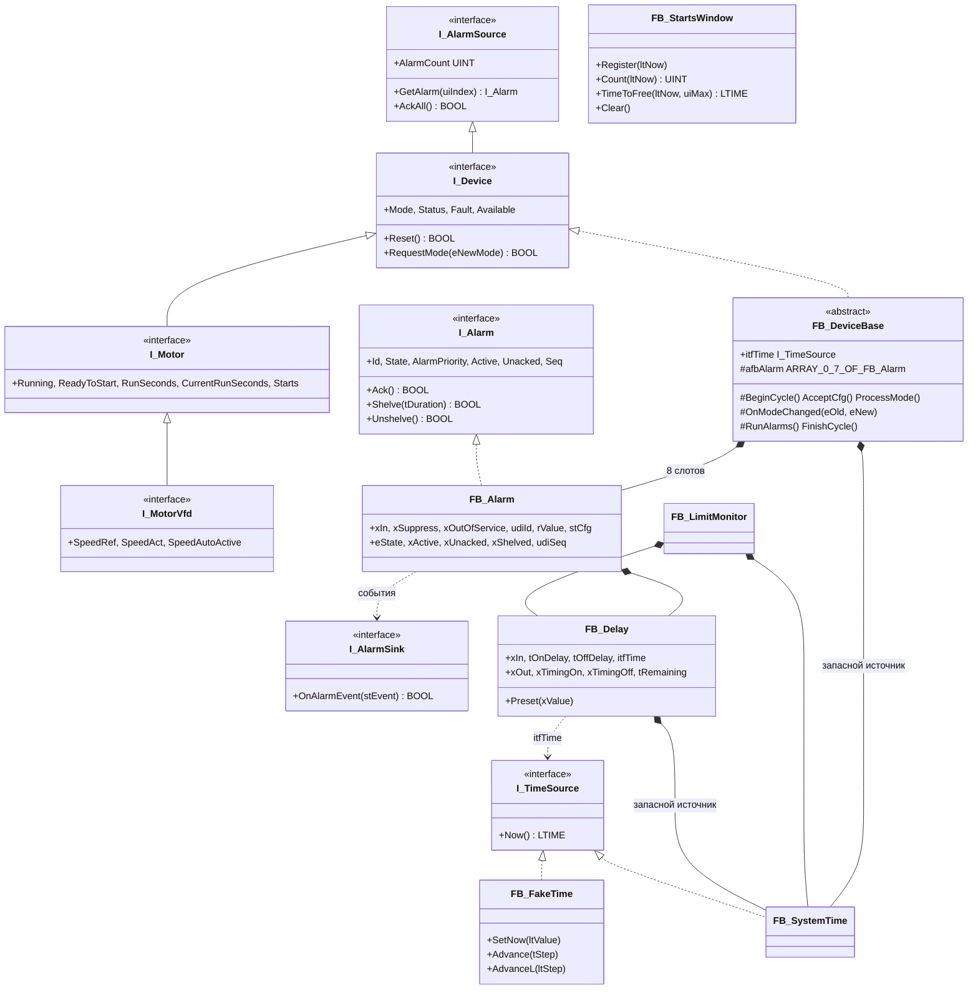
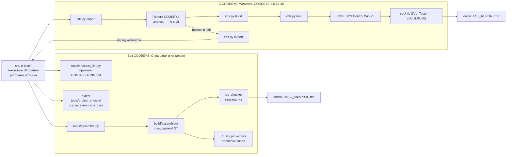

# Архитектура библиотеки

`plc-process-lib` — библиотека технологических ФБ для CODESYS V3.5 SP17 Patch 3, пространство имён
`PL`. Нормативное описание API — контракт [API.md](API.md) (версия 1.0.0; рассмотренные варианты — [DECISIONS.md](DECISIONS.md)): имена, типы, значения, карты
битов, порядок тела устройств, список тестов. Этот документ — обзор того, что лежит в `src/`.

Источник истины — текстовые файлы ST в `src/` и `tests/` (раскладка — [LAYOUT.md](LAYOUT.md)).
Проект CODESYS (`.project`) собирается из них скриптом и после правок в IDE экспортируется обратно.

## Состав и состояние

| Часть | Объекты | Состояние |
|---|---|---|
| Общие типы | 50 DUT (`src/DUTs/<Семейство>/`): перечисления, Cmd/Sts/Cfg/Retain всех устройств | этап 1, готово |
| Константы | `GVL_Const`: числа, пределы, все маски битов слов состояния; `GVL_Lib`: приёмник тревог | этап 1, готово |
| Интерфейсы | `I_TimeSource`, `I_Alarm`, `I_AlarmSource`, `I_AlarmSink`, `I_Device`, `I_Motor`, `I_MotorVfd` | этап 1, готово |
| Время | `FB_SystemTime`, `FB_FakeTime`, `FB_Delay` (`src/POUs/Time/`) | этап 1, готово |
| Утилиты | `F_LTimeToSec`, `F_TimeToSec`, `F_IsFinite`, `F_Ne107Worst`, `F_RateLimit`, `FB_StartsWindow`, `FB_LimitMonitor` (`src/POUs/Util/`) | этап 1, готово |
| Тревоги и база | `FB_Alarm` (`src/POUs/Alarm/`), `FB_DeviceBase` (`src/POUs/Base/`) — [fb/FB_Alarm.md](fb/FB_Alarm.md), [fb/FB_DeviceBase.md](fb/FB_DeviceBase.md) | этап 2, готово |
| Устройства | [`FB_AnalogInput`](fb/FB_AnalogInput.md), [`FB_DigitalInput`](fb/FB_DigitalInput.md), [`FB_Motor`](fb/FB_Motor.md), [`FB_MotorVfd`](fb/FB_MotorVfd.md), [`FB_Valve`](fb/FB_Valve.md), [`FB_ControlValve`](fb/FB_ControlValve.md) (`src/POUs/Devices/`), [`FB_PID`](fb/FB_PID.md) (`src/POUs/Control/`) | этап 3, готово; интеграция и межсемейные тесты — этап 4 |

`src/POUs/PRG_Main` — служебная программа рабочей сборки, не часть API (F-02 в
[ASSUMPTIONS.md](ASSUMPTIONS.md)).

## Общие типы

- `E_DeviceMode` (Auto = 1, Manual = 2, Local = 3, OutOfService = 4; значения 0 нет — 0 в retain
  трактуется как Manual), `E_DeviceType`, `E_Ne107Status` (по тяжести Good = 0 … Failure = 4,
  сводный статус — `MAX`), `E_CmdResult`. Перечисления состояний и режимов — `strict`, все DUT —
  `qualified_only`; перечисления-индексы слотов тревог (`E_<Dev>Alarm`, базовый тип `UINT`) — без
  `strict`: ими индексируются массивы.
- Общий заголовок команд `ST_DeviceCmd` (первое поле `stCommon` каждой `ST_<Dev>Cmd`) и состояния
  `ST_DeviceSts` (14 полей по 16 бит, 28 байт).
- **Структуры состояния для обмена** состоят только из 16- и 32-битных полей без скрытого
  выравнивания: регистр Modbus `n` = байты `2n…2n+1`. Размеры — таблица 4.6 контракта, их проверяет
  тест `Common_SizeOfSts_MatchesRegisterMap` (прогон в CODESYS Control Win V3, 32 бит):

| Структура | Байт | Регистров |
|---|---|---|
| `ST_DeviceSts` | 28 | 14 |
| `ST_AnalogInputSts` | 44 | 22 |
| `ST_DigitalInputSts` | 30 | 15 |
| `ST_MotorSts` (и `FB_MotorVfd`) | 68 | 34 |
| `ST_ValveSts` | 52 | 26 |
| `ST_ControlValveSts` | 52 | 26 |
| `ST_PidSts` | 64 | 32 |

## Энергонезависимые данные

В библиотеке нет ни одной `RETAIN`/`PERSISTENT`-переменной. `ST_DeviceRetain` (36 байт: режим,
вывод из работы, наработка, операции, счётчики ТО, резерв `audiReserve[0..3]`) и `ST_<Dev>Cfg`
приложение размещает в объекте Persistent Variables, по переменной на устройство. Изменение
persistent-типа переинициализирует переменную целиком (A-13), поэтому типы заморожены в пределах
1.x, а их размеры фиксирует тест `Common_SizeOfCfg_MatchesReference` (расчёт —
`tools/reference/common.py`):

| Структура | Байт |
|---|---|
| `ST_AlarmCfg` | 16 |
| `ST_AiLimitCfg` | 20 |
| `ST_AnalogInputCfg` | 264 |
| `ST_DigitalInputCfg` | 152 |
| `ST_MotorCfg` (с `ST_VfdCfg`, 32 байта) | 216 |
| `ST_ValveCfg` | 168 |
| `ST_ControlValveCfg` | 176 |
| `ST_PidCfg` | 212 |
| `ST_DeviceRetain` | 36 |

## Тревоги

`FB_Alarm` ([fb/FB_Alarm.md](fb/FB_Alarm.md)) — одна тревога ISA-18.2: четыре базовых состояния
(Normal, ActiveUnack, ActiveAck, RtnUnack) и три наложенных по старшинству OutOfService >
SuppressedByDesign > Shelved, приоритет, задержки появления и снятия через `FB_Delay`, shelve с
таймаутом. В каждом устройстве восемь слотов `afbAlarm[0..7]` базы, индекс — `E_<Dev>Alarm`, номер —
`udiAlarmIdBase + слот`; каждая `ST_<Dev>Cfg` заканчивается полями `udiAlarmIdBase` и `astAlarm[0..7]`.
Квитирование всех тревог, маски квитирования и shelve из HMI и сводка `wAlmActive`/`wAlmUnack`/
`wAlmShelved`/`ePrioUnack` реализованы один раз в `FB_DeviceBase.RunAlarms`. События уходят в
`PL.GVL_Lib.itfAlarmSink` — единственную изменяемую глобальную переменную библиотеки; приложение
присваивает её каждый цикл. Тексты тревог в ПЛК не хранятся (A-11).

## База устройств

`FB_DeviceBase` ([fb/FB_DeviceBase.md](fb/FB_DeviceBase.md)) — абстрактная база с пустым телом:
устройство вызывает её защищённые методы в нормативном порядке (время → конфигурация LKG → Reset →
режим → команды → логика → тревоги → состояние). Режимы — автомат `ProcessMode` (OutOfService >
Local > дистанционный, запомненный в `stRetain`), смена режима — виртуальный хук `OnModeChanged`
наследника (вызов через `THIS^` проверен на Control Win V3). Сводный NE 107 —
`MAX(устройство, режим, конфигурация)`; все 14 полей общего заголовка `stSts.stCommon` пишет
`FinishCycle`.

## Константы и карты битов

`GVL_Const` (`{attribute 'qualified_only'}`, из приложения — `PL.GVL_Const.X`) — блоками:
общие числа и пределы (NE 43, `PCT_FULL`, `REAL_SANE_MAX`, `NS_PER_S`, `DEV_ALARMS_MAX`, окно
пусков, ПИД), число используемых слотов тревог по типам, затем маски битов по устройствам. Маски —
`WORD`, значение `2^бит`, имя `<ПРЕФИКС>_<СЛОВО>_<ИМЯ>`: префиксы `DEV`, `AI`, `DI`, `MOT`, `VLV`,
`CV`, `PID`; слова `STS` (`wStatus`), `FLT` (`wFault`), `WRN` (`wWarning`), `CFG` (`wCfgErr`). Старший
байт `wStatus` общий для всех устройств:

| Бит | Маска | Константа | Значение 1 |
|---|---|---|---|
| 8 | 16#0100 | `DEV_STS_MODE_AUTO` | режим Auto (AI/DI: измерение) |
| 9 | 16#0200 | `DEV_STS_MODE_MANUAL` | режим Manual (AI/DI: подмена) |
| 10 | 16#0400 | `DEV_STS_MODE_LOCAL` | режим Local |
| 11 | 16#0800 | `DEV_STS_MODE_OOS` | выведено из работы |
| 12 | 16#1000 | `DEV_STS_CFG_ERROR` | `wCfgErr <> 0 OR NOT xCfgEverOk` |
| 13 | 16#2000 | `DEV_STS_FAILURE` | `eNe107 = Failure` |
| 14 | 16#4000 | `DEV_STS_WARNING` | `wWarning <> 0` или `eNe107` S, M |
| 15 | 16#8000 | `DEV_STS_ALARM_UNACK` | `wAlmUnack <> 0` |

Карты младшего байта и слов `wFault`, `wWarning`, `wCfgErr` каждого устройства — в его
`docs/fb/FB_<Dev>.md` и в контракте (разделы 11–17). Совпадение всех масок с картами контракта
проверяет `python -m pytest` (`tools/project_checks/test_conventions.py`).

## Время

Все задержки — через `FB_Delay`, который берёт время из `I_TimeSource`: по умолчанию встроенный в
экземпляр `FB_SystemTime` (оператор `LTIME()`, нс), в тестах — `FB_FakeTime`. Вход `itfTime = 0`
означает «системное время»; глобальных переменных времени нет. «Время назад» (`SetNow` назад,
сбой источника) ФБ переживают: отсчёт начинается заново. Подробно — [fb/FB_Delay.md](fb/FB_Delay.md),
[fb/FB_SystemTime.md](fb/FB_SystemTime.md), [fb/FB_FakeTime.md](fb/FB_FakeTime.md).

## Два контура проверок

| Контур | Где работает | Что ловит | Чего не ловит |
|---|---|---|---|
| Без CODESYS | CI (GitHub Actions, Ubuntu) и любой ПК с Python 3.12 | раскладку и правила имён, «магические числа», соглашения тестов и совпадение констант и DUT с контрактом, находки статанализа, типы (RuSTy) | особенности компилятора CODESYS, поведение в рантайме |
| С CODESYS | Windows с CODESYS 3.5.17.30 | ошибки компиляции CODESYS (только объектов, достижимых из задач: проверку всей библиотеки даёт тестовая сборка, F-03), юнит-тесты coUnit в Control Win | — |

## Каталоги

| Каталог | Содержимое |
|---|---|
| `src/` | библиотека: `DUTs/<Семейство>/`, `GVLs/`, `Interfaces/`, `POUs/Time/`, `POUs/Util/`, `POUs/Alarm/`, `POUs/Base/`; дальше — `POUs/Devices/`, `POUs/Control/` |
| `tests/` | наборы coUnit (`POUs/Suites/`), их регистрация (`GVLs/GVL_Tests<Семейство>`), `PRG_Tests`, помощники (`POUs/Helpers/`); при импорте — папка проекта `Tests` ([TESTING.md](TESTING.md)) |
| `tools/` | инструменты шаблона ([tools/README.md](../tools/README.md)), эталоны `reference/`, проверки соглашений `project_checks/` |
| `docs/` | документация, `fb/` — по ФБ, отчёты проверок |
| `build/` | артефакты сборки и проверок, в git не хранится |
