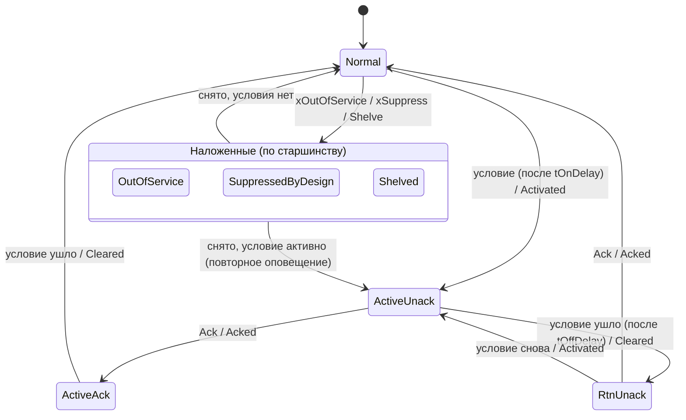

# FB_Alarm — тревога по ISA-18.2

Одна тревога с четырьмя базовыми состояниями ISA-18.2, тремя наложенными (вывод из работы,
подавление по условию, shelve с таймаутом), приоритетом и задержками появления и снятия. Каждый
переход отправляет событие в журнал приложения через `PL.GVL_Lib.itfAlarmSink` и увеличивает
счётчик `udiSeq` — для SCADA, которая опрашивает, а не принимает события.

Где используется: восемь слотов `afbAlarm[0..7]` в каждом устройстве ([FB_DeviceBase](FB_DeviceBase.md));
отдельные экземпляры — для станционных тревог приложения (проект 02) и демонстрации ПАЗ (проект 10).

Исходник: `src/POUs/Alarm/FB_Alarm/`. Контракт: раздел 10 [API.md](../API.md). Модель состояний и повторное
оповещение после shelve — **сверить с ANSI/ISA-18.2-2016** (S3 контракта).

## Входы и выходы

| Имя | Направление | Тип | Единицы | Описание |
|---|---|---|---|---|
| `xIn` | вход | `BOOL` | — | условие тревоги до задержек |
| `xSuppress` | вход | `BOOL` | — | подавление по условию (suppressed by design): логика знает, что тревога ожидаема |
| `xOutOfService` | вход | `BOOL` | — | вывод из работы (устройство в OutOfService) |
| `udiId` | вход | `UDINT` | — | номер тревоги на объекте (у устройств — `udiAlarmIdBase + слот`) |
| `rValue` | вход | `REAL` | инж. ед. | значение процесса, которое попадёт в событие |
| `stCfg` | вход | `ST_AlarmCfg` | — | параметры (ниже); 16 байт, передаётся копией |
| `itfTime` | вход | `I_TimeSource` | — | источник времени; 0 — встроенный `FB_SystemTime` |
| `eState` | выход | `E_AlarmState` | — | состояние ISA-18.2 |
| `xActive` | выход | `BOOL` | — | условие после задержек — **независимо** от наложенных состояний |
| `xUnacked` | выход | `BOOL` | — | `eState` = ActiveUnack или RtnUnack |
| `xInList` | выход | `BOOL` | — | `eState` = ActiveUnack, ActiveAck или RtnUnack — показывать в списке тревог |
| `xShelved` | выход | `BOOL` | — | shelve действует (в том числе под подавлением или выводом из работы) |
| `tShelveRemain` | выход | `TIME` | мс | остаток shelve; `T#0S` — shelve нет |
| `ltLastChange` | выход | `LTIME` | нс | монотонное время последнего перехода |
| `udiSeq` | выход | `UDINT` | — | +1 на каждый переход `eState`, по кругу |

| Метод / свойство | Тип | Действие |
|---|---|---|
| `Ack()` | `BOOL` | запрос квитирования; TRUE — тревога сейчас не квитирована (`xUnacked`) |
| `Shelve(tDuration : TIME)` | `BOOL` | запрос shelve; TRUE — принят: приоритет не None, `tShelveMax > 0`, не OutOfService. `T#0S` — на `tShelveMax`, больше `tShelveMax` — обрезается |
| `Unshelve()` | `BOOL` | запрос снятия shelve; TRUE — shelve сейчас действует |
| `Id`, `State`, `AlarmPriority`, `Active`, `Unacked`, `Seq` | свойства | `udiId`, `eState`, действующий приоритет, `xActive`, `xUnacked`, `udiSeq` (интерфейс `I_Alarm`) |

Методы **только ставят запрос**: его выполняет ближайший вызов тела в той же задаче (правило R3
контракта). Свойство приоритета называется `AlarmPriority`, а не `Priority`, как в контракте:
`PRIORITY` — ключевое слово разборщика iec_checker 0.4 (F-17 в [ASSUMPTIONS.md](../ASSUMPTIONS.md)).

## Параметры (`ST_AlarmCfg`)

| Поле | Тип | По умолчанию | Описание |
|---|---|---|---|
| `ePriority` | `E_AlarmPriority` | `Medium` | `None` — тревога выключена; `Low`, `Medium`, `High`, `Critical` (резерв). Значение вне перечисления (мусор persistent-памяти) работает как `Medium` |
| `tOnDelay` | `TIME` | `T#0S` | задержка появления |
| `tOffDelay` | `TIME` | `T#0S` | задержка снятия |
| `tShelveMax` | `TIME` | `T#8H` | максимальный срок shelve; `T#0S` — откладывать запрещено |

У устройств параметры слота — `stCfg.astAlarm[i]` (Cfg лежит в Persistent Variables приложения);
задержки тревоги действуют поверх логических задержек устройства, по умолчанию они нулевые.

## Состояния



| Из | Событие | В | `eReason` |
|---|---|---|---|
| Normal | условие ↑ (после `tOnDelay`) | ActiveUnack | Activated |
| ActiveUnack | Ack | ActiveAck | Acked |
| ActiveUnack | условие ↓ (после `tOffDelay`) | RtnUnack | Cleared |
| ActiveAck | условие ↓ | Normal | Cleared |
| RtnUnack | Ack | Normal | Acked |
| RtnUnack | условие ↑ | ActiveUnack | Activated |
| любое базовое | Shelve | Shelved | Shelved |
| Shelved | Unshelve / истёк срок | условие ? ActiveUnack : Normal | Unshelved / ShelveExpired |
| любое, кроме OutOfService | `xSuppress` ↑ | SuppressedByDesign | Suppressed |
| SuppressedByDesign | `xSuppress` ↓ | Shelved, если shelve ещё действует; иначе условие ? ActiveUnack : Normal | Unsuppressed |
| любое | `xOutOfService` ↑ | OutOfService | OosOn |
| OutOfService | `xOutOfService` ↓ | SuppressedByDesign, если подавление действует; иначе Shelved, если действует shelve; иначе условие ? ActiveUnack : Normal | OosOff |

Правила:
- **Старшинство наложенных:** OutOfService > SuppressedByDesign > Shelved. При входе в наложенное
  состояние неквитированность сбрасывается; при выходе активная тревога снова ActiveUnack —
  оператор увидит её заново.
- **Ack** в Normal, ActiveAck и наложенных состояниях — без эффекта, метод возвращает FALSE. Запрос без
  эффекта не запоминается: следующее появление тревоги (и повторное оповещение после shelve) остаётся
  неквитированным.
- **Shelve** отсчитывается от команды, независимо от наложенных состояний: срок может истечь под
  подавлением или выводом из работы. Shelve под подавлением принимается (состояние остаётся
  SuppressedByDesign, событие — при снятии подавления); повторный Shelve отсчитывает срок заново;
  shelve нормальной тревоги тоже допустим (Normal → Shelved). Запрос, принятый методом до вывода из
  работы, тело отклоняет, если в том же вызове поднялся `xOutOfService`.
- **Приоритет None** выключает тревогу: все выходы FALSE, shelve снимается. Тревога не в Normal закрывается
  одним переходом в Normal с событием `Disabled` (приоритет события — None, `udiSeq` + 1): журнал и список по
  событиям не держат «призрак» (F-31); выключение нормальной тревоги и дальнейшие вызовы событий не дают. После включения приоритета при активном условии — Activated (задержка
  появления отсчитывается от включения). Смена приоритета у активной тревоги действует сразу и
  события не порождает.
- **«Время назад»** (`FB_FakeTime.SetNow` назад, сбой источника): задержки начинают отсчёт заново
  (как у `FB_Delay`), остаток shelve не растёт сверх его срока.
- **Порядок в вызове** (все переходы и события рождаются в теле, в этом порядке): время и приоритет →
  условие после задержек → квитирование (против состояния на начало вызова) → shelve (снятие,
  истечение, новый запрос) → не больше одного перехода наложенных состояний или базового автомата.
  Поэтому в одном вызове возможны два события: например, Acked и затем Cleared.

## События

На каждом переходе: `udiSeq := udiSeq + 1`, `ltLastChange := ltNow`, затем, если
`PL.GVL_Lib.itfAlarmSink <> 0`, вызывается `OnAlarmEvent(stEvent)` с полями `ST_AlarmEvent`:

| Поле | Значение |
|---|---|
| `udiId` | номер тревоги |
| `ePriority` | действующий приоритет |
| `eOldState`, `eNewState` | состояния до и после перехода |
| `eReason` | причина (таблица выше) |
| `ltTime` | монотонная отметка этого вызова; астрономическое время ставит приёмник |
| `rValue` | значение процесса в момент события; всегда конечно: NaN, ±Inf и `|x| > REAL_SANE_MAX` — 0.0 (F-33) |

Ответ приёмника FALSE (буфер переполнен) ФБ не повторяет. Очерёдность событий внутри цикла —
порядок вызова ФБ. Приложение присваивает `PL.GVL_Lib.itfAlarmSink` **каждый цикл** до вызова
устройств.

## Карта битов

Слова состояния `wStatus` у `FB_Alarm` нет (это не устройство). В устройстве состояние слотов
сводится в общий заголовок `stSts.stCommon` ([FB_DeviceBase](FB_DeviceBase.md#тревоги-в-слотах)):

| Поле `ST_DeviceSts` | Бит i = 1, когда слот i |
|---|---|
| `wAlmActive` | `xActive` (условие после задержек, в любом состоянии) |
| `wAlmUnack` | `xUnacked` (ActiveUnack или RtnUnack) |
| `wAlmShelved` | в Shelved (отложен оператором) |
| `wAlmSuppressed` | в SuppressedByDesign (подавлен логикой); OutOfService — ни в одном слове, он виден по `eMode` (F-32) |
| `ePrioUnack` | наивысший `AlarmPriority` среди неквитированных слотов |

## Пример

```st
// станционная тревога «нет резерва насосов» (проект 02): задержка появления 10 с, журнал — fbJournal
PL.GVL_Lib.itfAlarmSink := fbJournal;                    // каждый цикл, до вызова устройств
stNoStandbyCfg.ePriority := PL.E_AlarmPriority.High;
stNoStandbyCfg.tOnDelay  := T#10S;
fbNoStandby(xIn := NOT xStandbyAvailable,
            xOutOfService := xStationOos,
            udiId := 100001,                             // станционные тревоги — от 100 000 (контракт 20.5)
            rValue := TO_REAL(uiPumpsAvailable),
            stCfg := stNoStandbyCfg);
// квитирование с HMI: IF xHmiAck THEN fbNoStandby.Ack(); END_IF
```

Из приложения — `PL.FB_Alarm`; без `itfTime` используется системное время.

## Тесты (`FB_Alarm_Test`)

Из списка контракта (18): `Alarm_Activate_GoesActiveUnack`, `Alarm_AckWhileActive_GoesActiveAck`,
`Alarm_ReturnWithoutAck_GoesRtnUnack`, `Alarm_AckAfterReturn_GoesNormal`,
`Alarm_ActiveAckReturn_GoesNormal`, `Alarm_ReactivateFromRtnUnack_GoesActiveUnack`,
`Alarm_OnDelay_ShortCondition_NoAlarm`, `Alarm_OffDelay_HoldsActive`,
`Alarm_Shelve_TimeoutUnshelvesAndReannunciates`, `Alarm_ShelveDurationAboveMax_ClippedToMax`,
`Alarm_ShelveMaxZero_ShelveRejected`, `Alarm_Unshelve_ConditionCleared_GoesNormal`,
`Alarm_SuppressByDesign_NoAnnunciation`, `Alarm_OutOfService_OverridesShelve`,
`Alarm_PriorityNone_NeverActivates`, `Alarm_AckInNormal_ReturnsFalse`,
`Alarm_SeqIncrementsOnEachTransition`, `Alarm_Transition_SendsEventToSink`.

Сверх контракта (22): `Alarm_AckAndClearSameCall_TwoEventsInOrder`,
`Alarm_PriorityNoneToMedium_ActiveCondition_Activates`, `Alarm_PriorityChangeWhileActive_NoEvent`,
`Alarm_PriorityOutOfEnum_TreatedAsMedium`, `Alarm_SuppressClearsUnack_ReleaseWithoutCondition_GoesNormal`,
`Alarm_ShelveWhileSuppressed_ShelvedAfterRelease`, `Alarm_ShelveExpiresDuringSuppress_ReleaseGoesToBase`,
`Alarm_OosOffWithSuppressActive_GoesSuppressed`, `Alarm_OosEntry_ClearsUnack_ReannunciatesOnExit`,
`Alarm_ShelveRemain_CountsDown`, `Alarm_TimeBackwards_ShelveRemainNotExtended`,
`Alarm_Reshelve_RestartsTimer`, `Alarm_ActiveWhileShelved_FollowsCondition`,
`Alarm_InterfaceProperties_MatchOutputs`, `Alarm_NoTimeSource_FallsBackToSystemTime`,
`Alarm_Unshelve_ReturnsTrueOnlyWhenShelved`, `Alarm_ShelveRequestThenOos_Rejected`,
`Alarm_PriorityNone_CancelsShelve`, `Alarm_PriorityReenabled_OnDelayCountsFromEnabling`,
`Alarm_AckWithoutEffect_NotKeptForLater`; ревью перед выпуском: `Alarm_PriorityNoneWhileActive_EmitsClosingEvent`
(F-31), `Alarm_NonFiniteValue_EventValueFinite` (F-33).

Описания — в [TEST_REPORT.md](../TEST_REPORT.md). Тревоги в составе устройства (маски, OutOfService
устройства, номера) проверяет `FB_DeviceBase_Test`.
