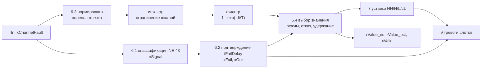
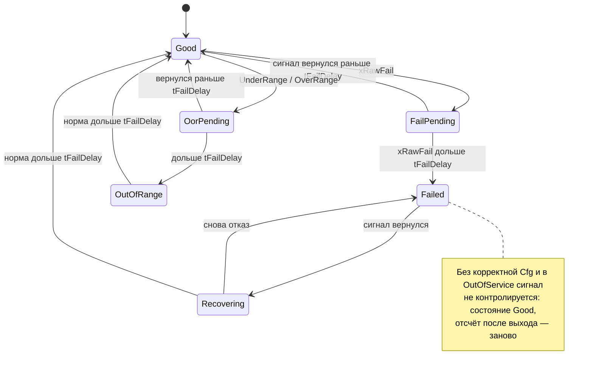

# FB_AnalogInput — аналоговый вход 4–20 мА

Назначение: измерение уровня, давления, расхода, температуры с датчика 4–20 мА, нормированного
сигнала 0–1 (0–10 В), готового значения в инженерных единицах (Modbus REAL) или целых отсчётов
канала (Modbus INT/UINT). ФБ проверяет достоверность тока по NAMUR NE 43, удерживает последнее
хорошее значение на время подтверждения отказа (обрыв не даёт ложного «сухого хода» по LL),
извлекает корень для расходомеров по перепаду давления, фильтрует значение с постоянной времени,
не зависящей от цикла задачи, формирует уставки HH/H/L/LL и позволяет оператору подменить значение
на время наладки. Наследует [FB_DeviceBase](FB_DeviceBase.md): режимы, конфигурация (LKG), NE 107,
квитирование и тревоги — по общим правилам базы.

Исходник: `src/POUs/Devices/FB_AnalogInput/`. Контракт: раздел 11 [API.md](../API.md). Тип в
`stCommon.eDevType`: `E_DeviceType.AnalogInput`. Используется слотов тревог: 6
(`GVL_Const.AI_ALARM_COUNT`).

## Входы и выходы

| Имя | Направление | Тип | Единицы | Описание |
|---|---|---|---|---|
| `rIn` | вход | `REAL` | по `eInput`: мА, доли 0–1, инж. ед., отсчёты | значение канала (модуль AI, регистр Modbus) |
| `xChannelFault` | вход | `BOOL` | — | TRUE — диагностика модуля или ошибка обмена; отказ после `tFailDelay` |
| `xSuppressLimitAlarms` | вход | `BOOL` | — | TRUE — тревоги уставок подавлены по условию (SuppressedByDesign), флаги `xHH…xLL` считаются |
| `itfTime` | вход (база) | `I_TimeSource` | — | источник времени; 0 — системное время. В тестах — `FB_FakeTime` |
| `stCmd` | `VAR_IN_OUT` | `ST_AnalogInputCmd` | — | команды HMI/SCADA (`GVL_Hmi.st<TAG>Cmd`) |
| `stCfg` | `VAR_IN_OUT CONSTANT` | `ST_AnalogInputCfg` | — | параметры (`GVL_Persist.st<TAG>Cfg`) |
| `rValue_eu` | выход | `REAL` | инж. ед. | значение для логики (таблица «Выбор значения») |
| `rValue_pct` | выход | `REAL` | % шкалы | `(rValue_eu - rRangeLo_eu) / (rRangeHi_eu - rRangeLo_eu) · 100`; 0 без корректной Cfg |
| `xValid` | выход | `BOOL` | — | значение пригодно для управления |
| `xHH`, `xH`, `xL`, `xLL` | выход | `BOOL` | — | флаги уставок после гистерезиса и задержек |
| `stSts` | выход | `ST_AnalogInputSts` | — | состояние для HMI/SCADA (раскладка — ниже) |

`stRetain` у аналогового входа нет: режим хранится в экземпляре, после перезапуска ПЛК — «Измерение»
(A-06). Общие методы и свойства (`Reset`, `AckAll`, `RequestMode`, `GetAlarm`, `Mode`, `Status`,
`Fault`, `Available`, `AlarmCount`) — в [FB_DeviceBase](FB_DeviceBase.md#публичные-методы-и-свойства-i_device-i_alarmsource).
Своих публичных методов и свойств нет. Защищённые методы (для наследников; имена зарезервированы):

| Метод | Шаг цикла | Действие |
|---|---|---|
| `CheckConfig(stCfgIn) : WORD` | 2 | биты `wCfgErr` (карта ниже); только считает |
| `ClassifySignal() : E_AiSignalState` | 6.1 | мгновенная классификация по NE 43 |
| `ComputeValue(xCompute)` | 6.3 | нормировка, корень, отсечка, инж. ед., ограничение, фильтр |
| `SelectValue(rSubst_eu)` | 6.4 | `rValue_eu`, `rValue_pct`, `xValid` по режиму и состоянию сигнала |
| `CallLimit(...) : BOOL` | 7 | вызов одной уставки `FB_LimitMonitor` |
| `FaultBits() : WORD`, `WarningBits() : WORD`, `SubstRemainSec() : UINT` | 10 | слова состояния и остаток подмены |

Методы не обращаются к `VAR_IN_OUT` экземпляра (правило R2): значение подмены `SelectValue`
получает параметром.

## Команды (`ST_AnalogInputCmd`)

| Поле | Вид | Действие | Результат (`eCmdResult`) |
|---|---|---|---|
| `stCommon.xSetAuto` | импульс | «Измерение» (выход из подмены и из OutOfService) | `Accepted` |
| `stCommon.xSetManual` | импульс | «Подмена» | `Accepted` |
| `stCommon.xSetOos` | импульс | вывести из работы (разрешено всегда) | `Accepted` |
| `stCommon.xReset` | импульс | фиксируемых отказов нет: квитирование всех тревог | `Accepted` (всегда) |
| `stCommon.xAck`, маски `wAckReq`, `wShelveReq`, `wUnshelveReq` | импульс / маска | тревоги слотов | [FB_DeviceBase](FB_DeviceBase.md#тревоги-в-слотах) |
| `rSubstValue_eu` | значение, инж. ед. | значение подмены. Пока режим не Manual, ФБ каждый вызов пишет сюда `rValue_eu` (слежение): подмена начинается без рывка | — |

Подмена снимается сама через `tSubstMax`: результат `SubstExpired` (+1 к `uiCmdSeq`), режим Auto.

## Параметры (`ST_AnalogInputCfg`)

| Поле | Тип | По умолчанию | Описание | Проверка (`wCfgErr`) |
|---|---|---|---|---|
| `eInput` | `E_AiInputType` | `MilliAmp` | `MilliAmp` — мА, NE 43; `Norm420` — 0..1 = 4..20 мА, NE 43 по I = 4 + 16·rIn; `Norm01` — 0..1 без NE 43; `Eng` — инж. ед.; `Raw` — отсчёты | бит 0, если вне перечисления |
| `rRangeLo_eu`, `rRangeHi_eu` | `REAL` | 0.0, 100.0 | шкала: значение при 4 мА / 0 / `rRawLo_cnt` и при 20 мА / 1 / `rRawHi_cnt` | бит 1, если `Lo >= Hi` или не конечны |
| `rRawLo_cnt`, `rRawHi_cnt` | `REAL` | 0.0, 0.0 | только `Raw`: отсчёты канала для начала и конца шкалы | бит 8, если `Raw` и (`Lo >= Hi` или не конечны); у других типов не проверяются |
| `xSqrt` | `BOOL` | FALSE | извлечение корня (расход по перепаду) | — |
| `rLowCut_pct` | `REAL` | 0.0 | отсечка малых значений, % шкалы, после корня; 0 — нет | бит 5, если вне 0…20 (`AI_LOWCUT_MAX_PCT`) |
| `tFilter` | `TIME` | `T#0S` | постоянная времени фильтра; `T#0S` — без фильтра | — |
| `tFailDelay` | `TIME` | `T#2S` | подтверждение отказа и выхода за диапазон — и появления, и возврата | — |
| `eFailValue` | `E_AiFailValue` | `HoldLast` | значение при подтверждённом отказе: последнее хорошее или `rFailValue_eu` | бит 6, если вне перечисления |
| `rFailValue_eu` | `REAL` | 0.0 | значение при `Substitute`, инж. ед. | бит 6, если не конечно |
| `xLimitsOnFail` | `BOOL` | FALSE | TRUE — при отказе уставки считаются по значению отказа и их тревоги не подавляются | — |
| `xClamp` | `BOOL` | FALSE | ограничить значение шкалой (по умолчанию — экстраполяция) | — |
| `astLimit[0..3]` | `ST_AiLimitCfg` | выключены | уставки, индекс `E_AiAlarm.HH`, `H`, `L`, `LL`: `xEnable`, `rSetpoint_eu`, `rHyst_eu`, `tOnDelay`, `tOffDelay` ([FB_LimitMonitor](FB_LimitMonitor.md)) | бит 2: включённые не строго LL < L < H < HH; бит 3: включённая вне `[Lo, Hi]`; бит 4: у включённой `rHyst_eu < 0`, `>= Hi - Lo` или не конечен |
| `tSubstMax` | `TIME` | `T#8H` | максимальная длительность подмены; `T#0S` — без ограничения | — |
| `udiAlarmIdBase` | `UDINT` | 0 | номер первой тревоги устройства | — |
| `astAlarm[0..7]` | `ST_AlarmCfg` | см. «Тревоги» | приоритеты, задержки, shelve по слотам | бит 7, если приоритет вне перечисления |

Значения по умолчанию проходят `CheckConfig` (тест `AnalogInput_DefaultCfg_FirstCallAutoTypeAndSlots`).
Сравнения в `CheckConfig` записаны так, что NaN в любом проверяемом поле даёт ошибку.

## Цепочка обработки



1. **Классификация** (мгновенная, `stSts.eSignal`). Старшинство: NotFinite > ChannelFault >
   FailLow/FailHigh > UnderRange/OverRange > Good. NE 43 — только для `MilliAmp` и `Norm420`:

   | Ток I | `eSignal` | После подтверждения | NE 107 | Значение |
   |---|---|---|---|---|
   | NaN, ±Inf, \|rIn\| > 1E30 | NotFinite | отказ | Failure | удерживается |
   | `xChannelFault` | ChannelFault | отказ | Failure | удерживается |
   | I ≤ 3,6 мА | FailLow | отказ | Failure | удерживается |
   | 3,6 < I < 3,8 мА | UnderRange | вне диапазона | OutOfSpecification | насыщение 3,8 мА, без экстраполяции; подтверждено — `xValid = FALSE` (AI-13) |
   | 3,8 ≤ I ≤ 20,5 мА | Good | — | Good | считается |
   | 20,5 < I < 21,0 мА | OverRange | вне диапазона | OutOfSpecification | насыщение 20,5 мА; подтверждено — `xValid = FALSE` (AI-13) |
   | I ≥ 21,0 мА | FailHigh | отказ | Failure | удерживается |

   Границы 3,6 и 21,0 мА включены в отказ, 3,8 и 20,5 мА — в норму (A-02). **Сверить с
   источником:** NAMUR NE 43 (пункт S1 раздела 24.3 контракта). Для `Norm01`, `Eng`, `Raw` действуют
   только первые две строки.
2. **Подтверждение.** `FB_Delay` с `tFailDelay` на появление и на возврат: `xFail` — отказ,
   `xOor` — выход за диапазон без отказа.
3. **Значение** (LREAL): `x` — доли шкалы (`MilliAmp`: (I − 4)/16; `Norm420`, `Norm01`: `rIn`;
   `Eng`: (rIn − Lo)/(Hi − Lo); `Raw`: (rIn − RawLo)/(RawHi − RawLo)); корень `SQRT(MAX(x, 0))`;
   отсечка `x·100 < rLowCut_pct` → 0 и бит `AI_STS_LOW_CUT` (и без корня); `Lo + x·(Hi − Lo)`;
   при `xClamp` — ограничение шкалой и бит `AI_WRN_CLAMPED`.
4. **Фильтр** — точная экспонента `lrFlt += (1 − EXP(−dt/T))·(x_eu − lrFlt)`, `dt` — реальное время
   между вызовами (`ltDt` базы). Реакция на ступень одинакова при любом цикле: за одну T — 63,2 %
   (тест `AnalogInput_Filter_IndependentOfCycleTime`: шаги 10 мс, 250 мс и неравномерный дают одно
   значение). Пока сигнал отказал (`xRawFail`), фильтр не обновляется. Первый расчёт, расчёт после
   подтверждённого отказа (`xFail`), после OutOfService и до первой корректной Cfg начинают фильтр с
   текущего значения; короткий неподтверждённый провал фильтр только замораживает — после него значение
   продолжается без скачка (AI-12). «Время назад» даёт `dt = 0`: значение не меняется.

### Выбор значения

| Режим | Сигнал | `rValue_eu` | `xValid` | Уставки |
|---|---|---|---|---|
| корректной Cfg ещё не было | любой | 0.0 | FALSE | сняты |
| Auto | норма | фильтрованное значение | TRUE | считаются |
| Auto | вне диапазона NE 43 (защитная полоса), ещё не подтверждено / подтверждено (`xOor`) | фильтрованное значение насыщения (3,8 или 20,5 мА) | TRUE / FALSE (AI-13) | считаются (по значению насыщения) |
| Auto | отказ, ещё не подтверждён (бит `AI_STS_FAIL_PENDING`) | последнее хорошее | TRUE | считаются по удержанному |
| Auto | отказ, ещё не подтверждён, хорошего значения после старта ПЛК или после выхода из OutOfService не было (AI-2) | как при подтверждённом отказе; бита `AI_STS_FAIL_PENDING` нет | FALSE | как при подтверждённом отказе |
| Auto | отказ подтверждён (и пока подтверждается возврат) | `HoldLast` — последнее хорошее; `Substitute` — `rFailValue_eu` | FALSE | сняты; при `xLimitsOnFail` — по значению отказа |
| Manual | любой | `stCmd.rSubstValue_eu` без фильтра (неконечное не принимается) | TRUE | по подменённому значению |
| OutOfService | любой | удерживается | FALSE | сняты |

Удержание на время подтверждения важно для объекта: ток 0 мА при обрыве дал бы −25 % шкалы и
мгновенный ложный LL раньше, чем сработает отказ.

**Защитные полосы NE 43** (AI-13). Исправный датчик NE 43 токов 3,6…3,8 и 20,5…21 мА не выдаёт: там либо
насыщение (процесс за пределом шкалы — известна только граница), либо ток отказа NAMUR (номинально 3,6 мА),
прочитанный с погрешностью канала как 3,61 мА. Поэтому значение не экстраполируется дальше насыщения, а
подтверждённый выход за диапазон для управления непригоден: ПИД, получающий `xValid`, фиксирует отказ PV и
удерживает выход, а не уводит его к пределу (тест `LevelLoop_GuardBandCurrent_PidHoldsOutput`). Уставки не
снимаются: для LL и HH значение насыщения — «не выше» или «не ниже» границы, а снятие уставок отключило бы
защиту по верхнему уровню, когда уровень выше шкалы. Тесты `AnalogInput_GuardBandLow_InvalidAfterDelay`,
`AnalogInput_GuardBandHigh_InvalidLimitsKept`.

## Режимы

| Режим | Значение | Контроль сигнала | Тревоги | NE 107 режима |
|---|---|---|---|---|
| Auto («Измерение») | измеренное | да | да | — |
| Manual («Подмена») | `stCmd.rSubstValue_eu`, не дольше `tSubstMax` | да: отказ датчика виден (Failure) | да | CheckFunction |
| OutOfService | удерживается, `xValid = FALSE` | нет | все слоты OutOfService | CheckFunction |

`xLocalSupported = FALSE` (режима Local нет), `xOosAllowed = TRUE`. После старта ПЛК — Auto (память
режима `stModeMem`, не энергонезависима). Хук `OnModeChanged` не переопределён: безударность подмены
даёт слежение `stCmd.rSubstValue_eu`.

## Состояния

Достоверность сигнала (`xFail`, `xOor`; шаги 6.1–6.2):



В `FailPending` значение удерживается (`AI_STS_FAIL_PENDING`), если хорошее значение было после старта
ПЛК или выхода из OutOfService (иначе — как в `Failed`, AI-2); в `Failed` и `Recovering` — по
`eFailValue`, `xValid = FALSE`, `wFault` — по текущей классификации (в `Recovering` — 0).

## Безопасное состояние

| Ситуация | Выходы и значения |
|---|---|
| Корректной Cfg ещё не было | `rValue_eu = 0.0`, `rValue_pct = 0.0`, `xValid = FALSE`, флаги уставок FALSE, NE 107 CheckFunction |
| Отказ подтверждён | `HoldLast` — последнее хорошее, `Substitute` — `rFailValue_eu`; `xValid = FALSE`, флаги уставок FALSE (если не `xLimitsOnFail`) |
| OutOfService | значение удерживается, `xValid = FALSE`, флаги уставок FALSE |
| Local | — (режима нет) |

## Отказы и тревоги

Отказ сигнала не фиксируется: снимается сам через `tFailDelay` после возврата; тревога остаётся
`RtnUnack` до квитирования.

| Слот (`E_AiAlarm`) | Условие | Подавление | Значение события | Приоритет по умолч. | Суффикс |
|---|---|---|---|---|---|
| 0 `HH` | `xHH` | `xSuppressLimitAlarms` OR (`xFail` AND NOT `xLimitsOnFail`) | `rValue_eu` | High | `HH` |
| 1 `H` | `xH` | то же | `rValue_eu` | Low | `H` |
| 2 `L` | `xL` | то же | `rValue_eu` | Low | `L` |
| 3 `LL` | `xLL` | то же | `rValue_eu` | High | `LL` |
| 4 `Failure` | `xFail` | — | `rIn` | Medium | `FAIL` |
| 5 `OutOfRange` | `xOor AND NOT xFail` | — | `rValue_eu` | Low | `OOR` |

Задержки тревог `astAlarm[i]` действуют поверх задержек уставок `astLimit[i]`; по умолчанию нулевые.

## Статус и готовность

- `eDevStatus`: Failure при `xFail`; OutOfSpecification при `xOor`; иначе Good. База добавляет
  CheckFunction за Manual, OutOfService и Cfg.
- `xAvailableDev = xValid`: подменённое значение пригодно, за подмену отвечает оператор, а NE 107 это
  показывает.

## Карта битов

| Бит | `wStatus` (младший байт) | `wFault` | `wWarning` | `wCfgErr` |
|---|---|---|---|---|
| 0 | `AI_STS_HH` — `xHH` | `AI_FLT_FAIL_LOW` | `AI_WRN_UNDER_RANGE` | `AI_CFG_INPUT_TYPE` — `eInput` вне перечисления |
| 1 | `AI_STS_H` — `xH` | `AI_FLT_FAIL_HIGH` | `AI_WRN_OVER_RANGE` | `AI_CFG_RANGE` — шкала |
| 2 | `AI_STS_L` — `xL` | `AI_FLT_CHANNEL` | `AI_WRN_CLAMPED` | `AI_CFG_LIMIT_ORDER` — порядок уставок |
| 3 | `AI_STS_LL` — `xLL` | `AI_FLT_NOT_FINITE` | — | `AI_CFG_LIMIT_OUT_OF_RANGE` — уставка вне шкалы |
| 4 | `AI_STS_SIGNAL_FAIL` — `xFail` | — | — | `AI_CFG_HYST` — гистерезис |
| 5 | `AI_STS_OUT_OF_RANGE` — `xOor` | — | — | `AI_CFG_LOW_CUT` — отсечка |
| 6 | `AI_STS_FAIL_PENDING` — Auto, последнее хорошее значение удерживается как годное до подтверждения отказа | — | — | `AI_CFG_FAIL_VALUE` — значение отказа |
| 7 | `AI_STS_LOW_CUT` — сработала отсечка | — | — | `AI_CFG_ALARM` — приоритет тревоги |
| 8 | — | — | — | `AI_CFG_RAW_RANGE` — шкала отсчётов `Raw` |

`wFault` — пока отказ подтверждён, бит по текущей классификации; `wWarning` UNDER/OVER — пока выход
за диапазон подтверждён, по текущей классификации; `AI_WRN_CLAMPED` — значение этого вызова ограничено
шкалой. Старший байт `wStatus` — общий ([FB_DeviceBase](FB_DeviceBase.md#карта-битов)).

## Раскладка `ST_AnalogInputSts` (карта регистров)

| Смещение, байт | Регистр | Поле | Тип | Описание |
|---|---|---|---|---|
| 0…27 | 0…13 | `stCommon` | `ST_DeviceSts` | общий заголовок |
| 28 | 14–15 | `rValue_eu` | `REAL` | итоговое значение, инж. ед. |
| 32 | 16–17 | `rValue_pct` | `REAL` | % шкалы |
| 36 | 18–19 | `rIn` | `REAL` | сырое значение входа |
| 40 | 20 | `eSignal` | `E_AiSignalState` (`INT`) | мгновенная классификация |
| 42 | 21 | `uiSubstRemain_s` | `UINT` | до снятия подмены, с (вверх); 0 — подмены нет или срок не ограничен |

Размер — 44 байта (тест `Common_SizeOfSts_MatchesRegisterMap`).

## Пример вызова

```st
// PRG_Devices (генерирует iolistgen): сигналы перечня и все VAR_IN_OUT в каждом вызове
GVL_Devices.fbLT101(
    rIn           := GVL_IO.rLT101_mA,
    xChannelFault := GVL_IO.xAI1_ModuleFault,
    stCmd         := GVL_Hmi.stLT101Cmd,
    stCfg         := GVL_Persist.stLT101Cfg);
// логика станции: уровень в резервуаре, запрет пуска насоса по «сухому ходу»
xDryRun := GVL_Devices.fbLT101.xLL OR NOT GVL_Devices.fbLT101.xValid;
```

```st
// Расходомер по перепаду: корень, отсечка 3 %, фильтр 2 с; Cfg — в объекте Persistent Variables
stFT201Cfg : PL.ST_AnalogInputCfg := (rRangeHi_eu := 400.0, xSqrt := TRUE, rLowCut_pct := 3.0,
                                      tFilter := T#2S);
```

## Допущения и отклонения

Решения реализации AI-1…AI-13 (AI-13 — по ревью перед выпуском) и открытые вопросы AI-Q1…AI-Q7 с решениями интеграции — [ASSUMPTIONS.md, «FB_AnalogInput»](../ASSUMPTIONS.md#fb_analoginput) и
[«Открытые вопросы семейств»](../ASSUMPTIONS.md#открытые-вопросы-семейств-решения-интеграции). Изменения нормативного поведения
контракта rc2 — AI-2 (старт с оборванной линией), AI-3 и AI-10 (контроль и слежение по режимам), AI-12 (фильтр
после провала) — [API.md, «Отклонения от rc2»](../API.md#отклонения-от-rc2). Общие решения: A-01 (LKG), A-02 (границы
NE 43), A-06 (подмена не энергонезависима), F-17 (`AlarmPriority`), F-28 (порядок результатов команд).

## Статанализ

| Инструмент | Итог (16.10.2026) |
|---|---|
| CODESYS 3.5.17.30, `cds.py build --tests`, `cds.py check --tests` | 0 ошибок, 0 предупреждений (C0371 нет) |
| `st_lint --strict` | 0 ошибок, подавлений нет (составные префиксы массивов и `VAR_IN_OUT CONSTANT` линтер шаблона понимает, F-13 снято) |
| iec_checker 0.4 (`run_iec_checker.py --tests`) | ошибок разбора нет; обоснованы в `tools/check/iec_checker_allow.toml` (раздел семейства входов): PLCOPEN-CP9 — классическая сложность тела 10, `CheckConfig` 12, `ComputeValue` 13, `ClassifySignal` 9, `SelectValue` 8; UnusedVariable `xChannelFault`, `lrFlt`, `xFltInit`, `rGood_eu`, `xClamped` — артефакт понижения (их используют методы, вынесенные в функции); в тестах — объединения `uEnum`, `uPrio` и индексы помощников `SetLimit`, `SetAlarmPriority` |
| RuSTy 1.0.6 (`run_rusty.py`) | проверяются все файлы, ошибок нет: `VAR_IN_OUT CONSTANT` вариант сборки `rusty` понижает до `VAR_IN_OUT` (замена R13 шаблона); исключений нет |

Ошибок разбора нет. Копия элемента в `CheckConfig` (`stLim := stCfgIn.astLimit[uiIdx]`) и метод
`CallLimit` остались от обходов разборщика: понижение шаблона теперь разбирает и `a[i].x`, и вызов
`afbLimit[i](...)`, но обе формы короче в чтении и оставлены.

## Тесты (`FB_AnalogInput_Test`)

Из списка контракта (40, ★ 21 — все): ★ `AnalogInput_Scale_4mA_ReturnsRangeLo` ·
★ `AnalogInput_Scale_20mA_ReturnsRangeHi` · ★ `AnalogInput_Scale_12mA_ReturnsMidRange` ·
`AnalogInput_Norm420_ScalesLikeMilliamps` · `AnalogInput_Norm01_NoNe43Check` ·
`AnalogInput_EngInput_PassesThrough` · ★ `AnalogInput_RawInput_ScalesCounts` ·
`AnalogInput_RawRangeUnset_CfgErrBit8` · ★ `AnalogInput_WireBreak_SetsFailureAfterDelay` ·
★ `AnalogInput_WireBreak_HoldsLastGoodValue` · ★ `AnalogInput_WireBreakShorterThanDelay_NoFailure` ·
★ `AnalogInput_At3p6mA_IsFailure` · ★ `AnalogInput_At3p7mA_IsOutOfSpecification` ·
`AnalogInput_At3p8mA_IsGood` · `AnalogInput_At20p5mA_IsGood` · `AnalogInput_At20p7mA_IsOutOfSpecification` ·
★ `AnalogInput_At21mA_IsFailure` · `AnalogInput_SignalRecovered_ClearsFailureAfterDelayAndResetsFilter` ·
★ `AnalogInput_NaNInput_TreatedAsFailure` · `AnalogInput_ChannelFault_SetsFailure` ·
`AnalogInput_FailValueSubstitute_UsesCfgValue` · `AnalogInput_LimitsOnFail_EvaluatesFailValue` ·
★ `AnalogInput_Sqrt_25PctDp_Returns50PctFlow` · ★ `AnalogInput_LowCut_BelowCut_ReturnsZero` ·
`AnalogInput_Clamp_LimitsToRange` · ★ `AnalogInput_Filter_OneTimeConstant_Reaches63Pct` ·
★ `AnalogInput_Filter_IndependentOfCycleTime` · ★ `AnalogInput_LimitH_Hysteresis_ClearsBelowSpMinusHyst` ·
`AnalogInput_LimitL_Hysteresis_ClearsAboveSpPlusHyst` · ★ `AnalogInput_LimitHH_OnDelay_ShortExcursionIgnored` ·
`AnalogInput_LimitOffDelay_HoldsFlag` · `AnalogInput_LimitDisabled_NeverSets` ·
★ `AnalogInput_Failure_ForcesLimitsFalseAndSuppressesLimitAlarms` ·
`AnalogInput_SuppressLimitAlarmsInput_FlagsStillSet` · ★ `AnalogInput_Substitution_ValueAndCheckFunction` ·
`AnalogInput_Substitution_StartsFromCurrentValue` · `AnalogInput_SubstitutionTimeout_ReturnsToAuto` ·
`AnalogInput_OutOfService_HoldsValueInvalid` · ★ `AnalogInput_InvalidRangeAtStartup_CheckFunctionSafeValue` ·
★ `AnalogInput_LimitOrderInvalidAtRuntime_KeepsLastValidCfg`.

Сверх контракта (14): `AnalogInput_DefaultCfg_FirstCallAutoTypeAndSlots` (умолчания Cfg, тип, слоты,
режим после старта — пункты 1 и 4 чек-листа), `AnalogInput_ResetCmd_AcceptedAndAcksAlarms`,
`AnalogInput_StartupWireBreak_InvalidUntilFirstGoodValue` (AI-2), `AnalogInput_AlarmEvents_FailureValueIsRawInput`,
`AnalogInput_CfgErrBits_MatchContractMap` (каждый бит `wCfgErr`), `AnalogInput_TimeBackwards_FilterHoldsWithoutJump`,
`AnalogInput_SubstitutionNonFinite_ValueHeld` (AI-5), `AnalogInput_OosExitWithBrokenSignal_InvalidAtOnce` (AI-2 после
OutOfService), `AnalogInput_SubstitutionRenewedAfterTimeout_CountsFullPeriod` (AI-7: новый срок подмены, округление
`uiSubstRemain_s` вверх), `AnalogInput_ShortGlitch_FilterKeptNoFalseLimit` (AI-12: короткий провал не сбрасывает
фильтр, ложного HH нет), `AnalogInput_SubstitutionDuringFailure_LimitsOnSubstValue` (подмена при оборванной линии:
уставки по подменённому значению, тревоги уставок подавлены, при возврате в Auto уставки сняты сразу);
по ревью перед выпуском: `AnalogInput_GuardBandLow_InvalidAfterDelay`, `AnalogInput_GuardBandHigh_InvalidLimitsKept`
(AI-13), `AnalogInput_SubstitutionUnlimited_NoTimeout` (`tSubstMax = T#0S` — без ограничения; мутант ревью M2
выживал). Контрактные `AnalogInput_At3p7mA_IsOutOfSpecification` и `AnalogInput_At20p7mA_IsOutOfSpecification`
проверяют значение насыщения и `xValid = FALSE` (AI-13).

Контрактные тесты дополнены проверками на границах, которые раньше не ловили мутации: отсечка ровно на
`rLowCut_pct` не срабатывает (`AnalogInput_LowCut_BelowCut_ReturnsZero`), бит `AI_STS_FAIL_PENDING` снимается
при подтверждении отказа (`AnalogInput_WireBreak_SetsFailureAfterDelay`), слежение `rSubstValue_eu` действует
и в OutOfService (`AnalogInput_OutOfService_HoldsValueInvalid`), отсечка, равная пределу `AI_LOWCUT_MAX_PCT`,
допустима (`AnalogInput_CfgErrBits_MatchContractMap`).

Эталоны масштабирования и фильтра — `tools/reference/ai_reference.py`; совпадение чисел в тестах с
эталоном проверяет `tools/project_checks/test_ai_reference.py` (pytest). Проверено в CODESYS
(Control Win V3, 16.10.2026, `cds.py test`): 51 из 51.

Мутационная проверка (16.10.2026, копия рабочего дерева, по одной однострочной мутации на прогон `cds.py test`,
затем откат). Первый прогон — на исходном коде, выжившие мутации закрыты новыми проверками; второй прогон (отмечен *) —
на коде после исправлений AI-12 и DI-2:

| № | Мутация | Итог | Поймал тест |
|---|---|---|---|
| M01 | граница 21,0 мА: `>=` → `>` | убита | `AnalogInput_At21mA_IsFailure`, `AnalogInput_Norm420_ScalesLikeMilliamps` |
| M02 | граница 3,8 мА: `<` → `<=` | убита | `AnalogInput_At3p8mA_IsGood` |
| M03 | `Norm420`: ток для NE 43 без смещения 4 мА | убита | `AnalogInput_Norm420_ScalesLikeMilliamps` |
| M04* | фильтр сбрасывается при любом провале (поведение до AI-12) | убита | `AnalogInput_ShortGlitch_FilterKeptNoFalseLimit` |
| M05* | фильтр не сбрасывается после подтверждённого отказа | убита | `AnalogInput_SignalRecovered_…`, `AnalogInput_NaNInput_TreatedAsFailure` |
| M06 | удерживаемое значение обновляется, пока подтверждается возврат | убита | `AnalogInput_SignalRecovered_…` |
| M07 | `Substitute` не действует | убита | `AnalogInput_FailValueSubstitute_UsesCfgValue`, `AnalogInput_LimitsOnFail_EvaluatesFailValue` |
| M08 | уставки снимаются при отказе и в подмене (без `eMode = Auto`) | выжила → убита* | `AnalogInput_SubstitutionDuringFailure_LimitsOnSubstValue` (новый) |
| M09 | сигнал контролируется и в OutOfService | убита | `AnalogInput_OutOfService_HoldsValueInvalid`, `AnalogInput_OosExitWithBrokenSignal_InvalidAtOnce` |
| M10 | `uiSubstRemain_s` без округления вверх | убита | `AnalogInput_SubstitutionRenewedAfterTimeout_CountsFullPeriod` |
| M11 | гистерезис, равный диапазону, допустим (`<` → `<=`) | убита | `AnalogInput_CfgErrBits_MatchContractMap` |
| M12 | отсечка, равная пределу 20 %, отвергается (`<=` → `<`) | выжила → убита* | `AnalogInput_CfgErrBits_MatchContractMap` (новая проверка) |

Мутации дискретного входа — в [FB_DigitalInput.md](FB_DigitalInput.md#тесты-fb_digitalinput_test). Выживших мутаций,
меняющих поведение, нет.
