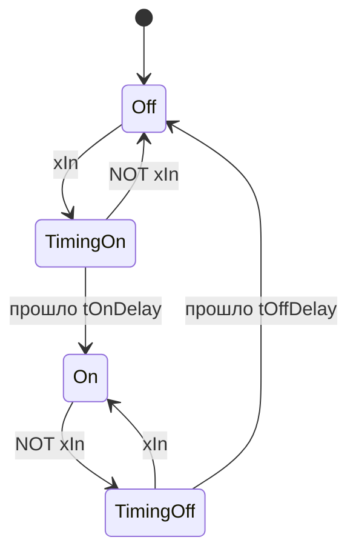

# FB_Delay — задержка включения и отключения

Единственный таймер библиотеки: `TON`, `TOF`, `TP` в коде библиотеки не используются. Время берётся
из источника `I_TimeSource` один раз за вызов, поэтому в тестах задержки детерминированы
(`FB_FakeTime`), а в работе идут по системному времени (`FB_SystemTime`, оператор `LTIME()`).

Исходник: `src/POUs/Time/FB_Delay/`. Контракт: раздел 7.4.

## Входы и выходы

| Имя | Тип | Единицы | Описание |
|---|---|---|---|
| `xIn` | `BOOL` | — | входной сигнал |
| `tOnDelay` | `TIME` | мс | задержка фронта; `T#0S` — выход меняется в том же вызове |
| `tOffDelay` | `TIME` | мс | задержка спада |
| `itfTime` | `I_TimeSource` | — | источник времени; 0 — встроенный `FB_SystemTime` |
| `xOut` | `BOOL` | — | сигнал после задержек |
| `xTimingOn` | `BOOL` | — | `xIn = TRUE`, `xOut = FALSE`: идёт отсчёт задержки включения |
| `xTimingOff` | `BOOL` | — | `xIn = FALSE`, `xOut = TRUE`: идёт отсчёт задержки отключения |
| `tRemaining` | `TIME` | мс | до смены `xOut`; `T#0S` — отсчёта нет |

| Метод | Действие |
|---|---|
| `Preset(xValue : BOOL)` | `xOut := xValue` сразу; отсчёт начнётся заново с ближайшего вызова тела (инициализация, выход из подмены, смена режима) |

## Поведение

- Отметка начала отсчёта ставится в первом вызове, при каждой смене `xIn`, после `Preset` и при
  «времени назад». Задержка истекла, когда `ltNow - отметка >= задержки` для текущего `xIn`.
- **«Время назад»** (`ltNow` меньше отметки: `FB_FakeTime.SetNow` назад, сбой источника) проверяется
  первым: `LTIME` без знака, и разность переполнилась бы. Отсчёт начинается заново, выход не меняется.
- Если `xIn` вернулся до конца задержки, ожидание отменяется.
- Изменение уставки задержки во время отсчёта действует сразу: прошедшее время сравнивается с
  новым значением.



Слова состояния `wStatus` у `FB_Delay` нет (это не устройство).

## Пример

```st
// задержка снятия флага «сухой ход» 5 с и время станции из подменяемого источника
fbDryRunDelay(xIn := GVL_Devices.fbLS102.xValue, tOffDelay := T#5S, itfTime := itfStationTime);
xDryRun := fbDryRunDelay.xOut;
```

Из приложения — `PL.FB_Delay`. Без `itfTime` используется системное время.

## Тесты (`FB_Time_Test`)

`Delay_ZeroDelays_PassThroughSameCall`, `Delay_OnDelay_OutputExactlyAtDelay`,
`Delay_OnDelay_ShortPulse_Ignored`, `Delay_OffDelay_HoldsOutputForDelay`,
`Delay_DelayChangedWhileTiming_UsesNewValue`, `Delay_Preset_ForcesOutputWithoutDelay`,
`Delay_TimeGoesBackwards_RestartsTiming`, `Delay_NoTimeSource_FallsBackToSystemTime`,
`Delay_Remaining_ReportsTimeLeft`, `Delay_BothDelays_OnThenOffTimed`, `Delay_OffDelay_ShortGap_Ignored`,
`Delay_TimingFlags_ReflectCountdown`, `Delay_Preset_RestartsTimingOnNextCall`,
`Delay_FirstCallWithInputTrue_StartsOnDelay` — описания в [TEST_REPORT.md](../TEST_REPORT.md).
