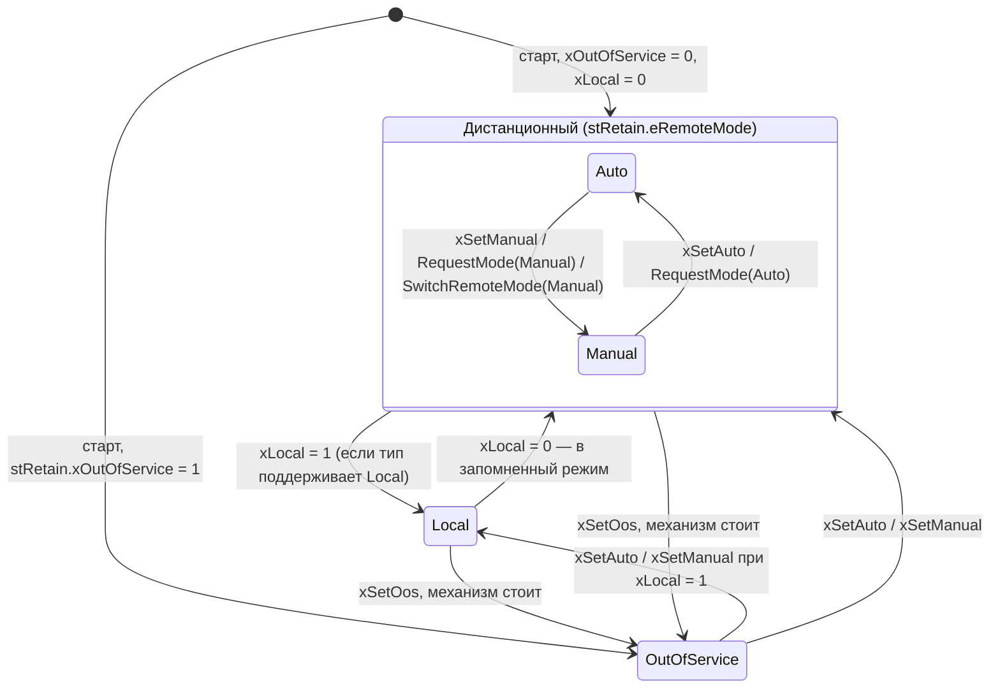

# FB_DeviceBase — абстрактная база устройств

Общая часть всех устройств библиотеки (`FB_AnalogInput`, `FB_DigitalInput`, `FB_Motor`,
`FB_MotorVfd`, `FB_Valve`, `FB_ControlValve`, `FB_PID`): время цикла, режимы с энергонезависимым
дистанционным режимом, конфигурация с последней корректной копией (LKG), результат команд HMI,
восемь слотов тревог `FB_Alarm`, сводный статус NAMUR NE 107 и общий заголовок состояния для
SCADA. Реализует `I_Device` (и через него `I_AlarmSource`): станционная логика и журнал работают
с любым устройством, не зная его типа.

Экземпляр базы не создаётся (`FUNCTION_BLOCK ABSTRACT`). Тело базы пустое: порядок цикла задаёт
наследник, шаги цикла — защищённые методы. Этот документ — для того, кто **пишет устройство**, и
для того, кто подключает устройства к станции через интерфейсы.

Исходник: `src/POUs/Base/FB_DeviceBase/`. Контракт: разделы 2 и 9, тревоги — 10.4–10.5 [API.md](../API.md).

## Входы и выходы

| Имя | Направление | Тип | Единицы | Описание |
|---|---|---|---|---|
| `itfTime` | вход | `I_TimeSource` | — | источник времени; 0 — встроенный `FB_SystemTime`. В тестах — `FB_FakeTime` |

Остальные входы, `VAR_IN_OUT` (`stCmd`, `stCfg`, `stRetain`) и выходы (`stSts` и сигналы процесса)
объявляет наследник по шаблону вызова (раздел 1 контракта):

| Часть | Секция | Где живёт в приложении |
|---|---|---|
| `stCmd : ST_<Dev>Cmd` (первое поле `stCommon : ST_DeviceCmd`) | `VAR_IN_OUT` | `GVL_Hmi.st<TAG>Cmd` |
| `stCfg : ST_<Dev>Cfg` (заканчивается `udiAlarmIdBase`, `astAlarm[0..7]`) | `VAR_IN_OUT CONSTANT` | `GVL_Persist.st<TAG>Cfg` |
| `stRetain : ST_DeviceRetain` (нет у AI/DI) | `VAR_IN_OUT` | `GVL_Persist.st<TAG>Retain` |
| `stSts : ST_<Dev>Sts` (первое поле `stCommon : ST_DeviceSts`) | `VAR_OUTPUT` | экземпляр |

## Публичные методы и свойства (`I_Device`, `I_AlarmSource`)

| Член | Тип | Действие |
|---|---|---|
| `Reset()` | `BOOL` | запрос сброса зафиксированных отказов и квитирования всех тревог; TRUE — принят |
| `AckAll()` | `BOOL` | запрос «квитировать все тревоги»; TRUE — было что квитировать |
| `RequestMode(eNewMode)` | `BOOL` | Auto, Manual, OutOfService — запрос, как бит `stCmd`; Local и прочее — FALSE |
| `GetAlarm(uiIndex)` | `I_Alarm` | слот тревоги; вне `0..AlarmCount - 1` — 0 |
| `Mode` | `E_DeviceMode` | текущий режим (только чтение) |
| `Status` | `E_Ne107Status` | сводный NE 107 последнего вызова |
| `Fault` | `BOOL` | `Status = Failure` |
| `Available` | `BOOL` | можно рассчитывать на устройство в автомате (по типу) и корректная Cfg была |
| `AlarmCount` | `UINT` | используемых слотов, 0…8 |

Методы только ставят запрос; выполняет его ближайший вызов тела в той же задаче (R3). Результат
каждой команды — в `stSts.stCommon.eCmdResult`, номер — `uiCmdSeq`.

## Параметры

Своей конфигурации у базы нет. Каждая `ST_<Dev>Cfg` заканчивается полями тревог:

| Поле | Тип | По умолчанию | Описание |
|---|---|---|---|
| `udiAlarmIdBase` | `UDINT` | 0 | номер первой тревоги устройства; номер слота i — `udiAlarmIdBase + i` (генератор: номер устройства · 10) |
| `astAlarm` | `ARRAY[0..7] OF ST_AlarmCfg` | по типу (раздел ФБ) | приоритет, задержки, `tShelveMax` по слотам ([FB_Alarm](FB_Alarm.md#параметры-st_alarmcfg)) |

Значения Cfg по умолчанию обязаны проходить `CheckConfig` устройства.

## Переменные базы (контракт для наследника)

Все переменные секции `VAR` доступны наследнику и входят в контракт; их имена **зарезервированы**:
наследник с тем же именем не компилируется (C0097). Приложение их не читает (R6).

| Переменная | Тип | Кто пишет | Смысл |
|---|---|---|---|
| `fbSysTime`, `itfTimeAct` | `FB_SystemTime`, `I_TimeSource` | `ResolveTime` | запасной и действующий источник времени |
| `ltNow`, `ltPrevCall`, `ltDt` | `LTIME` | `BeginCycle`, `FinishCycle` | время вызова, предыдущего вызова, шаг (0 в первом вызове и при «времени назад») |
| `xFirstCall` | `BOOL` | `FinishCycle` | TRUE до конца первого вызова |
| `eMode` | `E_DeviceMode` | `ProcessMode`, `SwitchRemoteMode` | текущий режим |
| `xModeReq`, `eModeReq` | `BOOL`, `E_DeviceMode` | `RequestMode` | запрос режима методом |
| `stModeMem` | `ST_DeviceRetain` | наследник AI/DI | память режима для ФБ без `stRetain` |
| `xManualIsCheck` | `BOOL` | наследник AI/DI | Manual (подмена) даёт CheckFunction |
| `eDevType` | `E_DeviceType` | наследник, первый вызов | тип в `stCommon.eDevType` |
| `wCfgErr`, `xCfgEverOk` | `WORD`, `BOOL` | `AcceptCfg` | непройденные проверки Cfg; корректная Cfg была |
| `eNe107`, `xFault`, `xAvailable` | | `FinishCycle` | сводный статус, отказ, готовность |
| `xResetReq`, `xAckAllReq` | `BOOL` | `Reset`, `AckAll` | запросы методов (снимает `FinishCycle`) |
| `eCmdResult`, `uiCmdSeq` | `E_CmdResult`, `UINT` | `SetCmdResult` | результат и номер последней команды |
| `uiAlarmCount` | `UINT` | наследник, первый вызов | используемых слотов |
| `afbAlarm[0..7]` | `FB_Alarm` | `RunAlarms` | слоты тревог (индекс — `E_<Dev>Alarm`) |
| `axAlmCond[0..7]`, `axAlmSuppress[0..7]`, `arAlmValue[0..7]` | `BOOL`, `BOOL`, `REAL` | наследник, шаг 7 | условие, подавление и значение слота |
| `wAlmActive`, `wAlmUnack`, `wAlmShelved`, `ePrioUnack` | | `RunAlarms` | сводка тревог |

Границы массивов записаны числом 7 (= `DEV_ALARMS_MAX - 1`): iec_checker 0.4 не разбирает
константы в границах; совпадение проверяет `Device_AlarmSlotArrays_MatchDevAlarmsMax` (F-18).

## Защищённые методы (для наследников)

| Метод | Шаг | Действие |
|---|---|---|
| `ResolveTime()` | 0 / 1 | `itfTimeAct := itfTime`, если задан, иначе `fbSysTime`. Повторный вызов безвреден. Вызывать первым, если вложенный `FB_Delay` вызывается до `BeginCycle` (как у `FB_MotorVfd`) |
| `BeginCycle()` | 1 | `ResolveTime()`, `ltNow`, `ltDt` (проверка `ltNow >= ltPrevCall` до вычитания) |
| `AcceptCfg(wErr) : BOOL` | 2 | `wCfgErr := wErr`; при 0 — `xCfgEverOk := TRUE` и TRUE: вызывающий копирует `stCfgLkg := stCfg` |
| `ProcessMode(xLocalSel, xLocalSupported, xOosAllowed, stCmd, stRetain) : E_CmdResult` | 4 | автомат режима ([ниже](#режимы)); `None` — запросов не было |
| `SwitchRemoteMode(eNew, stRetain)` | 5–6 | смена дистанционного режима логикой («Стоп» в Auto → Manual, снятие подмены по времени, ПИД ShedToManual); в Local и OutOfService — только запоминается |
| `OnModeChanged(eOld, eNew)` | — | **виртуальный хук**, в базе пуст; вызывается как `THIS^.OnModeChanged(...)` из `ProcessMode` и `SwitchRemoteMode` |
| `SetCmdResult(eResult)` | 3–7 | `eCmdResult := eResult`, `uiCmdSeq := uiCmdSeq + 1` |
| `CheckAlarmCfg(astCfg) : BOOL` | 2 | для `CheckConfig`: все `ePriority` слотов — значения перечисления |
| `RunAlarms(udiIdBase, stCmd, astCfg)` | 7 | запросы тревог, вызов слотов, сводка ([ниже](#тревоги-в-слотах)) |
| `CallAlarmSlot(...)` | 7 | вызов тела одного слота (часть `RunAlarms`; F-19), наследник не вызывает |
| `FinishCycle(eDevStatus, xAvailableDev, wLow, wFaultBits, wWarnBits, stCommon)` | 8 | NE 107, `Fault`, `Available`, все 14 полей `stCommon`, конец цикла |

Методы базы не трогают `VAR_IN_OUT` экземпляра (R2, предупреждение C0371): структуры приходят
параметрами. Хук наследника тоже их **не трогает** — только переменные экземпляра.

## Порядок тела устройства (нормативно)

```st
// 0. Только если вложенные ФБ вызываются до BeginCycle (FB_MotorVfd): ResolveTime();
// первый вызов: тип, число слотов, у AI/DI — xManualIsCheck и stModeMem.eRemoteMode := Auto
IF xFirstCall THEN
    uiAlarmCount := GVL_Const.<DEV>_ALARM_COUNT;
    eDevType := E_DeviceType.<Dev>;
END_IF
// 1. Время
BeginCycle();
// 2. Конфигурация (LKG): логика, хуки и методы читают только stCfgLkg
IF AcceptCfg(wErr := CheckConfig(stCfgIn := stCfg)) THEN
    stCfgLkg := stCfg;
END_IF
// 3. Reset: xResetNow := xResetReq OR stCmd.stCommon.xReset; снять отказы, у которых ушла причина;
//    SetCmdResult(Accepted / RejectedFault) — и у устройства без фиксируемых отказов (AI, DI):
//    RunAlarms результата сброса не пишет. Бит xReset сбросит RunAlarms
// 4. Режим (AI/DI: stRetain := stModeMem)
eRes := ProcessMode(xLocalSel := xLocal, xLocalSupported := TRUE, xOosAllowed := <механизм стоит>,
                    stCmd := stCmd.stCommon, stRetain := stRetain);
IF eRes <> E_CmdResult.None THEN
    SetCmdResult(eResult := eRes);
END_IF
// 5. Команды устройства из stCmd: результаты, сброс битов
// 6. Логика по stCfgLkg; без корректной Cfg (NOT xCfgEverOk) и при отказе — безопасный выход;
//    слежение значений в stCmd
// 7. Тревоги
axAlmCond[E_<Dev>Alarm.X] := ...;  axAlmSuppress[...] := ...;  arAlmValue[...] := ...;
RunAlarms(udiIdBase := stCfgLkg.udiAlarmIdBase, stCmd := stCmd.stCommon, astCfg := stCfgLkg.astAlarm);
// 8. Состояние
stSts.<поля устройства> := ...;
FinishCycle(eDevStatus := ..., xAvailableDev := ..., wLow := ..., wFaultBits := ..., wWarnBits := ...,
            stCommon := stSts.stCommon);
```

У каждого устройства: `stCfgLkg : ST_<Dev>Cfg` в `VAR`; `METHOD PROTECTED CheckConfig : WORD` с
`VAR_IN_OUT CONSTANT stCfgIn : ST_<Dev>Cfg` — только считает биты (в нём же
`CheckAlarmCfg(astCfg := stCfgIn.astAlarm)`). До первой корректной Cfg `stCfgLkg` содержит
умолчания типа: ими пользуются тревоги и безопасный выход. Полный рабочий пример порядка — тестовое
устройство `tests/POUs/Helpers/FB_TestDevice/` ([TESTING.md](../TESTING.md#тестовое-устройство)), что
устройство проверяет само — [чек-лист устройства](../TESTING.md#чек-лист-устройства).

Подводные камни порядка:
- **Результаты команд.** `eCmdResult` — последней обработанной команды в порядке тела: Reset (шаг 3) →
  режим (4) → команды устройства (5) → `xAck`/`AckAll()` и маски тревог (7). Если в одном вызове пришли
  «Пуск» и «Квитировать», последним будет результат квитирования (F-28 в [ASSUMPTIONS.md](../ASSUMPTIONS.md)).
- **Тело базы через `SUPER^(...)`** (`FB_MotorVfd` вызывает тело `FB_Motor`): после `SUPER^` уже выполнен
  `FinishCycle` — `xFirstCall = FALSE`, `ltPrevCall = ltNow`, `stSts.stCommon` записан; `ltNow` и `ltDt`
  ещё действительны. Что нужно знать о первом вызове, наследник запоминает до `SUPER^`.
- **Отклонение запроса режима устройством** (ПИД: Auto без Cfg или с негодной PV) — до `ProcessMode`:
  снять `stCmd.stCommon.xSetAuto` и `xModeReq` (если `eModeReq = Auto`) и записать результат.
- **Методы-запросы** (`Reset()`, `AckAll()`, `RequestMode()`) выполняет один ближайший вызов тела; снимает
  их `FinishCycle`, поэтому `FinishCycle` вызывается в каждом вызове тела, без условий.

## Режимы



`ProcessMode` в каждом вызове:
1. **Санитизация:** `stRetain.eRemoteMode` вне {Auto, Manual} (0 после очистки, мусор) заменяется
   на Manual и записывается обратно — сравнениями, без арифметики.
2. **Победивший запрос** среди битов `stCmd` и `RequestMode()`: OutOfService > Manual > Auto.
   Одновременные запросы — **одна** команда. Импульсы и `xModeReq` сбрасываются.
3. **Выполнение:** OutOfService принимается, только если механизм стоит (`xOosAllowed`), иначе
   `RejectedState` (повтор в OutOfService принимается всегда). Auto и Manual запоминаются в
   `stRetain` — в Local тоже — и выводят из OutOfService.
4. **Режим** по старшинству OutOfService > Local > дистанционный; при смене —
   `THIS^.OnModeChanged(eOld, eNew)`. Хук вызывается и в первом вызове, если режим из `stRetain`
   отличается от начального Manual (наследник видит `xFirstCall = TRUE`).

Хук наследника: в начале `SUPER^.OnModeChanged(eOld := eOld, eNew := eNew)`, затем безударность
(Auto → Manual: ручная защёлка := текущий выход) и снятие зафиксированных отказов при входе в
OutOfService. Виртуальный вызов проверен во время выполнения (R2, ниже).

## Конфигурация (LKG)

| Ситуация | `wCfgErr` | NE 107 | Логика | `Available` | Команды |
|---|---|---|---|---|---|
| Cfg корректна | 0 | по устройству | по `stCfg` (копия в `stCfgLkg`) | по устройству | обычно |
| Корректной Cfg ещё не было (старт) | ≠ 0 | CheckFunction | **безопасный выход** | FALSE | режимы и квитирование работают; пуск/открытие — `RejectedCfg` |
| Cfg испорчена в работе | ≠ 0 | CheckFunction | по `stCfgLkg` (последняя корректная) | не меняется | обычно |

Неверная Cfg в работе не останавливает механизм: запись многополевой уставки с HMI не атомарна
(A-01, DECISIONS.md D-07).

## Сводный статус NE 107 и Fault

`eNe107 := MAX(eDevStatus, eModeStatus, eCfgStatus)` (значения упорядочены по тяжести):
- `eDevStatus` — от логики устройства (Failure, OutOfSpecification, MaintenanceRequired);
- `eModeStatus` — CheckFunction в OutOfService, а при `xManualIsCheck` (AI/DI) ещё и в Manual;
- `eCfgStatus` — CheckFunction, если `wCfgErr <> 0` или корректной Cfg ещё не было.

`Fault = (eNe107 = Failure)`: устройство в OutOfService с отказом показывает Failure, режим виден
отдельно. `Available = xAvailableDev AND xCfgEverOk`. Порядок F > C > S > M — **сверить с NAMUR NE 107**.

## Безопасное состояние

База выход устройства не знает: безопасное состояние задаёт наследник в шаге 6 по таблице 2.6
контракта (раздел «Безопасное состояние» документа устройства). Общие правила: без корректной Cfg —
безопасный выход с первого вызова; механический отказ фиксируется до Reset, отказ сигнала и связи —
нет; вход в OutOfService снимает зафиксированные отказы (в хуке).

## Тревоги в слотах

`RunAlarms` за вызов:
1. **Запросы.** `stCmd.xAck`, `stCmd.xReset`, `AckAll()`, `Reset()` — `Ack()` всех слотов; биты
   `wAckReq` — `Ack()` слота, `wShelveReq` — `Shelve(T#0S)` (на `tShelveMax` слота),
   `wUnshelveReq` — `Unshelve()`. Результаты: «квитировать всё» (`xAck` и `AckAll()` вместе — одна
   команда) и каждая ненулевая маска — `Accepted`; маска shelve, которую не принял ни один слот, —
   `RejectedState`. В OutOfService (и в вызове входа в него) shelve не запрашивается вовсе — маска даёт
   `RejectedState`. `xReset`/`Reset()` дают результат в шаге Reset устройства. Затем `xAck`,
   `xReset` и маски обнуляются. Биты неиспользуемых слотов не действуют.
2. **Вызов слотов** `0..MIN(uiAlarmCount, 8) - 1`: условие, подавление, `xOutOfService := (eMode =
   OutOfService)`, `udiId := udiIdBase + слот`, значение, параметры слота, `itfTimeAct`. Цикл —
   `FOR ui := 1 TO MIN(...)`: при 0 слотов беззнаковое «0 - 1» не возникает.
3. **Сводка** `wAlmActive`, `wAlmUnack`, `wAlmShelved`, `ePrioUnack` — через `I_Alarm` слота.

## Карта битов

Старший байт `wStatus` (биты 8–15) общий для всех устройств, его пишет `FinishCycle`; младший байт
и слова `wFault`, `wWarning`, `wCfgErr` — по типу устройства (документ устройства).

| Бит | Маска | Константа | Значение 1 |
|---|---|---|---|
| 8 | 16#0100 | `DEV_STS_MODE_AUTO` | режим Auto (AI/DI: измерение) |
| 9 | 16#0200 | `DEV_STS_MODE_MANUAL` | режим Manual (AI/DI: подмена) |
| 10 | 16#0400 | `DEV_STS_MODE_LOCAL` | режим Local |
| 11 | 16#0800 | `DEV_STS_MODE_OOS` | выведено из работы |
| 12 | 16#1000 | `DEV_STS_CFG_ERROR` | `wCfgErr <> 0` или корректной Cfg не было |
| 13 | 16#2000 | `DEV_STS_FAILURE` | `eNe107 = Failure` |
| 14 | 16#4000 | `DEV_STS_WARNING` | `wWarning <> 0` или `eNe107` ∈ {S, M} |
| 15 | 16#8000 | `DEV_STS_ALARM_UNACK` | `wAlmUnack <> 0` |

Общий заголовок `ST_DeviceSts` (14 полей по 16 бит): `wStatus`, `wFault`, `wWarning`, `wCfgErr`,
`eMode`, `eNe107`, `eCmdResult`, `uiCmdSeq`, `wAlmActive`, `wAlmUnack`, `wAlmShelved`, `ePrioUnack`,
`eDevType`, `wReserve` (0) — все заполняет `FinishCycle`.

## Проверено во время выполнения (CODESYS Control Win V3, 32 бит)

| Вопрос | Ответ | Тест |
|---|---|---|
| R2: `THIS^.OnModeChanged` из метода базы вызывает переопределение наследника | да, в том числе через два уровня наследования (самое производное, его `SUPER^` — по цепочке) | `Device_OnModeChangedHook_CalledInDerived`, `Device_HookViaThis_DispatchesToMostDerivedOverride` |
| R3: `SUPER^(stCmd := stCmd, stRetain := stRetain, stCfg := stCfg)` работает над структурами вызывающего | да: тело базы выполняется один раз за вызов над теми же структурами; запись наследника после `SUPER^` видна; точка расширения до `SUPER^` действует | `Device_SuperBodyCall_RunsBaseBodyOnSameStructs` |
| L1: тело базы при вызове наследника само не выполняется | да, не выполняется | `Device_DerivedBodyWithoutSuper_BaseBodyNotRun` |
| L6: вызов метода без `THIS^` | тоже связывается динамически (реализация наследника) | `Runtime_MethodCallWithoutThis_DispatchesVirtually` |

Размеры на Control Win V3: `SIZEOF(FB_Alarm)` = 176 байт, восемь слотов — 1408 байт; тестовое
устройство `FB_TestDevice` — 1896 байт. Подробно — [TEST_REPORT.md](../TEST_REPORT.md).

## Пример: станция через интерфейс

```st
// общий сброс и счёт отказов насосов КНС без знания типов (проект 02)
aitfPumps[1] := GVL_Devices.fbP101;      // PL.FB_MotorVfd
aitfPumps[2] := GVL_Devices.fbP102;
FOR uiPump := 1 TO 2 DO
    itfDev := aitfPumps[uiPump];          // PL.I_Device
    IF xStationReset THEN
        itfDev.Reset();
    END_IF
    IF itfDev.Fault THEN
        uiPumpsFaulted := uiPumpsFaulted + 1;
    END_IF
END_FOR
```

## Тесты (`FB_DeviceBase_Test`, через `FB_TestDevice`)

Из списка контракта (15): `Device_RetainModeInvalid_SanitizedToManual`,
`Device_ConflictingModeRequests_OosWins`, `Device_LocalOverridesRemote_ReturnsToRememberedMode`,
`Device_ModeRequestInLocal_ChangesRememberedMode`, `Device_RequestMode_SameEffectAsCmd`,
`Device_RequestModeLocal_ReturnsFalse`, `Device_AckAll_AcksEveryAlarm`,
`Device_AckMask_AcksOnlySelectedSlot`, `Device_ShelveMask_ShelvesSlotForMax`,
`Device_GetAlarmOutOfRange_ReturnsNull`, `Device_CmdResult_SeqIncrementsPerCommand`,
`Device_CmdBits_ClearedAfterProcessing`, `Device_OosEntry_ClearsLatchedFaults`,
`Device_OnModeChangedHook_CalledInDerived`, `Device_OutOfServiceRetained_StartsInOos`;
`Common_SizeOfSts_MatchesRegisterMap` и `Common_SizeOfDeviceRetain_Is36` — в `FB_Common_Test` (F-04).
`Device_DevType_ReportedInStsCommon` и `Device_DefaultCfg_PassesCheck` (все семь типов) появятся с
устройствами; сейчас их часть проверяют `Device_DevTypeSetByHeir_ReportedInStsCommon` и
`Device_DefaultAlarmCfgOfAllTypes_PassesCheckAlarmCfg` (F-26).

Сверх контракта (29): `Device_HookViaThis_DispatchesToMostDerivedOverride`,
`Device_SuperBodyCall_RunsBaseBodyOnSameStructs`, `Device_DerivedBodyWithoutSuper_BaseBodyNotRun`,
`Device_InvalidCfgAtStart_CheckFunctionSafeOutput`, `Device_InvalidCfgDuringOperation_KeepsLastValidCfg`,
`Device_AlarmPriorityInvalid_CfgErrBit`, `Device_DefaultAlarmCfgOfAllTypes_PassesCheckAlarmCfg`,
`Device_SummaryStatus_MaxOfDeviceModeAndCfg`, `Device_StsHeader_AllFieldsFilled`,
`Device_Failure_SafeStateResetRules`, `Device_StopInAuto_SwitchesToManual`,
`Device_SwitchRemoteModeInLocal_OnlyRemembers`, `Device_AutoToManual_BumplessKeepsOutput`,
`Device_OosExitWithLocalSelected_GoesLocal`, `Device_BeginCycle_DtZeroOnFirstCallThenFromTimeSource`,
`Device_NoTimeSource_UsesSystemTime`, `Device_ResolveTimeBeforeBeginCycle_NestedDelayDeterministic`,
`Device_AlarmIds_BaseFromCfgPlusSlot`, `Device_AlarmsInOos_AllSlotsOutOfService`,
`Device_AlarmSummary_WordsAndPrioUnack`, `Device_ZeroAlarmCount_NoSlotsRun`,
`Device_ResetCmd_AcksAlarmsAndClearsLatch`, `Device_DevTypeSetByHeir_ReportedInStsCommon`,
`Device_InputLike_ModeMemStartsAutoManualIsCheck`, `Device_ImplementsIDevice_InterfaceAccess`,
`Device_AlarmSlotArrays_MatchDevAlarmsMax`, `Device_ShelveMaskNotAccepted_RejectedState`,
`Device_MethodRequests_ProcessedOnce`, `Device_ShelveMaskOnOosEntry_RejectedState`.

Описания — в [TEST_REPORT.md](../TEST_REPORT.md).
