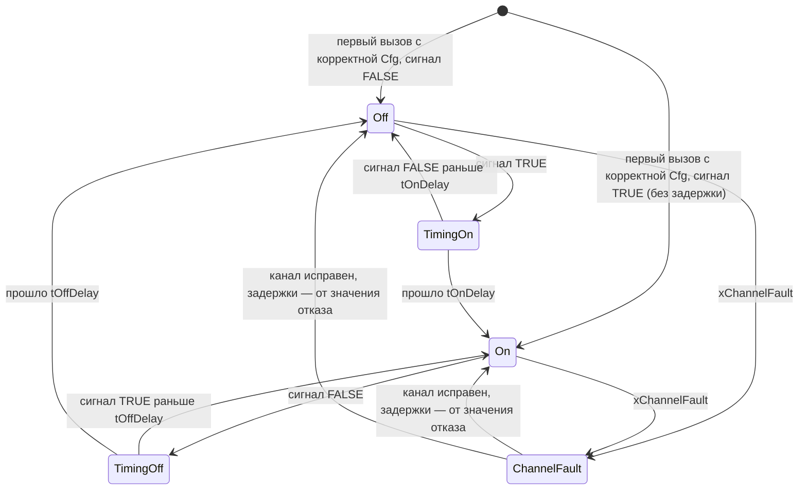

# FB_DigitalInput — дискретный вход

Назначение: дискретный сигнал процесса — поплавок, реле давления, концевик, «напряжение на вводе»,
сигнал аварии от внешнего устройства. ФБ инвертирует нормально замкнутый контакт, подавляет дребезг
задержками включения и отключения (`FB_Delay`), выдаёт значение по `eFailValue` при отказе канала
(обрыв или КЗ NAMUR-датчика, отказ модуля, ошибка обмена), позволяет оператору подменить значение и
формирует тревогу по состоянию сигнала. Наследует [FB_DeviceBase](FB_DeviceBase.md): режимы,
конфигурация (LKG), NE 107, квитирование и тревоги — по общим правилам базы.

Исходник: `src/POUs/Devices/FB_DigitalInput/`. Контракт: раздел 12 [API.md](../API.md). Тип в
`stCommon.eDevType`: `E_DeviceType.DigitalInput`. Используется слотов тревог: 2
(`GVL_Const.DI_ALARM_COUNT`).

## Входы и выходы

| Имя | Направление | Тип | Единицы | Описание |
|---|---|---|---|---|
| `xIn` | вход | `BOOL` | — | сигнал канала (модуль DI, бит Modbus) |
| `xChannelFault` | вход | `BOOL` | — | TRUE — обрыв/КЗ (NAMUR-датчик, модуль), ошибка обмена; действует сразу, без своей задержки |
| `itfTime` | вход (база) | `I_TimeSource` | — | источник времени; 0 — системное время. В тестах — `FB_FakeTime` |
| `stCmd` | `VAR_IN_OUT` | `ST_DigitalInputCmd` | — | команды HMI/SCADA (`GVL_Hmi.st<TAG>Cmd`) |
| `stCfg` | `VAR_IN_OUT CONSTANT` | `ST_DigitalInputCfg` | — | параметры (`GVL_Persist.st<TAG>Cfg`) |
| `xValue` | выход | `BOOL` | — | значение для логики |
| `xValid` | выход | `BOOL` | — | нет отказа канала (или подмена), Cfg была корректна, не OutOfService |
| `stSts` | выход | `ST_DigitalInputSts` | — | состояние для HMI/SCADA (значение и сырой сигнал — биты `wStatus`) |

`stRetain` у дискретного входа нет: после перезапуска ПЛК — «Измерение» (A-06). Общие методы и
свойства — в [FB_DeviceBase](FB_DeviceBase.md#публичные-методы-и-свойства-i_device-i_alarmsource).
Своих публичных методов и свойств нет. Защищённые методы: `CheckConfig(stCfgIn) : WORD` (шаг 2),
`SelectValue(xSubst)` (выбор значения, шаг 6), `SubstRemainSec() : UINT` (остаток подмены); значение
подмены `SelectValue` получает параметром — `VAR_IN_OUT` методы не трогают (R2).

## Команды (`ST_DigitalInputCmd`)

| Поле | Вид | Действие | Результат (`eCmdResult`) |
|---|---|---|---|
| `stCommon.xSetAuto` | импульс | «Измерение» (выход из подмены и из OutOfService) | `Accepted` |
| `stCommon.xSetManual` | импульс | «Подмена» | `Accepted` |
| `stCommon.xSetOos` | импульс | вывести из работы (разрешено всегда) | `Accepted` |
| `stCommon.xReset` | импульс | фиксируемых отказов нет: квитирование всех тревог | `Accepted` (всегда) |
| `stCommon.xAck`, маски тревог | импульс / маска | тревоги слотов | [FB_DeviceBase](FB_DeviceBase.md#тревоги-в-слотах) |
| `xSubstValue` | значение | значение подмены. Пока режим не Manual, ФБ каждый вызов пишет сюда `xValue` (слежение) | — |

Подмена снимается сама через `tSubstMax`: результат `SubstExpired`, режим Auto.

## Параметры (`ST_DigitalInputCfg`)

| Поле | Тип | По умолчанию | Описание | Проверка (`wCfgErr`) |
|---|---|---|---|---|
| `xInvert` | `BOOL` | FALSE | инверсия до задержек (НЗ-контакт: обрыв цепи = срабатывание) | — |
| `tOnDelay` | `TIME` | `T#0S` | задержка включения (фронт сигнала после инверсии) | — |
| `tOffDelay` | `TIME` | `T#0S` | задержка отключения | — |
| `eFailValue` | `E_DiFailValue` | `HoldLast` | значение при отказе канала: последнее, FALSE или TRUE (защитные сигналы) | бит 0, если вне перечисления |
| `xAlarmOnTrue` | `BOOL` | TRUE | тревога State при `xValue = TRUE` (FALSE — при `xValue = FALSE`) | — |
| `tSubstMax` | `TIME` | `T#8H` | максимальная длительность подмены; `T#0S` — без ограничения | — |
| `udiAlarmIdBase` | `UDINT` | 0 | номер первой тревоги устройства | — |
| `astAlarm[0..7]` | `ST_AlarmCfg` | State — None, Failure — Medium | приоритеты, задержки, shelve по слотам | бит 1, если приоритет вне перечисления |

Значения по умолчанию проходят `CheckConfig` (тест `DigitalInput_DefaultCfg_FirstCallValueWithoutDelay`).
Тревога State по умолчанию выключена: генератор включает её, если сигнал тревожный.

## Режимы

| Режим | Значение | Контроль канала | Тревоги | NE 107 режима |
|---|---|---|---|---|
| Auto («Измерение») | после инверсии и задержек; при отказе канала — по `eFailValue` | да | да | — |
| Manual («Подмена») | `stCmd.xSubstValue` сразу, задержки обходятся; не дольше `tSubstMax` | да: отказ канала виден (Failure) | да | CheckFunction |
| OutOfService | удерживается, `xValid = FALSE` | нет | оба слота OutOfService | CheckFunction |

`xLocalSupported = FALSE`, `xOosAllowed = TRUE`. Хук `OnModeChanged` не переопределён: безударность
подмены даёт слежение `stCmd.xSubstValue`.

## Состояния

Задержки (`FB_Delay` по сигналу после инверсии) и отказ канала:



При отказе канала задержки стоят на значении отказа — `HoldLast`: значение до отказа, `ForceFalse`/`ForceTrue`:
FALSE/TRUE — и после возврата канала отсчитываются заново от него (DI-2). Значение отказа снимается только через
задержку: защитный сигнал `ForceTrue` после возврата канала не «проваливается» в FALSE, разрешающий `ForceFalse`
снова подтверждается `tOnDelay`. Биты `DI_STS_TIMING_ON`/`OFF` — пока канал исправен.

## Безопасное состояние

| Ситуация | Выходы и значения |
|---|---|
| Корректной Cfg ещё не было | `xValue = FALSE`, `xValid = FALSE`, NE 107 CheckFunction |
| Отказ канала (Auto) | по `eFailValue`: `HoldLast` — значение до отказа, `ForceFalse` — FALSE, `ForceTrue` — TRUE; `xValid = FALSE`, NE 107 Failure. После возврата канала значение отказа снимается через `tOnDelay`/`tOffDelay` |
| OutOfService | значение удерживается, `xValid = FALSE` |
| Local | — (режима нет) |

Для защитных сигналов (поплавок «сухой ход») правило монтажа — НЗ-контакт (обрыв цепи = срабатывание)
и `eFailValue = ForceTrue`: отказ канала остановит насос так же, как сработавший датчик. `xInvert`
позволяет логике работать в «прямых» терминах.

## Отказы и тревоги

Отказ канала не фиксируется: снимается сам, когда `xChannelFault` пропал; тревога остаётся `RtnUnack`
до квитирования.

| Слот (`E_DiAlarm`) | Условие | Подавление | Значение события | Приоритет по умолч. | Суффикс |
|---|---|---|---|---|---|
| 0 `State` | `xValue = xAlarmOnTrue` | `xChannelFault` (отказ показывает слот 1; без дублирования по ISA-18.2) | `xValue` как 0.0 / 1.0 | None | `ALM` |
| 1 `Failure` | `xChannelFault` | — | `xValue` как 0.0 / 1.0 | Medium | `FAIL` |

## Статус и готовность

- `eDevStatus`: Failure при отказе канала (кроме OutOfService); иначе Good. База добавляет
  CheckFunction за Manual, OutOfService и Cfg.
- `xAvailableDev = xValid`.

## Карта битов

| Бит | `wStatus` (младший байт) | `wFault` | `wCfgErr` |
|---|---|---|---|
| 0 | `DI_STS_VALUE` — `xValue` | `DI_FLT_CHANNEL` — отказ канала (не в OutOfService) | `DI_CFG_FAIL_VALUE` — `eFailValue` вне перечисления |
| 1 | `DI_STS_RAW` — сигнал после инверсии, до задержек | — | `DI_CFG_ALARM` — приоритет тревоги вне перечисления |
| 2 | `DI_STS_TIMING_ON` — идёт задержка включения | — | — |
| 3 | `DI_STS_TIMING_OFF` — идёт задержка отключения | — | — |
| 4 | `DI_STS_CHANNEL_FAULT` — `xChannelFault` (во всех режимах) | — | — |
| 5 | `DI_STS_ALARM_COND` — условие слота State | — | — |

Биты `wWarning` не используются (0). Биты 6–7 `wStatus` — 0. Старший байт `wStatus` — общий
([FB_DeviceBase](FB_DeviceBase.md#карта-битов)).

## Раскладка `ST_DigitalInputSts` (карта регистров)

| Смещение, байт | Регистр | Поле | Тип | Описание |
|---|---|---|---|---|
| 0…27 | 0…13 | `stCommon` | `ST_DeviceSts` | общий заголовок; значение — бит 0 `wStatus` |
| 28 | 14 | `uiSubstRemain_s` | `UINT` | до снятия подмены, с (вверх); 0 — подмены нет или срок не ограничен |

Размер — 30 байт (тест `Common_SizeOfSts_MatchesRegisterMap`).

## Пример вызова

```st
// PRG_Devices (генерирует iolistgen): сигналы перечня и все VAR_IN_OUT в каждом вызове
GVL_Devices.fbLSL102(
    xIn           := GVL_IO.xLSL102,             // поплавок «сухой ход», НЗ-контакт
    xChannelFault := GVL_IO.xDI1_ModuleFault,
    stCmd         := GVL_Hmi.stLSL102Cmd,
    stCfg         := GVL_Persist.stLSL102Cfg);   // xInvert := TRUE, eFailValue := ForceTrue
// логика станции: TRUE — уровень ниже поплавка (или отказ канала)
xDryRun := GVL_Devices.fbLSL102.xValue;
```

## Допущения и отклонения

Решения реализации, которые контракт не задаёт. Интегратор переносит их в
[ASSUMPTIONS.md](../ASSUMPTIONS.md).

| № | Суть | Обоснование |
|---|---|---|
| DI-1 | В первом вызове с корректной Cfg (после старта ПЛК — сразу, если Cfg корректна; иначе — когда её исправят) задержки предустанавливаются на текущий сигнал после инверсии из этой Cfg (`FB_Delay.Preset`): значение сразу равно входу, без `tOnDelay`/`tOffDelay` | Как фильтр AI, который начинает с текущего значения. Иначе вход, включённый при старте, `tOnDelay` выглядел бы выключенным — ложная тревога у сигналов с `xAlarmOnTrue = FALSE`. Предустановка по первой корректной Cfg, а не по первому вызову: до неё инверсия берётся из умолчаний (`xInvert = FALSE`), и НЗ-контакт после исправления Cfg прошёл бы через задержку с неверной полярностью — ложное срабатывание «сухого хода» на `tOffDelay` или пропуск срабатывания на `tOnDelay` при `xValid = TRUE`. Тесты `DigitalInput_DefaultCfg_FirstCallValueWithoutDelay`, `DigitalInput_InvertFromFirstValidCfg_NoFalseValue` |
| DI-2 | При отказе канала задержки стоят на значении отказа (`HoldLast` — значение до отказа, `ForceFalse`/`ForceTrue` — FALSE/TRUE) и отсчитываются от него заново после возврата канала (отсчёт, начатый до отказа, тоже начинается заново); биты отсчёта — только пока канал исправен. Значение на выходе при возврате канала не меняется скачком: значение отказа снимается через задержку | Сигнал при отказе канала недостоверен: дребезг «мусора» не должен попасть в значение. Если бы задержки стояли на значении до отказа, защитный сигнал `ForceTrue` («сухой ход» НЗ) после возврата канала на `tOnDelay` стал бы FALSE при `xValid = TRUE`, хотя датчик сработал — насос пустили бы на сухую; разрешающий `ForceFalse` получил бы TRUE без подтверждения `tOnDelay`. Тесты `DigitalInput_ChannelFault_HoldLast`, `DigitalInput_ChannelFaultDuringOnDelay_RestartsDelay`, `DigitalInput_ChannelFaultRecovered_ForcedValueReleasedThroughDelay` (до исправления падал) |
| DI-3 | Отказ канала в OutOfService не даёт Failure и `DI_FLT_CHANNEL` (контроля нет, таблица 2.2); бит `DI_STS_CHANNEL_FAULT` показывает диагностику во всех режимах | Как AI-3 у аналогового входа: OutOfService — «в ремонте» |
| DI-4 | Отказ канала без корректной Cfg — Failure | Диагностика канала от Cfg не зависит (в отличие от NE 43 аналогового входа) |
| DI-5 | Защищённые методы сверх 22.4: `SelectValue`, `SubstRemainSec` | Тело — нормативные шаги 9.4, выбор значения — отдельным методом (как у AI) |
| DI-6 | Снятие подмены по `tSubstMax` — в шаге 5, до выбора значения; `uiSubstRemain_s` — вверх, 0 при `tSubstMax = T#0S` | Как AI-7 |
| DI-7 | Значение события обоих слотов — `xValue` как 0.0 / 1.0 | Контракт задаёт `arAlmValue` только для AI |
| DI-8 | Слежение `stCmd.xSubstValue := xValue` — во всех режимах, кроме Manual | Правило 2.1 контракта (12.3 называет только Auto) |

Открытые вопросы (решение — за интегратором).

DI-Q1: предустановка DI-1 обходит `tOnDelay` один раз — в первом
вызове с корректной Cfg. Для разрешающих сигналов, которые `tOnDelay` подтверждает перед пуском (например,
«давление на всасе есть»), подтверждение после перезапуска ПЛК пропускается; для защитных (НЗ, «сухой ход»)
это направление безопасное. Альтернатива — предустанавливать только FALSE (сигнал TRUE после старта проходит
`tOnDelay`) ценой ложной тревоги на `tOnDelay` у сигналов с `xAlarmOnTrue = FALSE`.

DI-Q2: перемежающийся отказ канала (ошибка обмена через цикл) по 12.3 не задерживается: слот Failure и подавление
слота State меняются каждый цикл — поток событий в журнал. Сейчас — задержки тревоги `astAlarm[Failure].tOffDelay`
(10.4); в контракте — решить, нужна ли собственная задержка снятия отказа канала.

## Статанализ

| Инструмент | Итог (16.10.2026) |
|---|---|
| CODESYS 3.5.17.30, `cds.py build --tests`, `cds.py check --tests` | 0 ошибок, 0 предупреждений |
| `st_lint --strict` | 0 ошибок; `lint:allow STL007` — `stCfg`, `CheckConfig.stCfgIn` (`VAR_IN_OUT CONSTANT`, F-13) |
| iec_checker 0.4 (`run_iec_checker.py --tests`) | ошибок разбора нет; PLCOPEN-CP9 обоснован в `tools/check/iec_checker_allow.toml` (классическая сложность: тело 10, `SelectValue` 5, `CheckConfig` 3); в тестах — объединения `uEnum`, `uPrio` и индекс помощника `SetAlarmPriority` |
| RuSTy 1.0.6 | `FB_DigitalInput.st`, `FB_DigitalInput_Test.st` исключены: `VAR_IN_OUT CONSTANT` (E034, E036) |

## Тесты (`FB_DigitalInput_Test`)

Из списка контракта (9, ★ 5 — все): ★ `DigitalInput_OnDelay_FiltersBounce` ·
★ `DigitalInput_OffDelay_HoldsValue` · ★ `DigitalInput_Invert_InvertsBeforeDelay` ·
★ `DigitalInput_Substitution_OverridesValueBypassesDelay` · ★ `DigitalInput_ChannelFault_ForceTrue` ·
`DigitalInput_ChannelFault_HoldLast` · `DigitalInput_AlarmOnFalse_ActivatesWhenValueFalse` ·
`DigitalInput_OutOfService_AlarmsOutOfService` · `DigitalInput_SubstitutionTimeout_ReturnsToAuto`.

Сверх контракта (9): `DigitalInput_DefaultCfg_FirstCallValueWithoutDelay` (умолчания Cfg, тип, слоты,
DI-1), `DigitalInput_InvalidCfgAtStartup_ValueFalseCheckFunction` (безопасное значение без Cfg, биты
`wCfgErr`), `DigitalInput_ResetCmd_AcceptedAndAcksAlarms`, `DigitalInput_ChannelFault_ForceFalse`,
`DigitalInput_InvertFromFirstValidCfg_NoFalseValue` (DI-1: предустановка по первой корректной Cfg),
`DigitalInput_ChannelFaultDuringOnDelay_RestartsDelay` (DI-2), `DigitalInput_SubstitutionRenewedAfterTimeout_CountsFullPeriod`
(DI-6), `DigitalInput_AlarmEvents_ValueIsZeroOrOne` (DI-7), `DigitalInput_ChannelFaultRecovered_ForcedValueReleasedThroughDelay`
(DI-2: значение отказа после возврата канала снимается через задержку). Контрактный
`DigitalInput_OutOfService_AlarmsOutOfService` дополнен проверкой слежения `xSubstValue` в OutOfService (DI-8).

Проверено в CODESYS (Control Win V3, 16.10.2026, `cds.py test`): 18 из 18.

Мутационная проверка (16.10.2026, вместе с мутациями аналогового входа — нумерация и порядок там же, * — второй
прогон на коде после исправления DI-2):

| № | Мутация | Итог | Поймал тест |
|---|---|---|---|
| M13* | при отказе канала задержки стоят на значении до отказа (поведение до DI-2) | убита | `DigitalInput_ChannelFaultRecovered_ForcedValueReleasedThroughDelay` |
| M14 | отказ канала даёт Failure и в OutOfService | убита | `DigitalInput_OutOfService_AlarmsOutOfService` |
| M15 | слежение `xSubstValue` только в Auto | выжила → убита* | `DigitalInput_OutOfService_AlarmsOutOfService` (новая проверка) |
| M16 | тревога State не подавляется при отказе канала | убита | `DigitalInput_ChannelFault_ForceTrue` |
| M17* | значение отказа по `eFailValue` не применяется | убита | `DigitalInput_ChannelFault_ForceTrue`, `…_ForceFalse`, `…_ChannelFaultRecovered_…` |
