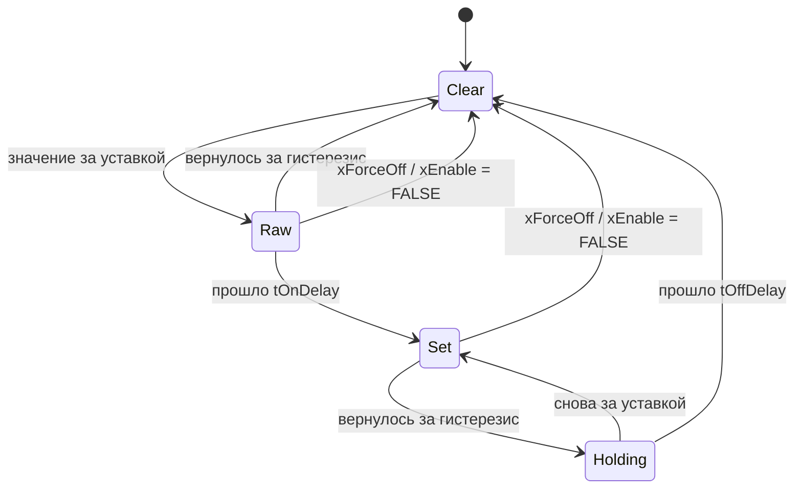

# FB_LimitMonitor — одна уставка

Одна уставка с гистерезисом, задержками срабатывания и снятия и разрешением. Используется в
`FB_AnalogInput` (четыре экземпляра: HH, H, L, LL) и годится для расчётных величин станции.

Исходник: `src/POUs/Util/FB_LimitMonitor/`, параметры — `ST_AiLimitCfg`. Контракт: раздел 8.3.

## Входы и выходы

| Имя | Тип | Единицы | Описание |
|---|---|---|---|
| `rValue_eu` | `REAL` | инж. ед. | контролируемое значение |
| `xHighLimit` | `BOOL` | — | `TRUE` — верхняя уставка (HH, H), `FALSE` — нижняя (L, LL) |
| `xForceOff` | `BOOL` | — | `TRUE` — флаг снимается сразу (отказ сигнала, OOS) |
| `stCfg` | `ST_AiLimitCfg` | — | параметры (копия по значению, 20 байт) |
| `itfTime` | `I_TimeSource` | — | источник времени; 0 — встроенный `FB_SystemTime` |
| `xOut` | `BOOL` | — | флаг после гистерезиса и задержек |
| `xRaw` | `BOOL` | — | флаг после гистерезиса, до задержек |

## Параметры `ST_AiLimitCfg`

| Поле | Тип | По умолчанию | Описание |
|---|---|---|---|
| `xEnable` | `BOOL` | `FALSE` | уставка включена |
| `rSetpoint_eu` | `REAL` | 0.0 | уставка, инж. ед. |
| `rHyst_eu` | `REAL` | 0.0 | гистерезис, инж. ед., >= 0 (проверяет `CheckConfig` устройства) |
| `tOnDelay` | `TIME` | `T#0S` | задержка срабатывания флага |
| `tOffDelay` | `TIME` | `T#0S` | задержка снятия флага |

## Поведение

- Верхняя уставка: `xRaw := TRUE` при `rValue_eu >= rSetpoint_eu`, `FALSE` при
  `rValue_eu < rSetpoint_eu - rHyst_eu`, в промежутке — прежнее значение. Нижняя — зеркально:
  `<= rSetpoint_eu` и `> rSetpoint_eu + rHyst_eu`.
- Затем `FB_Delay(xIn := xRaw, tOnDelay, tOffDelay)` → `xOut`.
- `xEnable = FALSE` или `xForceOff` → `xRaw := FALSE`, `xOut := FALSE` в том же вызове, задержки
  сброшены (`FB_Delay.Preset(FALSE)`): после включения отсчёт срабатывания начинается заново.
- Неконечное значение (NaN, ±Inf, `|x| > REAL_SANE_MAX`, `F_IsFinite`) `xRaw` не меняет.



## Пример

```st
fbLevelHigh(rValue_eu := rLevel_m, xHighLimit := TRUE, xForceOff := NOT xLevelValid,
            stCfg := stLevelHighCfg, itfTime := itfTimeAct);
xLevelHigh := fbLevelHigh.xOut;
```

## Тесты (`FB_Util_Test`)

`Util_LimitMonitor_HighHysteresis_ClearsBelowSpMinusHyst`,
`Util_LimitMonitor_LowHysteresis_ClearsAboveSpPlusHyst`, `Util_LimitMonitor_ForceOff_ClearsImmediately`,
`Util_LimitMonitor_Disabled_NeverSets`, `Util_LimitMonitor_OnDelay_ShortExcursionIgnored`,
`Util_LimitMonitor_OffDelay_HoldsFlag`, `Util_LimitMonitor_NonFiniteValue_KeepsState`,
`Util_LimitMonitor_Reenabled_RestartsOnDelay`.
