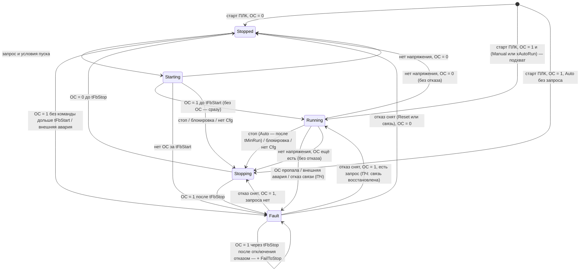

# FB_Motor — двигатель прямого пуска или с УПП

Двигатель насоса, вентилятора или мешалки с контактором или устройством плавного пуска: команда
«работа» удерживаемым выходом `xQRun`, обратная связь (ОС) «в работе», внешняя авария (тепловое
реле, автомат, авария УПП). ФБ ведёт пуск и останов от оператора и от автоматики, защищает по
блокировкам и разрешениям с первопричиной, контролирует ОС, считает моточасы и пуски в
энергонезависимой структуре и ограничивает частые пуски. Наследует [FB_DeviceBase](FB_DeviceBase.md):
режимы, конфигурация (LKG), NE 107, квитирование и тревоги — по общим правилам базы. Двигатель с
преобразователем частоты — наследник [FB_MotorVfd](FB_MotorVfd.md).

Исходник: `src/POUs/Devices/FB_Motor/`. Контракт: раздел 13 [API.md](../API.md). Тип в `stCommon.eDevType`:
`E_DeviceType.Motor`. Используется слотов тревог: 8 (`GVL_Const.MOT_ALARM_COUNT`), слоты 6–7 формирует
только `FB_MotorVfd`.

## Входы и выходы

| Имя | Направление | Тип | Единицы | Описание |
|---|---|---|---|---|
| `xAutoRun` | вход | `BOOL` | — | запрос автоматики «работать» — уровень, не импульс (логика станции) |
| `xFbRun` | вход | `BOOL` | — | ОС «в работе»: блок-контакт КМ, реле «работа» УПП (DI) |
| `xExtFault` | вход | `BOOL` | — | внешняя авария: тепловое реле, автомат, авария УПП (DI) |
| `xLocal` | вход | `BOOL` | — | переключатель «Местное» (DI) |
| `xPowerOk` | вход | `BOOL` | — | напряжение на секции шин есть; по умолчанию TRUE (DI «напряжение», колонка `link_power`) |
| `wInterlock` | вход | `WORD` | — | защитные блокировки: бит = 1 — блокировка действует (логика станции, ПАЗ); по умолчанию 0 |
| `wPermit` | вход | `WORD` | — | разрешения на пуск: бит = 1 — разрешено; по умолчанию `16#FFFF` |
| `itfTime` | вход | `I_TimeSource` | — | источник времени (база); 0 — системное время, в тестах — `FB_FakeTime` |
| `stCmd` | `VAR_IN_OUT` | `ST_MotorCmd` | — | команды HMI/SCADA (`GVL_Hmi.st<TAG>Cmd`) |
| `stCfg` | `VAR_IN_OUT CONSTANT` | `ST_MotorCfg` | — | параметры (`GVL_Persist.st<TAG>Cfg`) |
| `stRetain` | `VAR_IN_OUT` | `ST_DeviceRetain` | — | режим, OOS, наработка и пуски (`GVL_Persist.st<TAG>Retain`) |
| `xQRun` | выход | `BOOL` | — | команда «работа» на КМ/УПП (удерживаемая) |
| `xQReset` | выход | `BOOL` | — | импульс сброса аварии УПП/ПЧ по Reset, длительность `tResetPulse` |
| `xRunning` | выход | `BOOL` | — | работает: по ОС; без ОС (`xFbUsed = FALSE`) — по команде; ОС недостоверна (ПЧ без связи) — удерживается |
| `stSts` | выход | `ST_MotorSts` | — | состояние для HMI/SCADA (раскладка — ниже) |

Общие методы и свойства (`Reset`, `AckAll`, `RequestMode`, `GetAlarm`, `Mode`, `Status`, `Fault`,
`Available`, `AlarmCount`) — в [FB_DeviceBase](FB_DeviceBase.md#публичные-методы-и-свойства-i_device-i_alarmsource).
Свои члены (`I_Motor`):

| Член | Тип | Действие |
|---|---|---|
| `PresetCounters(udiRunTime_s, udiStarts)` | `BOOL` | запрос записать полную наработку, с, и число пусков (замена ПЛК, двигатель после ремонта). Применяет ближайший вызов тела: `stRetain.udiOpTime_s`, `udiOpCount`, результат `Accepted`. Счётчики «с последнего ТО» не меняются. TRUE — запрос принят |
| `Running` | `BOOL` | `xRunning` последнего вызова |
| `ReadyToStart` | `BOOL` | `Available` и стоит (нет ни команды работы, ни работы по ОС: в Starting — FALSE) и разрешения есть и нет запрета пуска (пауза, лимит пусков, нет напряжения) |
| `RunSeconds` | `UDINT` | наработка всего, с — `stRetain.udiOpTime_s`, запомненная телом (свойство `stRetain` не читает, R2) |
| `CurrentRunSeconds` | `UDINT` | текущая непрерывная работа, с; 0, пока стоит (`stSts.udiRunCurrent_s`) |
| `Starts` | `UDINT` | пусков всего — `stRetain.udiOpCount`, запомненное телом |

`I_Motor` — для станционной логики: чередование и АВР по `Available`, `ReadyToStart`, `Running`,
ограничение непрерывной работы по `CurrentRunSeconds`, выравнивание наработки по `RunSeconds`.

## Команды (`ST_MotorCmd`)

| Поле | Вид | Действие | Результат (`eCmdResult`) |
|---|---|---|---|
| `stCommon` | общий заголовок | режимы, Reset, квитирование, маски тревог | [FB_DeviceBase](FB_DeviceBase.md#режимы); Reset — ниже |
| `xStart` | импульс | Manual: ставит ручную защёлку, если выполнены условия пуска | `Accepted`; Auto, Local, OOS — `RejectedMode`; иначе причина по старшинству: `RejectedCfg` > `RejectedFault` > `RejectedInterlock` > `RejectedPermit` > `RejectedInhibit`. Уже работает — `Accepted` без проверок |
| `xStop` | импульс | Manual — снимает защёлку, останов сразу; Auto — переход в Manual (`SwitchRemoteMode`, запоминается в retain) и останов | `Accepted`; Local, OOS — `RejectedMode`. `xStop` старше `xStart` в одном вызове |
| `xResetMaint` | импульс | обнуляет `stRetain.udiOpTimeMaint_s` и `udiOpCountMaint` | `Accepted` в любом режиме |
| `rSpeedSp_pct` | значение | только `FB_MotorVfd` (задание в Manual, слежение) | — |

Импульсы сбрасываются в том же вызове. Порядок результатов в одном вызове — Reset → режим → команды
двигателя (`xStop`/`xStart`, `xResetMaint`, `PresetCounters()`) → отмена отложенного ручного пуска (ниже,
«Условия пуска») → квитирование и маски тревог (F-28).

## Параметры (`ST_MotorCfg`)

| Поле | Тип | По умолчанию | Описание | Проверка (`wCfgErr`) |
|---|---|---|---|---|
| `xFbUsed` | `BOOL` | TRUE | ОС «в работе» подключена; FALSE — ОС моделируется командой, контроля ОС нет | — |
| `tFbStart` | `TIME` | `T#5S` | ожидание ОС при пуске (для УПП — не меньше времени разгона); то же время — фильтр самопроизвольного пуска | бит 0, если `xFbUsed` и `T#0S` |
| `tFbStop` | `TIME` | `T#5S` | ожидание пропадания ОС при останове (выбег) | бит 0, если `xFbUsed` и `T#0S` |
| `tFbLossFilter` | `TIME` | `T#500MS` | фильтр пропадания ОС в работе | — |
| `tExtFaultFilter` | `TIME` | `T#200MS` | фильтр внешней аварии | — |
| `tMinRun` | `TIME` | `T#0S` | минимальное время работы — только для остановов от автоматики | — |
| `tMinStop` | `TIME` | `T#0S` | минимальная пауза перед пуском: от останова, от старта ПЛК, от пропадания напряжения | — |
| `uiMaxStartsPerHour` | `UINT` | 0 | лимит пусков за скользящий час; 0 — без ограничения | бит 1, если больше `STARTS_WINDOW_MAX` = 30 |
| `tResetWindow` | `TIME` | `T#3S` | окно снятия причин после Reset (сброс УПП/ПЧ) | бит 2, если `T#0S` |
| `tResetPulse` | `TIME` | `T#1S` | длительность импульса `xQReset` | бит 2, если больше `tResetWindow` |
| `wInterlockMask` | `WORD` | `16#FFFF` | какие биты `wInterlock` действуют | — |
| `wPermitMask` | `WORD` | `16#FFFF` | какие биты `wPermit` обязательны для пуска | — |
| `udiMaintInterval_h` | `UDINT` | 0 | ТО по наработке, ч; 0 — нет | — |
| `udiMaintStarts` | `UDINT` | 0 | ТО по числу пусков; 0 — нет | — |
| `stVfd` | `ST_VfdCfg` | — | только `FB_MotorVfd` ([FB_MotorVfd](FB_MotorVfd.md#параметры-пч-st_vfdcfg)) | биты 8–11 у `FB_MotorVfd` |
| `udiAlarmIdBase` | `UDINT` | 0 | номер первой тревоги (генератор: номер устройства · 10) | — |
| `astAlarm` | `ARRAY[0..7] OF ST_AlarmCfg` | см. «Отказы и тревоги» | приоритеты, задержки, shelve по слотам | бит 3, если приоритет вне перечисления |

Значения по умолчанию проходят `CheckConfig` (тест `Motor_FirstCall_SetsTypeSlotsAndPassesDefaultCfg`).
Маски по умолчанию `16#FFFF`: забытая маска даёт «блокирует», а не «молча игнорирует»; логика станции
пишет отдельные биты (`fbP101.wPermit.0 := …`) или всё слово с единицами у неиспользуемых разрешений.
Тип `ST_MotorCfg` лежит в Persistent Variables приложения и заморожен в пределах 1.x (A-13).

## Режимы

| Режим | Запрос работы | `xStart` | `xStop` | Выходы | Контроль ОС | Блокировка |
|---|---|---|---|---|---|---|
| Auto | `xAutoRun`; снятие ждёт `tMinRun` от входа в Running | `RejectedMode` | переход в Manual и останов | по запросу | да | останов; после снятия — пуск по `xAutoRun` (с учётом `tMinStop`) |
| Manual | ручная защёлка: `xStart` ставит, `xStop` снимает | пуск при условиях | останов сразу | по запросу | да | останов, защёлка снимается |
| Local | нет | `RejectedMode` | `RejectedMode` | сняты; `eState` следует ОС | нет (только внешняя авария) | только предупреждение `MOT_WRN_INTERLOCK_IN_LOCAL` |
| OutOfService | нет | `RejectedMode` | `RejectedMode` | сняты; `eState` следует ОС | нет | нет |

- `xLocalSupported = TRUE`, `xLocalSel = xLocal`; вывод из работы (`xOosAllowed`) — только когда
  `eState` не Starting, Running или Stopping (двигатель, запущенный по месту, тоже Running) и двигатель не
  работает по ОС: в Fault с ОС (сварился контактор) вывод из работы отклоняется — иначе вход в OOS снял бы
  FailToStop, и работающий двигатель числился бы в ремонте без тревог (M-23).
- В Local ПЛК не может остановить двигатель: защиты обязаны быть в схеме управления аппаратно (A-04).
- Безударность (`OnModeChanged`, первым — `SUPER^.OnModeChanged`):

  | Переход | Действие |
  |---|---|
  | Auto → Manual | ручная защёлка := команда работы — работающий насос продолжает работать |
  | Local или OOS → Auto/Manual | ручная защёлка := ОС — двигатель, запущенный по месту, продолжает работать в Manual |
  | Manual → Auto | дальше по `xAutoRun` |
  | вход в OutOfService | все зафиксированные отказы сняты, первопричина `uiFirstOut := NO_FIRST_OUT` |

## Условия пуска

Пуск от ПЛК (Stopped → Starting) возможен, только если выполнены все условия:
- есть корректная Cfg;
- нет отказа (`wFault = 0`);
- нет действующих блокировок: `(wInterlock AND wInterlockMask) = 0`;
- все разрешения есть: `(wPermitMask AND NOT wPermit) = 0` и нет доп. запрета наследника (`xStartBlockAdd`, ПЧ не готов);
- есть напряжение (`xPowerOk`);
- с останова прошло `tMinStop`;
- пусков за скользящий час меньше `uiMaxStartsPerHour` (если лимит задан).

В Auto при невыполненном условии запрос ждёт: биты `MOT_STS_PERMIT_MISSING`, `MOT_STS_START_INHIBIT`,
остаток запрета `stSts.uiInhibitRemain_s`; пуск произойдёт сам, когда условие выполнится. В Manual `xStart`
отклоняется, защёлка не ставится.

- **«Пуск» во время выбега** (Manual, Stopping) принимается по обычным проверкам: двигатель запустится, как
  только остановится. Если к моменту останова условие пуска уже не выполнено (за выбег пропало разрешение,
  ПЧ не готов), отложенный пуск отменяется вторым результатом `RejectedPermit` или `RejectedInhibit`:
  в Manual двигатель не запускается сам, когда условие вернётся (M-09).

- **Пауза `tMinStop`** отсчитывается от первого вызова, в котором нет ни команды работы, ни работы по ОС
  (фактический останов), от старта ПЛК и от момента пропадания напряжения. «Время назад» — пауза заново.
- **Окно пусков** (`FB_StartsWindow`, скользящий час, 30 отметок): отметка ставится на каждый вход в
  Starting (неудачный пуск тоже даёт пусковой ток) и на каждый фронт ОС без команды ПЛК (пуск по
  месту). Окно не энергонезависимо (A-03).
- **Остаток запрета** `uiInhibitRemain_s = MAX(остаток tMinStop, TimeToFree окна)`, с, с округлением
  вверх, не больше `UINT_MAX`. Бит `MOT_STS_START_INHIBIT` и остаток показываются, пока двигатель стоит.

## Блокировки и первопричина

- Действующие блокировки `stSts.wInterlock = wInterlock AND wInterlockMask`; недостающие разрешения
  `stSts.wPermitMissing = wPermitMask AND NOT wPermit`. Номер бита — номер причины в текстовом списке
  `TL_Reason` (`<TAG>.ILK.<бит>`, `<TAG>.PRM.<бит>`).
- **Первопричина** `stSts.uiFirstOut`: при переходе действующих блокировок из 0 в ненулевое значение —
  номер младшего из взведённых битов (биты 3 и 5 разом → 3). Последующие биты её не меняют. Держится до
  Reset, до следующего входа в Starting или до входа в OutOfService. В OutOfService не записывается.
- Блокировка не фиксируется (A-12): в Auto после её снятия двигатель запустится по `xAutoRun`, в
  Manual — нет (защёлка снята).
- Нет разрешения: пуск запрещён, работающий двигатель **не** останавливается.

## Состояния



- Из любого состояния при отказе (`wFault <> 0`) — Fault: выходы сняты, ручная защёлка снята.
- В Local и OutOfService `eState` следует ОС (Running/Stopped), в Local при отказе — Fault.
- **Нет напряжения** (`xPowerOk = FALSE`): Starting, Running → Stopped без отказа, а пока ОС ещё есть
  (выбег; ПЧ пережил провал напряжения) — Stopping: после восстановления питания торможение контролирует
  `tFbStop`, а не контроль самопроизвольного пуска (M-10). Ручная
  защёлка снимается, контроль ОС приостановлен (`MOT_WRN_FB_SUSPENDED`), пуск запрещён
  (`MOT_STS_START_INHIBIT`, `MOT_WRN_POWER_LOST`); момент пропадания — останов для `tMinStop`. После
  провала питания столб воды раскручивает погружной насос в обратную сторону: пуск в это время опасен
  для вала. Последовательный пуск после восстановления питания делает станция задержками `xAutoRun`.
- **Старт ПЛК**: работающий по ОС двигатель подхватывается (Manual или запрос Auto — Running с командой,
  Auto без запроса — штатный останов), самопроизвольный пуск при подхвате не формируется, подхват — не
  пуск (счётчики не растут), `tMinStop` — от старта ПЛК. Подхват решается в первом вызове с достоверной ОС:
  у ПЧ с ОС по связи — когда связь появится (M-18).

## Контроль ОС и отказы

| Отказ | Обнаружение | Где действует | Фиксация | Причина ушла (для Reset) | `wFault` | Слот |
|---|---|---|---|---|---|---|
| FailToStart | Starting дольше `tFbStart` без ОС | Auto, Manual | да | сразу | бит 0 | 0 |
| FeedbackLost | Running: ОС = 0 дольше `tFbLossFilter` | Auto, Manual | да | сразу | бит 1 | 1 |
| FailToStop | Stopping дольше `tFbStop` с ОС; Fault после отключения ExtFault, FailToStart или FeedbackLost — ОС дольше `tFbStop` (M-20) | Auto, Manual | да | двигатель не работает по ОС | бит 2 | 2 |
| UncommandedRun | Stopped без команды: ОС = 1 дольше `tFbStart` | Auto, Manual | да | двигатель не работает по ОС | бит 3 | 3 |
| ExtFault | `xExtFault` (или авария ПЧ) дольше `tExtFaultFilter` | все, кроме OOS | да | вход аварии снят | бит 4 | 4 |
| CommLoss (ПЧ) | отказ связи от `FB_MotorVfd` | все, кроме OOS | нет | — | бит 5 | 6 |

- Без ОС (`xFbUsed = FALSE`) ОС моделируется командой: FailToStart, FeedbackLost, FailToStop и
  UncommandedRun не формируются, наработка идёт по команде.
- Контроль ОС приостановлен (таймеры сброшены, состояние удерживается) при недостоверной ОС
  (`xFbInvalid`, ПЧ без связи) и без напряжения — `MOT_WRN_FB_SUSPENDED`.
- `UncommandedRun` и `FailToStop` в Auto не отменяют запрос автоматики: пуск резерва решает станция по
  `Available = FALSE`.
- **Reset** (`stCmd.stCommon.xReset` или `Reset()`):
  - сразу — результат `Accepted`, импульс `xQReset` на `tResetPulse`, первопричина снята, отказы без
    длящейся причины (FailToStart, FeedbackLost) сняты;
  - в течение `tResetWindow` остальные зафиксированные отказы снимаются, как только ушла их причина;
  - если к концу окна отказ остался — второй результат `RejectedFault` (`uiCmdSeq` растёт ещё раз).

  Так одно нажатие «Сброс» снимает аварию УПП/ПЧ, которая уходит только после сброса самого
  аппарата импульсом `xQReset`. Тревоги Reset квитирует (база).

## Безопасное состояние

| Ситуация | Выходы и значения |
|---|---|
| Корректной Cfg ещё не было | `xQRun := FALSE`; пуск — `RejectedCfg`, запрос Auto не исполняется; работающий по ОС двигатель — штатный останов (Stopping) |
| Отказ | `xQRun := FALSE`, `eState = Fault`, ручная защёлка снята |
| OutOfService | `xQRun := FALSE`, `eState` следует ОС |
| Local | `xQRun := FALSE`, `eState` следует ОС |
| Нет напряжения | `xQRun := FALSE` без отказа, пауза `tMinStop` |

Неверная Cfg в работе двигатель не останавливает: CheckFunction, биты `wCfgErr`, логика — по последней
корректной копии (A-01).

## Отказы и тревоги

| Слот (`E_MotorAlarm`) | Условие | Подавление | Фиксация до Reset | Приоритет по умолч. | `wFault` | Код |
|---|---|---|---|---|---|---|
| 0 `FailToStart` | отказ зафиксирован | — | да | Medium | бит 0 | `FTS` |
| 1 `FeedbackLost` | отказ зафиксирован | — | да | Medium | бит 1 | `FBL` |
| 2 `FailToStop` | отказ зафиксирован | — | да | High (механизм не остановить из ПЛК) | бит 2 | `FTP` |
| 3 `UncommandedRun` | отказ зафиксирован | — | да | High | бит 3 | `UCR` |
| 4 `ExtFault` | отказ зафиксирован | — | да | Medium | бит 4 | `EXT` |
| 5 `InterlockTrip` | остановлен блокировкой в работе (Starting, Running) — пока блокировка действует | — | нет | None (у причины обычно своя тревога) | — | `ILK` |
| 6 `CommLoss` | только `FB_MotorVfd` | — | нет | Medium | бит 5 | `COM` |
| 7 `SpeedDeviation` | только `FB_MotorVfd` | — | нет | Low | — | `SPD` |

Почему у отказов по умолчанию Medium: на насосной станции резерв запускается автоматически (АВР),
а High получает станционная тревога «нет резерва». High — только там, где ПЛК не может остановить
механизм сам. Значение процесса в событиях двигателя не передаётся (0); номер тревоги —
`udiAlarmIdBase + слот`.

## Счётчики и ТО

- **Наработка.** Шаг времени вызова (`ltDt`, не больше `DT_ACCUM_MAX` = 10 с) идёт в накопитель, если
  двигатель работал в прошлом вызове (в любом режиме, включая Local и OOS). Целые секунды переносятся в
  `stRetain.udiOpTime_s` и `udiOpTimeMaint_s`, доля секунды остаётся в накопителе: при пропадании питания
  ПЛК теряется меньше 1 с. Зависание задачи на час засчитывается как 10 с.
- **Пуски.** Фронт `xRunning` → `stRetain.udiOpCount` и `udiOpCountMaint` + 1 (подхват при старте ПЛК —
  не пуск). Попытка пуска без ОС — отметка в окне пусков, но не пуск.
- **Провал ОС в работе короче `tFbLossFilter`** (дребезг блок-контакта, Auto/Manual, Running) для счётчиков —
  не останов: наработка идёт, пуск не считается, текущая непрерывная работа не обнуляется (M-21). Выход
  `xRunning` при этом показывает ОС как есть. Дребезг в Local и OOS (контроля ОС нет) фильтрует задержка
  DI (`FB_DigitalInput`).
- **Текущая непрерывная работа** `stSts.udiRunCurrent_s` (`CurrentRunSeconds`): обнуляется на фронте
  `xRunning`, растёт по тому же накопителю, при останове — 0; не энергонезависима.
- `rRunTime_h`, `rRunTimeMaint_h` в Sts — наработка в часах (`udiOpTime_s / 3600`).
- **ТО:** `udiMaintInterval_h > 0` и `udiOpTimeMaint_s >= udiMaintInterval_h · 3600` →
  `MOT_WRN_MAINT_RUNTIME`; по пускам `udiMaintStarts > 0` и `udiOpCountMaint >= udiMaintStarts` →
  `MOT_WRN_MAINT_STARTS`. NE 107 — MaintenanceRequired; это не тревога. Сброс — `stCmd.xResetMaint`.
- Persistent-размещение `stRetain` — [MANUAL_STEPS.md](../MANUAL_STEPS.md) и раздел 18 контракта.

## Статус и готовность

- `eDevStatus` (вклад двигателя в NE 107): Failure при `wFault <> 0`; иначе MaintenanceRequired при ТО;
  затем `MAX` с вкладом наследника (`eDevStatusAdd`: у ПЧ — OutOfSpecification).
- `xAvailableDev = (eMode = Auto) AND (wFault = 0) AND (wInterlock AND wInterlockMask) = 0 AND xPowerOk`.
  Отсутствие разрешения и пауза не снимают готовность: станция видит их в `ReadyToStart`.
- `ReadyToStart = Available AND` стоит (`NOT xRunCmd AND NOT xRunning`) `AND` разрешения есть `AND NOT`
  запрет пуска (M-22).

## Карта битов

| Бит | `wStatus` (младший байт) | `wFault` | `wWarning` | `wCfgErr` |
|---|---|---|---|---|
| 0 | `MOT_STS_RUNNING` — `xRunning` | `MOT_FLT_FAIL_TO_START` | `MOT_WRN_MAINT_RUNTIME` | `MOT_CFG_FB_TIMES` — `xFbUsed` и (`tFbStart = T#0S` или `tFbStop = T#0S`) |
| 1 | `MOT_STS_RUN_CMD` — команда работы | `MOT_FLT_FEEDBACK_LOST` | `MOT_WRN_MAINT_STARTS` | `MOT_CFG_STARTS_LIMIT` — `uiMaxStartsPerHour > STARTS_WINDOW_MAX` |
| 2 | `MOT_STS_STARTING` | `MOT_FLT_FAIL_TO_STOP` | `MOT_WRN_SPEED_DEV` (ПЧ) | `MOT_CFG_RESET` — `tResetWindow = T#0S` или `tResetPulse > tResetWindow` |
| 3 | `MOT_STS_STOPPING` | `MOT_FLT_UNCOMMANDED_RUN` | `MOT_WRN_STARTS_LIMIT` — пусков за час не меньше лимита | `MOT_CFG_ALARM` — приоритет тревоги вне перечисления |
| 4 | `MOT_STS_INTERLOCKED` — блокировка действует (не в OOS) | `MOT_FLT_EXT_FAULT` | `MOT_WRN_POWER_LOST` | — |
| 5 | `MOT_STS_PERMIT_MISSING` — нет разрешения или ПЧ не готов | `MOT_FLT_COMM_LOSS` (ПЧ, нефикс.) | `MOT_WRN_INTERLOCK_IN_LOCAL` | — |
| 6 | `MOT_STS_START_INHIBIT` — пауза, лимит пусков или нет напряжения (пока стоит) | — | `MOT_WRN_COMM_LOSS` (ПЧ) | — |
| 7 | `MOT_STS_AVAILABLE` — `Available` | — | `MOT_WRN_FB_SUSPENDED` — контроль ОС приостановлен (Auto/Manual) | — |
| 8 | — | — | `MOT_WRN_SPEED_SP_INVALID` (ПЧ) | `MOT_CFG_VFD_SPEED_LIMITS` (ПЧ) |
| 9–11 | — | — | — | биты ПЧ ([FB_MotorVfd](FB_MotorVfd.md#карта-битов-пч)) |

Старший байт `wStatus` — общий ([FB_DeviceBase](FB_DeviceBase.md#карта-битов)). Биты, не имеющие смысла
для типа, всегда 0: у `FB_Motor` — биты ПЧ.

## Раскладка `ST_MotorSts` (карта регистров)

| Смещение, байт | Регистр | Поле | Тип | Описание |
|---|---|---|---|---|
| 0…27 | 0…13 | `stCommon` | `ST_DeviceSts` | общий заголовок; `eDevType = Motor` (у ПЧ — `MotorVfd`) |
| 28 | 14 | `eState` | `E_MotorState` (INT) | Stopped 0, Starting 1, Running 2, Stopping 3, Fault 4 |
| 30 | 15 | `wInterlock` | `WORD` | действующие блокировки |
| 32 | 16 | `wPermitMissing` | `WORD` | недостающие разрешения |
| 34 | 17 | `uiFirstOut` | `UINT` | бит первой блокировки 0…15; `16#FFFF` — нет |
| 36 | 18 | `uiInhibitRemain_s` | `UINT` | до снятия запрета пуска, с (вверх) |
| 38 | 19 | `uiStartsLastHour` | `UINT` | пусков за скользящий час |
| 40 | 20–21 | `rRunTime_h` | `REAL` | наработка всего, ч |
| 44 | 22–23 | `udiStarts` | `UDINT` | пусков всего |
| 48 | 24–25 | `rRunTimeMaint_h` | `REAL` | наработка с последнего ТО, ч |
| 52 | 26–27 | `udiStartsMaint` | `UDINT` | пусков с последнего ТО |
| 56 | 28–29 | `rSpeedRef_pct` | `REAL` | задание на ПЧ, % (0 у прямого пуска) |
| 60 | 30–31 | `rSpeedAct_pct` | `REAL` | фактическая скорость, % (0 у прямого пуска) |
| 64 | 32–33 | `udiRunCurrent_s` | `UDINT` | текущая непрерывная работа, с |

Размер — 68 байт, 34 регистра (тест `Common_SizeOfSts_MatchesRegisterMap`). Порядок слов 32-битных полей
задаёт адаптер обмена приложения (A-15).

## Для наследника: точки расширения

Наследник (`FB_MotorVfd`) пишет до вызова тела `SUPER^(stCmd := stCmd, stRetain := stRetain, stCfg := stCfg)`
и читает после него (контракт 13.2, 14.2). Имена внутренних переменных `FB_Motor` не содержат «Vfd».

| Переменная | Кто пишет | Смысл |
|---|---|---|
| `xFbOverride`, `xFbOverrideValue` | наследник | ОС берётся из `xFbOverrideValue` вместо `xFbRun` (при `xFbUsed`) |
| `xFbInvalid` | наследник | ОС недостоверна: контроль ОС приостановлен, `xRunning` удерживается |
| `xExtFaultAdd` | наследник | доп. внешняя авария (фиксируется как ExtFault) |
| `xCommFault` | наследник | нефиксируемый отказ связи: `wFault` бит 5, Fault (кроме OOS) |
| `xStartBlockAdd` | наследник | доп. запрет пуска: `MOT_STS_PERMIT_MISSING`, `RejectedPermit` |
| `wWarningAdd`, `eDevStatusAdd` | наследник | OR в `wWarning`, MAX в NE 107 |
| `axAlmCond[6..7]`, `arAlmValue[6..7]` | наследник | слоты ПЧ: `FB_Motor` их не трогает |
| `eDevType` | наследник | `MotorVfd`; `FB_Motor` ставит `Motor`, только если тип не задан |
| `eState`, `xRunCmd`, `xEnteredStarting`, `stCfgLkg` | `FB_Motor` | результаты для наследника: состояние, команда работы ПЛК, вызов входа в Starting, LKG |

## Пример вызова

```st
// логика станции — ДО вызова: запрос и защиты
GVL_Devices.fbM201.xAutoRun   := xMixerDemand;
GVL_Devices.fbM201.wInterlock := SEL(GVL_Devices.fbLS201.xValue, 0, 16#0001);   // бит 0 — нет уровня
// PRG_Devices (генерирует iolistgen): сигналы перечня и все VAR_IN_OUT в каждом вызове
GVL_Devices.fbM201(
    xFbRun    := GVL_IO.xM201_Run,
    xExtFault := GVL_IO.xM201_Fault,
    xLocal    := GVL_IO.xM201_Local,
    xPowerOk  := GVL_Devices.fbPWR1.xValue,
    stCmd     := GVL_Hmi.stM201Cmd,
    stCfg     := GVL_Persist.stM201Cfg,
    stRetain  := GVL_Persist.stM201Retain);
GVL_IO.xM201_QRun   := GVL_Devices.fbM201.xQRun;
GVL_IO.xM201_QReset := GVL_Devices.fbM201.xQReset;
```

## Допущения и отклонения

Решения, которые контракт не задаёт или задаёт неоднозначно; интегратор переносит их в
[ASSUMPTIONS.md](../ASSUMPTIONS.md).

| № | Суть | Обоснование / чем проверено |
|---|---|---|
| M-01 | `xRunCmd` — команда работы **ПЛК**: TRUE только в Auto/Manual при `eState` Starting или Running. В Local и OOS `eState` может быть Running (следует ОС), но `xRunCmd = FALSE` | Контракт определяет `xRunCmd` как «`eState` = Starting или Running», не оговаривая Local; иначе в Local был бы бит `RUN_CMD` и `FB_MotorVfd` считал бы задание. `Motor_LocalMode_OutputsOffTracksFeedback` |
| M-02 | Причина для Reset: FailToStart и FeedbackLost снимаются в момент Reset (длящейся причины нет); FailToStop и UncommandedRun — когда двигатель не работает по ОС (`xRunning`); ExtFault — когда снят вход аварии (`xExtFault OR xExtFaultAdd`, до фильтра) | `Motor_Reset_CauseClearsWithinWindow_FaultCleared`, `Motor_ExtFault_TripsAndResetRejectedWhileActive`, `MotorVfd_VfdFault_TripsAndResetPulses` |
| M-03 | Пауза `tMinStop` — от фактического останова (первый вызов без команды и без работы по ОС), от старта ПЛК и от спада `xPowerOk`; «время назад» отсчитывает её заново | Контракт: «с последнего останова», «момент пропадания считается остановом». `Motor_MinStopTime_InhibitsRestart_ReportsRemaining`, `Motor_PowerLoss_StopsWithoutFault_StartsMinStop`, `Motor_PowerDipWhileStopped_PauseFromPowerLoss` (провал питания у стоящего двигателя) |
| M-04 | `tMinRun` держит запрос только в Running: снятие `xAutoRun` во время Starting — останов сразу | Буква 13.3 («от входа в Running»). `Motor_MinRunTime_DelaysAutoStop` |
| M-05 | Наработка: шаг `ltDt` засчитывается, если двигатель работал в прошлом вызове; фронт `xRunning` в первом вызове — пуск, только если первый вызов сам запустил двигатель (без ОС), подхват — не пуск | Погрешность — один цикл на пуск в любую сторону; так подхват не даёт ложный пуск. `Motor_RunHours_*`, `Motor_PlcRestart_RunningFeedback_Adopted` |
| M-06 | Бит `MOT_STS_START_INHIBIT` и `uiInhibitRemain_s` показываются, пока двигатель стоит (нет команды и работы по ОС); `MOT_WRN_STARTS_LIMIT` — всегда, когда пусков за час не меньше лимита | Во время работы отсчёт паузы не идёт, и «остаток» вводил бы оператора в заблуждение |
| M-07 | Первопричина записывается во всех режимах, кроме OutOfService; слот 5 `InterlockTrip` активен от останова блокировкой до возврата маскированного слова в 0 | В OOS блокировки не действуют (13.3). `Motor_InterlockTrip_SlotAlarmWhileInterlockActive` |
| M-08 | Принудительный останов в Manual (блокировка **и** отсутствие корректной Cfg) снимает ручную защёлку | Контракт оговаривает блокировку; без корректной Cfg подхваченный двигатель иначе запустился бы сам, когда Cfg исправят. `Motor_InterlockCleared_AutoRestarts_ManualDoesNot` |
| M-09 | `xStart` при уже поданной команде (Starting, Running) — `Accepted` без проверок; во время Stopping — обычные проверки (пауза отсчитывается от останова), пуск — после останова. Если к останову условие пуска уже не выполнено, отложенный пуск отменяется вторым результатом `RejectedPermit`/`RejectedInhibit` | Повторное нажатие «Пуск» на работающем двигателе не должно давать «отклонено: пауза». Без отмены защёлка ждала бы и двигатель в Manual запустился бы сам, когда разрешение вернётся (хоть через час): 13.5 — «защёлка не ставится». `Motor_StartWhileStopping_PermitLostCancelsLatch` |
| M-10 | Пропадание напряжения: Starting, Running, Stopping → Stopped, если ОС = 0; пока ОС ещё есть (выбег; ПЧ пережил провал) — Stopping (контракт: Running/Starting → Stopped). В Local и OOS состояние следует ОС и от напряжения не зависит | Без напряжения контроль ОС приостановлен. Но после короткого провала, который пережил ПЧ, ОС остаётся, а Stopped с ОС через `tFbStart` давал ложный UncommandedRun (High), фиксируемый до Reset; Stopping контролирует торможение по `tFbStop`. Пуск после провала — только после останова (и `tMinStop`). `Motor_PowerDipFeedbackStays_StoppingWithoutUncommandedRun` |
| M-11 | Выход из Fault, когда отказ снят: ОС = 0 → Stopped; ОС = 1 и есть запрос (и нет блокировки, есть Cfg и напряжение) → Running; иначе → Stopping (в том числе при недостоверной ОС) | Обобщение трёх переходов диаграммы 13.7. `MotorVfd_CommLoss_FaultAfterDelayNotLatched`, `MotorVfd_CommRestored_RunningWithoutDemand_Stops` |
| M-12 | `xFbUsed = FALSE` отключает и ОС наследника (`xFbOverride`): ОС моделируется командой | «Без ОС … ОС моделируется командой» (13.6) — без исключений |
| M-13 | Внешняя авария в OutOfService не фиксируется (вход фильтра в OOS снят); вход в OOS закрывает и окно Reset | «все, кроме OOS» (13.6) |
| M-14 | `stSts.wPermitMissing` — только биты маски разрешений; доп. запрет наследника (ПЧ не готов) виден в бите `MOT_STS_PERMIT_MISSING`, но не в слове | Слово — номера причин для `TL_Reason`; у «ПЧ не готов» номера в маске нет |
| M-15 | `MOT_STS_INTERLOCKED` — в Auto, Manual и Local (в Local — вместе с предупреждением), не в OOS; `MOT_WRN_FB_SUSPENDED` — только в Auto/Manual при `xFbUsed` | В Local и OOS контроля ОС нет — приостанавливать нечего |
| M-16 | Значение процесса в событиях тревог двигателя — 0 (слоты 0–5) | У двигателя нет аналоговой величины; номер причины блокировки — в `uiFirstOut` |
| M-17 | `LTIME` без знака: разности (`tMinRun`, `tMinStop`, окно Reset) считаются только после проверки «время назад», при «времени назад» отметка переносится на текущий момент | L7 контракта. `Motor_TimeBackwards_NoFaultNoCountJump` |
| M-18 | Подхват при старте ПЛК решается по **первой достоверной ОС**, а не только в первом вызове: у ПЧ с ОС по связи (`xFbInvalid`, пока Modbus не опросил слейв) подхват ждёт связи; до этого контроль ОС приостановлен, подхват — не пуск. Ожидание снимается и при входе в Starting | Контракт 13.7 говорит о первом вызове; в первых циклах после перезапуска мастер Modbus ещё не прочитал слово состояния, и работающий ПЧ иначе не подхватился бы, а через `tFbStart` после появления связи сработал бы ложный UncommandedRun. `MotorVfd_PlcRestartCommLater_AdoptedWithoutFault` |
| M-19 | В Local `eState = Fault` при любом действующем отказе (зафиксированном раньше, внешней аварии, отказе связи ПЧ), контракт называет только внешнюю аварию | Отказ, зафиксированный до перехода в Local, не снимается сменой режима (снимают Reset или вход в OOS). `Motor_ExtFaultInLocal_Latches` |
| M-20 | FailToStop контролируется и в Fault (Auto, Manual), если двигатель отключён отказом ExtFault, FailToStart или FeedbackLost, а ОС держится дольше `tFbStop` (контракт: только Stopping). Не при UncommandedRun (ОС без команды — это и есть его причина) и не при одном отказе связи ПЧ (снимается сам по восстановлении связи, 13.7) | Сварившийся контактор после срабатывания теплового реле: команда снята, двигатель работает, а оператор видел только ExtFault (Medium). FailToStop (High) — «механизм не остановить из ПЛК». `Motor_FeedbackStaysAfterTrip_RaisesFailToStop` |
| M-21 | Счётчики (наработка, пуски, текущая непрерывная работа) перекрывают провал ОС в Running короче `tFbLossFilter` (Auto, Manual): пока идёт фильтр FeedbackLost, двигатель для счётчиков работает (контракт: фронт `xRunning`). Выход `xRunning` и бит `MOT_STS_RUNNING` показывают ОС как есть | Дребезг блок-контакта засчитывался пуском и обнулял `CurrentRunSeconds`, по которой станция ограничивает непрерывную работу и чередует насосы (проект 02). `Motor_FeedbackDropoutWithinFilter_NotCountedAsStart` |
| M-22 | `ReadyToStart` — «стоит»: нет ни команды работы, ни работы по ОС (контракт 13.8: `NOT xRunning`) | Интерфейс I_Motor: «Available AND стоит …». В Starting (ОС ещё нет, `tMinStop = 0`) насос был «готов к пуску», и станция считала бы запускаемый насос резервом. `Motor_ReadyToStart_FalseWhileStarting` |
| M-23 | `xOosAllowed` — `eState` не Starting/Running/Stopping **и** `NOT xRunning` (контракт 13.8: только по `eState`) | 2.2: «принимается, только если механизм стоит». В Fault с ОС (отключён отказом, а контактор сварился) вывод из работы снимал зафиксированные отказы, в том числе FailToStop (High), и работающий двигатель уходил «в ремонт» без тревог. `Motor_OosRequestWhileRunningByFeedback_Rejected` |

Фундамент (DUT, константы, интерфейсы, `FB_DeviceBase`) не менялся: защищённого API базы хватило.

## Статанализ

- CODESYS 3.5.17.30: `cds.py build --tests` и `check --tests` — 0 ошибок, 0 предупреждений (в том числе нет
  C0371: хук `OnModeChanged` и методы `VAR_IN_OUT` не трогают).
- `st_lint --strict` — чисто (`stCfg`/`stCfgIn` помечены `lint:allow STL007`, как у основы).
- iec_checker 0.4 (`run_iec_checker.py --tests`): ошибок разбора нет; PLCOPEN-CP9 (сложность тела —
  шаги нормативного порядка, классическая сложность по шагам не больше 27) обоснована записью в
  `tools/check/iec_checker_allow.toml`. Обходы разборщика: `SEL(NOT x, …)` iec_checker 0.4 не разбирает —
  записано `SEL(x, …, 0)`.
- RuSTy 1.0.6 (необязательное задание): `FB_Motor.st` не исключён — имя есть в фикстуре шаблона
  (`test_integration_sample_passes`). Известные ошибки — только `VAR_IN_OUT CONSTANT`: E034 ×2 (объявления
  `stCfg` и `CheckConfig.stCfgIn`), E036 ×3 (вызовы `CheckAlarmCfg`, `CheckConfig`, `RunAlarms`), E031 ×1
  (передача `stCfg` в `CheckConfig`); предупреждения E049 — RuSTy считает переменные базы закрытыми, в CODESYS
  они доступны наследнику (контракт 9.1). Наборы и `GVL_TestsMotor` исключены (`tools/check/rusty_exclude.txt`).

## Проверено в CODESYS (Control Win V3, 32 бит)

- Все тесты набора проходят (`cds.py test`, 16.10.2026): локальные экземпляры двух `FB_Motor` со
  структурами в одном методе теста — стека хватает (R5).
- Виртуальный вызов `THIS^.CheckConfig` из тела `FB_Motor` вызывает переопределение `FB_MotorVfd`:
  `MotorVfd_InvalidSpeedLimits_CfgErrBit8`.
- Мутационная проверка (16.10.2026): при разработке — две однострочные мутации `FB_Motor` (без отметки
  останова на спаде `xPowerOk` падает `Motor_PowerDipWhileStopped_PauseFromPowerLoss`, подхват только в
  первом вызове — `MotorVfd_PlcRestartCommLater_AdoptedWithoutFault`). При приёмочной проверке — 12
  однострочных мутаций `FB_Motor`/`FB_MotorVfd` в копии рабочего дерева, по одной на прогон `cds.py test`:
  6 выжили на наборах того времени (224 теста); на каждую написан тест, повторный прогон — все 12 убиты.

  | № | Мутация (одна строка) | Первый прогон | Убивает |
  |---|---|---|---|
  | M01 | лимит пусков `uiStartsHour >= uiMaxStartsPerHour` → `>` (условие пуска) | убита | `Motor_StartsPerHour_LimitReached_InhibitsUntilWindowFrees` |
  | M02 | окно Reset снимает FailToStop/UncommandedRun при `xRunning` вместо `NOT xRunning` | выжила | `Motor_ResetFailToStop_ClearedOnlyAfterMotorStops` |
  | M03 | `xFbOff` без `NOT xFbInvalid` (недостоверная ОС = «стоит») | выжила | `MotorVfd_CommLossWhileStopping_HoldsStopping` |
  | M04 | первопричина без условия `wIlkPrev = 0` (переписывается каждым вызовом) | убита | `Motor_Interlock_StopsInAutoAndManual_RecordsFirstOut` |
  | M05 | `xStartBlockAdd := NOT xVfdReady` (без связи — устаревшее «не готов») | выжила | `MotorVfd_CommLost_StatusWordIgnored` |
  | M06 | `xExtFaultAdd := xVfdFault` (без связи — устаревшая «авария») | выжила | `MotorVfd_CommLost_StatusWordIgnored` |
  | M07 | ТО по пускам `>=` → `>` | убита | `Motor_MaintIntervalReached_MaintenanceRequired` |
  | M08 | `CheckConfig`: `tResetPulse > tResetWindow` → `>=` | убита | `Motor_CfgChecks_SetEachCfgErrBit` |
  | M09 | предупреждение `MOT_WRN_COMM_LOSS` и в OutOfService | выжила | `MotorVfd_CommLossInOos_NoFaultNoWarning` |
  | M10 | отметка останова без `xRunOrCmdPrev` (пауза от последнего вызова в работе) | убита | `Motor_MinStopTime_InhibitsRestart_ReportsRemaining` |
  | M11 | вход в Starting без ограничения роста: при не конечной цели — устаревшая цель вместо `rSpeedMin_pct` | выжила | `MotorVfd_StartWithNaNTarget_RefStartsAtMin` |
  | M12 | задание не удерживается при потере связи (`ELSIF xVfdCommValid` → `ELSE`) | убита | `MotorVfd_CommLoss_FaultAfterDelayNotLatched` |

  Каждое исправление этой проверки (M-09, M-10, M-20…M-23) сначала дало красный тест на прежнем коде
  (224 теста — упало 5, затем 230 — упал 1), после исправления — зелёный.

## Тесты (`FB_Motor_Test`)

Из списка контракта (34, ★ 21): ★ `Motor_AutoRun_StartsAndConfirms`, ★ `Motor_ManualStart_FeedbackOk_GoesRunning`,
★ `Motor_ManualStartInAuto_Rejected`, ★ `Motor_StopInAuto_SwitchesToManualAndStops`, ★ `Motor_ModeAutoToManual_Bumpless`,
★ `Motor_NoFeedback_SetsFailToStartAfterTimeout`, ★ `Motor_FeedbackLostWhileRunning_TripsAndLatches`,
`Motor_FailToStop_RaisesHighPriorityAlarm`, ★ `Motor_UncommandedRun_Detected`,
★ `Motor_ExtFault_TripsAndResetRejectedWhileActive`, ★ `Motor_Reset_CauseClearsWithinWindow_FaultCleared`,
`Motor_Reset_PulsesResetOutput`, ★ `Motor_Interlock_StopsInAutoAndManual_RecordsFirstOut`,
★ `Motor_InterlockCleared_AutoRestarts_ManualDoesNot`, `Motor_InterlockMaskBitCleared_Ignored`,
★ `Motor_PermitMissing_BlocksStart_DoesNotStopRunning`, ★ `Motor_MinRunTime_DelaysAutoStop`,
`Motor_MinRunTime_ManualStopImmediate`, ★ `Motor_MinStopTime_InhibitsRestart_ReportsRemaining`,
★ `Motor_StartsPerHour_LimitReached_InhibitsUntilWindowFrees`, ★ `Motor_LocalMode_OutputsOffTracksFeedback`,
`Motor_LocalToRemote_RestoresRememberedMode`, `Motor_OosRequestWhileRunning_Rejected`,
★ `Motor_PowerLoss_StopsWithoutFault_StartsMinStop`, `Motor_PlcRestart_RunningFeedback_Adopted`,
★ `Motor_RunHours_AccumulateInRetain`, `Motor_RunHours_LargeTimeStep_Bounded`, `Motor_Starts_CountedOnFeedbackEdge`,
`Motor_PresetCounters_AppliedInBody`, `Motor_MaintIntervalReached_MaintenanceRequired`,
`Motor_NoFeedbackConfigured_RunsOnCommand`, ★ `Motor_InvalidCfgAtStartup_StaysStoppedCheckFunction`,
★ `Motor_InvalidCfgAtRuntime_KeepsRunningWithLastValid`, `Motor_CurrentRunSeconds_CountsAndResetsOnStop`.

Сверх контракта (18, чек-лист устройства, граничные и полевые случаи): `Motor_FirstCall_SetsTypeSlotsAndPassesDefaultCfg`,
`Motor_OosEntry_ClearsLatchedFaultsAndFirstOut`, `Motor_CfgChecks_SetEachCfgErrBit`,
`Motor_ManualStart_RejectionReasonByPrecedence`, `Motor_StopAndStartSameCall_StopWins`,
`Motor_PlcRestart_AutoWithoutDemand_Stops`, `Motor_ExtFaultInLocal_Latches`,
`Motor_PowerLossInManual_LatchClearedNoRestart`, `Motor_InterlockTrip_SlotAlarmWhileInterlockActive`,
`Motor_TimeBackwards_NoFaultNoCountJump`, `Motor_PowerDipWhileStopped_PauseFromPowerLoss`;
приёмочная проверка (полевые сценарии и мутации): `Motor_StartWhileStopping_PermitLostCancelsLatch`,
`Motor_PowerDipFeedbackStays_StoppingWithoutUncommandedRun`, `Motor_FeedbackStaysAfterTrip_RaisesFailToStop`,
`Motor_FeedbackDropoutWithinFilter_NotCountedAsStart`, `Motor_ReadyToStart_FalseWhileStarting`,
`Motor_OosRequestWhileRunningByFeedback_Rejected`, `Motor_ResetFailToStop_ClearedOnlyAfterMotorStops`.

Числа — `tools/reference/motor.py` (сценарии `run_*`, `inhibit_*`, `starts_limit_3_*`, `maint_runtime_*`,
`current_run_*`, `dropout_bridged_*`), сверка модели с тестами — `tools/project_checks/test_motor_reference.py`. Тесты
`Device_DevType_ReportedInStsCommon` и `Device_DefaultCfg_PassesCheck` (все семь типов) пишет основа после
слияния семейств (F-26); тип и умолчания двигателя проверяет первый тест набора.
