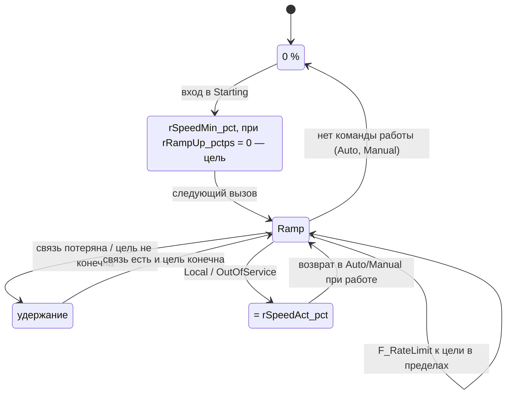

# FB_MotorVfd — двигатель с преобразователем частоты

Насос или вентилятор с ПЧ: всё, что делает [FB_Motor](FB_Motor.md) (режимы, пуск и стоп, блокировки и
разрешения, контроль ОС, Reset, времена, лимит пусков, счётчики), плюс задание скорости 0–100 % с
пределами и ограничением скорости изменения, обратная связь по скорости с контролем рассогласования,
отказ связи с ПЧ, авария и готовность ПЧ из слова состояния. Через `I_MotorVfd` ПИД станции берёт у
текущего ведущего насоса фактическую скорость и признак «задание действует», не зная экземпляра.
Наследует [FB_DeviceBase](FB_DeviceBase.md) через `FB_Motor`.

Карт регистров конкретных ПЧ в библиотеке нет: слово управления и слово состояния разбирает адаптер
приложения (проект 02, `FB_VfdAdapter_<Model>`), библиотека получает готовые сигналы. Cmd, Sts и Cfg —
те же типы, что у `FB_Motor`: одна мнемосхема и один шаблон генератора; отличие — `eDevType = MotorVfd`.

Исходник: `src/POUs/Devices/FB_MotorVfd/`. Контракт: раздел 14 [API.md](../API.md). Тип в `stCommon.eDevType`:
`E_DeviceType.MotorVfd`. Используется слотов тревог: 8 (`GVL_Const.MOT_ALARM_COUNT`), слоты 6–7 — ПЧ.

## Входы и выходы

Все входы и выходы [FB_Motor](FB_Motor.md#входы-и-выходы) и свои:

| Имя | Направление | Тип | Единицы | Описание |
|---|---|---|---|---|
| `rSpeedSpAuto_pct` | вход | `REAL` | % | задание скорости от автоматики (ПИД) в Auto |
| `xCommOk` | вход | `BOOL` | — | обмен с ПЧ исправен (статус слейва драйвера Modbus, диагностика адаптера); по умолчанию TRUE |
| `xVfdRunning` | вход | `BOOL` | — | ПЧ в работе (слово состояния) — ОС при `xFbFromComm` |
| `xVfdReady` | вход | `BOOL` | — | ПЧ готов к пуску (слово состояния); по умолчанию TRUE |
| `xVfdFault` | вход | `BOOL` | — | авария ПЧ (слово состояния) — внешняя авария двигателя |
| `rSpeedAct_pct` | вход | `REAL` | % от номинальной | фактическая скорость (слово состояния или аналоговый вход) |
| `rSpeedRef_pct` | выход | `REAL` | % | задание на ПЧ после пределов и рампы; 0 без команды работы |
| `xSpeedAutoActive` | выход | `BOOL` | — | Auto, Running и `wFault = 0`: задание ПИД действует, ПИД не в слежении |

`xQRun` и `xQReset` (из `FB_Motor`) адаптер переводит в биты слова управления; `xQReset` — по фронту.

| Член | Тип | Действие |
|---|---|---|
| `SpeedRef` | `REAL` | `rSpeedRef_pct` последнего вызова |
| `SpeedAct` | `REAL` | `rSpeedAct_pct` последнего вызова |
| `SpeedAutoActive` | `BOOL` | `xSpeedAutoActive` |
| `CheckConfig` | переопределение | биты `FB_Motor` (`SUPER^.CheckConfig`) OR биты ПЧ 8–11 |

Члены `I_Motor` (`Running`, `ReadyToStart`, `RunSeconds`, `CurrentRunSeconds`, `Starts`) и `PresetCounters()` —
от `FB_Motor`.

## Команды

Как у [FB_Motor](FB_Motor.md#команды-st_motorcmd); поле `rSpeedSp_pct` — задание оператора:

| Режим | Цель задания | Слежение `stCmd.rSpeedSp_pct` |
|---|---|---|
| Auto | `rSpeedSpAuto_pct` | := `LIMIT(rSpeedMin_pct, цель, rSpeedMax_pct)` — включение Manual без рывка |
| Manual | `stCmd.rSpeedSp_pct` | ограничивается пределами и записывается обратно |
| Local, OutOfService | — | := `rSpeedAct_pct` — возврат без рывка |

Не конечное значение (NaN, ±Inf, больше `REAL_SANE_MAX`) в `stCmd.rSpeedSp_pct` не пишется.

## Параметры ПЧ (`ST_VfdCfg`)

Поле `stCfg.stVfd`; остальные параметры — [FB_Motor](FB_Motor.md#параметры-st_motorcfg).

| Поле | Тип | По умолчанию | Описание | Проверка (`wCfgErr`) |
|---|---|---|---|---|
| `rSpeedMin_pct` | `REAL` | 0.0 | минимальное задание в работе, % (по данным насоса и двигателя); с него начинается рампа пуска | бит 8: `< 0`, `>= rSpeedMax_pct` или не конечно |
| `rSpeedMax_pct` | `REAL` | 100.0 | максимальное задание, % | бит 8: `> 100` или не конечно |
| `rRampUp_pctps` | `REAL` | 0.0 | ограничение роста задания, %/с; 0 — нет (работают рампы ПЧ) | бит 9: `< 0` или не конечно |
| `rRampDown_pctps` | `REAL` | 0.0 | ограничение спада задания, %/с; 0 — нет | бит 9: `< 0` или не конечно |
| `xFbFromComm` | `BOOL` | TRUE | ОС «в работе» — из слова состояния (`xVfdRunning`); FALSE — DI `xFbRun` | — |
| `xCommLossIsFault` | `BOOL` | TRUE | потеря связи — отказ; FALSE — только предупреждение (пуск/стоп проводами, по Modbus — задание) | — |
| `tCommLoss` | `TIME` | `T#3S` | фильтр потери связи | бит 10: `T#0S` |
| `rSpeedDev_pct` | `REAL` | 10.0 | допустимое рассогласование задания и факта, %; 0 — контроль выключен | бит 11: `< 0`, не конечно или `> 0` при `tSpeedDev = T#0S` |
| `tSpeedDev` | `TIME` | `T#10S` | задержка рассогласования | бит 11 (см. выше) |

Умолчания проходят `CheckConfig` (`MotorVfd_FirstCall_SetsTypeMotorVfdAndPassesDefaultCfg`).

## Порядок тела (нормативно, контракт 14.2)

```st
// 0. Источник времени: BeginCycle базы выполнится позже, внутри тела FB_Motor
ResolveTime();
// 1. Точки расширения FB_Motor (по LKG прошлого вызова; в первом вызове — по stCfg, если она корректна)
xVfdCommValid    := xCommOk AND F_IsFinite(rSpeedAct_pct);
fbVfdCommLoss(xIn := NOT xVfdCommValid, tOnDelay := tCommLoss, itfTime := itfTimeAct);
xFbOverride      := xFbFromComm;
xFbOverrideValue := xVfdRunning AND xVfdCommValid;
xFbInvalid       := xFbFromComm AND NOT xVfdCommValid;          // сразу, без задержки
xCommFault       := fbVfdCommLoss.xOut AND xCommLossIsFault;
xExtFaultAdd     := xVfdFault AND xVfdCommValid;                  // слово состояния — только при связи
xStartBlockAdd   := xVfdCommValid AND NOT xVfdReady;
eDevType         := E_DeviceType.MotorVfd;
// рассогласование, предупреждения (wWarningAdd), eDevStatusAdd, слоты тревог 6 и 7
// 2. Тело FB_Motor над теми же структурами — все VAR_IN_OUT явно (SUPER^(); — ошибка C0039)
SUPER^(stCmd := stCmd, stRetain := stRetain, stCfg := stCfg);
// 3. Задание скорости, слежение stCmd.rSpeedSp_pct, stSts.rSpeedRef_pct / rSpeedAct_pct, xSpeedAutoActive
```

Контроль ОС приостанавливается **с первого** пропущенного ответа, а не после `tCommLoss`: иначе за время
фильтра успел бы сработать ложный FailToStart. `ResolveTime()` первым — чтобы фильтр связи и в первом
вызове брал подменное время (иначе тест потери связи недетерминирован). После `SUPER^` уже выполнен
`FinishCycle` базы: `ltDt` ещё действителен, `xFirstCall` — уже FALSE.

## Задание скорости

- **Есть команда работы** (`xRunCmd`): `rSpeedRef_pct := F_RateLimit(rSpeedRef_pct, LIMIT(rSpeedMin_pct, цель,
  rSpeedMax_pct), rRampUp_pctps, rRampDown_pctps, dt)`. В вызове входа в Starting рампа начинается с
  `rSpeedMin_pct` (при `rRampUp_pctps = 0` — сразу цель в пределах; цель не конечна — `rSpeedMin_pct`,
  `MotorVfd_StartWithNaNTarget_RefStartsAtMin`).
- **Нет команды работы** в Auto/Manual (стоп, отказ, пауза): `rSpeedRef_pct := 0.0` — торможение рампой ПЧ.
- **Local, OutOfService:** задание следит за фактической скоростью — возврат в дистанционный режим без рывка.
- **Связь потеряна:** задание удерживается — передать его всё равно нельзя.
- **Цель не конечна** (NaN из Modbus или ПИД): задание удерживается, `MOT_WRN_SPEED_SP_INVALID`.
- **Нет корректной Cfg:** `rSpeedRef_pct := 0.0` (безопасное состояние, таблица 2.6 контракта).



## Связь с ПЧ

| Настройка | Потеря связи (до `tCommLoss`) | После `tCommLoss` | Восстановление |
|---|---|---|---|
| `xCommLossIsFault = TRUE` (по умолчанию) | ОС из слова состояния (`xFbFromComm = TRUE`) — контроль ОС приостановлен (`MOT_WRN_FB_SUSPENDED`), состояние удерживается; ОС по DI — контролируется как обычно; задание удерживается | нефиксируемый отказ: `wFault` бит 5, Fault, выходы сняты, `Available = FALSE`, тревога слота 6 | отказ снимается сам; состояние — по ОС: ПЧ работает и есть запрос — Running, запроса нет — штатный останов с контролем |
| `xCommLossIsFault = FALSE` (рекомендуемая схема: пуск/стоп и авария ПЧ проводами, `xFbFromComm = FALSE`) | ОС по DI контролируется как обычно | только `MOT_WRN_COMM_LOSS`, NE 107 OutOfSpecification, тревога слота 6; двигатель управляется дальше | предупреждение снимается |

Во время потери связи ПЛК **не может** остановить ПЧ, если команда идёт по Modbus: поведение задаёт сторожевой
таймер связи в самом ПЧ (A-05). Настройка — решение проекта 02 (`docs/MANUAL_STEPS.md` проекта 02).

- **Авария ПЧ** (`xVfdFault` при связи) — внешняя авария `FB_Motor` (фильтр `tExtFaultFilter`, фиксируется):
  Reset даёт импульс `xQReset`, и если ПЧ сбросил аварию в окне `tResetWindow`, отказ снимается без второго
  нажатия. Без связи слово состояния не учитывается (`MotorVfd_CommLost_StatusWordIgnored`): Reset в это время
  снимает зафиксированную аварию ПЧ (причина не видна), и если ПЧ всё ещё в аварии, ExtFault снова
  зафиксируется через `tExtFaultFilter` после восстановления связи.
- **ПЧ не готов** (`xVfdReady = FALSE` при связи) — запрет пуска: `MOT_STS_PERMIT_MISSING`, `RejectedPermit`,
  в Auto запрос ждёт.

Наладка (ограничения контракта, не ошибки реализации):
- **Единичные пропуски ответа** приостанавливают контроль ОС и сбрасывают его таймеры (13.6, 14.2). При ОС из
  слова состояния и частых пропусках (плохая линия, ответ теряется раз в 1–2 с) таймер FailToStart каждый раз
  начинается заново, а фильтр `tCommLoss` не успевает сработать: неудачный пуск может не дать отказа, и
  `Available` остаётся TRUE. Повторы запроса и фильтр единичных пропусков — в драйвере Modbus до `xCommOk`;
  тревога качества связи — на стороне приложения (проект 02).
- **`SpeedAutoActive` при потере связи без отказа** (`xCommLossIsFault = FALSE`) остаётся TRUE (формула
  контракта 6: Auto, Running, `wFault = 0`), хотя задание до ПЧ не доходит. ПИД станции на это время лучше
  перевести в слежение по биту `MOT_WRN_COMM_LOSS` — иначе интегратор накапливается против замершего задания.

## Рассогласование скорости

Условие: `rSpeedDev_pct > 0`, двигатель в Running, рампа задания завершена, связь есть,
`|задание − факт| > rSpeedDev_pct` дольше `tSpeedDev` (задание — прошлого вызова, факт — этого).
Реакция: `MOT_WRN_SPEED_DEV`, тревога слота 7 (значение — фактическая скорость), NE 107 OutOfSpecification.
Это не отказ: ПЧ в токоограничении на забитом насосе — повод для обслуживания, а не для останова.
Во время рампы контроль не действует (`MotorVfd_SpeedDeviationDuringRamp_Ignored`): медленная рампа ПЛК
дольше `tSpeedDev` не даёт ложного предупреждения.

Наладка: при `rRampUp_pctps = 0` (по умолчанию) разгон ведёт сам ПЧ, а «рампа задания завершена» наступает
сразу — задание равно цели с первого вызова. Тогда ПЧ должен дойти до «цель − `rSpeedDev_pct`» быстрее
`tSpeedDev`, иначе предупреждение появится в каждом пуске. При линейном разгоне 0–100 % за время T и цели
100 % это 0,9·T < `tSpeedDev`: с умолчаниями (10 %, `T#10S`) — T меньше 11 с. Время разгона — параметр
конкретного ПЧ, сверить при наладке.

## Безопасное состояние

| Ситуация | Выходы и значения |
|---|---|
| Корректной Cfg ещё не было | `xQRun := FALSE`, `rSpeedRef_pct := 0` |
| Отказ | `xQRun := FALSE`, `rSpeedRef_pct := 0` (при потере связи — удерживается: передать нельзя) |
| OutOfService, Local | `xQRun := FALSE`, задание следит за фактической скоростью |

## Отказы и тревоги

Слоты 0–5 — как у [FB_Motor](FB_Motor.md#отказы-и-тревоги). Слоты ПЧ:

| Слот (`E_MotorAlarm`) | Условие | Фиксация до Reset | Приоритет по умолч. | `wFault` / `wWarning` | Код |
|---|---|---|---|---|---|
| 6 `CommLoss` | связи нет дольше `tCommLoss` (оба режима `xCommLossIsFault`) | нет | Medium | `MOT_FLT_COMM_LOSS` или `MOT_WRN_COMM_LOSS` | `COM` |
| 7 `SpeedDeviation` | рассогласование дольше `tSpeedDev` | нет | Low | `MOT_WRN_SPEED_DEV` | `SPD` |

## Статус и готовность

- `eDevStatus`: как у `FB_Motor`, плюс OutOfSpecification при рассогласовании и при потере связи без отказа.
- `Available`: как у `FB_Motor`; при отказе связи — FALSE (станция запускает резерв).
- `SpeedAutoActive = (eMode = Auto) AND (eState = Running) AND (wFault = 0)`.

## Карта битов ПЧ

Биты `FB_Motor` — [FB_Motor](FB_Motor.md#карта-битов). Биты, которые формирует только `FB_MotorVfd`:

| Бит | `wFault` | `wWarning` | `wCfgErr` |
|---|---|---|---|
| 2 | — | `MOT_WRN_SPEED_DEV` — рассогласование скорости | — |
| 5 | `MOT_FLT_COMM_LOSS` — отказ связи (`xCommLossIsFault`, не фиксируется) | — | — |
| 6 | — | `MOT_WRN_COMM_LOSS` — потеря связи без отказа (кроме OOS) | — |
| 8 | — | `MOT_WRN_SPEED_SP_INVALID` — цель не конечна, задание удерживается | `MOT_CFG_VFD_SPEED_LIMITS` |
| 9 | — | — | `MOT_CFG_VFD_RAMP` |
| 10 | — | — | `MOT_CFG_VFD_COMM` |
| 11 | — | — | `MOT_CFG_VFD_SPEED_DEV` |

Раскладка `ST_MotorSts` — [FB_Motor](FB_Motor.md#раскладка-st_motorsts-карта-регистров): у ПЧ заполнены
`rSpeedRef_pct` (смещение 56) и `rSpeedAct_pct` (60).

## Пример вызова

```st
// логика станции — ДО вызова: запрос, задание ПИД, блокировка «сухой ход»
GVL_Devices.fbP101.xAutoRun         := GVL_Station.axPumpRun[1];
GVL_Devices.fbP101.rSpeedSpAuto_pct := GVL_Station.fbLevelPid.rOut_pct;
GVL_Devices.fbP101.wInterlock       := GVL_Station.awPumpInterlock[1];
// PRG_Devices (генерирует iolistgen): сигналы перечня и все VAR_IN_OUT в каждом вызове
GVL_Devices.fbP101(xFbRun := GVL_IO.xP101_Run, xExtFault := GVL_IO.xP101_Fault, xLocal := GVL_IO.xP101_Local,
                   xPowerOk := GVL_Devices.fbPWR1.xValue, xCommOk := GVL_IO.xP101_CommOk,
                   xVfdRunning := GVL_IO.xP101_VfdRun, xVfdReady := GVL_IO.xP101_VfdReady,
                   xVfdFault := GVL_IO.xP101_VfdFault, rSpeedAct_pct := GVL_IO.rP101_SpeedAct_pct,
                   stCmd := GVL_Hmi.stP101Cmd, stCfg := GVL_Persist.stP101Cfg,
                   stRetain := GVL_Persist.stP101Retain);
GVL_IO.xP101_QRun         := GVL_Devices.fbP101.xQRun;
GVL_IO.rP101_SpeedRef_pct := GVL_Devices.fbP101.rSpeedRef_pct;
// ПИД уровня — слежение и фактический выход от текущего ведущего насоса
itfLeadPump := GVL_Devices.fbP101;                       // PL.I_MotorVfd
xPidTrack   := NOT itfLeadPump.SpeedAutoActive;
```

## Допущения и отклонения

Решения, которые контракт не задаёт или задаёт неоднозначно; интегратор переносит их в
[ASSUMPTIONS.md](../ASSUMPTIONS.md). Решения `FB_Motor` (M-01…M-23) действуют и здесь.

| № | Суть | Обоснование / чем проверено |
|---|---|---|
| V-01 | В **первом** вызове точки расширения берут параметры ПЧ из `stCfg`, если она проходит `CheckConfig`, а не умолчания `stCfgLkg` (контракт 14.2: «в первом — умолчания»); дальше — LKG прошлого вызова | При ОС по DI (`xFbFromComm = FALSE`) и непрочитанном ещё слове состояния умолчание `xFbFromComm = TRUE` дало бы в первом вызове ОС = 0: работающий двигатель не подхватился бы, а со второго вызова сработал бы ложный UncommandedRun. `MotorVfd_PlcRestartFbFromDi_AdoptedWithoutFault` |
| V-02 | В Local и OutOfService `rSpeedRef_pct` следит за `rSpeedAct_pct`, а не равно 0 («нет команды работы: 0» относится к Auto/Manual) | Возврат из Local в Manual при работающем ПЧ — без провала задания до 0 и рампы с нуля. ПЧ в Local задание ПЛК не использует. `MotorVfd_LocalMode_RefTracksActualSpeed` |
| V-03 | При `rRampUp_pctps = 0` вход в Starting даёт сразу цель в пределах, а не `rSpeedMin_pct` | Без ограничения роста рампу ведёт ПЧ; один цикл на минимуме ничего не даёт. С ограничением — старт с минимума по контракту (`MotorVfd_StartPresetsRampToMin`) |
| V-04 | Предупреждения `MOT_WRN_SPEED_SP_INVALID` и `MOT_WRN_COMM_LOSS` (кроме OOS) вычисляются до `SUPER^` по режиму на начало вызова: в вызове смены режима они относятся к прежнему режиму | `wWarningAdd` — точка расширения: её читает тело `FB_Motor` внутри `SUPER^` |
| V-05 | «Рампа завершена» для контроля рассогласования — задание равно цели в пределах (сравнение без `=` для REAL: не меньше и не больше) | `F_RateLimit` выдаёт цель точно, когда дошёл до неё |
| V-06 | `xSpeedAutoActive` — по `eState = Running` (а не `xRunning`): в Stopping по ОС двигатель ещё вращается, но задание ПИД уже не действует | `MotorVfd_ImplementsIMotorVfd_LeadPumpProperties` |
| V-07 | Не конечное задание оператора в Manual не перезаписывается: предупреждение держится, пока оператор не введёт число | Перезапись текущим заданием спрятала бы ошибку SCADA за один цикл |
| V-08 | Подхват работающего ПЧ после старта ПЛК ждёт первой достоверной ОС (связи), а не только первого вызова — решение M-18 `FB_Motor`, ради ПЧ по Modbus | `MotorVfd_PlcRestartCommLater_AdoptedWithoutFault` |

Фундамент не менялся.

## Статанализ

- CODESYS 3.5.17.30: `build --tests`, `check --tests` — 0 ошибок, 0 предупреждений.
- iec_checker 0.4: ошибок разбора нет; PLCOPEN-CP9 обоснована (классическая сложность тела 20, `CheckConfig` — 8);
  PLCOPEN-CP28 (сравнение времени на равенство) — `tCommLoss <= T#0S` вместо `= T#0S` (TIME без знака — то же).
- RuSTy 1.0.6: `FB_MotorVfd.st` исключён (`tools/check/rusty_exclude.txt`): `SUPER^` и `CheckConfig` со
  `stCfg` (`VAR_IN_OUT CONSTANT`) — E031, E034, E036.

## Проверено в CODESYS (Control Win V3, 32 бит)

- R3 контракта для `FB_MotorVfd`: `SUPER^(stCmd := stCmd, stRetain := stRetain, stCfg := stCfg)` выполняет
  тело `FB_Motor` над структурами вызывающего — импульсы `stCmd` сбрасываются, режим пишется в `stRetain`,
  точки расширения до `SUPER^` действуют (все тесты набора, 16.10.2026).
- Виртуальный вызов `THIS^.CheckConfig` из тела `FB_Motor` попадает в переопределение:
  `MotorVfd_InvalidSpeedLimits_CfgErrBit8`.
- `FB_Motor` и `FB_MotorVfd` в одном массиве `I_Motor`: `MotorVfd_ImplementsIMotor_PolymorphicArray`.
- Мутационная проверка (16.10.2026, 12 мутаций, из них 5 в `FB_MotorVfd`): таблица — в
  [FB_Motor](FB_Motor.md#проверено-в-codesys-control-win-v3-32-бит); выжившие мутации ПЧ (слово состояния без
  связи, OutOfService, пуск с не конечной целью, недостоверная ОС при торможении) убиты новыми тестами набора.

## Тесты (`FB_MotorVfd_Test`)

Из списка контракта (17, ★ 8): ★ `MotorVfd_FirstCallFakeTime_CommLossDeterministic`,
`MotorVfd_ImplementsIMotorVfd_LeadPumpProperties`, ★ `MotorVfd_SpeedRamp_LimitsRate`, ★ `MotorVfd_SpeedClampedToMinMax`,
`MotorVfd_StartPresetsRampToMin`, ★ `MotorVfd_StopSetsRefZero`, ★ `MotorVfd_CommLoss_FaultAfterDelayNotLatched`,
★ `MotorVfd_CommLoss_SuppressesFeedbackSupervisionImmediately`, `MotorVfd_CommRestored_RunningWithoutDemand_Stops`,
`MotorVfd_CommLossNotFault_Warning`, `MotorVfd_VfdFault_TripsAndResetPulses`, `MotorVfd_VfdNotReady_BlocksStart`,
`MotorVfd_SpeedDeviation_WarningAfterDelay`, `MotorVfd_ManualSpeed_TracksAutoForBumpless`, `MotorVfd_SpeedSpNaN_HoldsRef`,
★ `MotorVfd_InvalidSpeedLimits_CfgErrBit8`, ★ `MotorVfd_ImplementsIMotor_PolymorphicArray`.

Сверх контракта (10): `MotorVfd_FirstCall_SetsTypeMotorVfdAndPassesDefaultCfg`, `MotorVfd_CfgChecks_RampCommSpeedDevBits`,
`MotorVfd_LocalMode_RefTracksActualSpeed`, `MotorVfd_PlcRestartFbFromDi_AdoptedWithoutFault`,
`MotorVfd_PlcRestartCommLater_AdoptedWithoutFault`, `MotorVfd_SpeedDeviationDuringRamp_Ignored`;
по мутационной проверке: `MotorVfd_CommLost_StatusWordIgnored`, `MotorVfd_CommLossInOos_NoFaultNoWarning`,
`MotorVfd_StartWithNaNTarget_RefStartsAtMin`, `MotorVfd_CommLossWhileStopping_HoldsStopping`.

Числа рампы — `tools/reference/motor.py` (сценарии `ramp_*`, `start_preset_*`), сверка модели с тестами —
`tools/project_checks/test_motor_reference.py`.
