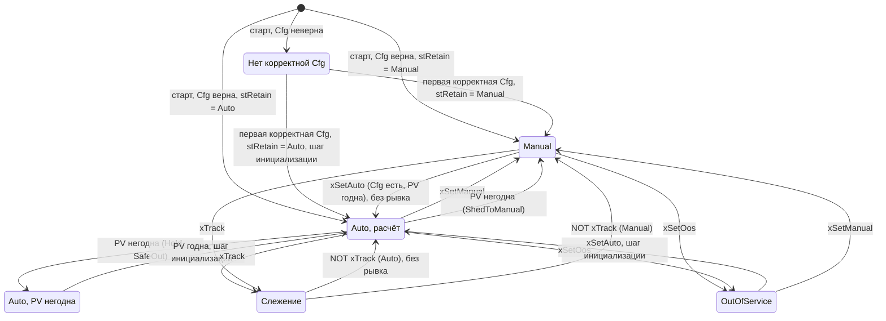

# FB_PID — ПИД-регулятор

Назначение: регулятор одного контура (уровень в резервуаре КНС через частоту насосов, давление,
температура) в идеальной форме ISA: Kp, Ti, Td. D-составляющая считается по измерению и
фильтруется, интегратор защищён от насыщения обратным расчётом — по своему выходу или по
фактическому выходу механизма (насыщение на минимальной частоте ПЧ, которое видит только
механизм). Есть пределы и ограничение скорости выхода, Manual и слежение с безударным переходом,
внешнее или операторское задание с рампой, прямое и обратное действие, зона нечувствительности,
расчёт по реальному `dt` источника времени и реакция на недостоверную PV. Наследует
[FB_DeviceBase](FB_DeviceBase.md): режимы, конфигурация (LKG), NE 107, квитирование и тревоги — по
общим правилам базы.

Исходник: `src/POUs/Control/FB_PID/`. Контракт: раздел 17 [API.md](../API.md). Тип в
`stCommon.eDevType`: `E_DeviceType.Pid`. Используется слотов тревог: 1 (`GVL_Const.PID_ALARM_COUNT`).
Эталон алгоритма и модель объекта для тестов — `tools/reference/pid.py`.

## Входы и выходы

| Имя | Направление | Тип | Единицы | Описание |
|---|---|---|---|---|
| `itfTime` | вход | `I_TimeSource` | — | источник времени; 0 — системное время. В тестах — `FB_FakeTime` |
| `rPv_eu` | вход | `REAL` | инж. ед. | регулируемая величина (обычно `fbLT101.rValue_eu`) |
| `xPvValid` | вход | `BOOL` | — | PV достоверна (обычно `fbLT101.xValid`). По умолчанию FALSE: забытая привязка видна сразу. Неконечная `rPv_eu` тоже считается недостоверной (P-04) |
| `xSpExt` | вход | `BOOL` | — | задание от логики (каскад, график), а не от оператора |
| `rSpExt_eu` | вход | `REAL` | инж. ед. | внешнее задание |
| `xTrack` | вход | `BOOL` | — | слежение: выход := `rTrack_pct` (механизм не в Auto или стоит) |
| `rTrack_pct` | вход | `REAL` | % | значение для слежения (например, `itfLeadPump.SpeedRef`) |
| `rOutAct_pct` | вход | `REAL` | % | фактический выход механизма; используется при `stCfg.xUseOutAct` |
| `stCmd` | `VAR_IN_OUT` | `ST_PidCmd` | — | команды HMI/SCADA (`GVL_Hmi.st<TAG>Cmd`) |
| `stCfg` | `VAR_IN_OUT CONSTANT` | `ST_PidCfg` | — | параметры (`GVL_Persist.st<TAG>Cfg`) |
| `stRetain` | `VAR_IN_OUT` | `ST_DeviceRetain` | — | дистанционный режим и OOS (`GVL_Persist.st<TAG>Retain`); счётчики не используются |
| `rOut_pct` | выход | `REAL` | % | выход регулятора |
| `xSatHigh` | выход | `BOOL` | — | выход на верхнем пределе (`rOut_pct >= rOutMax_pct`); FALSE без корректной Cfg |
| `xSatLow` | выход | `BOOL` | — | выход на нижнем пределе (`rOut_pct <= rOutMin_pct`); FALSE без корректной Cfg |
| `stSts` | выход | `ST_PidSts` | — | состояние для HMI/SCADA (раскладка — ниже) |

Общие для всех устройств методы и свойства (`Reset`, `AckAll`, `RequestMode`, `GetAlarm`, `Mode`,
`Status`, `Fault`, `Available`, `AlarmCount`) — в [FB_DeviceBase](FB_DeviceBase.md#публичные-методы-и-свойства-i_device-i_alarmsource).
Публичных методов сверх них нет. Защищённые методы (для наследника, если он появится; имена
зарезервированы):

| Член | Тип | Действие |
|---|---|---|
| `CheckConfig(stCfgIn)` | `WORD` | биты `wCfgErr` (карта ниже); ничего не меняет |
| `OnModeChanged(eOld, eNew)` | — | хук базы: выход из OutOfService — следующий расчёт будет шагом инициализации; вход в Auto — `I := u - P - D` |
| `CalcStep(xInit, lrStep_s, xSpFollow)` | — | шаг расчёта 17.4: рампа задания, ошибка, зона нечувствительности, P, D, v |
| `SelectOutput(xCalcNow, xInit, lrStep_s, rManualOut_pct)` | — | выбор выхода по таблице 17.5, интегратор, `rOut_pct`, `xSatHigh`, `xSatLow` |
| `RateStep(lrCurrent, lrTarget, lrRate, lrStep_s)` | `LREAL` | ограничение скорости в `LREAL` (рампа задания и выхода) |

## Команды (`ST_PidCmd`)

| Поле | Вид | Действие | Результат (`eCmdResult`) |
|---|---|---|---|
| `stCommon` | общий заголовок | режимы, Reset, квитирование, маски тревог | [FB_DeviceBase](FB_DeviceBase.md#режимы) |
| `stCommon.xSetAuto` (и `RequestMode(Auto)`) | импульс | в Auto | `Accepted`; без корректной Cfg — `RejectedCfg`; PV негодна — `RejectedFault` (запрос снимается) |
| `stCommon.xReset` (и `Reset()`) | импульс | фиксируемых отказов у ПИД нет: квитирование тревог | всегда `Accepted` |
| `rSp_eu` | значение | задание оператора, инж. ед. При `xSpExt` ФБ пишет сюда внешнее задание, в Manual при `xSpTrackPv` — PV | — |
| `rManualOut_pct` | значение | выход в Manual, %. В Auto, при слежении и в OutOfService ФБ пишет сюда текущий выход: переход в Manual без рывка | — |

`xSetOos` принимается всегда (`xOosAllowed = TRUE`): у регулятора нет движущегося механизма.

## Параметры (`ST_PidCfg`)

| Поле | Тип | По умолчанию | Описание | Проверка (`wCfgErr`) |
|---|---|---|---|---|
| `eAction` | `E_PidAction` | `Reverse` | `Reverse`: PV растёт — выход падает (e = SP − PV; нагрев, подача). `Direct`: PV растёт — выход растёт (e = PV − SP; уровень → скорость откачки) | бит 0 — вне перечисления |
| `rKp` | `REAL` | 1.0 | коэффициент, % выхода на % диапазона PV; знак — только через `eAction` | бит 1 — `<= 0` или не конечен |
| `rTi_s` | `REAL` | 30.0 | время интегрирования, с; 0 — без I (интегратор = смещение, задаётся предустановкой) | бит 2 — `< 0` |
| `rTd_s` | `REAL` | 0.0 | время дифференцирования, с; 0 — без D | бит 2 — `< 0` |
| `rDFilterN` | `REAL` | 10.0 | фильтр D: `Tf = Td / N` | бит 3 — при `Td > 0` вне 2…50 (`PID_DFILTER_N_MIN…MAX`); не конечен — всегда |
| `rTt_s` | `REAL` | 0.0 | постоянная слежения anti-windup, с; 0 — авто: `SQRT(Ti·Td)` при `Td > 0`, иначе `Ti` | бит 4 — `< 0` |
| `rPvMin_eu`, `rPvMax_eu` | `REAL` | 0.0, 100.0 | диапазон PV для нормировки ошибки (как у датчика) | бит 5 — `min >= max` |
| `rSpMin_eu`, `rSpMax_eu` | `REAL` | 0.0, 100.0 | пределы задания (равные допустимы) | бит 6 — `min > max` |
| `rSpRate_ups` | `REAL` | 0.0 | рампа задания, инж. ед./с; 0 — без рампы | бит 9 — `< 0` |
| `rOutMin_pct`, `rOutMax_pct` | `REAL` | 0.0, 100.0 | пределы выхода в Auto и Manual | бит 7 — `min < 0`, `max > 100` или `min >= max` |
| `rOutRate_pctps` | `REAL` | 0.0 | ограничение скорости выхода в Auto, %/с; 0 — нет | бит 9 — `< 0` |
| `rDeadband_pct` | `REAL` | 0.0 | зона нечувствительности по ошибке, % диапазона PV | бит 8 — вне 0…10 (`PID_DEADBAND_MAX_PCT`) |
| `tSample` | `TIME` | `T#0S` | период расчёта; `T#0S` — каждый вызов | бит 10 — `tSample >= tDtMax` |
| `tDtMax` | `TIME` | `T#2S` | больший шаг времени — разрыв (стоп ПЛК, отладка): шаг инициализации | бит 10 — `T#0S` |
| `ePvFailAction` | `E_PidPvFailAction` | `Hold` | реакция на негодную PV в Auto (ниже) | бит 11 — вне перечисления |
| `rSafeOut_pct` | `REAL` | 0.0 | выход при `SafeOut` | бит 11 — вне `[rOutMin_pct, rOutMax_pct]`, **проверяется при любой реакции** (P-11) |
| `xSpTrackPv` | `BOOL` | FALSE | в Manual задание следует за PV | — |
| `xUseOutAct` | `BOOL` | FALSE | обратный расчёт по `rOutAct_pct` (внешнее насыщение) | — |
| `udiAlarmIdBase` | `UDINT` | 0 | номер первой тревоги устройства | — |
| `astAlarm` | `ARRAY[0..7] OF ST_AlarmCfg` | слот 0 — Medium, остальные None | приоритеты, задержки, shelve по слотам | бит 12 `PID_CFG_ALARM` — приоритет вне перечисления |

Все REAL-параметры проверяются и на конечность (`F_IsFinite`): неконечное значение даёт бит своей
группы. Значения по умолчанию проходят `CheckConfig` (тест `Pid_DefaultCfg_PassesCheck`).

> При `rOutMin_pct > 0` задайте `rSafeOut_pct` в пределах выхода, даже если реакция `Hold`:
> иначе Cfg не пройдёт проверку (бит 11), и регулятор останется без расчёта.

## Алгоритм (шаг расчёта, контракт 17.4)

```text
s      = +1 (Reverse) | −1 (Direct)
e      = s · (SP − PV) · 100 / (PvMax − PvMin)                       [% диапазона PV]
e'     = 0, если |e| <= DB;   иначе e − DB · SIGN(e)                (без скачка на границе зоны)
P      = Kp · e'
Tf     = Td / N
D      = Tf/(Tf + dt) · D_prev − Kp · Td/(Tf + dt) · s · (PV − PV_prev) · 100 / (PvMax − PvMin)
v      = P + I + D
Auto:  uLim = LIMIT(OutMin, v, OutMax);  u = RateStep(u_prev, uLim, OutRate, dt)
       u_aw = rOutAct_pct при xUseOutAct, иначе u
       I    = I + Kp · dt/Ti · e' + MIN(dt/Tt, 1) · (u_aw − v)            (при Ti = 0 I не меняется)
вне Auto (Manual, слежение, OutOfService):  I = u − P − D
```

- Состояние — `LREAL`: I, D, P, v, PV прошлого шага, задание после рампы, выход. Входы и выходы — `REAL`.
- `dt` — реальное время между расчётами из `itfTime` (`F_LTimeToSec`). Расчёт выполняется, если
  прошло не меньше `tSample` (`T#0S` — каждый вызов) и больше 0; между расчётами выход держится.
- **Шаг инициализации**: `PV_prev := PV`, `D := 0`, интегрирования нет, выход прежний,
  `I := u − P − D` (следующий расчёт начинается с `v = u`, P-01). Когда:
  - первый расчёт после старта ПЛК — бит `PID_STS_DT_GAP` и предупреждение `PID_WRN_DT_GAP` на один
    вызов. Когда бы он ни случился: сразу при старте, после первой корректной Cfg или после первой
    годной PV;
  - разрыв: прошло больше `tDtMax` (ровно `tDtMax` — ещё обычный шаг) или время ушло назад — тоже с
    битом и предупреждением;
  - PV снова годна (расчёт уже был), выход из OutOfService — без бита (P-03).
- Два вызова с одним и тем же временем (`dt = 0`) — расчёта нет, выход держится (P-02).
- D по измерению: ступень задания не даёт «удара» по выходу. Обратная разность Эйлера для фильтра
  устойчива при любом `dt`.
- Почему обратный расчёт, а не условное интегрирование: на КНС насыщение почти всегда внешнее
  (насос на минимальной частоте, частоту ограничивает `FB_MotorVfd`), его видит только обратный
  расчёт по `rOutAct_pct` (DECISIONS.md, D-13). Тот же член `u − v` сдерживает интегратор при
  ограничении скорости выхода. Рекомендация `Tt = SQRT(Ti·Td)` — по Åström & Hägglund, **сверить**
  с «Advanced PID Control» (S5 контракта). `MIN(dt/Tt, 1)` ограничивает множитель единицей: без
  него при `Tt < dt` интегратор перелетал бы через `u − v` (сценарий `tt_small`). Но при `Tt <= dt`
  и `rOutAct_pct`, который приходит с задержкой на цикл (17.3: задание ПЧ с прошлого цикла),
  устойчивость только граничная: у интегратора остаётся незатухающая составляющая с периодом
  `2·dt` (раздел «Настройка»).

## Задание

- Цель: `rSpExt_eu` при `xSpExt`; в Manual при `xSpTrackPv` (и без `xSpExt`) — PV; иначе
  `stCmd.rSp_eu`. Затем `LIMIT(rSpMin_eu, цель, rSpMax_eu)` → `stSts.rSpTarget_eu`.
- Цель не конечна (NaN из Modbus) — прежняя цель и `PID_WRN_SP_INVALID`. Прежняя цель тоже
  ограничивается текущими пределами: NaN уже в первом вызове даёт цель `LIMIT(rSpMin_eu, 0,
  rSpMax_eu)`, а не 0 вне пределов; сужение пределов при NaN ограничивает удерживаемую цель (P-16).
- При `xSpExt` ФБ пишет внешнее задание в `stCmd.rSp_eu`, в Manual при `xSpTrackPv` — PV: переход на
  операторское задание и в Auto — без рывка.
- Рампа `rSpRate_ups` идёт на шагах расчёта (`dt`), в том числе в Manual и при слежении;
  `stSts.rSp_eu` — действующее задание. Первый расчёт берёт цель сразу (рампы от нуля нет); при
  слежении за PV задание равно цели без рампы.

## Режимы

| Режим | Выход | Интегратор | Слежение в Cmd |
|---|---|---|---|
| Auto | `u` по алгоритму | обратный расчёт | `rManualOut_pct := u` |
| Manual | `LIMIT(rOutMin_pct, stCmd.rManualOut_pct, rOutMax_pct)`, без ограничения скорости | `I := u − P − D` | при `xSpTrackPv`: `rSp_eu := PV` |
| слежение `xTrack` (в Auto или Manual) | `rTrack_pct` без пределов (механизм может стоять на 0) | `I := u − P − D` | `rManualOut_pct := u` |
| OutOfService | удерживается, расчёта нет | `I := u − P − D` | `rManualOut_pct := u` |
| Auto, PV негодна, `Hold` | удерживается | заморожен; возврат PV — шаг инициализации | `rManualOut_pct := u` |
| Auto, PV негодна, `SafeOut` | `rSafeOut_pct` без рампы | как при `Hold` | то же |
| Auto, PV негодна, `ShedToManual` | `SwitchRemoteMode(Manual)` с текущим выходом | — | `rManualOut_pct` уже равен выходу |
| нет корректной Cfg | `LIMIT(0, stCmd.rManualOut_pct, 100)`, расчёта нет | — | — |

`xLocalSupported = FALSE` (режима Local нет), `xOosAllowed = TRUE`. Перед `ProcessMode` тело
снимает запрос Auto без корректной Cfg (`RejectedCfg`) или при негодной PV (`RejectedFault`).
Неконечные `rManualOut_pct` или `rTrack_pct` — выход прежний. Старт ПЛК: режим — из `stRetain`,
выход — `rOutAct_pct` при `xUseOutAct`, иначе `rTrack_pct` при `xTrack`, иначе
`stCmd.rManualOut_pct` (неконечное значение источника — следующий источник); интегратор
инициализирует шаг инициализации первого расчёта.

> `stCmd` живёт в `GVL_Hmi` и энергонезависимым не является (18.1 контракта: в Persistent
> Variables — только `stCfg` и `stRetain`). После пропадания питания режим Auto восстанавливается
> из `stRetain`, а `stCmd.rSp_eu` и `stCmd.rManualOut_pct` — нули: регулятор работает на задание
> `LIMIT(rSpMin_eu, 0, rSpMax_eu)`, пока оператор или SCADA не запишут прежнее. Сохранить задание
> оператора — решение приложения (P-Q1 в [ASSUMPTIONS.md](../ASSUMPTIONS.md#открытые-вопросы-семейств-решения-интеграции): проект 02 хранит его в Persistent Variables; ФБ не знает, где лежит `stCmd`).

## Состояния



Выходы по состояниям — таблица «Режимы». Без корректной Cfg Manual и OutOfService переключаются,
запрос Auto отклоняется (`RejectedCfg`); если `stRetain` при старте хранит Auto, режим остаётся Auto,
но выход всё равно идёт по строке «нет корректной Cfg». Разрыв времени в Auto (стоп ПЛК, «время назад») не меняет режим: один шаг
инициализации с битом `DT_GAP`.

## Безопасное состояние

| Ситуация | Выходы и значения |
|---|---|
| Корректной Cfg ещё не было | расчёта нет, `rOut_pct := LIMIT(0, stCmd.rManualOut_pct, 100)`; `xSatHigh = xSatLow = FALSE` (таблица 2.6 контракта) |
| Отказ (PV негодна в Auto) | по `ePvFailAction`: `Hold` — удержание, `SafeOut` — `rSafeOut_pct`, `ShedToManual` — Manual с текущим выходом |
| OutOfService | удержание выхода (A-09) |
| Local | режима нет |

## Отказы и тревоги

| Слот (`E_PidAlarm`) | Условие | Подавление | Фиксация до Reset | Приоритет по умолч. | `wFault` |
|---|---|---|---|---|---|
| 0 `PvInvalid` (суффикс `PVF`) | PV негодна (`NOT xPvValid` или неконечна) и режим Auto; после `ShedToManual` — и в Manual, пока PV не вернётся или оператор не выберет OutOfService (P-15) | — | нет | Medium | бит 0 — PV негодна в Auto без слежения |

В Auto при слежении PV негодна: тревога по условию контракта есть, но `wFault = 0` и статус не
Failure — регулятор в этот момент не управляет (P-10). После `ShedToManual` тревога тоже есть,
а статус — Good, как в любом Manual: контур уже ведёт оператор, тревога говорит ему, почему.

## Статус и готовность

- `eDevStatus`: Failure, если PV негодна в Auto без слежения; иначе Good. Сводный NE 107 — по базе
  (OutOfService и неверная Cfg — CheckFunction).
- `xAvailableDev = (eMode = Auto) AND PV годна AND NOT xTrack`.

## Карта битов

| Бит | `wStatus` (младший байт) | `wFault` | `wWarning` | `wCfgErr` |
|---|---|---|---|---|
| 0 | `PID_STS_SAT_HIGH` — `xSatHigh` | `PID_FLT_PV_INVALID` — PV негодна в Auto без слежения | `PID_WRN_DT_GAP` — шаг инициализации по времени (один вызов) | `PID_CFG_ACTION` — `eAction` вне перечисления |
| 1 | `PID_STS_SAT_LOW` — `xSatLow` | — | `PID_WRN_SP_INVALID` — цель задания не конечна | `PID_CFG_KP` — `rKp <= 0` или не конечен |
| 2 | `PID_STS_SP_RAMPING` — действующее задание ≠ цели (есть Cfg, не OOS) | — | — | `PID_CFG_TI_TD` — `rTi_s < 0` или `rTd_s < 0` |
| 3 | `PID_STS_IN_DEADBAND` — `\|e\| <= rDeadband_pct > 0` в последнем расчёте | — | — | `PID_CFG_DFILTER` — `rTd_s > 0` и `rDFilterN` вне 2…50 |
| 4 | `PID_STS_PV_FAIL` — PV негодна (любой режим) | — | — | `PID_CFG_TT` — `rTt_s < 0` |
| 5 | `PID_STS_DT_GAP` — шаг инициализации по времени в этом вызове | — | — | `PID_CFG_PV_RANGE` — `rPvMin_eu >= rPvMax_eu` |
| 6 | `PID_STS_TRACKING` — выход следует за `rTrack_pct` | — | — | `PID_CFG_SP_RANGE` — `rSpMin_eu > rSpMax_eu` |
| 7 | `PID_STS_OUT_RATE_LIMITED` — выход ограничен по скорости (последний расчёт в Auto) | — | — | `PID_CFG_OUT_RANGE` — `rOutMin_pct < 0`, `rOutMax_pct > 100` или `min >= max` |
| 8 | — | — | — | `PID_CFG_DEADBAND` — `rDeadband_pct` вне 0…10 |
| 9 | — | — | — | `PID_CFG_RATES` — `rSpRate_ups < 0` или `rOutRate_pctps < 0` |
| 10 | — | — | — | `PID_CFG_SAMPLE` — `tDtMax = T#0S` или `tSample >= tDtMax` |
| 11 | — | — | — | `PID_CFG_PV_FAIL` — `ePvFailAction` вне перечисления или `rSafeOut_pct` вне пределов выхода |
| 12 | — | — | — | `PID_CFG_ALARM` — приоритет тревоги вне перечисления |

Старший байт `wStatus` — общий ([FB_DeviceBase](FB_DeviceBase.md#карта-битов)).

## Раскладка `ST_PidSts` (карта регистров)

| Смещение, байт | Регистр | Поле | Тип | Описание |
|---|---|---|---|---|
| 0…27 | 0…13 | `stCommon` | `ST_DeviceSts` | общий заголовок |
| 28 | 14 | `rSpTarget_eu` | `REAL` | цель задания после пределов, до рампы |
| 32 | 16 | `rSp_eu` | `REAL` | действующее задание (после рампы) |
| 36 | 18 | `rPv_eu` | `REAL` | PV (вход как есть; неконечная — 0.0, F-33) |
| 40 | 20 | `rErr_pct` | `REAL` | ошибка e' последнего расчёта, % диапазона PV, со знаком действия |
| 44 | 22 | `rOut_pct` | `REAL` | выход |
| 48 | 24 | `rP_pct` | `REAL` | P последнего расчёта |
| 52 | 26 | `rI_pct` | `REAL` | I после обновления в этом вызове (P-07) |
| 56 | 28 | `rD_pct` | `REAL` | D последнего расчёта |
| 60 | 30 | `rDt_ms` | `REAL` | `dt` последнего расчёта, мс; 0 — шаг инициализации |

Размер — 64 байта, 32 регистра (тест `Common_SizeOfSts_MatchesRegisterMap`).

## Пример вызова

КНС (проект 02): уровень в резервуаре через частоту ведущего насоса; прямое действие (уровень
растёт — частота растёт), обратный расчёт по фактическому заданию ПЧ (`xUseOutAct := TRUE`).

```st
// логика станции — ДО вызова: ведущий насос назначает логика чередования
IF GVL_Station.itfLeadPump <> 0 THEN
    xLeadAuto := GVL_Station.itfLeadPump.SpeedAutoActive;
    rLeadRef  := GVL_Station.itfLeadPump.SpeedRef;        // задание после мин. частоты и рампы
ELSE
    xLeadAuto := FALSE;                                   // нет ведущего — ПИД следит
    rLeadRef  := 0.0;
END_IF
// PRG_Devices: все VAR_IN_OUT в каждом вызове
GVL_Devices.fbLIC101(
    rPv_eu      := GVL_Devices.fbLT101.rValue_eu,
    xPvValid    := GVL_Devices.fbLT101.xValid,
    xTrack      := NOT xLeadAuto,                         // насос не в Auto или стоит — слежение
    rTrack_pct  := rLeadRef,
    rOutAct_pct := rLeadRef,
    stCmd       := GVL_Hmi.stLIC101Cmd,
    stCfg       := GVL_Persist.stLIC101Cfg,               // eAction := Direct, xUseOutAct := TRUE
    stRetain    := GVL_Persist.stLIC101Retain);
GVL_Devices.fbP101.rSpeedSpAuto_pct := GVL_Devices.fbLIC101.rOut_pct;
```

Подключение следующих насосов — по `xSatHigh` с задержкой `FB_Delay`; `xSatLow` для отключения не
годится: нижний предел ПИД обычно ниже минимальной частоты ПЧ, насыщение на ней внешнее (контракт
17.3).

## Настройка

- `rTt_s = 0` (авто: `SQRT(Ti·Td)` или `Ti`) подходит в большинстве случаев. Меньше — интегратор
  быстрее отходит от предела, но чувствительнее к шуму выхода механизма; обычно `Tt` берут между
  `Td` и `Ti` (Åström & Hägglund — сверить, S5 контракта).
- `rTt_s` не меньше 2–3 шагов расчёта, особенно при `xUseOutAct`: фактический выход приходит с
  задержкой на цикл. Расчёт по эталону (Kp = 2, Ti = 10 с, dt = 0,1 с, ступень ошибки 2 %, механизм
  повторяет выход прошлого цикла): при `Tt = 0,05` и `0,1 с` выход через 40 с всё ещё качается
  с размахом 4 % каждый цикл; при `Tt = 0,3 с` колебание затухает.
- `rKp` на ходу: идеальная форма хранит I в процентах выхода, поэтому смена `Kp` сразу меняет P на
  `ΔKp·e'` — при большой ошибке выход скачет (смягчает `rOutRate_pctps`). `Ti` меняется без рывка.
  Менять `Kp` удобнее у задания или в Manual.
- `xUseOutAct := TRUE`, если механизм сам ограничивает выход (минимальная частота ПЧ, концевик
  клапана, ручной байпас) и фактическое значение есть в ПЛК. Без фактического выхода обратный
  расчёт работает по собственным пределам ПИД.
- `tSample` — для медленных контуров при частых вызовах; `tDtMax` больше `tSample` и периода задачи
  с запасом (по умолчанию 2 с).
- Зона нечувствительности уменьшает износ механизма у задания; ошибка внутри зоны не меняет ни P,
  ни I.

## Допущения и отклонения

Решения реализации P-01…P-16 и решение интеграции по вопросу P-Q1 (`stCmd` не энергонезависим) — [ASSUMPTIONS.md,
«FB_PID»](../ASSUMPTIONS.md#fb_pid) и [«Открытые вопросы семейств»](../ASSUMPTIONS.md#открытые-вопросы-семейств-решения-интеграции).
Изменения нормативного поведения контракта rc2 — P-02 (`dt = 0`), P-15 (тревога PvInvalid после ShedToManual),
P-16 (удерживаемая цель в пределах) — [API.md, «Отклонения от rc2»](../API.md#отклонения-от-rc2).

## Статанализ

- `st_lint --strict` — 0 замечаний.
- `iec_checker` 0.4 (`run_iec_checker.py --tests`) — ошибок разбора нет, необоснованных находок 0.
  Обоснования — раздел «Семейство ПИД» в `tools/check/iec_checker_allow.toml`: PLCOPEN-CP9
  (классическая сложность: тело 27, `SelectOutput` 16, `CheckConfig` 14, `CalcStep` 6) и
  UnusedVariable — артефакты понижения методов и аргументы `SEL`. Обход: iec_checker 0.4 не
  разбирает `NOT` в начале позиционного аргумента (`SEL(NOT xPvOk, 0, M)` — ParserError), поэтому
  бит записан как `SEL(xPvOk, M, 0)`.
- RuSTy 1.0.6 — проверяются все файлы, ошибок нет: вариант сборки `rusty` понижает `VAR_IN_OUT CONSTANT` до `VAR_IN_OUT` (замена R13 шаблона), исключений нет.

## Тесты (`FB_Pid_Test`)

Эталоны — `tools/reference/pid.py` (тот же дискретный алгоритм и модель FOPDT с округлением
`REAL` в тех же местах). Перед каждым ассертом с расчётным значением — строка
`// ref: <сценарий>.<ключ>`; `tools/project_checks/test_pid_reference.py` сверяет литерал с
эталоном. Модель объекта — `tests/POUs/Helpers/FB_FopdtModel` (K = 2, T = 20 с, L = 4 с, шаг 0,1 с;
параметры вымышленные).

Из списка контракта (24, ★ 12 — все): ★ `Pid_POnly_ErrorStep_OutputEqualsKpTimesError` ·
★ `Pid_Integral_ConstantError_RampRateKpOverTi` · ★ `Pid_DOnMeasurement_SetpointStep_NoDerivativeKick` ·
`Pid_DFilter_PvStep_DecaysWithTdOverN` · ★ `Pid_DirectAction_InvertsSign` · ★ `Pid_OutputLimits_ClampAndFlags` ·
★ `Pid_AntiWindup_LongSaturation_RecoversWithinTt` · `Pid_AntiWindup_OutActFeedback_TracksExternalLimit` ·
`Pid_OutputRateLimit_IntegratorBacksOff` · ★ `Pid_ManualToAuto_Bumpless` ·
★ `Pid_Track_PresetsIntegrator_BumplessRelease` · `Pid_SpExternal_TracksIntoCmd` ·
`Pid_SetpointRamp_RateLimited` · ★ `Pid_RealDt_SameResultFor10msAnd100msSteps` ·
`Pid_Sample_ComputesOnlyEveryTSample` · `Pid_DtGap_SkipsIntegration` · `Pid_Deadband_NoActionInsideBand` ·
★ `Pid_PvFail_HoldOutput_BumplessResume` · `Pid_PvFail_ShedToManual` · `Pid_SetAutoWithInvalidPv_Rejected` ·
★ `Pid_Fopdt_ClosedLoop_MatchesPythonReference` · ★ `Pid_InvalidCfg_StartupManualOutput` ·
`Pid_RetainAuto_RestoredOnRestart` · `Pid_OutOfService_HoldsOutput`

Сверх контракта (18): `Pid_Fopdt_SaturatedStep_BackCalcLimitsOvershoot` (насыщение в замкнутом
контуре с обратным расчётом и без) · `FopdtModel_OpenLoopStep_MatchesPythonReference` (помощник) ·
`Pid_TimeBackwards_InitStep_NoJump` · `Pid_PvFail_SafeOut_DrivesSafeOutput` ·
`Pid_SpTrackPv_ManualSetpoint_FollowsPv` · `Pid_SetpointNaN_HoldsTarget_Warns` ·
`Pid_DefaultCfg_PassesCheck` · `Pid_FirstCall_ReportsDevTypeAndAlarmCount` ·
`Pid_CfgChecks_SetDocumentedBits` (все 13 битов `wCfgErr`) · `Pid_InvalidCfgAtRuntime_KeepsLastValidCfg` ·
`Pid_PvInvalidAlarm_ActiveOnlyInAuto` · `Pid_Reset_AcceptedWithoutLatchedFaults` ·
`Pid_TrackWithInvalidPv_NoFailure` · `Pid_AntiWindup_TtBelowDt_GainClampedToOne` (`Tt < dt`: множитель
`MIN(dt/Tt, 1)`) · `Pid_Startup_OutActInitialisesOutput` (старт в Auto от `rOutAct_pct`, а не от нуля
`rManualOut_pct`; неконечный `rOutAct_pct` — следующий источник) · `Pid_DtGap_BoundaryAtTDtMax` (шаг
ровно `tDtMax` — обычный, на 1 мс больше — разрыв) · `Pid_SetpointRamp_ResumesAfterPvFailure` (рампа
задания стоит, пока PV негодна, и продолжается без скачка к цели) · `Pid_PvNaN_EventAndStsFinite` (PV NaN:
значение события PvInvalid и `stSts.rPv_eu` конечны, F-33; ревью перед выпуском). В
`Pid_Track_PresetsIntegrator_BumplessRelease` добавлена проверка `Available = FALSE` при слежении с годной PV
(мутант ревью M4 выживал)

Добавлены при приёмочной проверке (12): `Pid_PvFail_ShedToManual_AlarmStaysActive` (P-15: тревога
после сброса в Manual) · `Pid_SetpointNaN_HeldTargetWithinSpLimits` (P-16) ·
`Pid_Track_PvMoving_NoDerivativeKickAtRelease` (снятие слежения при движущейся PV и Td > 0 — без
удара по D) · `Pid_AntiWindup_OutActNaN_UsesOwnOutput` (NaN в `rOutAct_pct` не попадает в
интегратор) · `Pid_SpTrackPv_InvalidPv_KeepsLastSetpoint` · `Pid_PvFail_ShedToManual_DeferredWhileTracking` ·
`Pid_Track_NaNValue_HoldsOutput` · `Pid_CfgSpLimitsEqual_FixedSetpoint` · `Pid_PvNaN_TreatedAsInvalid` (P-04) ·
`Pid_SetAutoWithOosRequest_OneCommand` (P-13) · `Pid_Manual_OutputClampedToLimits` (и `xSatLow` ровно на
пределе) · `Pid_SameTimestamp_NoCalc_HoldsOutput` (P-02: без всплеска D при `dt = 0`)

Ключевые числа (эталон, совпадение в CODESYS до допуска теста):

| Сценарий | Что показывает | Значения |
|---|---|---|
| `aw_recovery` | 60 с на пределе при e = +20 %, затем e = −20 % | с обратным расчётом I = 99,78 %, выход сразу 79,78 %, через Tt = 10 с — 59,98 %; без него (Tt = 10⁶ с) I = 170,0 %, выход 100 % и через Tt |
| `outact` | внешний минимум механизма 30 % | с `xUseOutAct` выход держится у 20,07 % и через 3 с после смены знака — 42,84 %; без — 0 % и 14,24 % (механизм всё ещё на 30 %) |
| `fopdt_step` | замкнутый контур, ступень задания 0 → 40 | выход/PV: 10 с — 31,212/22,550; 30 с — 20,687/40,312; 60 с — 19,998/40,323; 120 с — 19,999/40,012; перерегулирование 1,67 %; установление (±2 %) 24,3 с |
| `fopdt_sat` | то же, предел выхода 30 % | с обратным расчётом выход уходит с предела на 8,4 с, перерегулирования нет; без — на 20,8 с, пик 43,64 (9,1 %) |
| `tt_small` | `Tt = 0,05 с` при `dt = 0,1 с`, e = +50 % | за шаг насыщения I = 1 %, выход остаётся на 100 %; без `MIN` множитель 2 дал бы I = −49 % и выход 51 % на следующем шаге |

Проверено в CODESYS 3.5.17.30 + CODESYS Control Win V3 (32 бит), 16.10.2026, `cds.py test`: набор
`GVL_TestsPid.fbPidTest` — 53 теста, все пройдены (вместе с основой — 7 наборов, 204 теста).

Мутационная проверка при разработке (41 тест, по одной однострочной мутации, затем откат): каждую
ловит хотя бы один тест.

| Мутация | Упали |
|---|---|
| нет члена обратного расчёта `MIN(dt/Tt, 1)·(u_aw − v)` | `Pid_AntiWindup_LongSaturation_RecoversWithinTt`, `Pid_AntiWindup_OutActFeedback_TracksExternalLimit`, `Pid_OutputRateLimit_IntegratorBacksOff`, `Pid_Fopdt_SaturatedStep_BackCalcLimitsOvershoot` |
| знак D (`PV_prev − PV` вместо `PV − PV_prev`) | `Pid_DOnMeasurement_SetpointStep_NoDerivativeKick`, `Pid_DFilter_PvStep_DecaysWithTdOverN`, `Pid_Fopdt_ClosedLoop_MatchesPythonReference`, `Pid_Fopdt_SaturatedStep_BackCalcLimitsOvershoot` |
| `DT_GAP` без первого расчёта | `Pid_RetainAuto_RestoredOnRestart` |
| выход из OutOfService без шага инициализации | `Pid_OutOfService_HoldsOutput` |
| множитель обратного расчёта без `MIN(…, 1)` (`dt/Tt` как есть) | `Pid_AntiWindup_TtBelowDt_GainClampedToOne` |
| разрыв при `dt >= tDtMax` вместо `dt > tDtMax` | `Pid_DtGap_BoundaryAtTDtMax` |
| старт без источника `rOutAct_pct` (выход из `rManualOut_pct`) | `Pid_Startup_OutActInitialisesOutput` |
| `RateStep` при `dt = 0` сразу к цели | `Pid_SetpointRamp_ResumesAfterPvFailure` |

Последние четыре мутации (прогон 16.10.2026) ловит только свой тест: до них эти места не проверял ни один.

Приёмочная мутационная проверка (16.10.2026, копия репозитория, по одной однострочной мутации,
`cds.py test`). «До» — набор из 41 теста (коммит `2ec412c`), «после» — 53 теста. До проверки выжили
10 мутаций из 13; после каждую ловит хотя бы один тест.

| № | Мутация | До: упали | После: упали |
|---|---|---|---|
| M01 | авто-`Tt` при `Td > 0` = `Ti` вместо `SQRT(Ti·Td)` | `Pid_Fopdt_SaturatedStep_BackCalcLimitsOvershoot` | не повторялась: ловящий тест не менялся |
| M02 | обратный расчёт берёт неконечный `rOutAct_pct` | **выжила** | `Pid_AntiWindup_OutActNaN_UsesOwnOutput` |
| M03 | задание в Manual (`xSpTrackPv`) следует и за негодной PV | **выжила** | `Pid_SpTrackPv_InvalidPv_KeepsLastSetpoint` |
| M04 | `ShedToManual` выполняется и при слежении | **выжила** | `Pid_PvFail_ShedToManual_DeferredWhileTracking` |
| M05 | слежение пропускает неконечный `rTrack_pct` | **выжила** | `Pid_Track_NaNValue_HoldsOutput` |
| M06 | равные пределы задания — ошибка Cfg (`>=` вместо `>`) | **выжила** | `Pid_CfgSpLimitsEqual_FixedSetpoint` |
| M07 | неконечная PV при `xPvValid` считается годной | **выжила** | `Pid_PvNaN_TreatedAsInvalid` |
| M08 | отказ Auto пишет результат и при старшем запросе в том же вызове | **выжила** | `Pid_SetAutoWithOosRequest_OneCommand` |
| M09 | `xSatLow` только строго ниже предела | `Pid_OutputLimits_ClampAndFlags` | `Pid_OutputLimits_ClampAndFlags`, `Pid_Manual_OutputClampedToLimits` |
| M10 | Manual без пределов выхода | **выжила** | `Pid_Manual_OutputClampedToLimits` |
| M11 | зона нечувствительности со скачком на верхней границе | `Pid_Deadband_NoActionInsideBand` | `Pid_Deadband_NoActionInsideBand` |
| M12 | `dt = 0` (вызов в тот же момент) — расчёт с нулевым шагом | **выжила** | `Pid_SameTimestamp_NoCalc_HoldsOutput` |
| M13 | предустановка при слежении без D (`I := u − P`) | **выжила** | `Pid_Track_PvMoving_NoDerivativeKickAtRelease` |
| M14 | P-15 снято: признак сброса в Manual не ставится | — (кода ещё не было) | `Pid_PvFail_ShedToManual_AlarmStaysActive` |
| M15 | P-16 снято: цель без пределов вовсе | — (кода ещё не было) | `Pid_SpExternal_TracksIntoCmd`, `Pid_SetpointNaN_HeldTargetWithinSpLimits`, `Pid_CfgSpLimitsEqual_FixedSetpoint` |

M05 после первого прогона новых тестов ещё выживала: `AssertEquals_REAL` coUnit падает только при
`ABS(Expected − Actual) > Delta`, а сравнение с NaN ложно, поэтому NaN на выходе проходит любой такой
ассерт. Во всех тестах с неконечными входами выход, интегратор и цель теперь проверяются ещё и
`F_IsFinite`. M14 и M15 — проверка, что тесты P-15 и P-16 стерегут исправления; что они падали на
прежнем коде, показал прогон до исправления (202 из 204).
