# FB_Valve — запорная арматура: задвижка и соленоидный клапан

Назначение: управление запорной арматурой двух видов. **Задвижка с электроприводом** (`Motorized`):
два контактора «открывать» и «закрывать», стоп в промежутке, смена направления в ходе — через паузу
`tReverse`. **Клапан с соленоидом** (`SolenoidEto` — без тока закрыт, `SolenoidEtc` — без тока открыт):
одна катушка, пружинный возврат. Ставится на напорные и всасывающие задвижки насосных станций,
отсечные клапаны, байпасы. Положение — по концевикам ZSO/ZSC, а где их нет — по времени хода.
Регулирующий клапан с позиционером — отдельный [FB_ControlValve](FB_ControlValve.md).

Наследует [FB_DeviceBase](FB_DeviceBase.md): режимы, конфигурация (LKG), NE 107, квитирование и
тревоги — по общим правилам базы.

Исходник: `src/POUs/Devices/FB_Valve/`. Контракт: раздел 15 [API.md](../API.md). Тип в
`stCommon.eDevType`: `E_DeviceType.Valve`. Используется слотов тревог: 7 (`GVL_Const.VLV_ALARM_COUNT`).

## Входы и выходы

| Имя | Направление | Тип | Единицы | Описание |
|---|---|---|---|---|
| `itfTime` | вход | `I_TimeSource` | — | источник времени (база); 0 — системное время, в тестах `FB_FakeTime` |
| `xAutoOpen` | вход | `BOOL` | — | запрос автоматики (уровень): TRUE — открыть, FALSE — закрыть; действует в Auto |
| `xZso` | вход | `BOOL` | — | концевик «открыто» (DI); учитывается при `stCfg.xZsoUsed` |
| `xZsc` | вход | `BOOL` | — | концевик «закрыто» (DI); учитывается при `stCfg.xZscUsed` |
| `xTorqueOpen` | вход | `BOOL` | — | муфта (моментный выключатель) в сторону открытия; только `Motorized` и `xTorqueUsed` |
| `xTorqueClose` | вход | `BOOL` | — | муфта в сторону закрытия |
| `xExtFault` | вход | `BOOL` | — | авария привода: тепловое реле, обрыв фазы, авария интегрированного привода |
| `xLocal` | вход | `BOOL` | — | переключатель «Местное» на приводе или шкафу |
| `xPowerOk` | вход | `BOOL` | — | напряжение питания привода есть (по умолчанию TRUE) |
| `wInterlock` | вход | `WORD` | биты | блокировки: бит = 1 — вести в `eSafePos` (под маской `wInterlockMask`) |
| `wPermitOpen` | вход | `WORD` | биты | разрешения на открытие: бит = 1 — разрешено (по умолчанию 16#FFFF) |
| `wPermitClose` | вход | `WORD` | биты | разрешения на закрытие |
| `stCmd` | `VAR_IN_OUT` | `ST_ValveCmd` | — | команды HMI/SCADA (`GVL_Hmi.st<TAG>Cmd`) |
| `stRetain` | `VAR_IN_OUT` | `ST_DeviceRetain` | — | режим, OOS, циклы, время работы привода (`GVL_Persist.st<TAG>Retain`) |
| `stCfg` | `VAR_IN_OUT CONSTANT` | `ST_ValveCfg` | — | параметры (`GVL_Persist.st<TAG>Cfg`) |
| `xQOpen` | выход | `BOOL` | — | `Motorized`: контактор «открывать»; у соленоида всегда FALSE |
| `xQClose` | выход | `BOOL` | — | `Motorized`: контактор «закрывать»; у соленоида всегда FALSE |
| `xQCoil` | выход | `BOOL` | — | соленоид: катушка; у `Motorized` всегда FALSE |
| `xOpened` | выход | `BOOL` | — | положение «открыто» (по концевику или по времени хода; в Fault — по концевику) |
| `xClosed` | выход | `BOOL` | — | положение «закрыто» |
| `stSts` | выход | `ST_ValveSts` | — | состояние для HMI/SCADA (раскладка — ниже) |

Инвариант: `xQOpen AND xQClose` никогда не TRUE (тест `Valve_NeverBothOutputs`).

Общие для всех устройств методы и свойства (`Reset`, `AckAll`, `RequestMode`, `GetAlarm`, `Mode`,
`Status`, `Fault`, `Available`, `AlarmCount`) — в
[FB_DeviceBase](FB_DeviceBase.md#публичные-методы-и-свойства-i_device-i_alarmsource). Своих публичных
методов и свойств у `FB_Valve` нет.

## Команды (`ST_ValveCmd`)

Старшинство в одном вызове: `xClose` > `xOpen` > `xStop`; выполняется одна, все три бита сбрасываются.

| Поле | Вид | Действие | Результат (`eCmdResult`) |
|---|---|---|---|
| `stCommon` | общий заголовок | режимы, Reset, квитирование, маски тревог | [FB_DeviceBase](FB_DeviceBase.md#режимы) |
| `xOpen` | импульс | цель Manual := Open; в Auto — переход в Manual и открытие | `Accepted`; Local/OOS — `RejectedMode`; нет корректной Cfg — `RejectedCfg`; есть отказ — `RejectedFault`; блокировка — `RejectedInterlock`; нет разрешения на открытие — `RejectedPermit`; нет напряжения — `RejectedInhibit` |
| `xClose` | импульс | цель Manual := Closed; в Auto — переход в Manual и закрытие | как у `xOpen`, разрешение — на закрытие |
| `xStop` | импульс | только `Motorized`: цель Manual «никуда», ход останавливается (Intermediate); в Auto — переход в Manual | `Accepted`; Local/OOS — `RejectedMode`; соленоид — `RejectedNotSupported`; блокировка — `RejectedInterlock` |
| `xResetMaint` | импульс | `stRetain.udiOpCountMaint := 0`, `udiOpTimeMaint_s := 0` | `Accepted` в любом режиме |

- В Auto режим меняется на Manual только у **принятой** команды; отклонённая режим не меняет.
- Reset (`stCommon.xReset`, `Reset()`): `Accepted` сразу, затем окно `tResetWindow` — см. «Отказы и тревоги».

## Параметры (`ST_ValveCfg`)

| Поле | Тип | По умолчанию | Описание | Проверка (`wCfgErr`) |
|---|---|---|---|---|
| `eType` | `E_ValveType` | `Motorized` | вид арматуры | бит 0 `VLV_CFG_TYPE` — вне перечисления |
| `xZsoUsed` | `BOOL` | TRUE | концевик «открыто» подключён; FALSE — открытие «по времени» | — |
| `xZscUsed` | `BOOL` | TRUE | концевик «закрыто» подключён | — |
| `tTravel` | `TIME` | `T#60S` | максимальное время хода (паспорт привода + запас); без концевика — время «по времени» | бит 1 `VLV_CFG_TRAVEL` — `T#0S` |
| `tLimitFilter` | `TIME` | `T#500MS` | фильтр «оба концевика» и ухода с концевика; `T#0S` — без фильтра | — |
| `tReverse` | `TIME` | `T#1S` | пауза перед сменой направления (`Motorized`): в ходе — Reversing; после остановки встречный ход не раньше `tReverse` от снятия выхода | бит 4 `VLV_CFG_REVERSE` — `Motorized` и `T#0S` |
| `xTorqueUsed` | `BOOL` | FALSE | муфта подключена (`Motorized`) | бит 3 `VLV_CFG_TORQUE` — у соленоида |
| `xCloseOnTorque` | `BOOL` | FALSE | закрытие «по моменту» (клиновые задвижки): `xQClose` держится до муфты закрытия, ZSC выход не снимает; муфта раньше подключённого ZSC — TorqueTrip | бит 3 `VLV_CFG_TORQUE` — без `xTorqueUsed` |
| `eSafePos` | `E_ValveSafePos` | `Closed` | куда вести по блокировке: `Closed`, `Open`, `Stay` (стоп) | бит 2 `VLV_CFG_SAFE_POS` — вне перечисления или `Stay` у соленоида |
| `wInterlockMask` | `WORD` | 16#FFFF | какие биты `wInterlock` действуют | — |
| `wPermitOpenMask` | `WORD` | 16#FFFF | какие биты `wPermitOpen` обязательны | — |
| `wPermitCloseMask` | `WORD` | 16#FFFF | какие биты `wPermitClose` обязательны | — |
| `tResetWindow` | `TIME` | `T#3S` | окно снятия причин после Reset | бит 5 `VLV_CFG_RESET` — `T#0S` |
| `udiMaintCycles` | `UDINT` | 0 | ТО по числу циклов «открыто»; 0 — нет | — |
| `udiAlarmIdBase` | `UDINT` | 0 | номер первой тревоги устройства (`dev_no · 10`) | — |
| `astAlarm` | `ARRAY[0..7] OF ST_AlarmCfg` | см. «Отказы и тревоги» | приоритеты, задержки, shelve по слотам | бит 6 `VLV_CFG_ALARM` — приоритет вне перечисления |

Значения по умолчанию проходят `CheckConfig` (тест `Valve_DefaultCfg_PassesCheck`; общий тест всех
типов `Device_DefaultCfg_PassesCheck` пишет основа). Сравнения длительностей записаны как `<= T#0S`:
для беззнакового `TIME` это то же, что `= T#0S` (правило PLCOPEN-CP28 iec_checker).

## Режимы

| Режим | Цель движения | Выходы | Контроль и отказы | Особенности |
|---|---|---|---|---|
| Auto | `xAutoOpen` ? Open : Closed | по цели | да | команда оператора переводит в Manual |
| Manual | последняя команда оператора; `xStop` — «никуда» | по цели | да | после отказа и пропадания напряжения цель снята — арматура сама не двинется |
| Local | нет | сняты (катушка обесточена) | только внешняя авария | состояние по концевикам (арматуру двигают руками); блокировка — только `VLV_WRN_INTERLOCK_IN_LOCAL` |
| OutOfService | нет | сняты | нет | состояние по концевикам; вход снимает зафиксированные отказы и первопричину |
| блокировка (Auto/Manual) | `eSafePos` (`Stay` — стоп) | по цели, без разрешений | да | команды — `RejectedInterlock`; после снятия Manual остаётся в положении безопасности, Auto ведёт к `xAutoOpen` |

`xLocalSupported = TRUE`, `xLocalSel = xLocal`, `xOosAllowed = eState ∉ {Opening, Closing, Reversing}`
(тест `Valve_OosRequestWhileMoving_Rejected`). Безударность в `OnModeChanged`: при переходе в Manual
цель := текущее направление или положение (`Opening`/`Open` — Open, `Closing`/`Closed` — Closed,
`Reversing` — цель реверса, иначе «никуда»): арматура не дёргается (тест `Valve_AutoToManual_Bumpless`).

## Состояния

```mermaid
stateDiagram-v2
    [*] --> Closed : старт, ZSC
    [*] --> Open : старт, ZSO
    [*] --> Intermediate : старт, концевики не сработали
    [*] --> Unknown : старт, концевиков нет
    [*] --> Fault : старт, оба концевика (Auto/Manual)
    Closed --> Opening : цель Open, разрешение или блокировка
    Intermediate --> Opening : цель Open
    Unknown --> Opening : цель Open
    Open --> Closing : цель Closed, разрешение или блокировка
    Intermediate --> Closing : цель Closed
    Unknown --> Closing : цель Closed
    Opening --> Open : ZSO (без ZSO — через tTravel)
    Closing --> Closed : ZSC; при xCloseOnTorque — муфта после ZSC (без ZSC — муфта); без ZSC и муфты — через tTravel
    Opening --> Reversing : цель Closed (Motorized)
    Closing --> Reversing : цель Open (Motorized)
    Opening --> Closing : цель Closed (соленоид)
    Closing --> Opening : цель Open (соленоид)
    Reversing --> Opening : прошло tReverse, цель Open
    Reversing --> Closing : прошло tReverse, цель Closed
    Reversing --> Intermediate : стоп или нет разрешения
    Opening --> Intermediate : стоп, нет напряжения, Local, OOS
    Closing --> Intermediate : стоп, нет напряжения, Local, OOS
    Opening --> Fault : таймаут хода, муфта, внешняя авария
    Closing --> Fault : таймаут хода, муфта, внешняя авария
    Open --> Fault : уход с ZSO, оба концевика, внешняя авария
    Closed --> Fault : уход с ZSC, оба концевика, внешняя авария
    Fault --> Closed : отказы сняты, ZSC
    Fault --> Open : отказы сняты, ZSO
    Fault --> Intermediate : отказы сняты, концевики не сработали
    Open --> Unknown : положение «по времени», Local или OOS; соленоид без тока катушки
    Closed --> Unknown : положение «по времени», Local или OOS; соленоид без тока катушки
```



- **Без движения** состояние следует концевикам: только ZSO — Open, только ZSC — Closed, ни одного —
  Intermediate. Если концевика своего положения нет (`xZsoUsed`/`xZscUsed = FALSE`), последнее
  положение «по времени» сохраняется, пока арматурой управляет ПЛК. В Local и OOS (арматуру двигают с
  места или руками), а у соленоида и без тока катушки (нет напряжения) положение «по времени», которое
  держит катушка, сбрасывается: дальше — только по концевикам, без концевиков — Unknown
  (`VLV_WRN_POSITION_UNKNOWN`); Auto после возврата снова ведёт к цели (тесты
  `Valve_PositionByTime_LostInLocal_AutoDrivesAgain`, `Valve_SolenoidByTime_CoilOff_NotReportedOpen`).
  Без концевиков вовсе после старта и после отказа — тоже Unknown. В Local и OOS оба концевика сразу дают
  Unknown (без отказа).
- **Старт ПЛК** (первый вызов): состояние по концевикам; оба концевика в Auto/Manual — сразу отказ
  BothLimits без фильтра (движения не было); Manual: цель := текущее положение (тест
  `Valve_PlcRestart_StateFromLimits`); Auto ведёт к цели в том же вызове (тест
  `Valve_AutoToManual_Bumpless`).
- **Реверс** (`Motorized`): смена цели в ходе — Reversing, оба выхода сняты на `tReverse`; по
  окончании паузы — направление по цели на этот момент (цель «никуда» — Intermediate сразу). Если ход
  остановил концевик, стоп, отказ или пропадание напряжения, встречное направление включается не раньше
  `tReverse` после снятия выхода: арматура ждёт в своём состоянии, двигатель на выбеге встречным
  контактором не включается (тест `Valve_ReverseAfterEndStop_WaitsReversePause`). То же направление —
  без паузы.
- **Нет напряжения**: выходы сняты, контроль хода и ухода с концевика приостановлен, движущаяся
  арматура — Intermediate, `VLV_WRN_POWER_LOST`; команды — `RejectedInhibit`. После восстановления
  Auto снова ведёт к цели, Manual стоит (цель снята) — тест `Valve_PowerLoss_StopsWithoutFault`.
- **Соленоид**: катушка держит то положение, к которому клапан вели (`Opening`/`Open` — открытое,
  `Closing`/`Closed` — закрытое). Без цели (Manual после отказа или пропадания напряжения, старт без
  известного положения) катушка обесточена — положение пружины.

## Безопасное состояние

| Ситуация | Выходы и значения |
|---|---|
| Корректной Cfg ещё не было | `xQOpen = xQClose = xQCoil = FALSE`: привод стоит, катушка обесточена; состояние — по концевикам; открыть/закрыть — `RejectedCfg` (тест `Valve_InvalidCfg_StartupOutputsOff`) |
| Отказ | выходы сняты, катушка обесточена (клапан уходит в положение пружины независимо от `eSafePos`, A-10) |
| OutOfService | выходы сняты |
| Local | выходы сняты, ПЛК следит за концевиками |
| Нет напряжения | выходы сняты, без отказа |

## Отказы и тревоги

| Слот (`E_ValveAlarm`) | Условие | Где контролируется | Фиксация до Reset | Приоритет по умолч. | `wFault` |
|---|---|---|---|---|---|
| 0 `FailToOpen` | Opening дольше `tTravel` (от включения выхода; у соленоида — от смены цели), ZSO подключён | Auto, Manual | да | Medium | бит 0 |
| 1 `FailToClose` | Closing дольше `tTravel`, подключён ZSC или закрытие по моменту (тогда и при сработавшем ZSC: муфта не сработала) | Auto, Manual | да | Medium | бит 1 |
| 2 `BothLimits` | оба концевика дольше `tLimitFilter` (при старте ПЛК — сразу) | Auto, Manual при корректной Cfg | **нет**: снимается сам | Medium | бит 2 |
| 3 `PositionLost` | в Open/Closed, подтверждённом концевиком, он пропал без команды дольше `tLimitFilter` | Auto, Manual, есть напряжение | да | Medium | бит 3 |
| 4 `TorqueTrip` | муфта в направлении хода раньше концевика; при закрытии по моменту — муфта закрытия раньше подключённого ZSC (без ZSC муфта закрытия — штатное окончание) | Auto, Manual, в ходе | да | Medium | бит 4 |
| 5 `ExtFault` | `xExtFault` | все, кроме OutOfService | да | Medium | бит 5 |
| 6 `InterlockAct` | действует блокировка (Auto/Manual) | Auto, Manual | нет | None (выключена) | — |

- Любой отказ: выходы сняты, `eState = Fault`, NE 107 Failure, `Available = FALSE`; положение
  по-прежнему видно в `xOpened`/`xClosed` и битах `VLV_STS_OPENED`/`CLOSED`.
- **Reset** (`stCommon.xReset` или `Reset()`): результат `Accepted` сразу. Если есть зафиксированные
  отказы, открывается окно `tResetWindow`: FailToOpen, FailToClose и PositionLost снимаются сразу (привод
  стоит — причина в прошлом), TorqueTrip — когда муфта отпустила, ExtFault — когда `xExtFault = FALSE`.
  Муфту может держать самотормозящий редуктор, пока привод не отведут в обратную сторону: тогда привод
  отводят с места (Local), затем Reset (сверить с паспортом привода).
  Если к концу окна отказ остался — второй результат `RejectedFault` (тест
  `Valve_ExtFault_TripsAndResetRejectedWhileActive`); снялись раньше — окно закрывается без второго
  результата (тест `Valve_Reset_CauseClearsWithinWindow_FaultCleared`). Выходного импульса сброса
  нет. Reset снимает и первопричину блокировки.
- Вход в OutOfService снимает зафиксированные отказы (тест `Valve_OosEntry_ClearsLatchedFaults`).
- `arAlmValue` не заполняется (у арматуры нет аналогового значения процесса): 0.0.

## Блокировки и разрешения

- Действующие блокировки — `wInterlock AND wInterlockMask` (`stSts.wInterlock`). В Auto/Manual они ведут
  в `eSafePos` **без** проверки разрешений; бит `VLV_STS_INTERLOCKED`.
- Первопричина `stSts.uiFirstOut`: при переходе слова блокировок из 0 в не 0 — номер младшего
  взведённого бита (0…15); держится до Reset или входа в OutOfService; `NO_FIRST_OUT` — нет.
- Разрешения проверяются при **начале** движения в направлении (в том числе по окончании паузы
  реверса). Пропавшее разрешение работающий ход не останавливает (раздел 2.4 контракта, тест
  `Valve_PermitLostWhileMoving_ContinuesMotion`). В Auto запрос без разрешения ждёт: бит
  `VLV_STS_PERMIT_MISSING`, `stSts.wPermitMissing` — недостающие биты для направления к цели.

## Счётчики и ТО

- **Цикл** — вход в Open, если прошлое достигнутое крайнее положение не Open:
  `stRetain.udiOpCount`, `udiOpCountMaint` + 1. Неполный ход Open → стоп → снова Open и старт ПЛК на ZSO
  циклом не считаются (тест `Valve_Cycles_CountedOnOpen`). Считаются и циклы в Local.
- **Время работы привода** — пока включён `xQOpen` или `xQClose` (по выходу прошлого вызова, шаг не
  больше `DT_ACCUM_MAX` = 10 с): доли секунды копятся в экземпляре, целые секунды — в
  `stRetain.udiOpTime_s` и `udiOpTimeMaint_s`; `stSts.rActTime_h` — часы (тест
  `Valve_ActTime_AccumulatesInRetain`). У соленоида не считается: его `xQOpen`/`xQClose` всегда FALSE.
- **ТО**: `udiMaintCycles > 0 AND udiOpCountMaint >= udiMaintCycles` → `VLV_WRN_MAINT_CYCLES`, NE 107
  MaintenanceRequired (тест `Valve_MaintCyclesReached_MaintenanceRequired`).

## Статус и готовность

- `eDevStatus` (вклад устройства в NE 107): Failure при `wFault <> 0`; иначе MaintenanceRequired при
  ТО; иначе Good.
- `xAvailableDev = (eMode = Auto) AND (wFault = 0) AND` нет действующих блокировок `AND xPowerOk`
  (база добавляет `xCfgEverOk`).

## Карта битов

| Бит | `wStatus` (младший байт) | `wFault` | `wWarning` | `wCfgErr` |
|---|---|---|---|---|
| 0 | `VLV_STS_OPENED` — `xOpened` | `VLV_FLT_FAIL_TO_OPEN` | `VLV_WRN_MAINT_CYCLES` — интервал ТО по циклам | `VLV_CFG_TYPE` — `eType` вне перечисления |
| 1 | `VLV_STS_CLOSED` — `xClosed` | `VLV_FLT_FAIL_TO_CLOSE` | `VLV_WRN_POWER_LOST` — `xPowerOk = FALSE` | `VLV_CFG_TRAVEL` — `tTravel = T#0S` |
| 2 | `VLV_STS_OPENING` — `eState = Opening` | `VLV_FLT_BOTH_LIMITS` (нефикс.) | `VLV_WRN_INTERLOCK_IN_LOCAL` — Local и блокировка | `VLV_CFG_SAFE_POS` — `eSafePos` вне перечисления или `Stay` у соленоида |
| 3 | `VLV_STS_CLOSING` — `eState = Closing` | `VLV_FLT_POSITION_LOST` | `VLV_WRN_POSITION_BY_TIME` — Open без ZSO или Closed без ZSC (не по моменту) | `VLV_CFG_TORQUE` — `xCloseOnTorque` без `xTorqueUsed` или `xTorqueUsed` у соленоида |
| 4 | `VLV_STS_INTERLOCKED` — блокировка действует (Auto/Manual) | `VLV_FLT_TORQUE_TRIP` | `VLV_WRN_POSITION_UNKNOWN` — `eState = Unknown` | `VLV_CFG_REVERSE` — `Motorized` и `tReverse = T#0S` |
| 5 | `VLV_STS_PERMIT_MISSING` — `wPermitMissing <> 0` | `VLV_FLT_EXT_FAULT` | — | `VLV_CFG_RESET` — `tResetWindow = T#0S` |
| 6 | `VLV_STS_TORQUE` — муфта сработала (сигнал) | — | — | `VLV_CFG_ALARM` — приоритет тревоги вне перечисления |
| 7 | `VLV_STS_AVAILABLE` — `Available` | — | — | — |

Старший байт `wStatus` — общий ([FB_DeviceBase](FB_DeviceBase.md#карта-битов)).

## Раскладка `ST_ValveSts` (карта регистров)

| Смещение, байт | Регистр | Поле | Тип | Описание |
|---|---|---|---|---|
| 0…27 | 0…13 | `stCommon` | `ST_DeviceSts` | общий заголовок |
| 28 | 14 | `eState` | `E_ValveState` (`INT`) | состояние арматуры |
| 30 | 15 | `wInterlock` | `WORD` | действующие блокировки (после маски) |
| 32 | 16 | `wPermitMissing` | `WORD` | недостающие разрешения для направления к цели |
| 34 | 17 | `uiFirstOut` | `UINT` | первопричина блокировки; `NO_FIRST_OUT` (16#FFFF) — нет |
| 36 | 18 | `uiTravelRemain_s` | `UINT` | до таймаута хода, с (целые вверх); 0 — не движется |
| 38 | 19 | `wReserve` | `WORD` | выравнивание, 0 |
| 40 | 20–21 | `udiCycles` | `UDINT` | циклов «открыто» всего |
| 44 | 22–23 | `udiCyclesMaint` | `UDINT` | циклов с последнего ТО |
| 48 | 24–25 | `rActTime_h` | `REAL` | время работы привода, ч |

Размер — 52 байта, 26 регистров (тест основы `Common_SizeOfSts_MatchesRegisterMap`).

## Пример вызова

```st
// логика станции — ДО вызова: запрос автоматики и блокировки
GVL_Devices.fbXV101.xAutoOpen    := GVL_Station.xPumpRunning AND NOT GVL_Station.xFlush;
GVL_Devices.fbXV101.wInterlock.0 := GVL_Devices.fbLT101.xLL;          // сухой ход — закрыть
// PRG_Devices (генерирует iolistgen): сигналы перечня и все VAR_IN_OUT в каждом вызове
GVL_Devices.fbXV101(
    xZso      := GVL_IO.xXV101_Zso,
    xZsc      := GVL_IO.xXV101_Zsc,
    xExtFault := GVL_IO.xXV101_Fault,
    xLocal    := GVL_IO.xXV101_Local,
    xPowerOk  := GVL_Devices.fbPWR1.xValue,
    stCmd     := GVL_Hmi.stXV101Cmd,
    stCfg     := GVL_Persist.stXV101Cfg,
    stRetain  := GVL_Persist.stXV101Retain);
GVL_IO.xXV101_QOpen  := GVL_Devices.fbXV101.xQOpen;
GVL_IO.xXV101_QClose := GVL_Devices.fbXV101.xQClose;
```

## Реализация

Тело — нормативный порядок цикла (раздел 9.4 контракта): первый вызов → `BeginCycle` → LKG →
сигналы по LKG → `ResetFaults` → `ProcessMode` → условия вызова и `HandleCommands` → шаги логики
`SelectTarget`, `SuperviseLimits`, `TrackPosition`, `DriveToTarget`, `RunTravelTimers`, `SetOutputs`,
`CountOperations` → тревоги → состояние и `FinishCycle`. Шаги — защищённые методы (правило L5);
структуры `VAR_IN_OUT` они получают параметрами (`HandleCommands`, `CountOperations`), к
`VAR_IN_OUT` экземпляра не обращаются (R2, C0371 нет). Вспомогательные `LimitPosition` (положение по
концевикам) и `CurrentTarget` (цель «не дёргаться»). Задержки — только `FB_Delay` (`fbTravel`,
`fbReverse`, `fbRunOff`, `fbBoth`, `fbPosLost`, `fbResetWin`). `fbRunOff` (выбег) вызывается дважды за
цикл: в `DriveToTarget` — с выходами прошлого вызова (отсчёт к этому моменту), в `SetOutputs` — с
выходами этого вызова (отметка снятия выхода ровно в нём). Имена методов и переменных секции `VAR` для
наследника зарезервированы (L2).

## Допущения и отклонения

Решения, которые контракт не задаёт или задаёт неоднозначно. Сводит в
[ASSUMPTIONS.md](../ASSUMPTIONS.md) интегратор; номера здесь — внутренние.

| № | Суть | Почему |
|---|---|---|
| V-1 | Порядок причин отказа открыть/закрыть: `RejectedMode` > `RejectedCfg` > `RejectedFault` > `RejectedInterlock` > `RejectedPermit` > `RejectedInhibit` (нет напряжения). Стоп не проверяет Cfg и отказ | Контракт (15.3) называет `RejectedInterlock`, `RejectedPermit`, `RejectedNotSupported`; остальное — по аналогии с пуском двигателя (13.5). Стоп безопасен |
| V-2 | В Auto режим меняется на Manual только у принятой команды | Отклонённая команда ничего не делает — в том числе с режимом |
| V-3 | Блокировка в Manual: цель Manual := положение безопасности; после снятия блокировки Manual стоит в нём. Auto возвращается к `xAutoOpen` | Как у двигателя: «в Manual после снятия блокировки — нет» (13.6). Блокировка не фиксируется, но и «сама» арматуру в Manual не двигает |
| V-4 | Любой отказ снимает цель Manual: после Reset арматура в Manual сама не двинется; Auto ведёт к цели | Как ручная защёлка двигателя при отказе (13.6) |
| V-5 | Смена направления в ходе — Reversing на `tReverse`; направление после паузы — по цели на её конец; цель «никуда» — Intermediate сразу; нет разрешения на конец паузы — Intermediate. После остановки (концевик, стоп, отказ, нет напряжения) встречное направление включается не раньше `tReverse` после снятия выхода — арматура ждёт в своём состоянии; то же направление — сразу | Контракт: «смена направления в движении: оба выхода сняты на tReverse». Цель паузы — не включать встречный контактор на выбеге двигателя и пока на контактах снятого не погасла дуга. Остановка на ZSO и сразу «закрыть» (или стоп и «открыть» через 0,2 с) давали бы реверс за один цикл задачи. Отсчёт — от снятия выхода (`fbRunOff`), а не от команды |
| V-6 | Разрешения проверяются при начале движения в направлении (и после паузы реверса); идущий ход пропавшее разрешение не останавливает; движение по блокировке разрешений не требует | Раздел 2.4: «пуск или движение запрещены, работающий механизм не останавливается» |
| V-7 | «Оба концевика»: фильтр `tLimitFilter` только на появление, снимается сразу; при старте ПЛК — без фильтра (15.4: «оба → Fault»); контролируется только в Auto/Manual при корректной Cfg; в Local/OOS — состояние Unknown без отказа | Нефиксируемый отказ сигнала (2.4). В Local/OOS контроля нет (2.2) |
| V-8 | Уход с концевика контролируется только у положения, подтверждённого своим концевиком (не «по времени» и не «по моменту» без ZSC), и только при напряжении | Без концевика контролировать нечего; соленоид без напряжения уходит на пружину штатно |
| V-9 | Таймаут хода — ровно на `tTravel` (как `FB_Delay`: прошло ≥ задержки). Закрытие с `xCloseOnTorque` завершает только муфта, поэтому таймаут — отказ и без ZSC, и при сработавшем ZSC | Контракт: «прошло больше tTravel»; граница одна на всю библиотеку (FB_Delay) |
| V-19 | При `xCloseOnTorque` ZSC в ходе закрытия выход `xQClose` не снимает: Closing → Closed только по муфте закрытия, а если ZSC подключён — только по муфте **после** ZSC. Муфта закрытия раньше подключённого ZSC — TorqueTrip, `xClosed` нет. ZSC подтверждает положение (контроль ухода с концевика). Без ZSC муфта — штатное окончание закрытия | Контракт 15.4: «при xCloseOnTorque — до срабатывания муфты закрытия» и «муфта в ходе — заклинивание, посторонний предмет». Концевик закрытия у клиновой задвижки настраивают чуть раньше посадки клина: останов по ZSC оставил бы задвижку недожатой, а муфта раньше ZSC — не посадка (посторонний предмет, нарост на седле), и «закрыто» у недошедшей задвижки было бы ложным. Тесты `Valve_CloseOnTorque_ZscAloneKeepsDrivingUntilTimeout`, `Valve_CloseOnTorque_CompletesClosing`, `Valve_CloseOnTorque_TorqueBeforeZsc_LatchesTorqueTrip` |
| V-10 | Окно Reset: FailToOpen, FailToClose, PositionLost снимаются сразу; TorqueTrip — когда муфта отпустила; ExtFault — когда `xExtFault = FALSE`; окно закрывается раньше, если всё снято; Reset без зафиксированных отказов — только `Accepted`; BothLimits Reset не нужен | Причина отказа хода в прошлом (привод стоит); «Reset при неснятой причине» (E_CmdResult) относится к муфте и аварии |
| V-11 | Внешняя авария: во всех режимах, кроме OutOfService (и в Local), без фильтра (в Cfg нет `tExtFaultFilter`), фиксируется | Как у двигателя (13.6); Cfg заморожена (A-13) |
| V-12 | Цикл «открыто» — вход в Open, если прошлое достигнутое крайнее положение не Open; неполный ход и старт ПЛК не считаются | Контракт: «вход в Open из другого состояния». Буквально Open → стоп → Open дал бы цикл без хода на закрытие — счётчик ТО завышался бы |
| V-13 | Время работы привода копится по выходу прошлого вызова: `ltDt` прошло именно с ним | Точнее на границах включения и отключения |
| V-14 | Соленоид: катушка держит положение, к которому клапан вели; без цели — обесточена (положение пружины) | Иначе после отказа «залипший» клапан Eto под током открылся бы сам при Reset |
| V-15 | Без концевика своего положения последнее положение «по времени» сохраняется без движения, пока арматурой управляет ПЛК. В Local и OOS, а у соленоида и без тока катушки (положение, которое держит катушка: Eto — Open, Etc — Closed) оно сбрасывается — дальше по концевикам, без концевиков — Unknown. После отказа без концевиков — Unknown | Положение после отказа неизвестно. В Local и OOS арматуру двигают с места или руками (15.4), соленоид без тока уходит на пружину: устаревшее «Open» обманывало бы логику станции (насос на закрытую задвижку), а возврат из Local в Manual включал бы катушку соленоида без команды. Auto снова ведёт к цели и выставит положение по времени |
| V-16 | Первопричина фиксируется при переходе 0 → не 0 во всех режимах, кроме OutOfService; снимается Reset и входом в OOS | Как у двигателя (13.6) |
| V-17 | `VLV_WRN_POWER_LOST` — при `xPowerOk = FALSE` в любом режиме; `uiTravelRemain_s` — целые секунды вверх, 0 без движения, не больше `UINT_MAX`; `wPermitMissing` — для направления к цели, 0 при блокировке | Контракт не уточняет |
| V-18 | Шаги тела вынесены в защищённые методы, условия вызова — переменные `VAR` экземпляра | Классическая цикломатическая сложность тела была 93; после разбиения — не больше 20 (DriveToTarget) |

Связанные решения основы: A-01 (LKG), A-04 (Local), A-10 (соленоид на пружине), A-12 (блокировки
не фиксируются), A-13 (Cfg заморожена).

## Статанализ

- CODESYS 3.5.17.30: тестовая сборка — 0 ошибок, 0 предупреждений (C0371 нет); `cds.py check --tests` —
  0 ошибок.
- iec_checker 0.4 (`run_iec_checker.py --tests`): ошибок разбора нет — в коде нет конструкций, которые
  понижение шаблона ещё не обходит (`LTIME()`, константы в границах массивов, `a[i].x`, длительности с
  пропуском единиц, ключевые слова как имена). Обоснования в `tools/check/iec_checker_allow.toml`,
  раздел «Семейство арматуры»: PLCOPEN-CP9 (классическая сложность — тело 10, `DriveToTarget` 20,
  `HandleCommands` 15, `TrackPosition` 15, `RunTravelTimers` 12, `SelectTarget` 10, остальные ≤ 8) и
  UnusedVariable — артефакт понижения (переменные, которые используют только методы-шаги).
- RuSTy 1.0.6: `FB_Valve.st`, `FB_Valve_Test.st`, `GVL_TestsValve.st` исключены
  (`tools/check/rusty_exclude.txt`): `stCfg`/`CheckConfig.stCfgIn` — `VAR_IN_OUT CONSTANT` (E034, E036).

## Тесты (`FB_Valve_Test`)

Прогон: CODESYS 3.5.17.30, Control Win V3, 16.10.2026, `cds.py test` — все тесты набора пройдены.
Числа — из `tools/reference/valve_reference.py` (сценарии `valve_travel_remain`, `valve_act_time`),
их согласованность проверяет `tools/project_checks/test_valve_reference.py`.

Из списка контракта (21, ★ 9 — все): ★ `Valve_Open_LimitReached_GoesOpen` · ★
`Valve_Close_LimitReached_GoesClosed` · ★ `Valve_Open_Timeout_SetsFailToOpen` · ★
`Valve_BothLimits_SetsFailureOutputsOff` · `Valve_PositionLost_LatchesFault` · ★
`Valve_Reverse_PausesBeforeOppositeDirection` · ★ `Valve_NeverBothOutputs` ·
`Valve_StopMotorized_GoesIntermediate` · `Valve_StopSolenoid_Rejected` · ★
`Valve_SolenoidEtc_FaultDeenergizesCoil` · `Valve_SolenoidEto_OpenEnergizesCoil` · ★
`Valve_Interlock_DrivesToSafePosition` · `Valve_PermitOpenMissing_OpenRejected` ·
`Valve_TorqueMidTravel_LatchesTorqueTrip` · `Valve_CloseOnTorque_CompletesClosing` ·
`Valve_NoLimitSwitches_PositionByTravelTime` · `Valve_ManualCmdInAuto_SwitchesToManual` ·
`Valve_PowerLoss_StopsWithoutFault` · `Valve_Local_OutputsOffTracksLimits` · `Valve_Cycles_CountedOnOpen` ·
★ `Valve_InvalidCfg_StartupOutputsOff`

Сверх контракта (20): `Valve_ExtFault_TripsAndResetRejectedWhileActive` ·
`Valve_Reset_CauseClearsWithinWindow_FaultCleared` · `Valve_OosRequestWhileMoving_Rejected` ·
`Valve_OosEntry_ClearsLatchedFaults` · `Valve_AutoToManual_Bumpless` · `Valve_PlcRestart_StateFromLimits` ·
`Valve_ActTime_AccumulatesInRetain` · `Valve_MaintCyclesReached_MaintenanceRequired` ·
`Valve_DefaultCfg_PassesCheck` · `Valve_CfgChecks_SetBits` · `Valve_PermitLostWhileMoving_ContinuesMotion` ·
`Valve_InvalidCfgAtRuntime_KeepsLastValid` · `Valve_InterlockStay_StopsMotorized` ·
`Valve_CloseOnTorque_ZscAloneKeepsDrivingUntilTimeout` · `Valve_ReverseAfterEndStop_WaitsReversePause` ·
`Valve_CloseOnTorque_TorqueBeforeZsc_LatchesTorqueTrip` · `Valve_PositionByTime_LostInLocal_AutoDrivesAgain` ·
`Valve_SolenoidByTime_CoilOff_NotReportedOpen` · `Valve_CloseOnTorqueNoZsc_TorqueMissing_SetsFailToClose` ·
`Valve_PermitCloseMissing_AutoWaitsReportsCloseBits`

Мутационная проверка (16.10.2026, по одной однострочной мутации на прогон `cds.py test`, затем откат).
Первый круг: все пять мутаций `FB_Valve` поймал хотя бы один тест — реверс без паузы
(`Valve_Reverse_PausesBeforeOppositeDirection`), уход с концевика без фильтра
(`Valve_PositionLost_LatchesFault`), Reset снимает аварию при действующей причине
(`Valve_ExtFault_TripsAndResetRejectedWhileActive`), катушка НО по неверной цели
(`Valve_SolenoidEtc_FaultDeenergizesCoil`), команда в Auto без перехода в Manual
(`Valve_ManualCmdInAuto_SwitchesToManual`). Второй круг (после исправлений проверки, в копии рабочего
дерева), восемь мутаций `FB_Valve`: сразу пойманы три — Reset снимает TorqueTrip при нажатой муфте
(`Valve_Reset_CauseClearsWithinWindow_FaultCleared`), внешняя авария фиксируется в OOS
(`Valve_OosEntry_ClearsLatchedFaults`), нет выбега перед закрытием после остановки
(`Valve_ReverseAfterEndStop_WaitsReversePause`). Выжили пять; после добавленных тестов пойманы все:
таймаут закрытия по моменту без ZSC не отказ (`Valve_CloseOnTorqueNoZsc_TorqueMissing_SetsFailToClose`),
вход в OOS не снимает TorqueTrip (`Valve_OosEntry_ClearsLatchedFaults`), готовность без проверки
напряжения (`Valve_PowerLoss_StopsWithoutFault`), `xResetMaint` не обнуляет время с ТО
(`Valve_ActTime_AccumulatesInRetain`), `wPermitMissing` закрытия из маски открытия
(`Valve_PermitCloseMissing_AutoWaitsReportsCloseBits`).

Описания — в комментариях объявлений методов набора (`tests/POUs/Suites/FB_Valve_Test/`); сводную
таблицу в [TEST_REPORT.md](../TEST_REPORT.md) дополняет интегратор.
