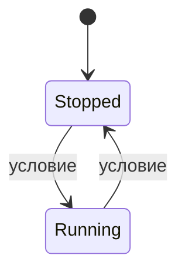

# FB_&lt;Dev&gt; — &lt;что это, 3–6 слов&gt;

<!--
Шаблон документа устройства для команд семейств. Образец заполнения — FB_DeviceBase.md и FB_Alarm.md.
Правила:
- по-русски; имена, типы и значения — ровно как в контракте API.md (раздел устройства) и в src/;
- по этому файлу и README устройство можно применить, не читая код (критерий готовности спецификации);
- общее для всех устройств (режимы, LKG, NE 107, старший байт wStatus, тревоги в слотах) не
  переписывать: ссылка на FB_DeviceBase.md; здесь — только то, что делает устройство;
- требования стандартов, которые не сверены с первоисточником, — пометка «сверить с <источник>»;
- «проверено в CODESYS» — только то, что подтверждено тестом прогона (имя теста рядом);
- отклонения от контракта и допущения — в docs/ASSUMPTIONS.md, здесь — ссылка на номер;
- в заголовке POU устройства: «Документ: docs/fb/FB_<Dev>.md» (STL001);
- комментарии-подсказки вроде этого удалить.
-->

Назначение: 2–4 предложения — какую задачу решает, где ставится (насосная, вентиляция…), чем
отличается от соседних ФБ. Наследует [FB_DeviceBase](FB_DeviceBase.md): режимы, конфигурация (LKG),
NE 107, квитирование и тревоги — по общим правилам базы.

Исходник: `src/POUs/Devices/FB_<Dev>/`. Контракт: раздел NN [API.md](../API.md). Тип в `stCommon.eDevType`:
`E_DeviceType.<Dev>`. Используется слотов тревог: N (`GVL_Const.<DEV>_ALARM_COUNT`).

## Входы и выходы

| Имя | Направление | Тип | Единицы | Описание |
|---|---|---|---|---|
| `xExample` | вход | `BOOL` | — | что значит TRUE; откуда приходит (DI, логика станции) |
| `rExample_eu` | вход | `REAL` | инж. ед. | … |
| `stCmd` | `VAR_IN_OUT` | `ST_<Dev>Cmd` | — | команды HMI/SCADA (`GVL_Hmi.st<TAG>Cmd`) |
| `stCfg` | `VAR_IN_OUT CONSTANT` | `ST_<Dev>Cfg` | — | параметры (`GVL_Persist.st<TAG>Cfg`) |
| `stRetain` | `VAR_IN_OUT` | `ST_DeviceRetain` | — | режим, OOS, счётчики (`GVL_Persist.st<TAG>Retain`); у AI/DI нет |
| `xQExample` | выход | `BOOL` | — | … |
| `stSts` | выход | `ST_<Dev>Sts` | — | состояние для HMI/SCADA (раскладка — ниже) |

Общие для всех устройств методы и свойства (`Reset`, `AckAll`, `RequestMode`, `GetAlarm`, `Mode`,
`Status`, `Fault`, `Available`, `AlarmCount`) — в [FB_DeviceBase](FB_DeviceBase.md#публичные-методы-и-свойства-i_device-i_alarmsource).
Свои методы и свойства устройства:

| Член | Тип | Действие |
|---|---|---|
| `Example()` | `BOOL` | … |

## Команды (`ST_<Dev>Cmd`)

| Поле | Вид | Действие | Результат (`eCmdResult`) |
|---|---|---|---|
| `stCommon` | общий заголовок | режимы, Reset, квитирование, маски тревог | [FB_DeviceBase](FB_DeviceBase.md#режимы) |
| `xExample` | импульс | … | `Accepted`; в Auto — `RejectedMode`; … |
| `rExampleSp_eu` | значение | ФБ пишет сюда текущее, пока значением управляет не оператор (слежение) | — |

## Параметры (`ST_<Dev>Cfg`)

| Поле | Тип | По умолчанию | Описание | Проверка (`wCfgErr`) |
|---|---|---|---|---|
| `tExample` | `TIME` | `T#5S` | … | бит N, если … |
| `udiAlarmIdBase` | `UDINT` | 0 | номер первой тревоги устройства | — |
| `astAlarm` | `ARRAY[0..7] OF ST_AlarmCfg` | см. «Тревоги» | приоритеты, задержки, shelve по слотам | бит N `<DEV>_CFG_ALARM` |

Значения по умолчанию проходят `CheckConfig` (тест `Device_DefaultCfg_PassesCheck`).

## Режимы

| Режим | Выходы | Контроль и отказы | Особенности устройства |
|---|---|---|---|
| Auto | по запросам автоматики | да | … |
| Manual | по командам оператора | да | … |
| Local | сняты, ПЛК следит за ОС | только внешняя авария | если тип поддерживает Local |
| OutOfService | безопасное состояние | нет | … |

`xLocalSupported = …`, `xOosAllowed = …` (когда механизм «стоит»). Безударность в `OnModeChanged`:
… (или «хук не переопределён»).

## Состояния



Пояснения к переходам, которые не очевидны из диаграммы (таймауты, первый вызов после старта ПЛК,
пропадание питания).

## Безопасное состояние

| Ситуация | Выходы и значения |
|---|---|
| Корректной Cfg ещё не было | … (таблица 2.6 контракта) |
| Отказ | … |
| OutOfService | … |
| Local | … |

## Отказы и тревоги

| Слот (`E_<Dev>Alarm`) | Условие | Подавление | Фиксация до Reset | Приоритет по умолч. | `wFault` |
|---|---|---|---|---|---|
| 0 `Example` | … | — | да / нет | Medium | бит 0 |

## Статус и готовность

- `eDevStatus` (вклад устройства в NE 107): …
- `xAvailableDev`: …

## Карта битов

| Бит | `wStatus` (младший байт) | `wFault` | `wWarning` | `wCfgErr` |
|---|---|---|---|---|
| 0 | `<DEV>_STS_…` — … | `<DEV>_FLT_…` | `<DEV>_WRN_…` | `<DEV>_CFG_…` — условие |

Старший байт `wStatus` — общий ([FB_DeviceBase](FB_DeviceBase.md#карта-битов)). Биты, не имеющие смысла
для типа, всегда 0.

## Раскладка `ST_<Dev>Sts` (карта регистров)

| Смещение, байт | Регистр | Поле | Тип | Описание |
|---|---|---|---|---|
| 0…27 | 0…13 | `stCommon` | `ST_DeviceSts` | общий заголовок |
| 28 | 14 | `…` | `INT` | … |

Размер — N байт (тест `Common_SizeOfSts_MatchesRegisterMap`).

## Пример вызова

```st
// логика станции — ДО вызова: запросы автоматики
GVL_Devices.fb<TAG>.xExample := ...;
// PRG_Devices (генерирует iolistgen): сигналы перечня и все VAR_IN_OUT в каждом вызове
GVL_Devices.fb<TAG>(
    xExample := GVL_IO.x<TAG>_Example,
    stCmd    := GVL_Hmi.st<TAG>Cmd,
    stCfg    := GVL_Persist.st<TAG>Cfg,
    stRetain := GVL_Persist.st<TAG>Retain);
GVL_IO.x<TAG>_Q := GVL_Devices.fb<TAG>.xQExample;
```

## Допущения и отклонения

| № | Суть | Где подробно |
|---|---|---|
| A-NN / F-NN | … | [ASSUMPTIONS.md](../ASSUMPTIONS.md) |

## Тесты (`FB_<Dev>_Test`)

Из списка контракта (N, ★ M): `<Dev>_Case_Expectation`, …

Сверх контракта (K): …

Описания — в [TEST_REPORT.md](../TEST_REPORT.md).
